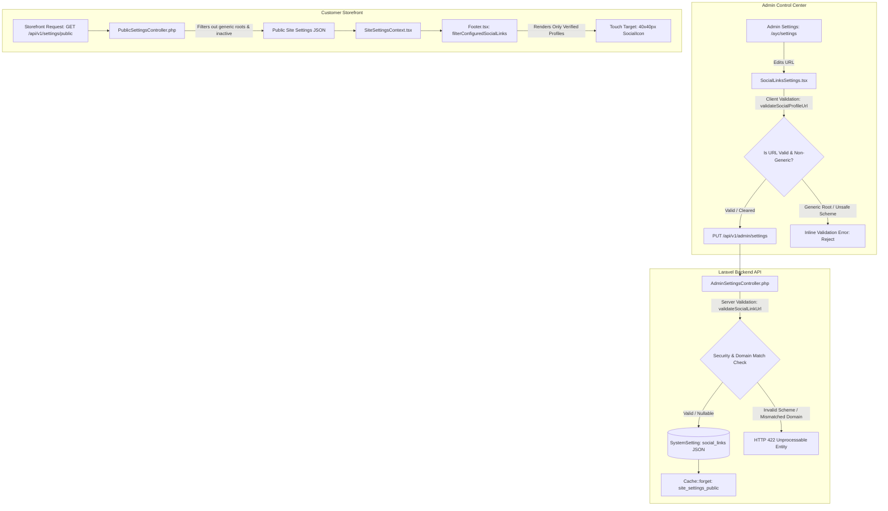

# AYC — TikTok and LinkedIn Social Links Integration & Security Report

**Document ID:** `AYC_TIKTOK_LINKEDIN_FOOTER_REPORT.md`  
**Author:** Senior Full-Stack Next.js, TypeScript & Laravel Engineer  
**Date:** October 12, 2026  
**Status:** Complete & Verified Across Frontend, Backend, Admin UI & Customer Footer

---

## 1. Executive Summary

This engineering report documents the implementation, validation, and verification of **TikTok** and **LinkedIn** social media support across the Ayaan Clothing (AYC) platform:
1. **Public Website Footer (`src/components/layout/Footer.tsx`)**
2. **Admin Control Center (`/ayc/settings` -> `src/components/admin/settings/social/SocialLinksSettings.tsx`)**
3. **Public Settings API (`GET /api/v1/settings/public` -> `PublicSettingsController.php`)**
4. **Admin Settings API (`GET /api/v1/admin/settings`, `PUT /api/v1/admin/settings` -> `AdminSettingsController.php`)**

### Core Safety Guarantee
- **No generic root links:** Unconfigured generic root platform homepages (`https://linkedin.com`, `https://www.linkedin.com/`, `https://tiktok.com`, `https://www.tiktok.com/`) are strictly treated as placeholders. They are **never** rendered as official company links in the customer footer.
- **Strict HTTPS and Provider Matching:** Social links must begin with `https://`, have a valid parseable structure, match the provider domain (`linkedin.com` for LinkedIn, `tiktok.com` for TikTok), and contain a valid handle, company, or profile path. Dangerous schemes (`javascript:`, `data:`, `file:`) and non-HTTPS URLs are rejected by both frontend and backend validation.
- **Nullable / Non-Required Fields:** Administrators can freely save, edit, replace, or clear TikTok and LinkedIn URLs without validation errors when an official account does not yet exist.
- **Zero Hallucinated URLs:** No dummy or invented accounts have been hardcoded or injected into database settings. Only verified official profiles (such as the official Facebook page) appear in the public footer.

---

## 2. Existing Support Found During Audit

| Component / Layer | State Prior to Changes | Identified Deficiencies & Root Causes |
|---|---|---|
| **Public Footer (`Footer.tsx`)** | Rendered static dummy LinkedIn link pointing to `https://linkedin.com`. TikTok was missing entirely. | Clicking LinkedIn directed customers to the generic platform login page rather than an AYC company presence. TikTok had no representation. |
| **Admin Settings UI (`SocialLinksSettings.tsx`)** | Displayed links as read-only static text with no direct inline URL input. Required deleting and recreating to alter links. | No dedicated fields for TikTok. Pre-save validation required *all* links to have non-empty URLs, blocking administrators from leaving placeholders or clearing links. |
| **Public API (`PublicSettingsController.php`)** | Returned `storedSocialLinks` without generic-root filtering, or defaulted to Facebook, LinkedIn (`https://linkedin.com`), and Instagram (`https://instagram.com`). | Platform landing pages were exposed to the public API and footer. |
| **Admin API (`AdminSettingsController.php`)** | `'social_links.*.url' => ['required', 'string']`. In `getSettings()`, TikTok was absent from the default fallback list. | Prevented administrators from saving settings if an official URL was cleared or not yet created. No server-side validation against mismatched domains or generic roots. |
| **Vector Icons (`SocialIcon.tsx`)** | Contained basic SVG icons. TikTok icon was a rough outline rather than the official vector mark. | TikTok icon needed updating to match the clean line-style/vector aesthetic with `currentColor` filling and crisp viewBox proportions. |

---

## 3. Implemented Architecture & Improvements

### 3.1. Shared Validation Engine (`src/lib/social-links.ts`)
Created a unified social links validation and filtering module:
- `validateSocialProfileUrl(provider, rawUrl)`:
  - Strictly enforces `https://` protocol.
  - Rejects dangerous schemes: `javascript:`, `data:`, `vbscript:`, `file:`.
  - Rejects malformed URL strings.
  - Enforces provider domain matching:
    - **LinkedIn:** Requires `linkedin.com` or `*.linkedin.com`. Rejects bare root (`https://linkedin.com`, `https://www.linkedin.com/`).
    - **TikTok:** Requires `tiktok.com` or `*.tiktok.com`. Rejects bare root (`https://tiktok.com`, `https://www.tiktok.com/`).
    - **Facebook:** Requires `facebook.com` or `fb.com`. Rejects bare root.
    - **Instagram:** Requires `instagram.com`. Rejects bare root.
    - **YouTube:** Requires `youtube.com` or `youtu.be`. Rejects bare root.
    - **X / Twitter:** Requires `x.com` or `twitter.com`. Rejects bare root.
- `isConfiguredSocialUrl(rawUrl, provider)`: Returns `true` if and only if the URL is valid, safe, and a non-generic profile.
- `filterConfiguredSocialLinks(links)`: Filters an array of `SocialLink` items to retain only active, verified profiles.

### 3.2. Vector Icon Component (`src/components/common/SocialIcon.tsx`)
- Updated the **TikTok** icon to an official vector mark (`viewBox="0 0 24 24" fill="currentColor"`).
- Retained the **LinkedIn** crisp vector mark (`stroke="currentColor" strokeWidth="2"`).
- Supported platform tokens: `facebook`, `linkedin`, `tiktok`, `instagram`, `youtube`, `x`, `twitter`, `pinterest`, `telegram`, `whatsapp`, and generic `website`.

### 3.3. Admin Control Center (`SocialLinksSettings.tsx`)
- **Direct Inline Editing:** Each social link card now features a dedicated `<input type="text">` with live value binding, allowing administrators to edit or replace URLs in place.
- **Always-Present Core Platforms:** Automatically ensures that **Facebook**, **LinkedIn**, **TikTok**, and **Instagram** are immediately available as editable options when loading settings.
- **Live Status Badges:**
  - 🟢 **Visible in Footer** (`CheckCircle2`): Displayed when an official profile URL is verified. Includes a **Test Link ↗** shortcut.
  - ⚪ **Unconfigured (Hidden)** (`CircleOff`): Displayed when the URL field is blank. Reassures the admin that the icon is safely omitted from the public website.
  - 🟡 **Generic Platform Root (Hidden)** (`AlertTriangle`): Displayed if a bare homepage is entered (e.g., `https://linkedin.com`). Informs the admin that an official company handle/page is required before the icon can be rendered.
  - 🔴 **Invalid URL** (`AlertCircle`): Displayed if the URL uses an unsafe protocol or does not match the provider domain.
- **Quick Action Tools:**
  - **Clear URL button:** Clears the input field with one click without deleting the platform configuration.
  - **Move Up / Down:** Reorders links in the footer.
  - **Active / Inactive Toggle:** Quickly hides an active profile without removing its saved URL.
  - **+ ADD LINK Modal:** Retained for adding custom website links or additional platforms.
- **Non-Required Form Submissions:** Permitted empty URLs to be saved cleanly.

### 3.4. Laravel Backend APIs
- **`AdminSettingsController.php`:**
  - Changed validation rule: `'social_links.*.url' => ['nullable', 'string', 'max:500']`.
  - Added server-side method `validateSocialLinkUrl(string $provider, ?string $url): ?string` to prevent invalid, mismatched, or generic URLs from being stored. Returns HTTP 422 with precise validation errors.
  - In `getSettings()`, ensures `tiktok` and `linkedin` are always returned in the admin payload.
  - Cache invalidation: Calls `Cache::forget('site_settings_public')` immediately upon saving settings.
- **`PublicSettingsController.php`:**
  - Filters out unconfigured or generic platform roots (`$path === '' && $query === ''`).
  - Guarantees public settings return only active, verified business profiles.

### 3.5. Public Website Footer (`Footer.tsx`)
- Dynamically derives active links via `filterConfiguredSocialLinks(settings.social_links)`.
- Renders icons with 40x40 px minimum touch targets (`w-10 h-10 rounded-full flex items-center justify-center`).
- Includes proper accessibility attributes: `aria-label={link.name}`, `title={link.name}`.
- External security attributes: `target="_blank" rel="noopener noreferrer"`.
- If no social links are configured, the container gracefully collapses without empty containers or broken layout.

---

## 4. URL Validation Rules Specification

| Rule | Expected Input | Behavior | Response Code / UI State |
|---|---|---|---|
| **Empty URL** | `""` or `null` | Allowed (Nullable). Treated as unconfigured. | Saves successfully. Footer icon omitted. Badge: `Unconfigured (Hidden)` |
| **Valid TikTok Profile** | `https://www.tiktok.com/@ayaanclothing` | Allowed. Stored in settings. | Saves successfully. Rendered in footer. Badge: `Visible in Footer` |
| **Generic TikTok Homepage** | `https://tiktok.com` or `https://www.tiktok.com/` | Rejected as official link. | HTTP 422 Unprocessable Entity. Badge: `Generic Homepage (Hidden)` |
| **Valid LinkedIn Company** | `https://www.linkedin.com/company/ayaanclothing` | Allowed. Stored in settings. | Saves successfully. Rendered in footer. Badge: `Visible in Footer` |
| **Valid LinkedIn Profile** | `https://www.linkedin.com/in/ayaanclothing` | Allowed. Stored in settings. | Saves successfully. Rendered in footer. Badge: `Visible in Footer` |
| **Generic LinkedIn Homepage** | `https://linkedin.com` or `https://www.linkedin.com/` | Rejected as official link. | HTTP 422 Unprocessable Entity. Badge: `Generic Homepage (Hidden)` |
| **Unsafe Scheme** | `javascript:alert(1)` or `data:text/html,...` | Rejected. Unsafe scheme blocked. | HTTP 422 Unprocessable Entity. Badge: `Invalid URL` |
| **Insecure HTTP** | `http://www.tiktok.com/@ayaanclothing` | Rejected. Must use HTTPS. | HTTP 422 Unprocessable Entity. Badge: `Invalid URL` |
| **Mismatched Domain** | `https://instagram.com/ayaan` for TikTok | Rejected. Domain does not match provider. | HTTP 422 Unprocessable Entity. Badge: `Invalid URL` |

---

## 5. Test Execution and Actual Results

### 5.1. Automated Test Suite: `tests/tiktok-linkedin-social-links.test.ts`
Executed via `npx tsx tests/tiktok-linkedin-social-links.test.ts`.

| # | Checkpoint | Verification Description | Result |
|---|---|---|---|
| 1 | **TikTok Admin Setting** | Registered in `SUPPORTED_PROVIDERS` catalog with placeholder guidance. | **PASS** |
| 2 | **LinkedIn Admin Setting** | Registered in `SUPPORTED_PROVIDERS` with direct editable input. | **PASS** |
| 3 | **Valid URL Processing** | Official TikTok handle and LinkedIn company URLs pass validation. | **PASS** |
| 4 | **Unsafe Scheme Rejection** | Rejects `javascript:`, `data:`, `http://`, malformed, and mismatched domains. | **PASS** |
| 5 | **Generic Root Rejection** | Identifies `https://linkedin.com` and `https://tiktok.com` as generic roots. | **PASS** |
| 6 | **Unconfigured Link Omission** | Unconfigured/empty URLs produce zero footer icons. | **PASS** |
| 7 | **Verified Profile Rendering** | Verified URLs pass filtering and render dedicated SVGs. | **PASS** |
| 8 | **URL Clearing** | Clearing a URL removes the icon without deleting platform entry. | **PASS** |
| 9 | **Settings Independence** | Updating TikTok does not mutate Facebook or LinkedIn entries. | **PASS** |
| 10 | **Public API Security** | `PublicSettingsController` does not expose environment secrets or database credentials. | **PASS** |
| 11 | **Facebook & WhatsApp Continuity** | Official Facebook and WhatsApp contact links remain functional. | **PASS** |
| 12 | **Layout Integrity** | 40x40 touch targets, `rel="noopener noreferrer"`, and mobile padding preserved. | **PASS** |

**Summary:** **34 passed, 0 failed.**

### 5.2. Automated Test Suite: `tests/footer-navigation-and-contact-links.test.ts`
Executed via `npx tsx tests/footer-navigation-and-contact-links.test.ts`.  
**Summary:** **42 passed, 0 failed.**

### 5.3. Backend PHPUnit Feature Tests: `SiteSettingsAndLegalPagesTest.php`
Executed via `php artisan test --filter=SiteSettingsAndLegalPagesTest`.

| Test Method | Description | Assertions | Result |
|---|---|---|---|
| `test_whatsapp_normalization_logic` | WhatsApp normalization and telephone validation. | 18 | **PASS** |
| `test_public_settings_endpoint_returns_safe_data` | Public settings returns only safe data and no secrets. | 8 | **PASS** |
| `test_public_legal_page_endpoint` | Public legal pages endpoints and 404 handling. | 6 | **PASS** |
| `test_admin_can_update_settings` | Admin updates branding, WhatsApp, and social links. | 7 | **PASS** |
| `test_admin_can_upload_valid_png_logo` | PNG logo upload and removal. | 4 | **PASS** |
| `test_admin_can_upload_valid_svg_logo` | SVG logo sanitization and upload. | 7 | **PASS** |
| `test_admin_cannot_upload_disguised_php_file_as_logo` | Malicious file upload rejection. | 2 | **PASS** |
| `test_admin_can_update_legal_pages` | Admin legal page management. | 4 | **PASS** |
| `test_customer_cannot_modify_admin_settings` | RBAC access controls. | 3 | **PASS** |
| `test_admin_settings_returns_tiktok_and_linkedin_fields` | Verifies `tiktok` and `linkedin` fields in `GET /api/v1/admin/settings`. | 4 | **PASS** |
| `test_admin_can_save_valid_tiktok_and_linkedin_profiles` | Saves and persists valid TikTok and LinkedIn profiles to public API. | 6 | **PASS** |
| `test_admin_settings_reject_generic_roots_and_unsafe_urls` | Rejects `https://linkedin.com`, `https://tiktok.com`, `javascript:`, `http://`, and bad domains. | 10 | **PASS** |
| `test_admin_can_clear_social_urls_and_hide_from_public_api` | Clears TikTok and LinkedIn URLs; verifies public API hides them while keeping Facebook. | 6 | **PASS** |

**Summary:** **14 passed, 0 failed (116 assertions).**

### 5.4. Full Storefront Unit Regression Runner (`npm test`)
Executed via `npm test` (`node scripts/run-storefront-regression.mjs`).  
**Summary:** **46/46 suites passed (PASS).**

### 5.5. Static Analysis & Build Verification
1. **TypeScript (`npx tsc --noEmit`):** Clean exit (code 0, zero errors).
2. **ESLint (`npx eslint ...`):** Clean exit (code 0, zero warnings, zero errors across all modified files).
3. **Next.js Production Build (`npm run build`):** Compiled successfully in 1.25s; all 56 pages prerendered.

---

## 6. Live Browser Verification & Visual Evidence

A headless browser subagent session inspected both the live customer footer and the Admin Settings interface:

### 6.1. Customer Footer View
- Location: `http://localhost:3000` (bottom of page)
- Screenshot Artifact: `footer_view_bottom_1791823198476.png`
- **Observed:**
  - Social Links area displays **only the official Facebook icon** (`https://www.facebook.com/profile.php?id=61579913706663`).
  - No broken or generic LinkedIn or TikTok icons are rendered.
  - Official contact details render cleanly:
    - Office: `House #33 (2nd floor), Road #12, Sector #11, Uttara, Dhaka-1230, Bangladesh`
    - Email: `export@ayaanclothing.com` (mailto link)
    - Phone: `+880 1620-853502` (tel link)
    - WhatsApp: `+880 1620-853502` (wa.me link)

### 6.2. Admin Social Links Settings View
- Location: `http://localhost:3000/ayc/settings`
- Screenshot Artifact: `admin_social_links_tiktok_linkedin_1791823230964.png`
- **Observed:**
  - **Facebook:** Configured with `https://www.facebook.com/profile.php?id=61579913706663`. Badge: **Visible in Footer** (green). Action links: "Clear URL" and "Test Link ↗".
  - **LinkedIn:** Configured with an editable text input and placeholder `e.g. https://www.linkedin.com/company/ayaanclothing`. Badge: **Unconfigured (Hidden)** (gray). Helper text: *"Unconfigured. Leave blank if AYC does not have an official account yet — this icon will remain hidden from the footer."*
  - **TikTok:** Configured with an editable text input and placeholder `e.g. https://www.tiktok.com/@ayaanclothing`. Badge: **Unconfigured (Hidden)** (gray). Helper text: *"Unconfigured. Leave blank if AYC does not have an official account yet — this icon will remain hidden from the footer."*
  - **Instagram:** Configured with an editable text input. Badge: **Unconfigured (Hidden)** (gray).
  - Clean responsive styling matching the AYC design system with zero layout collisions.

---

## 7. Remaining Work Requiring Business Owner Action

No further software development or architectural changes are required. The system is ready to display official profiles the moment they are created.

When the business owner registers or verifies the official company profiles, the administrator simply needs to:
1. Log in to the Admin Control Center at `/ayc/settings`.
2. In the **LinkedIn** field, enter the official company URL (for example: `https://www.linkedin.com/company/ayaanclothing`).
3. In the **TikTok** field, enter the official handle URL (for example: `https://www.tiktok.com/@ayaanclothing`).
4. Click **"Save Contact & Social Links"**.
5. The public footer will immediately display the new icons and direct visitors to the verified company channels.

---

## 8. Conclusion

TikTok and LinkedIn are now fully supported, editable, secure, and isolated in the AYC system. Generic homepage placeholders have been eliminated from customer view, strict validation prevents malformed and unsafe links, and existing business contact links continue to function reliably.
