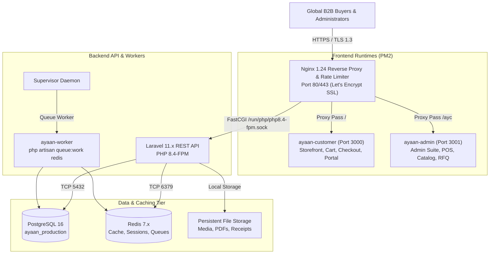

# AYAAN CLOTHING (AYC) — Enterprise B2B Apparel Platform

[-emerald?style=flat-square)](https://ayaanclothing.com)
[-black?style=flat-square&logo=next.js)](https://nextjs.org/)
[-red?style=flat-square&logo=laravel)](https://laravel.com/)
[](https://www.postgresql.org/)
[](https://redis.io/)
[](#)

AYAAN CLOTHING (AYC) is an enterprise-grade digital manufacturing, export wholesale, and commercial trading platform for global apparel commerce. The platform bridges ready-stock wholesale garment exports, custom manufacturing Request-for-Quotations (RFQs), physical warehouse Point-of-Sale (POS) operations, and authoritative international trade documentation (Offer Sheets, Proforma Invoices, Commercial Invoices, Packing Lists).

---

## 🏛️ System Architecture At a Glance

The platform is designed around a decoupled, high-performance architecture operating on an isolated, hardened VPS topology:



---

## 🚀 Key Platform Capabilities

1. **B2B Storefront & Discovery**: High-performance catalog browsing, tiered volume pricing (MOQ-based wholesale discounts), faceted search, brand collections, and pre-order management.
2. **Mandatory Email Verification**: Strict security gate ensuring no customer can place an order without verifying their email address via AYAAN CLOTHING's cryptographic verification links, regardless of whether they signed up via email/password or Google OAuth.
3. **Google OAuth & Account Isolation**: Seamless Socialite Google Sign-In for customers, completely isolated from administrative privilege boundaries.
4. **Pre-Generated & Compressed Product Offer Sheets**: Canonical 2–3-page product Offer Sheets pre-rendered, compressed (target $\le 1.5$ MB, hard limit 2.0 MB), cached on disk, and merged on-demand via a pure PHP PDF merger for instantaneous multi-product order downloads.
5. **Order-Specific Proforma Invoices (PI)**: Authoritative export billing documents with item breakdowns, pricing, consignee records, and international bank remittance coordinates.
6. **100% SHA-256 Byte Parity**: Exact identical PDF artifacts served for browser downloads and dispatched as transactional email attachments.
7. **Point-of-Sale (POS) Terminal**: Dedicated barcode scanning, walk-in customer creation, inventory deductions, coupon bindings, and direct receipt printing for factory physical showrooms.
8. **Custom RFQ Workflow**: Multi-round request-for-quotation negotiation pipeline with custom tech-pack attachments and administrative quote generation.
9. **Zero-Downtime Atomic Deployment**: Automated symlink-swap releases, multi-gate pre-activation verification, and automated rollbacks protecting active production traffic.

---

## 📚 Complete Technical Documentation

Comprehensive, authoritative technical documentation is maintained in the [`docs/`](docs/) directory:

| Document | Focus & Scope |
| :--- | :--- |
| **[docs/README.md](docs/README.md)** | **Master Documentation Index & Source-of-Truth Matrix** |
| **[docs/SYSTEM_OVERVIEW.md](docs/SYSTEM_OVERVIEW.md)** | Business scope, B2B wholesale domain, user journeys, core components |
| **[docs/ARCHITECTURE.md](docs/ARCHITECTURE.md)** | Full-stack architecture, network layout, process model, and data flow |
| **[docs/APPLICATION_MODULES.md](docs/APPLICATION_MODULES.md)** | Complete inventory of all storefront, admin, and backend functional modules |
| **[docs/FRONTEND.md](docs/FRONTEND.md)** | Next.js 16 App Router, Tailwind tokens, UI components, client state |
| **[docs/BACKEND.md](docs/BACKEND.md)** | Laravel 11 service layers, controllers, requests, models, and commands |
| **[docs/AUTHENTICATION_AND_VERIFICATION.md](docs/AUTHENTICATION_AND_VERIFICATION.md)** | Sanctum, registration, login, token hashing, and checkout verification gate |
| **[docs/GOOGLE_OAUTH.md](docs/GOOGLE_OAUTH.md)** | Google Socialite flow, customer isolation, account linking, verification rules |
| **[docs/CUSTOMERS_AND_ADMINISTRATION.md](docs/CUSTOMERS_AND_ADMINISTRATION.md)** | Customer dashboard, Admin management portal (`/ayc`), POS, and RBAC |
| **[docs/PRODUCTS_AND_CATALOG.md](docs/PRODUCTS_AND_CATALOG.md)** | Product lifecycle, 3-tier wholesale pricing, assortments, specifications |
| **[docs/ORDERS_AND_CHECKOUT.md](docs/ORDERS_AND_CHECKOUT.md)** | Checkout pipeline, order states, idempotency keys, Order Placed modal |
| **[docs/PAYMENTS_AND_INVENTORY.md](docs/PAYMENTS_AND_INVENTORY.md)** | Payment methods, wire transfers, receipt proof upload, inventory deductions |
| **[docs/COMMERCIAL_DOCUMENTS.md](docs/COMMERCIAL_DOCUMENTS.md)** | Export trade documents overview (Offer Sheets, PI, CI, Packing Lists) |
| **[docs/PRODUCT_OFFER_SHEETS.md](docs/PRODUCT_OFFER_SHEETS.md)** | Canonical product Offer Sheet pre-generation, compression, caching, merger |
| **[docs/PROFORMA_INVOICES.md](docs/PROFORMA_INVOICES.md)** | Order-specific PI generation, banking coordinates, separate artifact lifecycle |
| **[docs/DOCUMENT_STORAGE_AND_DELIVERY.md](docs/DOCUMENT_STORAGE_AND_DELIVERY.md)** | Disk storage structure, atomic file persistence, byte-parity guarantees |
| **[docs/EMAIL_AND_NOTIFICATIONS.md](docs/EMAIL_AND_NOTIFICATIONS.md)** | Transactional email infrastructure, templates, layouts, queue jobs |
| **[docs/SECURITY.md](docs/SECURITY.md)** | Security architecture, rate limits, token signing, proxy trust, Nginx rules |
| **[docs/DATABASE.md](docs/DATABASE.md)** | PostgreSQL schemas, migrations, relations, indexes, data integrity |
| **[docs/API_REFERENCE.md](docs/API_REFERENCE.md)** | Complete REST API reference, endpoints, schemas, headers, auth gates |
| **[docs/QUEUES_AND_BACKGROUND_JOBS.md](docs/QUEUES_AND_BACKGROUND_JOBS.md)** | Redis queues, Supervisor configuration, worker jobs, retry policies |
| **[docs/CACHING_AND_PERFORMANCE.md](docs/CACHING_AND_PERFORMANCE.md)** | Redis caching, filesystem PDF artifacts, query tuning, benchmarks |
| **[docs/DEPLOYMENT.md](docs/DEPLOYMENT.md)** | Zero-downtime deployment script, symlinks, release gates, rollback runbook |
| **[docs/OPERATIONS_RUNBOOK.md](docs/OPERATIONS_RUNBOOK.md)** | Daily operations, maintenance commands, log locations, incident response |
| **[docs/BACKUP_AND_RECOVERY.md](docs/BACKUP_AND_RECOVERY.md)** | PostgreSQL dumps, Redis snapshots, media backups, disaster recovery |
| **[docs/TESTING.md](docs/TESTING.md)** | Test suites (PHPUnit, Jest, Playwright, release gates), test data isolation |
| **[docs/TROUBLESHOOTING.md](docs/TROUBLESHOOTING.md)** | Diagnostic runbooks for common operational failures and fixes |
| **[docs/CONFIGURATION_REFERENCE.md](docs/CONFIGURATION_REFERENCE.md)** | Complete environment variable and configuration reference |
| **[docs/CHANGELOG.md](docs/CHANGELOG.md)** | Chronological record of major architectural updates and releases |

---

## 🛠️ Quickstart for Developers

### Prerequisites
- **Node.js**: v20.x LTS or higher
- **PHP**: 8.4 CLI + FPM with extensions (`pdo_pgsql`, `redis`, `gd`, `bcmath`, `intl`, `zip`)
- **Composer**: v2.x
- **PostgreSQL**: 16.x
- **Redis**: 7.x

### Local Development Setup
```bash
# 1. Clone repository
git clone https://github.com/labib-0/AYC.git
cd AYC

# 2. Frontend dependencies
npm install

# 3. Backend dependencies
cd backend
composer install
cp .env.example .env
php artisan key:generate

# 4. Database migrations & seeds
php artisan migrate --seed

# 5. Start development servers
# Terminal 1: Backend API
php artisan serve --port=8000

# Terminal 2: Queue Worker
php artisan queue:listen redis

# Terminal 3: Frontend Storefront (from repo root)
npm run dev
```

For detailed setup, environment variables, and seeding guides, see **[docs/LOCAL_DEVELOPMENT.md](docs/LOCAL_DEVELOPMENT.md)**.

---

## 🔐 Security & Operations Policy

- **No Secrets in Repositories**: API keys, OAuth secrets, database passwords, and SMTP credentials must never be committed to git or printed in documentation.
- **Source of Truth**: The active codebase, migrations, and verified server state supersede any historical notes or speculative documentation.
- **Production Safety**: Database migrations, queue flushes, and production deployments must only be executed through approved, tested deployment scripts.
