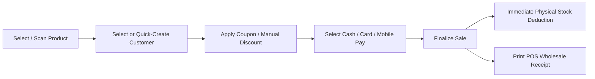
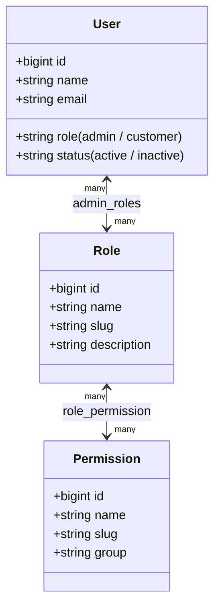

# Admin, POS & Permissions — AYAAN CLOTHING (AYC)

> [!NOTE]
> **Canonical Notice**: This historical document has been modernized and superseded by the authoritative canonical reference at **[docs/CUSTOMERS_AND_ADMINISTRATION.md](CUSTOMERS_AND_ADMINISTRATION.md)**. Please consult `CUSTOMERS_AND_ADMINISTRATION.md` for current administrative portals, RBAC, and POS terminal architectures.

## 1. Administrative Architecture (`/ayc`)

The AYC Management Portal is hosted under the unified `/ayc` namespace and served via an isolated Node.js gateway process (`scripts/admin-proxy.js`) running on port 3001. This guarantees that intensive administrative tasks (batch inventory adjustments, PDF compilations, POS transactions) do not impact customer storefront performance.

---

## 2. Admin Portal Functional Modules

### A. Executive Dashboard (`/ayc/dashboard`)
* **Real-Time KPIs**: Total wholesale revenue, monthly sales volume, pending payment proofs, and pending shipments.
* **Fulfillment Pipeline Counter**: Live badge indicators for orders requiring immediate attention (`pending_verification`, `processing`).
* **Inventory Alerts**: Automatic highlighting of stock lots with inventory below the package MOQ threshold.

### B. Product Catalog Management (`/ayc/products`)
* **Product Authoring**: Intuitive modal workflow for creating and editing styles with multi-image upload, 3-tier volume price setup, and package assortment allocation.
* **Featured & Pinned Controls**: One-click actions to pin clearance lots to the top of catalog sorting or feature styles on the homepage.
* **Storefront Visibility**: Allows hiding products from public browsing while keeping them active for showroom POS sales.

### C. Order Verification & Logistics (`/ayc/orders`)
* **Receipt Review Modal**: Inspects uploaded wire transfer receipts with zoom capabilities.
* **Status Progression**: Form-validated verification and rejection workflows with mandatory audit notes.
* **Carrier Tracking Assignment**: Direct input of courier details (Aramex, DHL, Ocean) and tracking AWB links.

---

## 3. Point-of-Sale (POS) Showroom System (`/ayc/pos`)

The POS interface allows showroom sales representatives and warehouse cashiers to process in-person wholesale and sample sales while sharing the exact same inventory and order database:

### A. Walk-In Customer Invariants
* **Minimal Friction**: Factory showroom walk-ins often prefer quick settlement. The quick-create customer modal requires only **Name** and **Phone Number**.
* **Optional Email Rule**: Database migration `2026_10_09_170000` made the `email` field nullable on `users` and `orders`. Walk-in customers are not required to provide an email address.
* **Default Walk-In Customer**: The POS system pre-selects a global walk-in customer profile (`walkinCustomer`) for instant counter sales.

### B. Inventory & Discount Safeguards
* **Zero Negative Stock**: POS lookups validate physical warehouse inventory in real time. Items with 0 units cannot be added to the POS cart.
* **Granular Discount Authorization**: Cashiers can only enter custom line discounts if their assigned role contains the `pos.discounts` permission. Standard cashiers are restricted to system-configured coupon codes.
* **Immediate Settlement**: POS orders are created with `order_source: pos`, `payment_status: paid`, and `status: confirmed` (or `delivered`), ensuring cash drawers reconcile with stock movements.

---

## 4. Role-Based Access Control (RBAC) Architecture

AYC implements granular, table-driven RBAC to enforce the principle of least privilege across company departments:

### A. Pre-Configured System Roles
1. **Super Admin**: Unrestricted system access across catalog, finance, users, system settings, and RBAC matrix.
2. **Merchandiser / Catalog Manager**: Authorized for `catalog.manage` and `inventory.adjust`. Restricted from financial verification and RBAC roles.
3. **Finance & Order Verifier**: Authorized for `orders.manage` and `orders.verify_payment`. Reviews wire receipts and confirms payments.
4. **Showroom POS Cashier**: Authorized for `pos.access`. Limited to counter sales and stock lookups.

### B. Granular Permission Slugs
* `catalog.manage`: Full product, category, and brand CRUD operations.
* `inventory.adjust`: Warehouse inventory edits and physical count reconciliations.
* `orders.manage`: Customer order management, carrier assignment, tracking updates.
* `orders.verify_payment`: Approve or reject buyer wire transfer receipts.
* `pos.access`: Access POS showroom terminal.
* `pos.discounts`: Apply manual discounts on POS order lines.
* `users.manage`: View registered customer profiles.
* `administrators.manage`: Create and manage administrative accounts.
* `rbac.manage`: Create custom roles and modify the permission assignment matrix.
* `settings.manage`: Update corporate contact details and business rules.

### C. Admin Security & Middleware
All administrative requests pass through `CheckPermission` middleware:
* If the user account has `status: inactive`, all requests are terminated with `HTTP 403 Forbidden`.
* Super Admin roles bypass granular checks automatically.
* Non-super admins must possess the explicit permission slug matching the requested endpoint.
