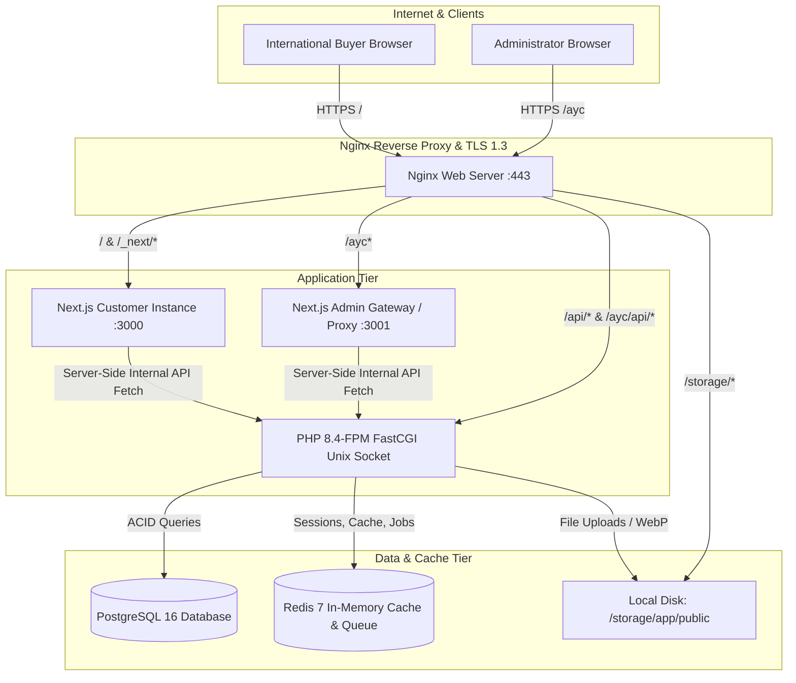
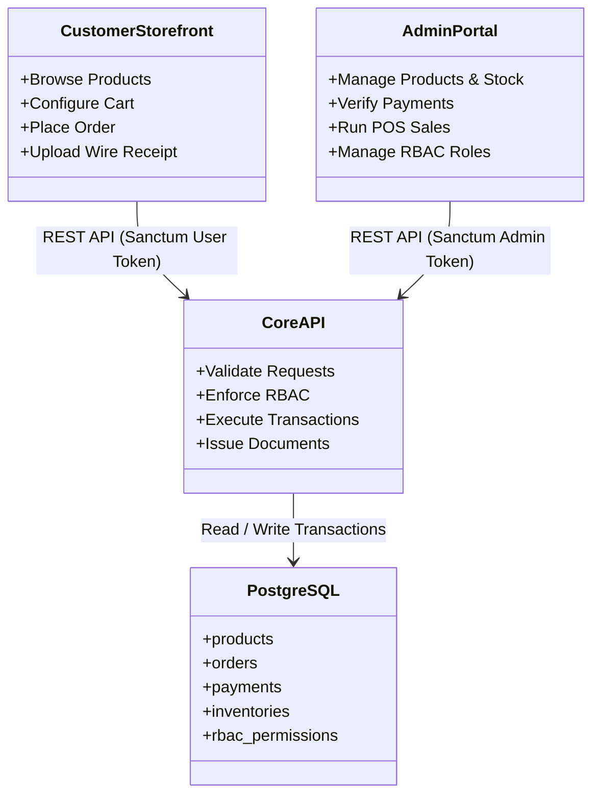

# System Architecture — AYAAN CLOTHING (AYC)

## 1. High-Level Architecture Topology

The AYAAN CLOTHING platform employs a decoupled, high-performance architecture combining a **Next.js 16 App Router** frontend with a **Laravel 11 / PHP 8.4** REST API backend, backed by **PostgreSQL 16** and **Redis 7**.

---

## 2. Network Routing & Ingress Rules (Nginx)

The production Nginx configuration (`/etc/nginx/sites-enabled/ayaanclothing.com`) acts as the single ingress controller:

| Route Pattern | Target Destination | Protocol / Header Handling |
| :--- | :--- | :--- |
| `https://ayaanclothing.com/` | `http://127.0.0.1:3000` | Customer Storefront; passes `X-Real-IP`, `X-Forwarded-Proto`, WebSocket upgrades. |
| `https://ayaanclothing.com/ayc` | `http://127.0.0.1:3001` | Admin Portal Gateway; injects `X-Admin-App: true`, `X-Is-Admin-Host: 1`. |
| `https://ayaanclothing.com/api/` | `unix:/run/php/php8.4-fpm.sock` | Customer REST API; handled by Laravel `index.php`. |
| `https://ayaanclothing.com/ayc/api/` | `unix:/run/php/php8.4-fpm.sock` | Admin REST API; rewrites `/ayc/api/(.*)` to `/api/$1`. |
| `https://ayaanclothing.com/storage/` | `/var/www/ayaan/backend/storage/app/public/` | Direct static file delivery for images/documents; 30-day client cache. |
| `https://ayaanclothing.com/_next/static/` | `http://127.0.0.1:3000` | Next.js compiled chunks; served with `Cache-Control: public, immutable` (1 year). |
| `https://ayaanclothing.com/admin*` | Returns `HTTP 404 Not Found` | Retired legacy namespace; blocked to prevent security enumeration. |

---

## 3. Frontend Architecture (Next.js 16 App Router)

The frontend uses Next.js 16, React 19, and TypeScript with the modern App Router paradigm:

### A. Route Groups & Portal Separation
* `src/app/(customer)/`: Public storefront layouts, catalog routes, search, cart, checkout, and authenticated customer dashboard (`/dashboard`).
* `src/app/(admin)/`: Administrative interfaces (`/ayc/*`) including product catalog management, order verification, inventory controls, POS terminals, and RBAC administration.
* `src/proxy.ts`: Next.js 16 proxy middleware running on edge requests:
  * Intercepts incoming requests and handles internal rewrite rules.
  * Enforces the Bangladesh Storefront Geo-Block on `/` and `/products/*` via an internal sub-request to `/api/v1/internal/storefront/access-check`.
  * Leaves administrative routes (`/ayc`), customer service routes (`/login`, `/signup`, `/dashboard`, `/order-access`, `/rfq`), and static assets completely unrestricted.

### B. Admin Proxy Architecture (`scripts/admin-proxy.js`)
To guarantee complete isolation between customer storefront traffic and heavy administrative operations (e.g., POS calculations, bulk inventory edits, PDF rendering):
* A dedicated Node.js process runs on port `3001` managed by PM2 (`ayaan-admin`).
* It handles administrative requests routed under `/ayc`, injecting required security headers and isolating memory footprints.

---

## 4. Backend Architecture (Laravel 11 REST API)

The backend is built on Laravel 11 running on PHP 8.4-FPM:

### A. Architectural Patterns
* **Controller-Service Layer**: Controllers handle HTTP request validation and status response formatting, while business logic resides in dedicated domain services:
  * `OrderService`: Order creation, pricing calculations, status transitions, and stock adjustments.
  * `PaymentVerificationService`: Receipt upload processing, WebP transcoding, and admin review audit logging.
  * `InventoryService`: Warehouse stock synchronization and SKU-level inventory updates.
  * `DocumentService`: Calculation of line items, freight, and terms for Offer Sheets, PIs, and CIs.
  * `RbacService`: Dynamic role permissions resolution and role assignments.
* **FormRequest Validation**: Every mutating endpoint uses an explicit `FormRequest` class enforcing strict type casting, minimums, maximums, and custom business rules before reaching controllers.
* **Database Transactions**: All financial, order, payment, and inventory mutations execute inside `DB::transaction()` blocks to guarantee strict ACID compliance.

### B. Authentication & Authorization
* **Laravel Sanctum**: Token-based authentication using personal access tokens for both customer web sessions and admin interfaces.
* **Granular RBAC**: Role-Based Access Control allowing custom administrative roles (e.g., `Super Admin`, `Catalog Manager`, `Order Verifier`, `POS Cashier`) with fine-grained permissions checked via `permission:<slug>` middleware.
* **Customer Tenant Isolation**: Customer endpoints enforce ownership checks (`$order->user_id === $request->user()->id`), preventing horizontal privilege escalation.

---

## 5. Storage & Asset Pipeline

* **Product & Brand Media**: Uploaded via the Admin Portal, processed using PHP GD/Imagick, and stored in `storage/app/public/products` and `storage/app/public/brands`.
* **Payment Receipts**: Uploaded by buyers to `storage/app/public/receipts`. Receipts are validated for MIME type (`image/jpeg`, `image/png`, `image/webp`), restricted to 10 MB input, transcoded to high-efficiency WebP, and served via public storage with sanitized filenames.
* **Static Assets**: Web fonts, icons, and Next.js JavaScript chunks are pre-compiled and served directly through Nginx reverse-proxy caching.

---

## 6. Service Boundaries & Data Ownership

