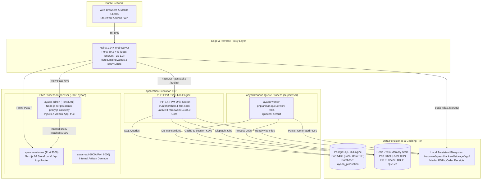
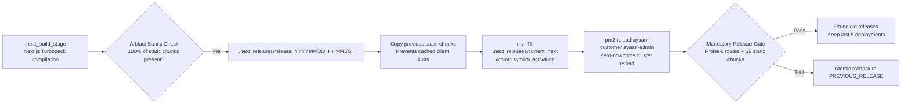

# AYAAN CLOTHING (AYC) — System Architecture

**Document Purpose**: Comprehensive technical reference for the platform's infrastructure, network routing, process model, service boundaries, and data persistence layers.  
**Audience**: DevOps Engineers, System Architects, Backend/Frontend Developers, Security Auditors.  
**Last Verified Date**: October 20, 2026  
**Environment Baseline**: Production Release `release_20261020_052638_a8d2fef` on Hostinger VPS `srv2010990`.

---

## 1. Full-Stack Infrastructure Topology

The production platform is hosted on an isolated, hardened Ubuntu 24.04 LTS VPS (`srv2010990`) in Mumbai, India.



---

## 2. Network Routing & Reverse Proxy Configuration

Nginx acts as the single public entry point for all HTTP/HTTPS traffic. It provides TLS termination, header sanitization, IP connection limits, endpoint-specific request rate limiting, and static file offloading.

### A. Virtual Host & Domain Mapping
* **Canonical Domain**: `https://ayaanclothing.com` (with automatic 301 redirect from `http://` and `www.ayaanclothing.com`).
* **SSL/TLS**: Let's Encrypt automated certificates with TLS 1.2 and TLS 1.3, ECDHE ciphers, and HTTP Strict Transport Security (`Strict-Transport-Security: max-age=31536000; includeSubDomains`).
* **Security Headers**: Injected globally on all responses:
  ```nginx
  add_header X-Frame-Options SAMEORIGIN always;
  add_header X-Content-Type-Options nosniff always;
  add_header Referrer-Policy strict-origin-when-cross-origin always;
  add_header Strict-Transport-Security "max-age=31536000; includeSubDomains" always;
  ```

### B. Path Routing Architecture
| Public Path | Target Service / Handler | Timeout & Body Limits | Rate Limit Policy |
| :--- | :--- | :--- | :--- |
| `/` (Storefront routes) | Reverse Proxy to `http://127.0.0.1:3000` (`ayaan-customer`) | 60s, `client_max_body_size 2M` | Connection limit: 25 conns/IP |
| `/ayc` (Admin routes) | Reverse Proxy to `http://127.0.0.1:3001` (`ayaan-admin`) | 60s, `client_max_body_size 2M` | Connection limit: 25 conns/IP |
| `/api/*` (Customer API) | FastCGI to `/run/php/php8.4-fpm.sock` via `@laravel` | 120s, `client_max_body_size 2M` | `zone=req_api_general` (30 r/s) |
| `/ayc/api/*` (Admin API) | Rewritten to `/api/*` and sent to `@laravel_ayc` | 120s, `client_max_body_size 2M` | `zone=req_api_general` (30 r/s) |
| `/api/v1/auth/*` | FastCGI to `/run/php/php8.4-fpm.sock` | 60s, `client_max_body_size 2M` | `zone=req_api_auth` (5 r/m, burst 5) |
| `/api/v1/orders` (Checkout) | FastCGI to `/run/php/php8.4-fpm.sock` | 120s, `client_max_body_size 2M` | `zone=req_api_heavy` (5 r/m, burst 5) |
| `/api/v1/orders/*/documents/*/pdf` | FastCGI to `/run/php/php8.4-fpm.sock` | 120s, `client_max_body_size 2M` | `zone=req_api_heavy` (5 r/m, burst 5) |
| `/api/v1/orders/*/payment-proof` | FastCGI to `/run/php/php8.4-fpm.sock` | 120s, **`client_max_body_size 20M`** | `zone=req_api_upload` (5 r/m, burst 3) |
| `/api/v1/rfq` (Tech-packs) | FastCGI to `/run/php/php8.4-fpm.sock` | 120s, **`client_max_body_size 20M`** | `zone=req_api_upload` (5 r/m, burst 5) |
| `/api/v1/upload` (Admin media) | FastCGI to `/run/php/php8.4-fpm.sock` | 120s, **`client_max_body_size 20M`** | `zone=req_api_upload` (5 r/m, burst 5) |
| `/storage/*` | Direct static disk alias to `backend/storage/app/public/` | Unmetered, `expires 30d` | Cache-Control: public |

### C. Security Hardening at Nginx
* **Header Stripping**: Nginx explicitly forces `fastcgi_param HTTP_X_INTERNAL_SECRET "";` to prevent external clients from spoofing internal communication bypass tokens.
* **Sensitive File Blocking**: Direct matching rules return HTTP 404 for any attempt to access `/.env`, `/.git`, or `/vendor/`.
* **Zero Trust Proxies**: Laravel is configured with `$middleware->trustProxies(at: [])`, meaning client-supplied `X-Forwarded-For` headers are strictly ignored unless `TRUSTED_PROXIES` is explicitly configured.

---

## 3. Application Process Architecture

The system segregates responsibilities across isolated system processes operating under the dedicated non-root service user `ayaan`:

### A. PM2 Daemons (Node.js & SSR)
```text
┌────┬───────────────────┬─────────┬──────────┬──────────┬──────────┬──────────┐
│ id │ name              │ mode    │ port     │ memory   │ user     │ status   │
├────┼───────────────────┼─────────┼──────────┼──────────┼──────────┼──────────┤
│ 0  │ ayaan-customer    │ fork    │ 3000     │ ~60 MB   │ ayaan    │ online   │
│ 1  │ ayaan-admin       │ fork    │ 3001     │ ~48 MB   │ ayaan    │ online   │
│ 2  │ ayaan-api-8000    │ fork    │ 8000     │ ~48 MB   │ ayaan    │ online   │
└────┴───────────────────┴─────────┴──────────┴──────────┴──────────┴──────────┘
```
1. **`ayaan-customer`**: Serves the unified Next.js App Router application (handling customer storefront, search, user cart, checkout wizard, and `/ayc` admin routes forwarded by `admin-proxy.js`).
2. **`ayaan-admin`**: Runs `scripts/admin-proxy.js` on port 3001, injecting `X-Admin-App: true` and `X-Is-Admin-Host: 1` headers and proxying internally to Next.js on port 3000.
3. **`ayaan-api-8000`**: Internal Laravel artisan daemon providing local auxiliary services and release-gate health probes.

### B. PHP-FPM Daemon (Laravel REST API)
* **Runtime**: PHP 8.4-FPM socket at `/run/php/php8.4-fpm.sock` (PHP 8.4.26).
* **Framework**: Laravel Framework 13.34.0.
* **Pool Configuration**: Dynamic process manager with opcache enabled and preloading configured for production performance.
* **Execution Boundary**: Executes all REST API endpoints, business calculation services, PDF rendering via Dompdf, and database migrations.

### C. Supervisor Daemon (Background Workers)
* **Configuration**: `/etc/supervisor/conf.d/ayaan-worker.conf`
* **Process**: `ayaan-worker` running:
  ```bash
  php /var/www/ayaan/backend/artisan queue:work redis --sleep=3 --tries=3 --max-time=3600 --timeout=180
  ```
* **Responsibilities**:
  - Pre-generating and compressing product Offer Sheet PDFs (`GenerateProductOfferSheetJob`).
  - Assembling and delivering transactional emails with attachments (`SendOrderConfirmationEmailJob`).
  - Processing payment confirmation notices (`SendOrderConfirmedEmailJob`).
  - Purging expired challenge tokens and old temporary exports.

---

## 4. Data Persistence & Storage Architecture

Data persistence is partitioned cleanly into relational storage, fast in-memory key-value storage, and structured filesystem directories:

```text
/var/www/ayaan/backend/storage/app/
├── public/                       # Publicly accessible assets (/storage/ alias)
│   ├── products/                 # High-resolution catalog imagery & thumbnails
│   ├── brands/                   # Brand vector & PNG logos
│   └── order-receipts/           # Scanned customer wire transfer receipts (WebP format)
├── product_offer_sheets/         # Pre-generated product Offer Sheet artifacts
│   └── {product_id}/             # Per-product directory
│       └── OFFER_SHEET_{fingerprint}.pdf # Compressed individual product PDFs (<=1.5 MB)
├── documents_cache/              # Merged order documents and PI artifacts
│   └── order_{id}/               # Order-specific artifact storage
│       ├── OFFER_SHEET_{fingerprint}.pdf # Merged multi-product order Offer Sheet
│       └── PROFORMA_INVOICE_{fingerprint}.pdf # Authoritative order Proforma Invoice
└── temp/                         # Temporary working directory for PDF assembly
```

### Relational Database (PostgreSQL 16)
* Database name: `ayaan_production`
* Connection: Local Unix socket / TCP `127.0.0.1:5432`
* Character set: UTF-8 with standard collation
* Integrity: Full foreign-key enforcement, cascading delete rules on child items, and atomic transaction boundaries around all order mutations.

### In-Memory Cache & Queues (Redis 7.x)
* Host: `127.0.0.1:6379`
* Client: PhpRedis / Predis
* Database partitioning:
  - **DB 0**: Application caching (catalog counts, settings, fingerprint lookups).
  - **DB 1**: Laravel queue worker job payloads and failed job records.

---

## 5. Release Activation & Zero-Downtime Deployment

To prevent asset 404 outages during continuous updates, the platform deploys using an atomic release pipeline:



1. **Active Release Isolation**: Active release remains completely untouched while Next.js compiles into `.next_build_stage`.
2. **Chunk Merging**: Previous static chunks are mirrored into the new build to protect in-flight browser sessions.
3. **Atomic Symlink**: `mv -Tf` executes an atomic filesystem pointer swap pointing `.next` to the new release.
4. **Automated Verification Gate**: Script tests all major customer and admin routes and issues HTTP requests for 100% of compiled static chunks before confirming success.

---

## 6. Related Technical References

* **[FRONTEND.md](FRONTEND.md)**: Next.js App Router, state management, and styling.
* **[BACKEND.md](BACKEND.md)**: Laravel service architecture and controller layers.
* **[DOCUMENT_STORAGE_AND_DELIVERY.md](DOCUMENT_STORAGE_AND_DELIVERY.md)**: Storage paths, atomic writes, and SHA-256 byte parity.
* **[DEPLOYMENT.md](DEPLOYMENT.md)**: Deployment script runbook and automated release gates.
* **[PRODUCTION_STATE_AUDIT.md](PRODUCTION_STATE_AUDIT.md)**: Production interrogation and evidence report (`ENV-001`, `RUN-001`, `NET-001`).

