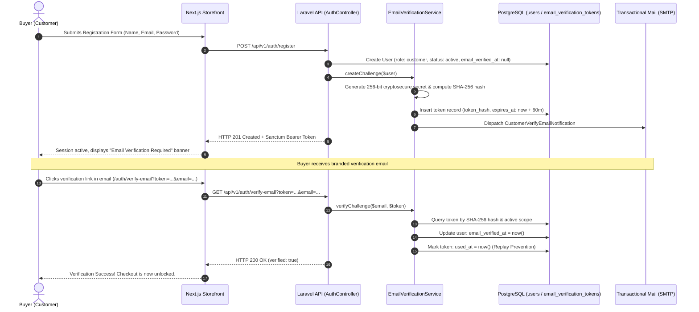

# AYAAN CLOTHING (AYC) — Authentication & Email Verification

**Document Purpose**: Definitive technical reference for the authentication lifecycle, credential management, cryptographic email verification challenges, and the mandatory verified-only checkout security gate.  
**Audience**: Security Engineers, Backend Developers, Frontend Developers, Compliance Auditors.  
**Last Verified Date**: October 20, 2026  
**Environment Baseline**: Production Release `release_20261020_052638_a8d2fef` on Hostinger VPS `srv2010990`.

---

## 1. Authentication Lifecycle Overview

The platform uses Laravel Sanctum token-based authentication. Users are categorized into two strictly separated roles:
* **`customer`**: International wholesale buyers and RFQ negotiators. Allowed to browse, save carts, submit RFQs, and—once verified—place commercial orders.
* **`admin`**: Factory operators, sales merchandisers, and system administrators. Granted granular administrative permissions; prohibited from using customer storefront checkout.



---

## 2. The Mandatory Verified-Only Ordering Invariant

### Core Business Rule
> **No customer can place an order until they have verified their email address through AYAAN CLOTHING's own email verification link, regardless of how they created their account.**

This rule applies universally and without exception to:
1. Standard email and password registrations.
2. Google OAuth / Socialite registrations.
3. Pre-existing customer accounts that remain unverified.

**External OAuth Verification Does NOT Bypass AYC Verification**: Google Sign-In success alone does NOT verify an AYC account. Even if Google reports that the user's Gmail is verified, the user must click AYAAN CLOTHING's own email verification link before their account is permitted to place orders.

---

## 3. Defense-in-Depth Enforcement Points

Verification is enforced across multiple software layers so that no API bypass is possible:

### Layer 1: Route Middleware (`verified`)
Defined in `backend/bootstrap/app.php` and implemented in `App\Http\Middleware\EnsureEmailIsVerified`:
```php
public function handle(Request $request, Closure $next): Response
{
    $user = $request->user();
    if ($user && ! $user->hasVerifiedEmail()) {
        if ($request->expectsJson() || $request->is('api/*')) {
            return response()->json([
                'success' => false,
                'error_code' => 'EMAIL_VERIFICATION_REQUIRED',
                'message' => 'Email verification is required before placing an order. Please verify your email address through the link sent to your inbox, or request a new verification link.',
                'email' => $user->email,
            ], 403);
        }
        return redirect()->away(config('app.frontend_url') . '/auth/verify-email?status=unverified');
    }
    return $next($request);
}
```

### Layer 2: Controller Checks (`OrderController::store` & `calculateCheckout`)
Even within the controller method, an explicit guard verifies the user's state:
```php
if (! $user->hasVerifiedEmail()) {
    return response()->json([
        'success' => false,
        'error_code' => 'EMAIL_VERIFICATION_REQUIRED',
        'message' => 'Email verification is required before placing an order. Please verify your email address through the link sent to your inbox, or request a new verification link.',
        'email' => $user->email,
    ], 403);
}
```

### Layer 3: Frontend Checkout Modal Guard (`CheckoutModal.tsx`)
* Before submitting an order, the frontend checks `user.email_verified_at`.
* If unverified, the modal displays a clear warning card with a one-click **"Resend Verification Link"** button, preventing accidental form submission failures.

---

## 4. Cryptographic Challenge Architecture

Token generation and verification are encapsulated in `App\Services\Auth\EmailVerificationService`:

### A. Token Generation & Storage
1. **Raw Secret**: Generated using `bin2hex(random_bytes(32))` (256-bit entropy).
2. **Hash-at-Rest**: The raw secret is **never stored in the database**. Only its SHA-256 hash is persisted in `email_verification_tokens.token_hash`.
3. **Challenge Expiration**: Configurable via `auth.verification.expire` (default: **60 minutes**).
4. **Replay Prevention**: Upon successful verification, `used_at` is immediately timestamped. Used tokens can never be re-executed.
5. **Challenge Invalidation**: When a user requests a new verification email, all previously pending unused challenges for that user are marked `used_at = now()`, immediately invalidating old links.

### B. Same-Browser Binding (Optional Hardening)
* Controlled by configuration `auth.verification.same_browser_required` (default: `false` for enterprise international buyer convenience).
* When enabled, a secure HTTP-only cookie (`ayc_reg_binding`) is set during registration, and its SHA-256 hash is bound to the token challenge to ensure the email is verified from the exact same browser session.

---

## 5. Token Resend & Throttling Controls

To prevent email spamming and protect SMTP delivery quotas:
* **Endpoint**: `POST /api/v1/auth/email/verification-notification`
* **Rate Limit**: Protected by Laravel's `throttle:email-verification` (max 5 requests per 10 minutes per IP/account).
* **Cooldown**: The frontend enforces a 60-second visual countdown timer between resend requests.

---

## 6. Failure Modes & Error Codes

| Scenario | HTTP Status | Response Payload | User Remediation |
| :--- | :---: | :--- | :--- |
| **Unverified user attempts checkout** | `403` | `{"error_code": "EMAIL_VERIFICATION_REQUIRED", ...}` | User is prompted to check inbox or request a new verification link. |
| **Expired token link clicked (>60m)** | `422` | `{"error_code": "TOKEN_EXPIRED", "message": "Verification link has expired."}` | Landing page prompts user to enter email for an instant resend. |
| **Already-used token link clicked** | `422` | `{"error_code": "TOKEN_USED", "message": "This verification link has already been used."}` | User is directed to log in directly. |
| **Tampered / invalid token** | `422` | `{"error_code": "TOKEN_INVALID", "message": "Invalid verification link."}` | Link was corrupted; user requests a new link. |

---

## 7. Related Technical Documentation

* **[GOOGLE_OAUTH.md](GOOGLE_OAUTH.md)**: Google Sign-In mechanics and verified status handling.
* **[ORDERS_AND_CHECKOUT.md](ORDERS_AND_CHECKOUT.md)**: Order creation pipeline and checkout modal.
* **[SECURITY.md](SECURITY.md)**: Rate limiting and token hashing security boundaries.
