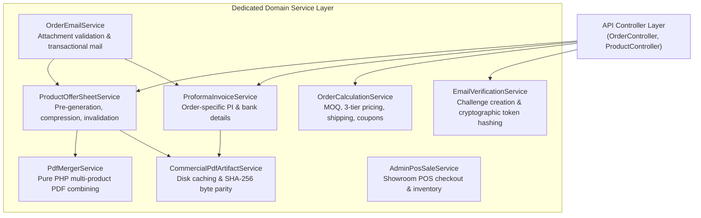

# AYAAN CLOTHING (AYC) — Backend Architecture

**Document Purpose**: Comprehensive technical reference for the Laravel 11.x backend application, PHP 8.4 runtime, service layers, controllers, middleware pipeline, model design, and artisan commands.  
**Audience**: Backend Engineers, API Developers, System Integrators, Technical Architects.  
**Last Verified Date**: October 20, 2026  
**Environment Baseline**: Production Release `release_20261020_052638_a8d2fef` (Laravel 11.x, PHP 8.4-FPM).

---

## 1. Framework & Runtime Core

* **Framework**: Laravel 11.x.
* **PHP Version**: PHP 8.4 with strict typing (`declare(strict_types=1);` where applicable), property promotion, match expressions, and typed properties.
* **Execution Environment**: PHP 8.4-FPM Unix socket at `/run/php/php8.4-fpm.sock`.
* **API Architecture**: Stateless REST API communicating via JSON payloads and binary PDF streams.
* **Authentication**: Laravel Sanctum with personal access tokens and cryptographically secure random challenge tokens for email verification.

---

## 2. Directory Structure & Key Subsystems

The backend code lives under `backend/`:

```text
backend/
├── app/
│   ├── Console/Commands/        # Artisan CLI commands (pregeneration, cleanup)
│   ├── Http/
│   │   ├── Controllers/Api/V1/  # Versioned REST API controllers
│   │   │   ├── AuthController.php
│   │   │   ├── GoogleAuthController.php
│   │   │   ├── OrderController.php
│   │   │   ├── ProductController.php
│   │   │   ├── RfqController.php
│   │   │   └── Admin/           # Protected administrative controllers
│   │   ├── Middleware/          # Role, permission, verification & security middleware
│   │   └── Requests/            # Form request validation classes
│   ├── Jobs/                    # Asynchronous queue jobs (PDF, email, dispatch)
│   ├── Mail/                    # Mailable classes for transactional notifications
│   ├── Models/                  # Eloquent entities & relationship declarations
│   ├── Notifications/           # Notification dispatch classes
│   └── Services/                # Encapsulated enterprise domain service layers
│       ├── Auth/                # Email verification token services
│       ├── Documents/           # Offer Sheet, PI, CI, and PDF merger services
│       ├── Mail/                # Order email dispatch & tracking services
│       ├── Order/               # Order calculation & POS sales services
│       └── Shipping/            # Aramex & logistics integration services
├── config/                      # Application configuration files
├── database/
│   ├── migrations/              # PostgreSQL schema migrations (92 migrations)
│   └── seeders/                 # Database seeders for roles, settings & demos
├── routes/
│   ├── api.php                  # REST API route definitions (/api/v1/ and /ayc/api/)
│   └── console.php              # Scheduled tasks & command routes
└── storage/                     # File storage disks (media, PDFs, receipts)
```

---

## 3. Domain Service Layer Architecture

Business logic is strictly decoupled from HTTP controllers into specialized domain service classes:



### Core Service Responsibilities:
1. **`ProductOfferSheetService`**:
   - Manages the lifecycle of canonical product Offer Sheet PDFs.
   - Computes deterministic source data fingerprints.
   - Enforces the strict $\le 1.5$ MB target / 2.0 MB maximum size cap.
   - Coordinates with `PdfMergerService` to merge order items into a single combined Offer Sheet in exact item sequence.
2. **`PdfMergerService`**:
   - Pure PHP PDF object merger. Combines multiple Dompdf binaries without external shell execution (`gs` or `qpdf`).
   - Preserves independent `/Resources` subtrees for each document to avoid font and image naming collisions.
3. **`ProformaInvoiceService`**:
   - Assembles authoritative order commercial details, consignee records, itemized pricing, and export banking coordinates (IBAN/SWIFT).
4. **`CommercialPdfArtifactService`**:
   - Ensures persistent disk caching and guarantees 100% byte parity between UI downloads and email attachments.
5. **`EmailVerificationService`**:
   - Issues 256-bit cryptographically secure raw challenge tokens.
   - Stores SHA-256 hashes in `email_verification_tokens` table.
   - Prevents replay attacks by marking used tokens and expiring challenges after 60 minutes.

---

## 4. Middleware & Request Filtering Pipeline

All requests traverse an explicit pipeline configured in `backend/bootstrap/app.php`:


### Registered Middleware Aliases:
* `'role' => \App\Http\Middleware\EnsureUserHasRole::class`: Enforces strict separation between customer actions and admin back-office actions.
* `'permission' => \App\Http\Middleware\RequirePermission::class`: Enforces granular RBAC permissions for administrative staff (e.g. `product.edit`, `payment.receipt.verify`).
* `'verified' => \App\Http\Middleware\EnsureEmailIsVerified::class`: Blocks unverified customer accounts from placing orders or creating checkouts, returning HTTP 403 `EMAIL_VERIFICATION_REQUIRED`.

---

## 5. API Response & Error Handling Standards

All API responses are normalized via `App\Http\Controllers\Api\ApiController`:

### Standard Success Response
```json
{
  "success": true,
  "message": "Resource retrieved successfully",
  "data": { ... },
  "meta": { "page": 1, "per_page": 20, "total": 120 }
}
```

### Standard Error Response
```json
{
  "success": false,
  "error_code": "EMAIL_VERIFICATION_REQUIRED",
  "message": "Email verification is required before placing an order.",
  "email": "customer@example.com"
}
```

---

## 6. Authoritative Artisan Console Commands

| Command Signature | Purpose & Execution Context |
| :--- | :--- |
| `php artisan ayaan:pregenerate-offer-sheets {--product=} {--force}` | Pre-generates, compresses, and caches product Offer Sheet PDFs across the published catalog. |
| `php artisan ayaan:cleanup-production-db` | Safe audit and maintenance command for pruning obsolete sessions and demo artifacts. |
| `php artisan ayaan:test-order-email {orderId} {email}` | Diagnostic command verifying transactional email delivery and attachment parity without live customer impact. |
| `php artisan ayaan:test-verification-email {email}` | Diagnostic command validating SMTP delivery of account verification challenges. |
| `php artisan ayaan:optimize-media` | Scans product imagery, compresses oversized files, and converts formats to WebP. |

---

## 7. Related Technical References

* **[AUTHENTICATION_AND_VERIFICATION.md](AUTHENTICATION_AND_VERIFICATION.md)**: Deep dive into Sanctum and verification service.
* **[PRODUCT_OFFER_SHEETS.md](PRODUCT_OFFER_SHEETS.md)**: Offer Sheet pre-generation and PDF merging mechanics.
* **[API_REFERENCE.md](API_REFERENCE.md)**: Exhaustive REST API endpoint catalog.
* **[QUEUES_AND_BACKGROUND_JOBS.md](QUEUES_AND_BACKGROUND_JOBS.md)**: Queue worker and Supervisor management.
