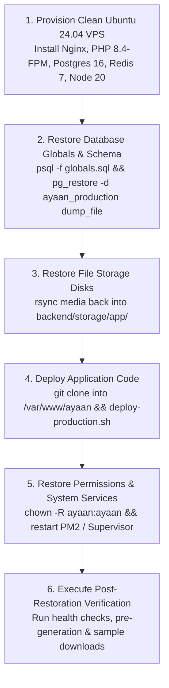

# AYAAN CLOTHING (AYC) — Backup & Disaster Recovery

**Document Purpose**: Comprehensive technical reference for database dumps, filesystem media backups, snapshot schedules, and disaster recovery restoration procedures.  
**Audience**: DevOps Engineers, Database Administrators, Site Reliability Engineers, Security Auditors.  
**Last Verified Date**: October 20, 2026  
**Environment Baseline**: Production Release `release_20261020_052638_a8d2fef` on Hostinger VPS `srv2010990`.

---

## 1. Backup Scope & Data Classification

To guarantee business continuity without data loss, backups are categorized by volatility and criticality:

| Asset Category | Target Path / Resource | Criticality | Recommended Frequency | Backup Format |
| :--- | :--- | :---: | :---: | :--- |
| **Relational Database** | PostgreSQL (`ayaan_production`) | **CRITICAL** | Daily Automated / Pre-Deploy | Custom compressed dump (`pg_dump -F c`) |
| **Customer Uploads** | `storage/app/public/payment_proofs/` | **CRITICAL** | Daily Snapshot | Incremental rsync / tar archive |
| **Catalog Photography** | `storage/app/public/products/`, `brands/` | **HIGH** | Weekly Snapshot | Incremental rsync / tar archive |
| **Offer Sheet Artifacts**| `storage/app/product_offer_sheets/` | **MEDIUM** | Weekly Snapshot | Regenerable via artisan command |
| **Environment Config** | `/var/www/ayaan/backend/.env` | **CRITICAL** | On Change | Encrypted off-site vault |
| **Web & Proxy Config** | `/etc/nginx/`, `/etc/supervisor/` | **HIGH** | On Change | Git versioned / Tar backup |

---

## 2. PostgreSQL Backup Procedures

### A. Creating an Authoritative Database Dump
```bash
# Set secure timestamped filename
BACKUP_DIR="/var/backups/ayaan/db"
mkdir -p "${BACKUP_DIR}"
TIMESTAMP=$(date +%Y%m%d_%H%M%S)
DUMP_FILE="${BACKUP_DIR}/ayaan_production_${TIMESTAMP}.dump"

# Execute compressed PostgreSQL dump
pg_dump -U ayaan_user -h 127.0.0.1 -p 5432 -d ayaan_production -F c -b -v -f "${DUMP_FILE}"

# Verify dump file integrity
pg_restore -l "${DUMP_FILE}" > /dev/null && echo "✔ Database dump verified valid"
```

### B. Dumping Global Roles & Schema
```bash
pg_dumpall -U postgres --globals-only > "${BACKUP_DIR}/ayaan_globals_${TIMESTAMP}.sql"
```

---

## 3. Persistent Media & Document Backup

Product photography and customer wire receipts are archived incrementally:

```bash
MEDIA_BACKUP_DIR="/var/backups/ayaan/media"
mkdir -p "${MEDIA_BACKUP_DIR}"

# Mirror public uploads and payment receipts
rsync -avz --delete /var/www/ayaan/backend/storage/app/public/ "${MEDIA_BACKUP_DIR}/public/"

# Mirror pre-generated PDF offer sheets
rsync -avz --delete /var/www/ayaan/backend/storage/app/product_offer_sheets/ "${MEDIA_BACKUP_DIR}/product_offer_sheets/"
```

---

## 4. Complete Disaster Recovery & Restoration Runbook

In the event of catastrophic server failure or unrecoverable database corruption:



### Step-by-Step Restoration Commands:
```bash
# 1. Restore Database
dropdb -U ayaan_user -h 127.0.0.1 ayaan_production --if-exists
createdb -U ayaan_user -h 127.0.0.1 ayaan_production
pg_restore -U ayaan_user -h 127.0.0.1 -d ayaan_production -v "${DUMP_FILE}"

# 2. Restore Filesystem Media
rsync -avz "${MEDIA_BACKUP_DIR}/public/" /var/www/ayaan/backend/storage/app/public/
rsync -avz "${MEDIA_BACKUP_DIR}/product_offer_sheets/" /var/www/ayaan/backend/storage/app/product_offer_sheets/

# 3. Ensure Permissions Are Non-Root (ayaan:ayaan)
chown -R ayaan:ayaan /var/www/ayaan/backend/storage
chmod -R 775 /var/www/ayaan/backend/storage

# 4. Trigger Deployment Release Gate
/var/www/ayaan/scripts/deploy-production.sh
```

---

## 5. Post-Restoration Sanity Checks

1. **Database Health**: `pg_isready` returns `accepting connections`.
2. **API Health Endpoint**: `curl http://127.0.0.1:8000/api/v1/health` returns `{"database": "ok", "redis": "ok"}`.
3. **Offer Sheet Integrity**: Run `php artisan ayaan:pregenerate-offer-sheets --product=177` to verify Dompdf and image libraries function cleanly.
4. **Order Documents**: Issue test download for an existing order to verify PDF generation and disk retrieval.

---

## 6. Related Technical Documentation

* **[OPERATIONS_RUNBOOK.md](OPERATIONS_RUNBOOK.md)**: Daily system operations and service checks.
* **[DEPLOYMENT.md](DEPLOYMENT.md)**: Deployment pipeline and release rollbacks.
* **[DATABASE.md](DATABASE.md)**: Schema specifications and entity relationships.
