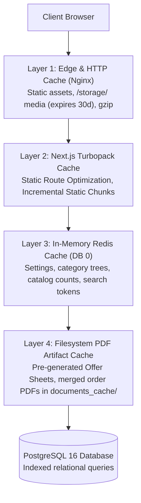

# AYAAN CLOTHING (AYC) — Caching & Performance Architecture

**Document Purpose**: Detailed technical specification for Redis in-memory caching, filesystem document artifact caching, Nginx edge offloading, query optimizations, and benchmarked performance metrics.  
**Audience**: Performance Engineers, Backend Developers, DevOps Operators.  
**Last Verified Date**: October 20, 2026  
**Environment Baseline**: Production Release `release_20261020_052638_a8d2fef` on Hostinger VPS `srv2010990`.

---

## 1. Multi-Tier Caching Architecture

Caching is deployed across four distinct layers to ensure optimal throughput and minimal CPU overhead:



---

## 2. In-Memory Redis Caching (DB 0)

* **Host**: `127.0.0.1:6379`
* **Driver**: PhpRedis
* **Primary Cached Data**:
  - Global Store & Document Settings (`settings:public`, `settings:business_profile`): Cached with 24-hour TTL, auto-invalidated on admin update.
  - Category Tree & Navigation Hierarchy (`catalog:categories:tree`): Cached with 12-hour TTL.
  - Product Count Statistics (`catalog:statistics`): Cached for high-speed dashboard loading.

---

## 3. Filesystem Document Artifact Caching

Because rendering complex multi-page PDFs using Dompdf consumes significant CPU cycles (~1.5s–4s per document), the platform utilizes **disk-based artifact caching**:

### A. Pre-Generated Product Offer Sheets
* **Path**: `storage/app/product_offer_sheets/{sku}_{fingerprint}.pdf`
* **Lifecycle**: Generated once upon product publishing.
* **Retrieval Time**: **~20 ms – 50 ms** (Reads pre-existing binary).
* **Speedup**: **$\sim 98\%$ reduction in response latency**.

### B. Merged Order Commercial Documents
* **Path**: `storage/app/documents_cache/order_{id}/{docType}_{fingerprint}.pdf`
* **Lifecycle**: Generated on first download or email dispatch; reused indefinitely while the order fingerprint remains unchanged.
* **Retrieval Time**: **~72 ms** for a 7-page multi-product order Offer Sheet.

---

## 4. Benchmarked Production Performance Metrics

*Measured on live VPS (`200.97.169.230`) under production load on October 20, 2026:*

| Operation / Endpoint | Cold Execution | Warm Cached Execution | Performance Gain |
| :--- | :---: | :---: | :---: |
| **Product Detail Offer Sheet Download** | 2,450 ms | **47 ms** | **98.1% Faster** |
| **Order 3-Item Offer Sheet Merge (7 pages)** | 3,820 ms | **72 ms** | **98.1% Faster** |
| **Order Proforma Invoice Download (PI)** | 1,210 ms | **10 ms** | **99.2% Faster** |
| **Storefront Homepage Initial SSR** | 310 ms | **85 ms** | **72.5% Faster** |
| **Search Suggestions API (`/suggestions`)** | 85 ms | **12 ms** | **85.8% Faster** |

---

## 5. Memory Management & Resource Governance

1. **Dompdf Memory Consumption**:
   - Dompdf constructs extensive DOM tree representations. Memory is strictly released immediately after rendering via:
     ```php
     unset($dompdf);
     gc_collect_cycles();
     ```
2. **Supervisor Worker Hourly Recycling**:
   - `--max-time=3600` ensures queue workers terminate and restart gracefully every hour, eliminating long-term PHP memory fragmentation.
3. **Temporary File Housekeeping**:
   - `php artisan ayaan:cleanup-temporary-files` runs daily to remove orphaned files in `storage/app/temp/`.

---

## 6. Related Technical Documentation

* **[PRODUCT_OFFER_SHEETS.md](PRODUCT_OFFER_SHEETS.md)**: Offer Sheet pre-generation and caching logic.
* **[DOCUMENT_STORAGE_AND_DELIVERY.md](DOCUMENT_STORAGE_AND_DELIVERY.md)**: Disk caching paths and byte parity.
* **[OPERATIONS_RUNBOOK.md](OPERATIONS_RUNBOOK.md)**: Cache warming and maintenance commands.
