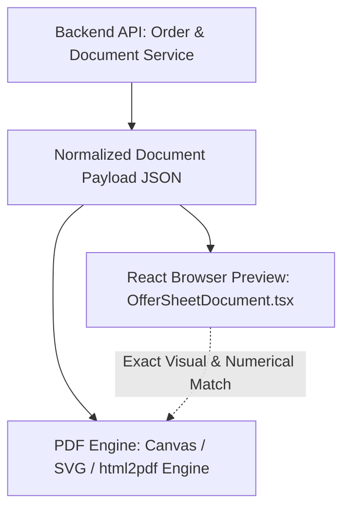

# Commercial Documents — AYAAN CLOTHING (AYC)

## 1. Export Trade Documentation Overview

In the international ready-made garment (RMG) export industry, commercial documents serve as legal financial instruments required by central banks, customs authorities, and freight carriers. The AYC platform automatically generates and compiles three standardized commercial documents:


### Document Types & Legal Functions
1. **Offer Sheet (Quotation)**:
   * **Purpose**: Issued during initial buyer negotiations to formalize unit wholesale pricing, package carton breakdowns, validity dates, and export shipping terms.
   * **Access**: Available immediately upon product configuration or quote generation.
2. **Proforma Invoice (PI)**:
   * **Purpose**: Legally binding pre-shipment invoice required by foreign exchange banks to authorize international wire transfers (T/T in advance) or open documentary Letters of Credit (L/C).
   * **Access**: Issued immediately upon order placement (`status: pending`).
3. **Commercial Invoice (CI)**:
   * **Purpose**: Authoritative shipping invoice required for customs clearance at export ports (Dhaka DAC airport, Chittagong Port) and destination customs at the port of entry for duty calculation.
   * **Access**: Available once payment is approved (`payment_status: paid`) or order is confirmed.

---

## 2. Core Rule: Actual Product Data Only (Zero Fabrication)

A foundational architectural requirement enforced across the document pipeline:

* **Strict Prohibition of Synthetic Data**: Document generators must **never** invent, assume, hardcode, or inject dummy specifications to fill empty space.
* **Authentic Specifications**: Only attributes explicitly present in the product database record (`products.specifications`) are rendered (e.g. Fabric Composition, Sizing, Colors, Package Assortments).
* **Missing Fields Omission**: If a specification (such as Fabric Weight / GSM) is not present in the product record, the corresponding row or field is omitted cleanly from the table rather than printing fabricated values or generic placeholders.
* **Price Parity**: Document prices reflect the exact unit prices, volume tier discounts, freight fees, and line totals stored in `order_items`.

---

## 3. Parity Between Preview and PDF Download

The system guarantees 100% visual and numerical consistency between the browser preview modal and the downloaded PDF binary:



### A. Shared Document Components (`src/components/admin/documents/`)
* **`DocumentHeader.tsx`**: Renders exporter credentials, document badges, reference numbers, and dates.
* **`OfferSheetDocument.tsx`**: Renders wholesale quotation details, validity terms, and package size-curve tables.
* **`ProformaInvoiceDocument.tsx`**: Renders pre-shipment banking details, SWIFT routing codes, and freight terms.
* **`CommercialInvoiceDocument.tsx`**: Renders customs declaration, final packaging counts, and shipping marks.

### B. Header Layout & Non-Overlap Fixes
Historical releases experienced CSS layout overlap between the company logo and the document badge when printed on narrow pages. In commit `85b8bed`, the header was re-engineered using an explicit flexbox grid:
* Left column: Exporter legal entity, physical factory address, and registration numbers.
* Right column: Document badge (`PROFORMA INVOICE`), reference number, issue date, and payment terms.
* Both columns use explicit CSS `min-height` and isolated z-indexing, guaranteeing zero visual overlap across desktop displays, mobile previews, and printed A4 paper sheets.

---

## 4. Standard Exporter & Beneficiary Details

Every generated trade document embeds the verified corporate identity:

* **Exporter / Beneficiary**: `AYAAN CLOTHING`
* **Address**: House #33 (2nd floor), Road #12, Sector #11, Uttara, Dhaka - 1230, Bangladesh
* **Official Phone**: `+880 1620-853502`
* **Official Email**: `info@ayaanclothing.com`
* **Beneficiary Bank**: The City Bank Limited, Principal Branch, Dhaka, Bangladesh
* **Country of Origin**: Bangladesh
* **Standard Shipping Terms**: FOB Hazrat Shahjalal International Airport (DAC) or FOB Chittagong Port (CGP), unless CIF is explicitly quoted.

---

## 5. Automated Document Verification Suite

The document generation pipeline is continuously verified using an automated script:
```bash
node scripts/verify-offer-sheet-pdf.mjs
```
This test renders live product data, compiles the PDF binary in headless Chromium, and verifies:
1. All rendered specifications match the database record.
2. Fabricated fields (such as unverified GSM claims) do not appear.
3. Text bounding boxes do not collide or clip table borders.
