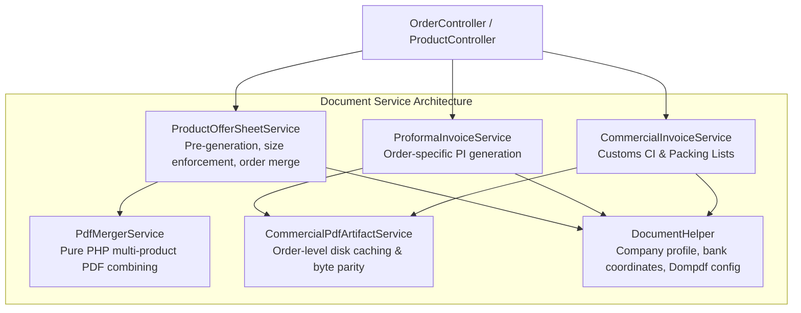

# AYAAN CLOTHING (AYC) — Commercial Export Trade Documents

**Document Purpose**: Comprehensive architectural specification for official B2B export documents (Offer Sheets, Proforma Invoices, Commercial Invoices, Packing Lists), document lifecycles, and layout standards.  
**Audience**: International Trade Specialists, Backend Developers, Financial Auditors, Legal Compliance Officers.  
**Last Verified Date**: October 20, 2026  
**Environment Baseline**: Production Release `release_20261020_052638_a8d2fef` on Hostinger VPS `srv2010990`.

---

## 1. Trade Documents Matrix

AYAAN CLOTHING generates four authoritative trade documents complying with international apparel export standards:

| Document Type | Code Identifier | Target Scope | Availability Stage | Gating / Authorization Rule | Primary Service |
| :--- | :--- | :--- | :--- | :--- | :--- |
| **Product Offer Sheet** | `OFFER_SHEET` | Product & Multi-Product Order | Instant (Pre-generated) | Public (Catalog) / Owner (Order) | `ProductOfferSheetService` |
| **Proforma Invoice** | `PROFORMA_INVOICE` | Specific Order | Upon Order Placement | Customer Owner or Admin | `ProformaInvoiceService` |
| **Commercial Invoice** | `COMMERCIAL_INVOICE` | Specific Order | After Payment Confirmation | **Gated**: Requires `payment_status = 'paid'` | `CommercialInvoiceService` |
| **Packing List** | `PACKING_LIST` | Specific Order | After Payment Confirmation | **Gated**: Requires `payment_status = 'paid'` | `CommercialInvoiceService` |

---

## 2. Document Purpose & Data Elements

### A. Product Offer Sheet (`OFFER_SHEET`)
* **Purpose**: Comprehensive commercial presentation of garments for buyer review and purchase approval.
* **Core Elements**: Product title, SKU, brand identity, multi-angle photography, fabric composition, GSM, wash care, packaging breakdown, MOQ, 3-tier wholesale pricing, exporter contact info, and legal commercial export terms.
* **Lifecycle**: Pre-generated and cached per product ($\le 1.5$ MB); dynamically merged in order item sequence for multi-product orders.

### B. Proforma Invoice (`PROFORMA_INVOICE`)
* **Purpose**: Preliminary commercial bill used by international buyers to obtain import permits, open Letters of Credit (L/C), or initiate SWIFT telegraphic transfers (T/T).
* **Core Elements**: Unique PI number (`AYC_PI_{number}.pdf`), order creation date, consignee name/company, destination port, transport mode (Air/Sea/Manual), itemized unit pricing, shipping freight, discounts, grand total, and exporter banking remittance coordinates.

### C. Commercial Invoice (`COMMERCIAL_INVOICE`)
* **Purpose**: Authoritative legal customs document accompanying the physical shipment for international customs clearance, duty assessment, and foreign exchange reporting.
* **Core Elements**: Commercial Invoice number (`AYC_CI_{number}.pdf`), Harmonized System (HS) export tariff codes, country of origin (Bangladesh), confirmed payment reference, and port of lading / discharge.
* **Gating**: Strictly gated. If an unverified or unpaid order requests a Commercial Invoice, the API returns HTTP 403.

### D. Export Packing List (`PACKING_LIST`)
* **Purpose**: Physical cargo breakdown for freight forwarders, shipping lines, and port customs inspectors.
* **Core Elements**: Carton-by-carton breakdown, size ratio breakdown per carton, total carton count, gross weight (kg), net weight (kg), and total cubic meters (CBM).

---

## 3. Architecture & Service Hierarchy

Document processing is divided into dedicated specialized services:

---

## 4. PDF Layout & Formatting Standards

PDF rendering is powered by **Dompdf 3.1.6** with strict design rules enforced in `DocumentHelper`:

1. **Page Geometry**: Standard ISO A4 format (`210mm x 297mm`) with consistent 12mm–14mm margins.
2. **Typography**: Embedded Helvetica / Arial fonts with fixed line heights to guarantee text never collides across columns or clips vertically.
3. **Branding & Layout Non-Overlap**:
   - Company profile, registered address, and WhatsApp contact in top left header.
   - Brand logo and official document title right-aligned.
   - Reference bar with isolated columns and explicit gutters.
4. **Image Handling**:
   - High-resolution product images are processed through Intervention Image and resized to 1200px max dimensions.
   - Images are embedded as standard RGB JPEGs to prevent Dompdf transparency/color rendering anomalies.
5. **Privacy Protection**: Administrative operator notes, internal wholesale margins, and supplier purchase costs are stripped before rendering for customer requests.

---

## 5. API Delivery Endpoints

| Endpoint | Method | Format | Content-Disposition | Authorization |
| :--- | :---: | :---: | :--- | :--- |
| `/api/v1/products/{id}/offer-sheet/pdf` | `GET` | Binary PDF | `attachment; filename="AYC_Offer_Sheet_{SKU}.pdf"` | Public Storefront |
| `/api/v1/products/bulk-offer-sheet` | `POST` | Binary PDF | `attachment; filename="AYC_Bulk_Offer_Sheets.pdf"` | Public Storefront |
| `/api/v1/orders/{id}/documents/OFFER_SHEET/pdf` | `GET` | Binary PDF | `attachment; filename="AYC_Offer_Sheet_{order_no}.pdf"` | Customer Owner / Admin |
| `/api/v1/orders/{id}/documents/PROFORMA_INVOICE/pdf` | `GET` | Binary PDF | `attachment; filename="AYC_PI_{pi_no}.pdf"` | Customer Owner / Admin |
| `/api/v1/orders/{id}/documents/COMMERCIAL_INVOICE/pdf` | `GET` | Binary PDF | `attachment; filename="AYC_CI_{ci_no}.pdf"` | Customer Owner (Paid) / Admin |
| `/api/v1/orders/{id}/documents/PACKING_LIST/pdf` | `GET` | Binary PDF | `attachment; filename="AYC_PL_{order_no}.pdf"` | Customer Owner (Paid) / Admin |

---

## 6. Related Technical Documentation

* **[PRODUCT_OFFER_SHEETS.md](PRODUCT_OFFER_SHEETS.md)**: Deep dive into the canonical Offer Sheet architecture.
* **[PROFORMA_INVOICES.md](PROFORMA_INVOICES.md)**: Proforma Invoice generation and banking details.
* **[DOCUMENT_STORAGE_AND_DELIVERY.md](DOCUMENT_STORAGE_AND_DELIVERY.md)**: Disk caching and byte parity.
