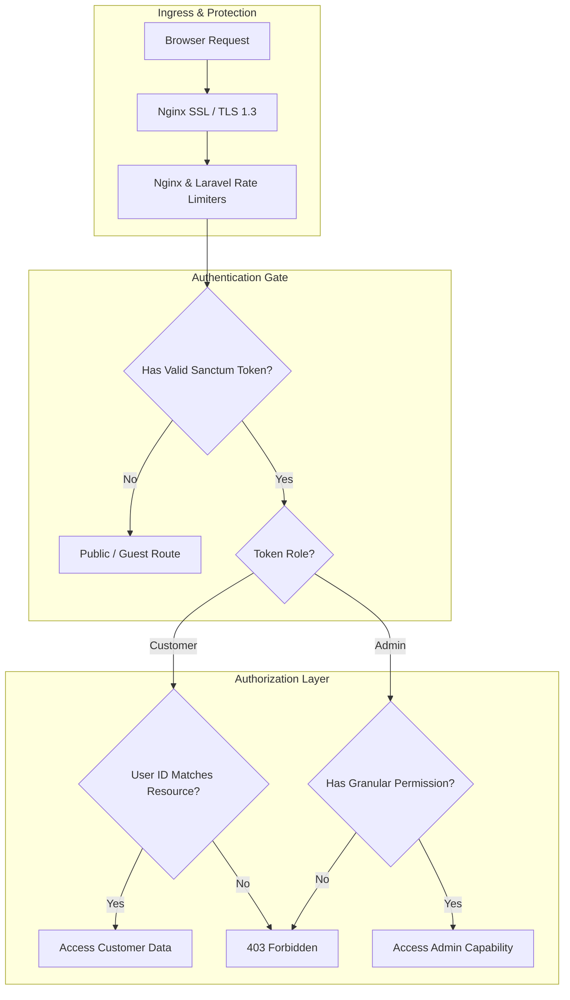

# Configuration and Security — AYAAN CLOTHING (AYC)

> [!NOTE]
> **Canonical Notice**: This historical document has been modernized and superseded by the authoritative canonical references at **[docs/SECURITY.md](SECURITY.md)** and **[docs/CONFIGURATION_REFERENCE.md](CONFIGURATION_REFERENCE.md)**. Please consult those guides for active security boundaries, rate limiting, and environment variable references.

## 1. Security Architecture & Threat Model

The AYC platform manages wholesale commercial contracts, proprietary garment designs, buyer banking documents, and customer transactions. The security model enforces strict tenant isolation, role-based administrative boundaries, defensive file upload handling, and network-level ingress controls.



---

## 2. Authentication Architecture

The system uses **Laravel Sanctum** token-based authentication with distinct paths for international buyers and internal company personnel:

### A. Customer Authentication
* **Registration & Login**: Handled via `/api/v1/auth/register` and `/api/v1/auth/login`. Rate-limited via `throttle:auth-register` (3 req/min) and `throttle:auth-login` (5 req/min) to prevent brute-force attacks.
* **Token Issuance**: Returns a personal access token stored securely in `localStorage` or `sessionStorage` and transmitted in HTTP request headers as `Authorization: Bearer <token>`.
* **Password Encryption**: All passwords are encrypted using PHP's native `bcrypt` algorithm with cost factor 12.
* **Google OAuth**: Supported via Socialite (`/api/v1/auth/google/redirect` and `/callback`).

### B. Administrator Authentication
* **Dedicated Endpoint**: Administrators authenticate exclusively via `/api/v1/auth/admin/login`.
* **Role Verification**: The controller verifies credentials and strictly checks that the account possesses `role: admin` and `status: active`. Customer accounts attempting to authenticate via the admin endpoint are rejected immediately.
* **Password Resets**: Standard password reset tokens expire after 60 minutes and can only be used once.

---

## 3. Granular Role-Based Access Control (RBAC)

The administrative system implements a multi-tenant dynamic RBAC system stored in PostgreSQL:

### A. Database Tables
* `roles`: Custom named roles (`super_admin`, `catalog_manager`, `order_verifier`, `pos_cashier`).
* `permissions`: Discrete granular permission slugs (143 seeded permissions).
* `role_permissions`: Many-to-many pivot mapping permissions to roles.
* `admin_roles`: Many-to-many pivot assigning roles to admin users.

### B. Standard Granular Permissions
| Permission Slug | Capability / Authorized Operation |
| :--- | :--- |
| `catalog.manage` | Create, edit, and delete products, categories, brands, and pricing tiers. |
| `inventory.adjust` | Adjust warehouse stock levels, edit allocations, and view cost metrics. |
| `order.view` | View administrative orders, customer details, and audit trails. |
| `order.update_status` | Advance lifecycle status of orders (restores stock if cancelled). |
| `payment.receipt.verify` | Inspect uploaded wire transfer receipts, approve payments, and trigger inventory deduction. |
| `payment.receipt.reject` | Reject wire transfer receipts and mark payment failed to allow customer re-upload. |
| `pos.view` | Access the in-showroom POS terminal, view stock balances, and calculate cart totals. |
| `pos.create` | Execute showroom counter sales with instant physical stock deduction. |
| `pos.discount` | Apply custom percentage or flat monetary discounts in POS checkout. |
| `users.manage` | View registered customer profiles, companies, and contact information. |
| `administrators.manage`| Create admin accounts, assign roles, and modify system access. |
| `rbac.manage` | Create custom roles, adjust permission matrix, and revoke access. |
| `settings.manage` | Update business addresses, banking instructions, and legal policies. |

*(Note: Legacy permission labels `orders.verify_payment`, `pos.access`, `pos.operate`, and `pos.discounts` are superseded by the canonical slugs above).*

### C. Route Enforcement
Endpoints are protected using middleware chaining:
```php
Route::middleware(['auth:sanctum', 'permission:payment.receipt.verify'])->group(function () {
    Route::post('/orders/{id}/payment/verify', [AdminOrderController::class, 'reviewPaymentProof']);
    Route::post('/orders/{id}/payment-proof/review', [AdminOrderController::class, 'reviewPaymentProof']);
});

Route::middleware(['auth:sanctum', 'permission:payment.receipt.reject'])->group(function () {
    Route::post('/orders/{id}/payment/reject', [AdminOrderController::class, 'reviewPaymentProof']);
});

Route::prefix('pos')->group(function () {
    Route::get('/products', [AdminPosController::class, 'products'])->middleware('permission:pos.view');
    Route::post('/orders', [AdminPosController::class, 'store'])->middleware('permission:pos.create');
});
```

---

## 4. Customer Tenant Isolation & Data Ownership

To eliminate horizontal privilege escalation (IDOR vulnerabilities):
1. **Strict Ownership Scoping**: Every customer endpoint querying an order, address, quote, or profile verifies ownership against the authenticated user:
   ```php
   $order = Order::where('id', $orderId)
                 ->where('user_id', $request->user()->id)
                 ->firstOrFail();
   ```
2. **Guest Order Access**: Unregistered or guest buyers accessing order tracking must provide both the exact Order Number (`AYN-YYYYMMDD-XXXXXX`) and matching contact email or phone number.
3. **Internal Data Sanitization**: Purchase costs (`buying_price`), internal supplier identities (`supplier_id`, `supplier_name`), and admin operational notes are stripped from public API resources via dedicated Eloquent serialization transforms.

---

## 5. File Upload & Payment Receipt Security

The receipt upload pipeline (`/api/v1/orders/{id}/payment-proof`) enforces defense-in-depth sanitization:

1. **Input Size Limit**: Strictly limited to **10 MB** (10,485,760 bytes). Larger files are rejected by both Nginx (`client_max_body_size 20M;` ceiling, app-level 10 MB via `ReceiptImageService::MAX_SOURCE_BYTES`) and Laravel validator (`max:10240`).
2. **MIME Type Whitelist**: Only `image/jpeg`, `image/jpg`, `image/png`, and `image/webp` are permitted. Executables, PDFs, SVGs, and scriptable files are blocked (PDFs are explicitly rejected with HTTP 422).
3. **WebP Transcoding & Metadata Stripping**:
   * Every uploaded image is loaded into memory, validated for real image headers, and transcoded into optimized WebP format at quality 85.
   * All EXIF metadata, GPS camera tags, and embedded device information are stripped during transcoding.
4. **Current Storage Location**:
   * Files are stored with cryptographically secure tokens: `storage/app/public/order-receipts/receipt_{order}_{token}_{timestamp}.webp`.
   * Stored permissions are restricted to `0644` (non-executable).
5. **State-Locked Replacement**:
   * Buyers can upload or replace receipts when `payment_status` is `pending`, `payment_submitted`, or `failed` (or legacy `unpaid`).
   * Once an order payment is approved and marked `paid` (or `payment_confirmed_at !== null`), customer resubmission is strictly forbidden with HTTP 422 to preserve financial audit integrity.
6. **Outstanding Security Remediation (High Priority)**:
   * Storing receipts under `storage/app/public/order-receipts/` allows unauthenticated access if the exact URL is known or leaked.
   * The target safe architecture requires migrating receipt storage to an unexposed private disk (`storage/app/private/order-receipts/`) served exclusively through an authenticated streaming controller route that verifies order ownership or admin permissions.

---

## 6. Secrets Management & Environment Isolation

| Secret Name | Location | Scope / Purpose | Exposure Risk Policy |
| :--- | :--- | :--- | :--- |
| `APP_KEY` | `backend/.env` | Laravel AES-256 session and token encryption key. | **Strictly Private**. Never committed to Git. |
| `DB_PASSWORD` | `backend/.env` | PostgreSQL password for `ayaan_user`. | **Strictly Private**. Localhost bound. |
| `INTERNAL_API_SECRET` | Root `.env` & `backend/.env` | Shared HMAC secret for Next.js SSR and proxy sub-requests. | **Server-Only**. Never prefixed with `NEXT_PUBLIC_`. |
| `MAIL_PASSWORD` | `backend/.env` | SMTP transactional email credentials. | **Strictly Private**. |

### Security Invariants
* **Zero Secrets in Frontend Bundles**: No environment variable containing database passwords, private keys, or API tokens may use the `NEXT_PUBLIC_` prefix.
* **Firewall Isolation**: PostgreSQL (`5432`) and Redis (`6379`) are strictly bound to `127.0.0.1` and blocked from external ingress by UFW rules.
