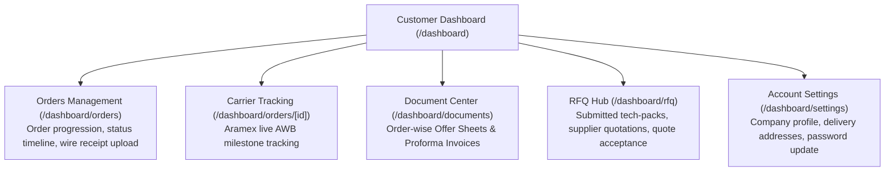
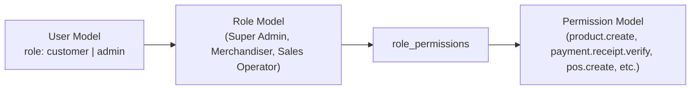
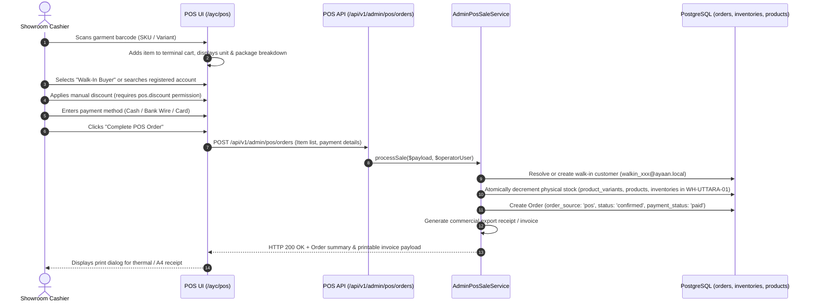

# AYAAN CLOTHING (AYC) — Customers & Administration

**Document Purpose**: Detailed technical specification for customer self-service portals, administrative back-office management, role-based access control (RBAC), and factory showroom Point-of-Sale (POS) operations.  
**Audience**: Operations Managers, Admin Developers, System Administrators, Security Engineers.  
**Last Verified Date**: October 20, 2026  
**Environment Baseline**: Production Release `release_20261020_052638_a8d2fef` on Hostinger VPS `srv2010990`.

---

## 1. Customer Self-Service Portal (`/dashboard`)

The customer portal provides international wholesale buyers with self-service tools for managing orders, shipments, commercial documents, and RFQ inquiries:



### Key Customer Capabilities:
* **Order Tracking**: Real-time status badge (`ORDER_PLACED`, `PAYMENT_PENDING`, `WAITING_FOR_APPROVAL`, `ORDER_CONFIRMED`, `ON_SHIPMENT`, `DELIVERED`).
* **Document Downloads**: Single-click downloads of official commercial PDFs directly from order rows.
* **Wire Proof Upload**: Scanned payment receipt upload modal (JPG, JPEG, PNG, WebP up to 10 MB; PDFs rejected by validation).

---

## 2. Administrative Portal Architecture (`/ayc`)

The admin suite is hosted under the unified `/ayc` namespace and served via a dedicated Node.js gateway process (`scripts/admin-proxy.js` on port 3001, PM2 process `ayaan-admin`). The gateway injects `x-admin-app: true` and `x-is-admin-host: 1` headers and proxies requests internally to Next.js on port 3000 (`ayaan-customer`). Next.js `src/proxy.ts` detects these headers (or the `/ayc` path prefix) and routes into the administrative App Router tree (`src/app/ayc/*`). Administrative API requests (`/ayc/api/*`) are rewritten by Nginx directly to `/api/*` and dispatched to the PHP 8.4-FPM socket. Legacy `/admin` routes return HTTP 404.

### Administrative Sub-modules:
1. **Analytics & KPIs (`/ayc/dashboard`)**:
   - Total wholesale gross sales, pending payment verifications, open RFQs, catalog items, and top-performing brands.
2. **Catalog & Inventory (`/ayc/products`, `/ayc/inventory`, `/ayc/products/stock`)**:
   - Product creation wizard with 3-tier pricing curves, package assortment matrices, high-resolution media galleries, and pre-generation status triggers.
3. **Order & Payment Verification (`/ayc/orders`, `/ayc/orders/[id]`)**:
   - Audit ledger for incoming customer wire transfer receipts. Allows authorized merchandisers to verify deposits (`payment.receipt.verify`), confirm orders, and release commercial invoices.
4. **Point-of-Sale Terminal (`/ayc/pos`)**:
   - Specialized fast-checkout interface for in-person factory showroom wholesale transactions (`pos.view`, `pos.create`, `pos.discount`).
5. **RFQ & Quotation Builder (`/ayc/rfq`, `/ayc/quotations`)**:
   - Tech-pack inspection, multi-round negotiation messaging, and formal export quotation generation.
6. **Access Control & RBAC (`/ayc/roles`, `/ayc/permissions`, `/ayc/administrators`)**:
   - Granular permission assignment and staff account management via `role_permissions` and `admin_roles`.

---

## 3. Role-Based Access Control (RBAC) Architecture

Access control is governed by database entities `roles` and `permissions`, mapped to users through Eloquent relationships (`admin_roles` and `role_permissions`):



### A. Role Hierarchy
* **`customer`**: Storefront buyers. Has no administrative permissions; access restricted to own profile, orders, and documents.
* **`admin`**: Factory operators and staff. Access controlled by granular permission flags.
* **Super Admin**: Has `is_super_admin: true` or `access_level: super_admin`; automatically bypasses granular permission checks.

### B. Core Verified Permissions Catalog (Evidence: `AUTH-001`)
| Permission Code | Category | Operational Scope |
| :--- | :--- | :--- |
| `product.create` | Catalog | Create draft products and initial specifications. |
| `product.edit` | Catalog | Modify descriptions, pricing curves, images, and publish status. |
| `product.delete` | Catalog | Soft-delete products and release associated slugs. |
| `order.view` | Orders | Inspect customer orders and financial summaries. |
| `payment.receipt.verify` | Orders/Payment | Audit and approve wire receipts, triggering stock deduction. |
| `payment.receipt.reject` | Orders/Payment | Reject wire receipts with notes, marking payment failed. |
| `order.update_status` | Orders | Advance lifecycle status (restores stock if moving to cancelled). |
| `order.update_fulfillment` | Orders | Update warehouse fulfillment progress. |
| `shipment.create` | Shipping | Create shipment waybills (Aramex) and mark orders dispatched. |
| `pos.view` | POS | Access and view POS showroom terminal, catalog, and totals. |
| `pos.create` | POS | Execute counter sales and quick-create walk-in customers. |
| `pos.discount` | POS | Apply manual custom discounts to POS line items and sales. |
| `rfq.view` / `rfq.accept` | RFQ | Review customer inquiries and accept RFQ terms. |
| `quotation.create` / `send` | Quotations | Generate and issue export quotations to buyers. |
| `coupon.view` / `coupon.create`| Marketing | Create promo coupons and bind sales commissions to staff. |
| `settings.view` / `edit` | System | Modify company profile, banking details, and homepage banners. |

*(Note: Historical documentation references to `pos.access`, `pos.operate`, and `order.verify_payment` are superseded by the verified database slugs above).*

### C. Backend Enforcement Syntax
```php
// Route level middleware in backend/routes/api.php
Route::middleware(['auth:sanctum', 'permission:payment.receipt.verify'])->group(function () {
    Route::post('/orders/{id}/payment/verify', [AdminOrderController::class, 'reviewPaymentProof']);
});
```

---

## 4. Factory Showroom Point-of-Sale (POS) Terminal

The POS module (`src/app/ayc/pos/page.tsx` and `App\Services\Order\AdminPosSaleService`) is engineered for low-latency physical warehouse showroom commerce:



### Key POS Engineering Highlights:
* **Barcode Scanner Support**: Native keyboard wedge support; auto-focuses scanner input field and adds garments to cart instantaneously.
* **Synthetic Walk-In Accounts**: When a walk-in buyer lacks an account, generates `walkin_{timestamp}_{rand}@ayaan.local`. Email confirmation dispatch is automatically suppressed for `@ayaan.local` addresses. Optional email and phone fields are supported.
* **Atomic Physical Inventory Decrement**: Deducts stock across `product_variants.stock`, `products.stock`, and `inventories.quantity` for warehouse `WH-UTTARA-01`, logging audit entries in `admin_inventory_adjustments`.
* **Staff Coupon Bindings**: Automatically records which sales operator initiated the transaction in `coupon_admin_bindings` for internal commission tracking.
* **Discount Gate**: Applying manual line-item discounts requires the `pos.discount` permission; otherwise, attempts are rejected with HTTP 403.

---

## 5. Related Technical Documentation

* **[AUTHENTICATION_AND_VERIFICATION.md](AUTHENTICATION_AND_VERIFICATION.md)**: Customer authentication and email verification.
* **[ORDERS_AND_CHECKOUT.md](ORDERS_AND_CHECKOUT.md)**: Storefront checkout vs. POS ordering differences.
* **[PAYMENTS_AND_INVENTORY.md](PAYMENTS_AND_INVENTORY.md)**: Stock decrementing and restoration logic.
* **[PRODUCTION_STATE_AUDIT.md](PRODUCTION_STATE_AUDIT.md)**: Live VPS interrogation and evidence ledger (`AUTH-001`, `INV-001`).
* **[SECURITY.md](SECURITY.md)**: Administrative route protection and role boundaries.

