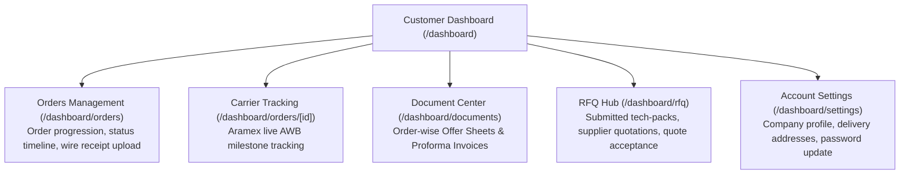
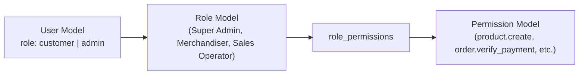
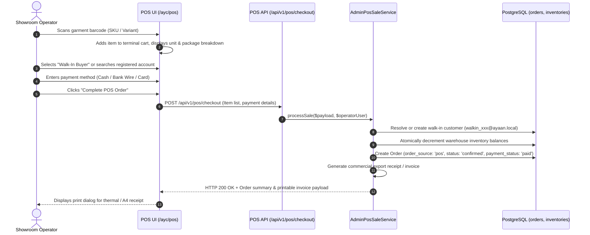

# AYAAN CLOTHING (AYC) — Customers & Administration

**Document Purpose**: Detailed technical specification for customer self-service portals, administrative back-office management, role-based access control (RBAC), and factory showroom Point-of-Sale (POS) operations.  
**Audience**: Operations Managers, Admin Developers, System Administrators, Security Engineers.  
**Last Verified Date**: October 20, 2026  
**Environment Baseline**: Production Release `release_20261020_052638_a8d2fef` on Hostinger VPS `srv2010990`.

---

## 1. Customer Self-Service Portal (`/dashboard`)

The customer portal provides international wholesale buyers with self-service tools for managing orders, shipments, commercial documents, and RFQ inquiries:



### Key Customer Capabilities:
* **Order Tracking**: Real-time status badge (`ORDER_PLACED`, `PAYMENT_PENDING`, `WAITING_FOR_APPROVAL`, `ORDER_CONFIRMED`, `ON_SHIPMENT`, `DELIVERED`).
* **Document Downloads**: Single-click downloads of official commercial PDFs directly from order rows.
* **Wire Proof Upload**: Scanned payment receipt upload modal (PDF, JPEG, PNG, WebP up to 20 MB).

---

## 2. Administrative Portal Architecture (`/ayc`)

The admin suite is an isolated single-page application served via PM2 on port 3001, accessed publicly under the `/ayc` path prefix:

### Administrative Sub-modules:
1. **Analytics & KPIs (`/ayc/dashboard`)**:
   - Total wholesale gross sales, pending payment verifications, open RFQs, catalog items, and top-performing brands.
2. **Catalog & Inventory (`/ayc/products`, `/ayc/inventory`, `/ayc/products/stock`)**:
   - Product creation wizard with 3-tier pricing curves, package assortment matrices, high-resolution media galleries, and pre-generation status triggers.
3. **Order & Payment Verification (`/ayc/orders`, `/ayc/orders/[id]`)**:
   - Audit ledger for incoming customer wire transfer receipts. Allows authorized merchandisers to verify deposits, confirm orders, and release commercial invoices.
4. **Point-of-Sale Terminal (`/ayc/pos`)**:
   - Specialized fast-checkout interface for in-person factory showroom wholesale transactions.
5. **RFQ & Quotation Builder (`/ayc/rfq`, `/ayc/quotations`)**:
   - Tech-pack inspection, multi-round negotiation messaging, and formal export quotation generation.
6. **Access Control & RBAC (`/ayc/roles`, `/ayc/permissions`, `/ayc/administrators`)**:
   - Granular permission assignment and staff account management.

---

## 3. Role-Based Access Control (RBAC) Architecture

Access control is governed by two core database entities: `roles` and `permissions`, mapped to users through Eloquent relationships:



### A. Role Hierarchy
* **`customer`**: Storefront buyers. Has no administrative permissions; access restricted to own profile, orders, and documents.
* **`admin`**: Factory operators and staff. Access controlled by granular permission flags.

### B. Core Permissions Catalog
| Permission Code | Category | Operational Scope |
| :--- | :--- | :--- |
| `product.create` | Catalog | Create draft products and initial specifications. |
| `product.edit` | Catalog | Modify descriptions, pricing curves, images, and publish status. |
| `product.delete` | Catalog | Soft-delete products and release associated slugs. |
| `order.view` | Orders | Inspect customer orders and financial summaries. |
| `order.verify_payment` | Orders | Audit uploaded wire proofs and mark orders as paid. |
| `order.fulfill` | Orders | Create shipment waybills (Aramex) and mark orders dispatched. |
| `pos.operate` | POS | Access and execute sales on the showroom POS terminal. |
| `rfq.manage` | RFQ | Review customer inquiries, upload quotes, and negotiate terms. |
| `coupon.manage` | Marketing | Create promo coupons and bind sales commissions to staff. |
| `settings.manage` | System | Modify company profile, banking details, and homepage banners. |

### C. Backend Enforcement Syntax
```php
// Route level middleware
Route::middleware(['auth:sanctum', 'permission:order.verify_payment'])->group(function () {
    Route::post('/orders/{id}/verify-payment', [AdminOrderController::class, 'verifyPayment']);
});
```

---

## 4. Factory Showroom Point-of-Sale (POS) Terminal

The POS module (`src/app/ayc/pos/page.tsx` and `App\Services\Order\AdminPosSaleService`) is engineered for low-latency physical warehouse showroom commerce:



### Key POS Engineering Highlights:
* **Barcode Scanner Support**: Native keyboard wedge support; auto-focuses scanner input field and adds garments to cart instantaneously.
* **Synthetic Walk-In Accounts**: When a walk-in buyer lacks an account, generates `walkin_{timestamp}_{rand}@ayaan.local`. Email confirmation dispatch is automatically suppressed for `@ayaan.local` addresses.
* **Atomic Inventory Decrementing**: Real-time stock reservation prevents overselling showroom inventory.
* **Staff Coupon Bindings**: Automatically records which sales operator initiated the transaction in `coupon_admin_bindings` for internal commission tracking.

---

## 5. Related Technical Documentation

* **[AUTHENTICATION_AND_VERIFICATION.md](AUTHENTICATION_AND_VERIFICATION.md)**: Customer authentication and email verification.
* **[ORDERS_AND_CHECKOUT.md](ORDERS_AND_CHECKOUT.md)**: Storefront checkout vs. POS ordering differences.
* **[SECURITY.md](SECURITY.md)**: Administrative route protection and role boundaries.
