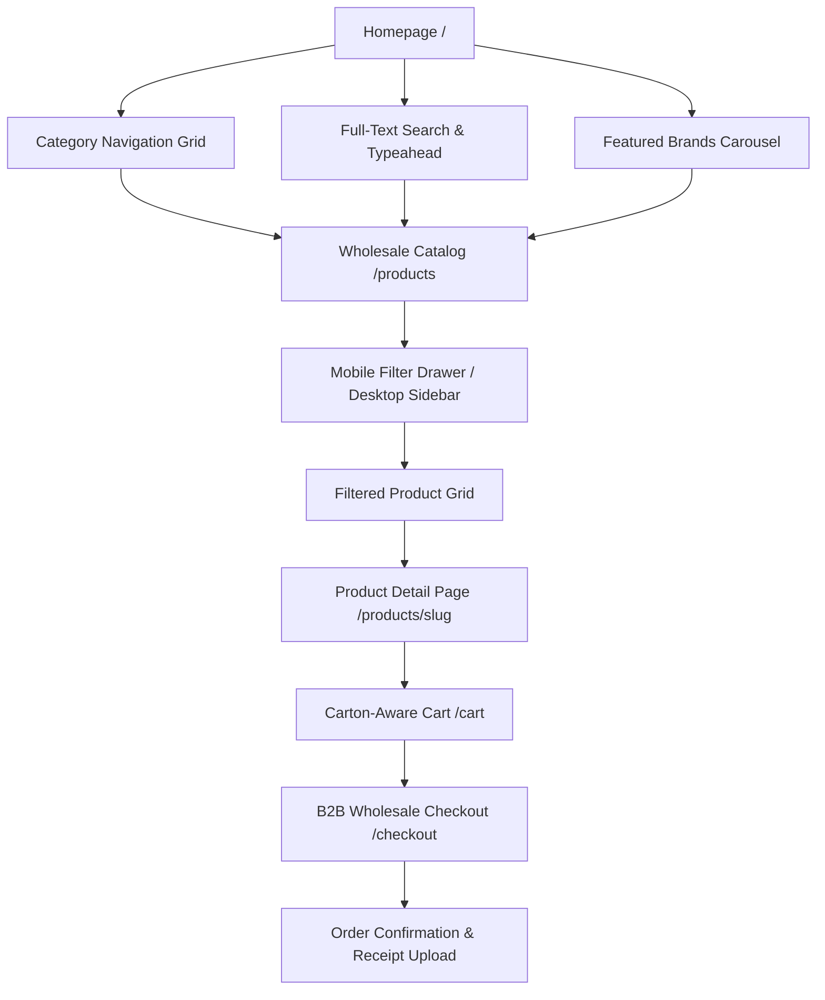

# Customer Storefront — AYAAN CLOTHING (AYC)

## 1. Storefront Architecture & Design Philosophy

The AYC Customer Storefront is engineered for international B2B wholesale buyers, fashion retail sourcing agents, and commercial apparel importers. It balances fast, responsive product discovery with the complex data requirements of garment export trade (tiered pricing, minimum order quantities, and carton size-curve breakdowns).

---

## 2. Navigation & Discovery Architecture



### A. Global Header & Navigation
* **Top Utility Bar**: Displays authoritative WhatsApp sales helpline (`+880 1620-853502`), export shipping notice, and multi-currency selector.
* **Instant Typeahead Search**: Input bar delivering debounced live suggestions for product titles, brands, and categories via `/api/v1/search/suggestions`.
* **Category Bar**: Horizontal navigation menu mapping garment departments (Men, Women, Kids, Outerwear, Activewear, Denim).
* **Cart Badge**: Real-time reactive counter indicating total carton and unit volume.

---

## 3. Mobile Category & Filter Experience

Mobile buyers benefit from a dedicated responsive filtering system (`src/components/products/MobileFilterDrawer.tsx`):
1. **Sticky Mobile Filter Trigger**: Floats smoothly on mobile viewports without obstructing product thumbnails.
2. **Bottom Sheet Drawer**: Slides up natively with touch gestures, displaying categories, brands, price sliders, and fabric filters.
3. **Active Filter Pills**: Shows chip indicators for active filters with one-tap removal.
4. **Live Results Count**: Updates button state in real-time (e.g. `Show 24 Products`) before applying, preventing jarring full-page refreshes.

---

## 4. Product Detail Page (PDP) Architecture

The PDP (`src/app/products/[slug]/page.tsx`) represents the core decision-making hub for wholesale apparel buyers:

### A. Media Gallery
* Multi-angle garment photography served in high-efficiency WebP format.
* Pinch-to-zoom and lightbox view for inspecting fabric textures, stitch quality, and garment trims.

### B. Dynamic Wholesale Tier Table
Unit prices automatically scale based on volume thresholds defined in `product_pricing_tiers`:
```text
┌──────────────────────┬──────────────────────┬──────────────────────┐
│  Tier 1 (50–99 pcs)  │ Tier 2 (100–499 pcs) │ Tier 3 (500+ pcs)    │
│  $12.50 / unit       │ $10.80 / unit        │ $8.90 / unit (Best)  │
└──────────────────────┴──────────────────────┴──────────────────────┘
```
As the buyer increments quantity, the active tier highlights, and total savings are calculated dynamically.

### C. Carton Assortment & Size Curves
Wholesale garments are sold in factory cartons. The PDP displays the exact assortment breakdown:
* **Package Multiplier (`quantity_step`)**: Enforces carton increments (e.g. 30 pcs per carton).
* **Assortment Curve Breakdown**:
  * *Example Message*: `"Each 30-piece carton contains a balanced ratio: S:6, M:12, L:8, XL:4 in assorted export colorways."`
* **MOQ Indicator**: Displays Minimum Order Quantity (e.g., `MOQ: 60 units / 2 cartons`). Add-to-cart is disabled until MOQ is satisfied.

### D. Garment Specifications Accordion
Displays verified specifications entered during product creation:
* Fabric Composition (e.g., `100% Combed Ringspun Cotton`)
* Fabric Weight / GSM (rendered only when authentic data exists; generic claims strictly eliminated)
* Weave / Construction (e.g., `French Terry`, `Single Jersey`)
* Country of Origin: `Bangladesh (Export Certified)`

---

## 5. Cart & Carton Quantity Rules

The Cart system (`src/app/cart/page.tsx`) enforces wholesale trading constraints:
* **Carton Increment Validation**: Buyers cannot enter arbitrary quantities; stepping adheres to `quantity_step` (e.g. 30 → 60 → 90).
* **MOQ Gate**: If an order falls below the required threshold, an informative warning badge guides the buyer to reach the minimum carton count.
* **Volume Price Lock**: Cart calculates line totals against the active volume tier achieved across the order.

---

## 6. Checkout Workflow

The Checkout funnel (`src/app/checkout/page.tsx`) is designed for international commercial transactions:
1. **Company & Consignee Details**:
   * Legal Trading Name, VAT/Tax ID, Consignee Destination Address, Port of Discharge.
2. **Shipping & Freight Options**:
   * Air Express (Aramex / DHL door-to-door).
   * Air Freight (Dhaka DAC to destination airport).
   * Ocean Cargo (Chittagong Port FCL/LCL).
3. **Payment Method Selection**:
   * **Bank Wire Transfer (T/T)**: Displays official beneficiary bank details (Beneficiary: AYAAN CLOTHING, Bank: The City Bank Ltd, SWIFT code).
   * **Letter of Credit (L/C)**: For commercial orders exceeding $10,000 USD.
   * **Company Card**: For samples and express orders.
4. **Order Finalization**:
   * Instant stock deduction inside a PostgreSQL transaction.
   * Generation of canonical order number (`ORD-YYYY-XXXX`).

---

## 7. Customer Dashboard & Order Management

Located at `/dashboard`, buyers manage active orders and fulfill documentation requirements:

### A. Order Status Timeline
Tracks progression across the canonical order states:
* `pending` → Order placed; awaiting wire transfer receipt.
* `pending_verification` → Receipt uploaded; under review by AYC finance.
* `paid` → Payment confirmed; stock scheduled for packing.
* `processing` → Factory carton labeling and customs export preparation.
* `shipped` → Export consignment dispatched with live carrier tracking link.
* `delivered` → Consignment received at destination.

### B. Payment Receipt Upload Dropzone
* Intuitive drag-and-drop file upload for wire transfer confirmations.
* Supports JPG, PNG, and WebP up to 10 MB.
* Immediately reflects `pending_verification` state upon upload.
* Allows receipt replacement if rejected by finance with feedback notes. Once verified and marked `paid`, replacement is permanently locked.

### C. Commercial Document Downloads
Buyers can view and download official trade documents directly from their dashboard:
* **Offer Sheet (Quotation)**
* **Proforma Invoice (PI)** (Required for foreign exchange wire authorization)
* **Commercial Invoice (CI)** (Required for import customs clearance)
