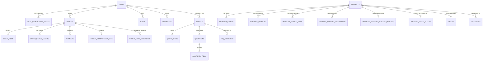

# AYAAN CLOTHING (AYC) — Database Architecture & Schema Reference

**Document Purpose**: Definitive technical specification for the PostgreSQL 16 database, relational schema, table relationships, foreign-key constraints, index optimizations, and data integrity invariants.  
**Audience**: Database Administrators, Backend Engineers, Data Architects, System Auditors.  
**Last Verified Date**: October 20, 2026  
**Environment Baseline**: Production Release `release_20261020_052638_a8d2fef` on PostgreSQL 16 (`ayaan_production`).

---

## 1. Database Engine & Connection Architecture

* **Database Engine**: PostgreSQL 16.x.
* **Character Set & Collation**: UTF-8 with standard Unicode collation.
* **Database Name**: `ayaan_production`.
* **Database User**: `ayaan_user`.
* **Connection**: Local TCP connection on port `5432` / Unix domain socket.
* **Migration Count**: 92 versioned migrations in `backend/database/migrations/`.

---

## 2. Core Entity Relationship Diagram (ERD)

---

## 3. Major Table Specifications

### A. Authentication & Users
1. **`users`**:
   - `id`: `bigint PK`
   - `name`: `varchar(255)`
   - `email`: `varchar(255) nullable` (unique for registered web accounts)
   - `password`: `varchar(255)` (Bcrypt hash)
   - `role`: `varchar(50)` (`customer` or `admin`)
   - `status`: `varchar(50)` (`active`, `inactive`)
   - `google_id`: `varchar(255) nullable` (OAuth provider ID)
   - `avatar_url`: `text nullable`
   - `email_verified_at`: `timestamp nullable` (**Critical gate for ordering**)
2. **`email_verification_tokens`**:
   - `id`: `bigint PK`
   - `user_id`: `bigint FK -> users.id` (cascade delete)
   - `email`: `varchar(255)`
   - `token_hash`: `varchar(64)` (SHA-256 hash of 256-bit secret)
   - `browser_binding_hash`: `varchar(64) nullable`
   - `expires_at`: `timestamp`
   - `used_at`: `timestamp nullable`

### B. Catalog, Products & Inventory
1. **`products`**:
   - `id`: `bigint PK`
   - `sku`: `varchar(100) UNIQUE`
   - `slug`: `varchar(255) UNIQUE`
   - `product_id`: `varchar(255) UNIQUE nullable` (Visible custom ID format)
   - `name`: `varchar(255) nullable` (Not unique; permits repeat production runs)
   - `status`: `varchar(50)` (`draft`, `published`, `archived`)
   - `stock`: `integer default 0` (Aggregate physical stock)
   - `wholesale_price`: `numeric(12,2)`
   - `bulk_price`: `numeric(12,2) nullable`
   - `bulk_threshold`: `integer nullable`
   - `full_stock_price`: `numeric(12,2) nullable`
   - `moq`: `integer nullable` (Minimum Order Quantity)
   - `specifications`: `jsonb nullable`
   - `package_assortment_visible`: `boolean default true`
   - `package_assortment_message`: `text nullable`
   - `is_sold_out`: `boolean default false`
   - `is_preorder`: `boolean default false`
   - `deleted_at`: `timestamp nullable` (Soft deletes)
2. **`inventories`**:
   - `id`: `bigint PK`
   - `product_variant_id`: `bigint FK -> product_variants.id nullable`
   - `product_id`: `bigint FK -> products.id nullable`
   - `warehouse_id`: `bigint FK -> warehouses.id`
   - `quantity`: `integer default 0` (Authoritative warehouse physical count)
   - *(Note: `reserved_quantity` was dropped and does not exist in the production schema).*
3. **`warehouses`**:
   - `id`: `bigint PK`
   - `code`: `varchar(50) UNIQUE` (Canonical production warehouse: `WH-UTTARA-01`)
   - `name`: `varchar(255)` (`Uttara Warehouse`)
   - `is_active`: `boolean default true`
4. **`product_offer_sheets`**:
   - `id`: `bigint PK`
   - `product_id`: `bigint FK -> products.id` (cascade delete)
   - `sku`: `varchar(100)`
   - `status`: `varchar(50)` (`pending`, `processing`, `ready`, `failed`)
   - `fingerprint`: `varchar(64)` (Deterministic SHA-256)
   - `file_path`: `varchar(255)`
   - `filename`: `varchar(255)`
   - `filesize_bytes`: `integer`
   - `checksum_sha256`: `varchar(64)`
   - `page_count`: `integer`
   - `generated_at`: `timestamp nullable`

### C. Orders & Fulfillment
1. **`orders`**:
   - `id`: `bigint PK`
   - `order_number`: `varchar(100) UNIQUE` (`AYN-YYYYMMDD-XXXXXX`)
   - `user_id`: `bigint FK -> users.id nullable` (null for walk-in accounts)
   - `order_source`: `varchar(50) default 'storefront'` (`storefront`, `pos`)
   - `status`: `varchar(50) default 'pending'` (`pending`, `processing`, `confirmed`, `fulfilled`, `cancelled`, `shipped`, `delivered`)
   - `payment_status`: `varchar(50) default 'unpaid'` (`unpaid`, `pending`, `payment_submitted`, `paid`, `failed`, `refunded`)
   - `shipping_status`: `varchar(50) default 'unfulfilled'` (`unfulfilled`, `processing`, `shipped`, `delivered`)
   - `customer_status`: *(Computed Eloquent model accessor `$order->customer_status`, not a raw database column; maps to `ORDER_PLACED`, `PAYMENT_PENDING`, `WAITING_FOR_APPROVAL`, `ORDER_CONFIRMED`, `ON_SHIPMENT`, `DELIVERED`).*
   - `subtotal`: `decimal(12,2)`
   - `shipping_cost`: `decimal(12,2)`
   - `discount_amount`: `decimal(12,2)`
   - `total_amount`: `decimal(12,2)`
   - `payment_method`: `varchar(50)`
   - `payment_proof_url`: `varchar(255) nullable`
   - `payment_details`: `jsonb nullable` (Holds `inventory_decremented: bool`)
   - `payment_confirmed_at`: `timestamp nullable`
   - `payment_confirmed_by`: `bigint FK -> users.id nullable`
   - `shipping_snapshot`: `jsonb nullable`
2. **`order_items`**:
   - `id`: `bigint PK`
   - `order_id`: `bigint FK -> orders.id` (cascade delete)
   - `product_id`: `bigint FK -> products.id`
   - `product_name`: `varchar(255)`
   - `sku`: `varchar(100)`
   - `unit_price`: `decimal(10,2)` (snapshot locked at sale)
   - `quantity`: `integer`
   - `package_breakdown`: `jsonb nullable`
3. **`order_idempotency_keys`**:
   - `id`: `bigint PK`
   - `idempotency_key`: `varchar(255) UNIQUE`
   - `user_id`: `bigint FK -> users.id nullable`
   - `request_hash`: `varchar(64)`
   - `response_payload`: `jsonb`

---

## 4. Key Performance Indexes

The database schema utilizes targeted B-tree indexes for high-frequency queries:

| Table | Index Name | Indexed Columns | Query Purpose |
| :--- | :--- | :--- | :--- |
| `products` | `idx_products_sku` | `sku` | Direct lookup by product SKU |
| `products` | `idx_products_slug` | `slug` | SEO storefront URL resolution |
| `products` | `idx_products_status` | `status` | Published catalog browsing filters |
| `product_offer_sheets` | `idx_pos_product_status`| `(product_id, status)` | Fast pre-generated PDF lookup |
| `orders` | `idx_orders_order_number`| `order_number` | Customer tracking and document generation |
| `orders` | `idx_orders_user_status` | `(user_id, status)` | Customer dashboard order history |
| `email_verification_tokens` | `idx_evt_token_hash` | `token_hash` | Cryptographic verification lookup |
| `order_idempotency_keys` | `idx_oik_key` | `idempotency_key` | Instant checkout idempotency check |

---

## 5. Data Integrity & Transactional Invariants

1. **Atomic Payment & POS Transactions**: Stock deductions occur atomically during admin payment approval (`AdminOrderController::verifyPayment`) or POS counter sale (`AdminPosSaleService`). Web order placement commits pending orders without immediate inventory decrement.
2. **Pessimistic Inventory Locking**: Stock checks use `lockForUpdate()` during payment approval and POS checkout to eliminate race conditions between simultaneous wholesale buyers.
3. **Soft-Deleted Product Slugs**: When a product is deleted, its slug is updated or released so new products can reuse the canonical URL structure without foreign key violations.

---

## 6. Related Technical Documentation

* **[ORDERS_AND_CHECKOUT.md](ORDERS_AND_CHECKOUT.md)**: Order creation and checkout transactions.
* **[PAYMENTS_AND_INVENTORY.md](PAYMENTS_AND_INVENTORY.md)**: Stock decrementing and restoration logic.
* **[PRODUCTION_STATE_AUDIT.md](PRODUCTION_STATE_AUDIT.md)**: Production schema interrogation evidence (`DB-001`).
* **[BACKUP_AND_RECOVERY.md](BACKUP_AND_RECOVERY.md)**: PostgreSQL database backup and restore runbooks.

