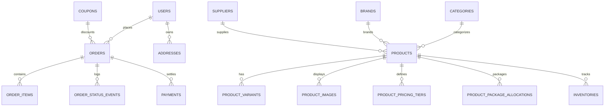

# Database & Data Model — AYAAN CLOTHING (AYC)

> [!NOTE]
> **Canonical Notice**: This historical document has been modernized and superseded by the authoritative canonical reference at **[docs/DATABASE.md](DATABASE.md)**. Please consult `DATABASE.md` for current PostgreSQL schemas, ERDs, indexes, and migration standards.

## 1. Database Architecture & Conventions

The AYC platform utilizes **PostgreSQL 16** as its authoritative, ACID-compliant relational datastore. The production database is named `ayaan_production`, owned by `ayaan_user`.

### Key Architectural Conventions
1. **Primary Keys**: Auto-incrementing 64-bit integers (`bigserial`) or UUIDs where cross-system synchronization is needed.
2. **Monetary Values**: Stored as exact decimal values with precision `12,2` (e.g. `99.50`) or integer cents depending on legacy schema, normalized at the API resource level to two decimal places.
3. **JSONB Columns**: Used selectively for flexible, non-indexed domain specifications such as `specifications` (garment attributes), `package_breakdown` (size/color curve snapshots), and `shipping_snapshot` (rate quotes).
4. **Timestamps**: All tables maintain UTC `created_at` and `updated_at` timestamp with timezone fields.
5. **No Production Truncation**: Database resets (`migrate:fresh`, `db:wipe`, `TRUNCATE`) are strictly forbidden on production. Schema evolution is managed via append-only migrations.

---

## 2. Entity-Relationship Model (Core Entities)



---

## 3. Product Catalog & Identifier Invariants

A product in AYC is defined by a rigorous set of identifiers with distinct uniqueness and business semantics:

| Identifier Field | Format / Example | Uniqueness Requirement | Purpose & Business Semantics |
| :--- | :--- | :--- | :--- |
| **`id`** | `bigint` (e.g., `42`) | **Globally Unique** | Database primary key used for foreign key relations. |
| **`product_id`** | `string` (e.g., `PRD-0042` or `LLB-SHT-01`) | **Globally Unique** | Human-readable visible identifier used on commercial export documents and warehouse packing labels. |
| **`sku`** | `string` (e.g., `AYC-MHOOD-BLK-M`) | **Globally Unique** | Stock Keeping Unit for inventory control and barcode scanning. |
| **`slug`** | `string` (e.g., `mens-premium-hoodie-black`) | **Globally Unique** | Canonical URL slug for SEO routing (`/products/[slug]`). |
| **`name`** | `string` (e.g., `Heavyweight Fleece Hoodie`) | **Non-Unique (Duplicates Allowed)** | Human-facing product title. Multiple products may share the same name if differentiated by color, fabric, or brand. |

---

## 4. Comprehensive Schema Definitions

### A. `products`
The core catalog table representing garment stock lots, surplus styles, and OEM templates:

```sql
CREATE TABLE products (
    id BIGSERIAL PRIMARY KEY,
    product_id VARCHAR(64) UNIQUE,            -- Visible commercial code (e.g. PRD-0042)
    name VARCHAR(255) NOT NULL,               -- Product display name
    slug VARCHAR(255) NOT NULL UNIQUE,        -- Canonical URL slug
    sku VARCHAR(100) NOT NULL UNIQUE,         -- Master inventory SKU
    category_id BIGINT REFERENCES categories(id) ON DELETE SET NULL,
    brand_id BIGINT REFERENCES brands(id) ON DELETE SET NULL,
    supplier_id BIGINT REFERENCES suppliers(id) ON DELETE SET NULL,
    supplier_name VARCHAR(255),               -- Internal supplier reference (Hidden from customers)
    base_price DECIMAL(12,2) NOT NULL,        -- Default unit wholesale price (USD)
    old_price DECIMAL(12,2),                  -- MSRP / Strikethrough comparison price
    buying_price DECIMAL(12,2),               -- Factory purchase cost (Strictly internal)
    purchase_price_updated_at TIMESTAMP,
    stock INTEGER NOT NULL DEFAULT 0,         -- Available uncommitted stock
    moq INTEGER NOT NULL DEFAULT 1,           -- Minimum Order Quantity in units
    quantity_step INTEGER NOT NULL DEFAULT 1, -- Carton package quantity multiplier
    is_sold_out BOOLEAN DEFAULT FALSE,        -- Admin sold out override
    is_featured BOOLEAN DEFAULT FALSE,       -- Featured on homepage flag
    is_pinned BOOLEAN DEFAULT FALSE,         -- Pinned to top of catalog
    pinned_at TIMESTAMP,                      -- Timestamp when pinned
    is_hidden_from_storefront BOOLEAN DEFAULT FALSE,
    package_assortment_message TEXT,          -- Breakdown description (e.g. 6S, 12M, 8L, 4XL)
    package_assortment_visible BOOLEAN DEFAULT TRUE,
    bulk_pricing_enabled BOOLEAN DEFAULT TRUE,
    specifications JSONB,                     -- Fabric, weave, fit, country of origin
    meta_title VARCHAR(255),                  -- SEO title
    meta_description TEXT,                    -- SEO description
    sort_order INTEGER DEFAULT 0,
    created_at TIMESTAMP WITH TIME ZONE DEFAULT CURRENT_TIMESTAMP,
    updated_at TIMESTAMP WITH TIME ZONE DEFAULT CURRENT_TIMESTAMP
);
```

### B. `product_pricing_tiers`
Defines automated volume discount thresholds for wholesale buyers:

```sql
CREATE TABLE product_pricing_tiers (
    id BIGSERIAL PRIMARY KEY,
    product_id BIGINT NOT NULL REFERENCES products(id) ON DELETE CASCADE,
    min_quantity INTEGER NOT NULL,            -- e.g. 50
    max_quantity INTEGER,                     -- e.g. 99 (NULL for open-ended top tier)
    unit_price DECIMAL(12,2) NOT NULL,        -- Tier discounted unit price (USD)
    created_at TIMESTAMP WITH TIME ZONE DEFAULT CURRENT_TIMESTAMP,
    updated_at TIMESTAMP WITH TIME ZONE DEFAULT CURRENT_TIMESTAMP,
    CONSTRAINT chk_tier_quantities CHECK (max_quantity IS NULL OR max_quantity >= min_quantity)
);
```

### C. `orders`
The central commercial contract tracking export orders, POS sales, and payment states:

```sql
CREATE TABLE orders (
    id BIGSERIAL PRIMARY KEY,
    order_number VARCHAR(32) NOT NULL UNIQUE, -- Canonical reference: ORD-YYYY-XXXX
    user_id BIGINT REFERENCES users(id) ON DELETE SET NULL, -- Nullable for POS walk-in customers
    order_source VARCHAR(32) DEFAULT 'web',   -- 'web' or 'pos'
    operator_id BIGINT REFERENCES users(id),  -- Admin user who created or processed order
    customer_name VARCHAR(255) NOT NULL,
    company_name VARCHAR(255),                -- International buyer trading company
    email VARCHAR(255),                       -- Nullable for POS phone-only customers
    shipping_phone VARCHAR(64) NOT NULL,
    shipping_address1 TEXT NOT NULL,
    shipping_address2 TEXT,
    shipping_city VARCHAR(100) NOT NULL,
    shipping_country_code VARCHAR(8) NOT NULL DEFAULT 'US',
    status VARCHAR(32) NOT NULL DEFAULT 'pending', 
    -- 'pending', 'confirmed', 'processing', 'shipped', 'delivered', 'cancelled'
    payment_status VARCHAR(32) NOT NULL DEFAULT 'pending',
    -- 'pending', 'pending_verification', 'paid', 'payment_rejected'
    fulfillment_status VARCHAR(32) NOT NULL DEFAULT 'unfulfilled',
    subtotal DECIMAL(12,2) NOT NULL,
    shipping_cost DECIMAL(12,2) NOT NULL DEFAULT 0.00,
    tax_amount DECIMAL(12,2) NOT NULL DEFAULT 0.00,
    discount_amount DECIMAL(12,2) NOT NULL DEFAULT 0.00,
    total_amount DECIMAL(12,2) NOT NULL,
    currency VARCHAR(8) NOT NULL DEFAULT 'USD',
    payment_method VARCHAR(64) NOT NULL DEFAULT 'wire_transfer',
    payment_proof_url TEXT,                   -- Public path to sanitized WebP wire receipt
    coupon_id BIGINT REFERENCES coupons(id) ON DELETE SET NULL,
    carrier VARCHAR(100),                     -- e.g. Aramex Express, DHL, Ocean Freight
    tracking_number VARCHAR(100),
    carrier_status VARCHAR(255),
    shipping_snapshot JSONB,                  -- Port of origin, weight, carton count, rates
    created_at TIMESTAMP WITH TIME ZONE DEFAULT CURRENT_TIMESTAMP,
    updated_at TIMESTAMP WITH TIME ZONE DEFAULT CURRENT_TIMESTAMP
);
```

### D. `order_items`
Snapshot records of items purchased, freezing historical prices and internal costs:

```sql
CREATE TABLE order_items (
    id BIGSERIAL PRIMARY KEY,
    order_id BIGINT NOT NULL REFERENCES orders(id) ON DELETE CASCADE,
    product_id BIGINT REFERENCES products(id) ON DELETE SET NULL,
    product_name VARCHAR(255) NOT NULL,
    product_slug VARCHAR(255),
    sku VARCHAR(100) NOT NULL,
    unit_price DECIMAL(12,2) NOT NULL,        -- Wholesale price charged at sale
    buying_price_at_sale DECIMAL(12,2),       -- Purchase cost snapshot (for profit reports)
    quantity INTEGER NOT NULL,                -- Units purchased
    line_total DECIMAL(12,2) NOT NULL,
    package_breakdown JSONB,                  -- Size/color curve frozen at purchase
    created_at TIMESTAMP WITH TIME ZONE DEFAULT CURRENT_TIMESTAMP,
    updated_at TIMESTAMP WITH TIME ZONE DEFAULT CURRENT_TIMESTAMP
);
```

### E. `inventories`
Authoritative multi-warehouse physical stock tracking:

```sql
CREATE TABLE inventories (
    id BIGSERIAL PRIMARY KEY,
    warehouse_id BIGINT NOT NULL REFERENCES warehouses(id) ON DELETE RESTRICT,
    product_id BIGINT NOT NULL REFERENCES products(id) ON DELETE CASCADE,
    product_variant_id BIGINT REFERENCES product_variants(id) ON DELETE CASCADE,
    quantity INTEGER NOT NULL DEFAULT 0,      -- Physical uncommitted stock
    created_at TIMESTAMP WITH TIME ZONE DEFAULT CURRENT_TIMESTAMP,
    updated_at TIMESTAMP WITH TIME ZONE DEFAULT CURRENT_TIMESTAMP,
    CONSTRAINT uq_warehouse_product_variant UNIQUE (warehouse_id, product_id, product_variant_id)
);
```
*Note on Inventory Model:* The database has no `reserved_quantity` column (dropped in migration `2026_09_29_070000`). When an order is placed, `quantity` is deducted immediately within the checkout transaction.

---

## 5. Critical Database Invariants & Migrations

1. **Immediate Inventory Deduction**: Checkout transactions execute `SELECT quantity FROM inventories WHERE ... FOR UPDATE` followed by an immediate deduction. Cancelled orders restore stock automatically.
2. **Slug Recycling for Soft-Deleted Products**: When an old product is archived or deleted, migration `2026_09_26_220000` appends a timestamp suffix to its slug (`{slug}-deleted-{timestamp}`), releasing the clean slug for future use.
3. **Audit History Preservation**: Order status changes append immutable entries into `order_status_events` containing the previous status, new status, operating admin ID, and timestamp.
