# AYAAN CLOTHING (AYC) — Production Deployment & Release Management

**Document Purpose**: Definitive technical specification for the zero-downtime atomic deployment pipeline, release directory structure, mandatory pre-activation release gates, and automated/manual rollback runbooks.  
**Audience**: DevOps Engineers, Release Managers, Full-Stack Developers, Site Reliability Engineers.  
**Last Verified Date**: October 20, 2026  
**Environment Baseline**: Production Release `release_20261020_052638_a8d2fef` on Hostinger VPS `srv2010990`.

---

## 1. Zero-Downtime Deployment Architecture

The deployment pipeline (`/var/www/ayaan/scripts/deploy-production.sh`) is designed to prevent Next.js chunk desynchronization outages (where clients with cached HTML request old chunks that a standard rebuild deletes):

```mermaid
graph TD
    DeployStart["Operator / CI Triggers Deployment<br/>/var/www/ayaan/scripts/deploy-production.sh"] --> MutexLock["Acquire Mutex File Lock (.deploy.lock)<br/>Prevents concurrent deployments"]
    
    subgraph Step1 ["Step 1: Backend Services"]
        MutexLock --> MigrateDB["php artisan migrate --force"]
        MigrateDB --> CacheConfig["php artisan config:cache && route:cache"]
        CacheConfig --> RestartWorker["supervisorctl restart ayaan-worker"]
    end

    subgraph Step2 ["Step 2: Isolated Frontend Compilation"]
        RestartWorker --> BuildStage["Compile into .next_build_stage<br/>Next.js Turbopack production build"]
        BuildStage --> SanityCheck{"Artifact Sanity Check<br/>100+ chunks compiled?"}
        SanityCheck -- Pass --> MoveRelease["Move to .next_releases/release_YYYYMMDD_HHMMSS_<commit>"]
    end

    subgraph Step3 ["Step 3: Chunk Continuity Preservation"]
        MoveRelease --> CopyOldChunks["Mirror static chunks from PREVIOUS_RELEASE<br/>into new static/chunks/<br/>Guarantees zero 404s for active browser sessions"]
    end

    subgraph Step4 ["Step 4: Atomic Symlink Swap & Process Reload"]
        CopyOldChunks --> AtomicSwap["mv -Tf .next_releases/current .next<br/>Atomic symlink pointer swap"]
        AtomicSwap --> PM2Reload["pm2 reload ayaan-customer ayaan-admin<br/>Zero-downtime cluster reload"]
        PM2Reload --> ReloadNginx["nginx -t && systemctl reload nginx"]
    end

    subgraph Step5 ["Step 5: Mandatory Release Gate"]
        ReloadNginx --> Gate1["Gate 1: Verify PM2 daemons online"]
        Gate1 --> Gate2["Gate 2: Probe /api/v1/health (DB + Redis ok)"]
        Gate2 --> Gate3["Gate 3: Probe 6 HTML routes (/, /products, /rfq, etc.)"]
        Gate3 --> Gate4["Gate 4: Test HTTP status for 100% of unique static chunks"]
    end

    Gate4 -- All Pass --> PruneReleases["Prune old releases (Keep last 5)<br/>Deployment Complete!"]
    Gate4 -- Any Fail --> AutoRollback["Execute Automatic Rollback<br/>Restore PREVIOUS_RELEASE symlink & PM2 reload"]
```



---

## 2. Standard Production Deployment Procedure

### Standard Step-by-Step Operator Guide:
```bash
# 1. Commit and push local changes to GitHub
git commit -am "feat: description of verified changes"
git push origin main

# 2. Connect to the production server
ssh srv2010990

# 3. Pull latest commit in repository working tree
cd /var/www/ayaan
git pull origin main

# 4. Execute atomic deployment script
/var/www/ayaan/scripts/deploy-production.sh
```

---

## 3. The 4-Tier Mandatory Release Gate

Before a new deployment is declared successful, `deploy-production.sh` runs an exhaustive automated verification gate:

1. **Gate 1: Daemon Health**: Checks that both `ayaan-customer` and `ayaan-admin` PM2 daemons are in the `online` state.
2. **Gate 2: API & Datastore Health**: Queries `http://127.0.0.1:8000/api/v1/health` to confirm PostgreSQL database is `ok` and Redis is `ok`.
3. **Gate 3: HTML Route Audits**: Requests 6 representative routes and extracts all referenced script and style tags:
   - Storefront Home (`/`)
   - Product Catalog (`/products`)
   - Customer RFQ Form (`/rfq`)
   - Customer Dashboard (`/dashboard/rfq`)
   - Admin Portal Gateway (`/ayc`)
   - Admin RFQ Management (`/ayc/rfq`)
4. **Gate 4: 100% Static Chunk HTTP 200 Audit**: Extracts every unique chunk hash and executes real HTTP GET requests against Nginx. If **even a single chunk** returns a 404 or 500 error, the release gate immediately fails and triggers automated rollback.

---

## 4. Rollback Runbooks

### A. Automated Rollback
If any release gate fails during deployment, the script automatically triggers rollback:
1. Re-points `.next` to the release path stored in `.next_releases/PREVIOUS_RELEASE`.
2. Reloads PM2 daemons (`pm2 reload ayaan-customer ayaan-admin`).
3. Reloads Nginx.
4. Preserves logs and reports failure.

### B. Manual Rollback Procedure
If unexpected runtime bugs are discovered after a successful deployment:
```bash
# Connect to production
ssh srv2010990

# Trigger standalone rollback
/var/www/ayaan/scripts/deploy-production.sh --rollback
```

### C. Rollback Scope & Data Safety:
| Asset / Component | Safe to Roll Back? | Technical Notes |
| :--- | :---: | :--- |
| **Next.js Frontend Build** | **YES** | Instantaneous atomic symlink pointer reversion. |
| **Laravel Backend Code** | **YES** | Code changes can be rolled back via git checkout if no destructive migrations ran. |
| **Database Migrations** | **MANUAL** | If migrations added nullable columns, rollback is safe. If data was migrated, rollback requires explicit migration down steps. |
| **Product Offer Sheet PDFs** | **N/A** | Persistent artifacts in `storage/app/product_offer_sheets/` remain intact across rollbacks. |
| **Customer Orders & Media** | **N/A** | Stored in PostgreSQL and `storage/app/public/`; completely unaffected by frontend release swaps. |

---

## 5. Related Technical Documentation

* **[ARCHITECTURE.md](ARCHITECTURE.md)**: VPS infrastructure and process layout.
* **[OPERATIONS_RUNBOOK.md](OPERATIONS_RUNBOOK.md)**: Daily operational commands and monitoring.
* **[TROUBLESHOOTING.md](TROUBLESHOOTING.md)**: Diagnostic playbooks for deployment failures.
