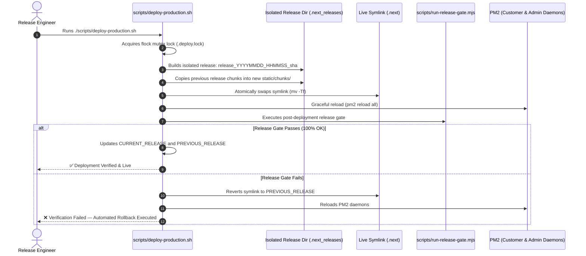

# Deployment & Rollback — AYAAN CLOTHING (AYC)

> [!NOTE]
> **Canonical Notice**: This historical document has been modernized and superseded by the authoritative canonical reference at **[docs/DEPLOYMENT.md](DEPLOYMENT.md)**. Please consult `DEPLOYMENT.md` for current production deployment pipelines, release gates, and rollback runbooks.

## 1. Zero-Downtime Deployment Philosophy

Deploying updates to a live e-commerce and wholesale manufacturing platform cannot tolerate service interruptions. In particular, Next.js applications are prone to **chunk desynchronization outages** if builds overwrite live assets while existing clients are mid-session.

AYC implements an automated, atomic, zero-downtime deployment pipeline codified in `scripts/deploy-production.sh`.



---

## 2. Release Directory Architecture

All production builds reside in the isolated `.next_releases/` directory at the application root:

```text
/var/www/ayaan/
├── .next -> /var/www/ayaan/.next_releases/release_20261017_153246_18c11ba  (Active Symlink)
├── .next_releases/
│   ├── CURRENT_RELEASE            # Contains name of active release
│   ├── PREVIOUS_RELEASE           # Contains name of rollback target
│   ├── release_20261016_204956_3fd8150/
│   ├── release_20261017_145044_66ccc97/  # Verified Rollback Target
│   └── release_20261017_153246_18c11ba/  # Current Active Production Release
```

### Invariants of the Release Pipeline
1. **Isolated Build Space**: The active release is never touched during `npm run build`. The build compiles into a separate directory.
2. **Chunk Forward-Compatibility**: Chunks from the previous release are copied into the new release's `static/chunks/` directory. Active visitors who opened the site prior to deployment do not encounter `ChunkLoadError` or blank screens.
3. **Atomic Symlink Activation**: Symlink activation uses Linux atomic file descriptor swapping:
   ```bash
   ln -sfn "${NEW_RELEASE_PATH}" "${APP_DIR}/.next_tmp"
   mv -Tf "${APP_DIR}/.next_tmp" "${APP_DIR}/.next"
   ```
   At no point is the `.next` path non-existent or broken.

---

## 3. Git Workflow & Remote Repositories

The project maintains two synchronized Git remotes:
* **`origin`**: Primary production repository (`https://github.com/ayaanclproject26-max/ayaan.git`)
* **`labib`**: Secondary engineering mirror (`https://github.com/labib-0/AYC.git`)
* **Branch**: Production deploys exclusively from `main`.

### Safe Release Promotion Workflow
```bash
# 1. Ensure local main is clean and up to date
git checkout main
git pull origin main

# 2. Run local release gate
node scripts/run-release-gate.mjs

# 3. Push verified commit to both remotes
git push origin main
git push labib main

# 4. Trigger deployment on production VPS
ssh srv2010990 "cd /var/www/ayaan && git pull origin main && ./scripts/deploy-production.sh"
```

---

## 4. Emergency Rollback Procedure

If unexpected regressions, network faults, or critical exceptions occur in production, execute an immediate one-command rollback:

### Executing Standalone Rollback
```bash
ssh srv2010990 "cd /var/www/ayaan && ./scripts/deploy-production.sh --rollback"
```

### What the Rollback Does Automatically:
1. Reads the target release identifier from `.next_releases/PREVIOUS_RELEASE`.
2. Validates that the target release directory physically exists and contains valid manifests.
3. Atomically updates the `.next` symlink to point to the rollback directory.
4. Reloads the PM2 customer and admin daemons:
   ```bash
   su - ayaan -c "pm2 reload ayaan-customer"
   su - ayaan -c "pm2 reload ayaan-admin"
   sudo systemctl reload nginx
   ```
5. Executes the release gate to confirm the rolled-back version is healthy.
6. Restores live traffic in under 5 seconds with zero downtime.

---

## 5. Post-Deployment Verification Checklist

Following any deployment or rollback, verify:
* **API Health**: `curl -s https://ayaanclothing.com/api/v1/health` returns `{"status":"ok"}`.
* **Storefront Delivery**: `curl -I https://ayaanclothing.com/` returns `HTTP 200 OK`.
* **Admin Gateway**: `curl -I https://ayaanclothing.com/ayc` returns `HTTP 200 OK`.
* **PM2 Process Status**: `pm2 status` shows `ayaan-customer` and `ayaan-admin` in `online` state with 0 restarts.
