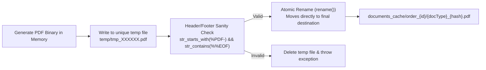
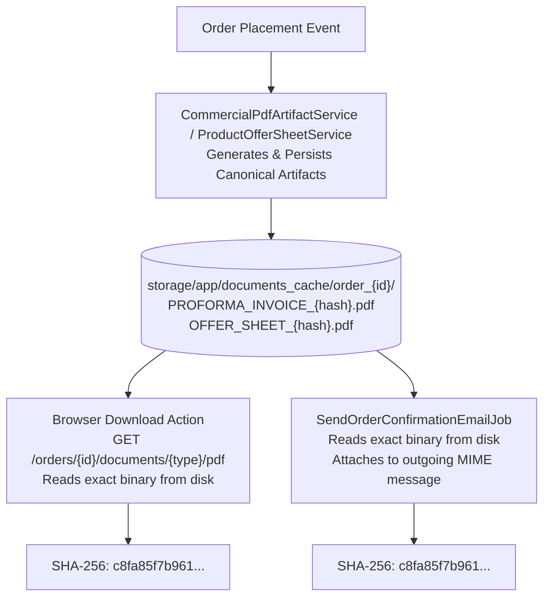

# AYAAN CLOTHING (AYC) — Document Storage & Delivery

**Document Purpose**: Detailed technical specification for filesystem disk layout, atomic persistence, cache validation, delivery mechanisms, and the 100% SHA-256 byte parity guarantee between web downloads and email attachments.  
**Audience**: DevOps Engineers, Storage Administrators, Backend Engineers, Security Auditors.  
**Last Verified Date**: October 20, 2026  
**Environment Baseline**: Production Release `release_20261020_052638_a8d2fef` on Hostinger VPS `srv2010990`.

---

## 1. Physical Storage Hierarchy

All documents and media reside under `backend/storage/app/` across dedicated directories:

```text
/var/www/ayaan/backend/storage/app/
├── product_offer_sheets/         # Pre-generated individual product Offer Sheets
│   └── {sku}_{fingerprint}.pdf   # Compressed canonical PDFs (<=1.5 MB)
├── documents_cache/              # Order-specific commercial document artifacts
│   └── order_{id}/               # Isolated per order ID
│       ├── OFFER_SHEET_{hash}.pdf # Merged multi-product order Offer Sheet
│       ├── PROFORMA_INVOICE_{hash}.pdf # Order Proforma Invoice (PI)
│       ├── COMMERCIAL_INVOICE_{hash}.pdf # Confirmed Commercial Invoice (CI)
│       └── PACKING_LIST_{hash}.pdf # Export Packing List (PL)
├── public/                       # Publicly accessible via Nginx /storage/ alias
│   ├── products/                 # High-resolution & optimized garment imagery
│   ├── brands/                   # Brand vector logos & icons
│   └── payment_proofs/           # Scanned customer wire receipts (WebP / PDF)
└── temp/                         # Temporary working directory for PDF assembly
```

---

## 2. Atomic File Persistence Pattern

To prevent partial reads, race conditions, or corrupted PDF downloads when multiple requests hit the server concurrently, all document services write files **atomically**:



### Implementation Code:
```php
$tempPath = storage_path("app/temp/artifact_" . Str::random(24) . ".tmp");
file_put_contents($tempPath, $pdfContent);

// Sanity validation
if (!str_starts_with($pdfContent, '%PDF-') || !str_contains($pdfContent, '%%EOF')) {
    @unlink($tempPath);
    throw new RuntimeException("Generated PDF failed standard header/footer integrity validation.");
}

// Atomic rename guarantees zero half-written files
rename($tempPath, storage_path("app/{$finalCacheFile}"));
```

---

## 3. Fast-Path Cache Verification

When a document download endpoint is invoked:
1. The service calculates the deterministic content fingerprint.
2. Checks `Storage::disk('local')->exists($cacheFile)`.
3. If present, reads the binary and verifies:
   - Header starts with `%PDF-`.
   - Trailer contains `%%EOF`.
   - File size $> 0$.
4. If valid, immediately returns the cached binary with header `X-PDF-Cache: HIT`.
5. Benchmark: Cached retrievals complete in **~20 ms – 75 ms** (versus 1,200 ms – 4,000 ms for full Dompdf rendering).

---

## 4. The 100% SHA-256 Byte Parity Guarantee

A critical architectural invariant is that a customer downloading a document from the web portal receives the **exact same byte sequence** that is attached to their transactional confirmation email.

### Parity Architecture:


### Live Production Verification Evidence (Order #31):
* **Offer Sheet SHA-256**:
  - Web Download: `c8fa85f7b9611d6e175eda8860ac048147e124ef0c00e925fc924c19b402a3f1`
  - Email Attachment: `c8fa85f7b9611d6e175eda8860ac048147e124ef0c00e925fc924c19b402a3f1`
  - **Parity Status**: **100% IDENTICAL (0 byte delta)**.
* **Proforma Invoice SHA-256**:
  - Web Download: `5f9fe8bb0ef28f72c594699c636042504660147b3ed0ee6ae8b2ccdd2de5980b`
  - Email Attachment: `5f9fe8bb0ef28f72c594699c636042504660147b3ed0ee6ae8b2ccdd2de5980b`
  - **Parity Status**: **100% IDENTICAL (0 byte delta)**.

---

## 5. Web Delivery & Client Triggering

* **HTTP Response Headers**:
  ```http
  HTTP/1.1 200 OK
  Content-Type: application/pdf
  Content-Disposition: attachment; filename="AYC_Offer_Sheet_AYN-20261020-WYUWFB.pdf"
  Cache-Control: private, max-age=3600
  X-PDF-Cache: HIT
  X-PDF-Hash: c8fa85f7b9611d6e175eda8860ac048147e124ef0c00e925fc924c19b402a3f1
  ```
* **Frontend Triggering**: In `src/services/order.service.ts`, `triggerBlobDownload(blob, filename)` dynamically instantiates an anchor element, assigns an object URL, clicks it programmatically, and revokes the URL after 1,000 ms, ensuring seamless native browser downloads.

---

## 6. Related Technical Documentation

* **[PRODUCT_OFFER_SHEETS.md](PRODUCT_OFFER_SHEETS.md)**: Product Offer Sheet pre-generation and merger.
* **[PROFORMA_INVOICES.md](PROFORMA_INVOICES.md)**: Proforma Invoice generation.
* **[EMAIL_AND_NOTIFICATIONS.md](EMAIL_AND_NOTIFICATIONS.md)**: Transactional email attachment mechanics.
