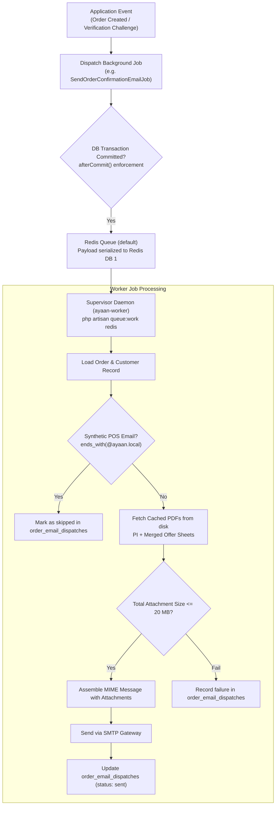

# AYAAN CLOTHING (AYC) — Transactional Email & Notifications

**Document Purpose**: Detailed technical specification for the transactional email engine, shared responsive templates, attachment assembly, queue worker dispatching, and diagnostic test commands.  
**Audience**: DevOps Engineers, Email Deliverability Specialists, Backend Engineers.  
**Last Verified Date**: October 20, 2026  
**Environment Baseline**: Production Release `release_20261020_052638_a8d2fef` on Hostinger VPS `srv2010990`.

---

## 1. Transactional Email Infrastructure

Transactional email delivery is handled by the Laravel Mail component running through asynchronous Redis queues:

* **Sender Display Name**: `AYAAN CLOTHING` (configured in `config/mail.php` via `MAIL_FROM_NAME`).
* **From Address**: `export@ayaanclothing.com` (or `orders@ayaanclothing.com` via `MAIL_FROM_ADDRESS`).
* **Queue Worker**: Asynchronous queue execution via `ayaan-worker` under Supervisor.
* **Delivery Driver**: Configured via `MAIL_MAILER` (SMTP in production, `log` in development/testing).



---

## 2. Supported Email Workflows

| Lifecycle Workflow | Trigger Event | Mailable / Notification Class | Attached Documents |
| :--- | :--- | :--- | :--- |
| **Account Email Verification** | Customer Registration / Google Sign-Up / Resend | `App\Notifications\CustomerVerifyEmailNotification` | None (Cryptographic Link) |
| **Password Reset** | Forgotten Password Form | `Illuminate\Auth\Notifications\ResetPassword` | None (Reset Link) |
| **Order Placement Confirmation** | Customer Order Checkout (`POST /orders`) | `App\Mail\CustomerOrderConfirmationMail` | **PI (`AYC_PI_*.pdf`) + Offer Sheets (`AYC_Offer_Sheet_*.pdf`)** |
| **Payment Proof Received** | Wire Receipt Uploaded (`POST /payment-proof`) | `App\Mail\CustomerPaymentProofReceivedMail` | None (Status Notification) |
| **Payment Confirmed / Shipment**| Admin Verifies Payment (`POST /verify-payment`) | `App\Mail\CustomerOrderConfirmedMail` | **Commercial Invoice (`AYC_CI_*.pdf`)** |

---

## 3. Order Confirmation Email & Attachment Parity

The order confirmation email (`SendOrderConfirmationEmailJob`) attaches official trade documentation so international buyers can immediately present documents to their bank:

### A. Attachment Assembly Pipeline
1. **Proforma Invoice**: Retrieved via `CommercialPdfArtifactService::getOrGenerateForOrder($order, 'PROFORMA_INVOICE', ...)`.
2. **Product Offer Sheets**: Retrieved via `ProductOfferSheetService::getOrGenerateForOrder($order)`.
3. **Payload Size Guard**: Calculates `$totalBytes = strlen($piBinary) + strlen($offerBinary)`.
   - Max allowable limit: **20 MB** (`config('order.emails.max_attachment_size_mb', 20)`).
   - If exceeded, records failure in `order_email_dispatches` and suppresses sending to prevent SMTP rejection.
4. **Byte Parity Guarantee**: Because these files are retrieved from the canonical cache, the attachments have **100% SHA-256 byte parity** with the documents downloaded from the customer portal.

### B. Audit Registry (`order_email_dispatches` table)
Every order confirmation dispatch records:
* `order_id`: Associated order reference.
* `recipient_email`: Destination email address.
* `status`: `pending`, `sent`, `failed`, `skipped`.
* `attachments_summary`: JSON array of attached filenames, MIME types, and exact byte counts.
* `error_message`: Detailed exception logging if SMTP failure occurs.

---

## 4. Shared Responsive Layout & Visual Decisions

All transactional emails share a unified, responsive Blade template at `backend/resources/views/emails/layout/app.blade.php`:
* **Container Width**: Widened 640px maximum container for optimal desktop and tablet readability.
* **Header Branding**: Centered AYAAN CLOTHING export wordmark with dark/light mode background styling.
* **Typography**: Highly legible email-safe sans-serif font stack with explicit high-contrast colors (`#0f172a` text on `#ffffff` card).
* **Footer Notice**: Authoritative business exporter credentials:
  ```text
  AYAAN CLOTHING — Readymade Garments Manufacturer & Global Exporter
  Dhaka, Bangladesh | WhatsApp: +880 1819-000000 | export@ayaanclothing.com
  ```

---

## 5. Diagnostic Commands for Verification

To safely verify SMTP deliverability without placing live orders:

```bash
# 1. Test Email Verification Challenge Delivery
php artisan ayaan:test-verification-email engineer@example.com

# 2. Test Order Confirmation Delivery with Real Attachments
php artisan ayaan:test-order-email 31 engineer@example.com
```

Both commands bypass live customer records, simulate full PDF attachment assembly, issue diagnostic console logs, and confirm delivery.

---

## 6. Related Technical Documentation

* **[AUTHENTICATION_AND_VERIFICATION.md](AUTHENTICATION_AND_VERIFICATION.md)**: Email verification challenge token architecture.
* **[DOCUMENT_STORAGE_AND_DELIVERY.md](DOCUMENT_STORAGE_AND_DELIVERY.md)**: 100% SHA-256 byte parity guarantees.
* **[QUEUES_AND_BACKGROUND_JOBS.md](QUEUES_AND_BACKGROUND_JOBS.md)**: Supervisor queue management.
