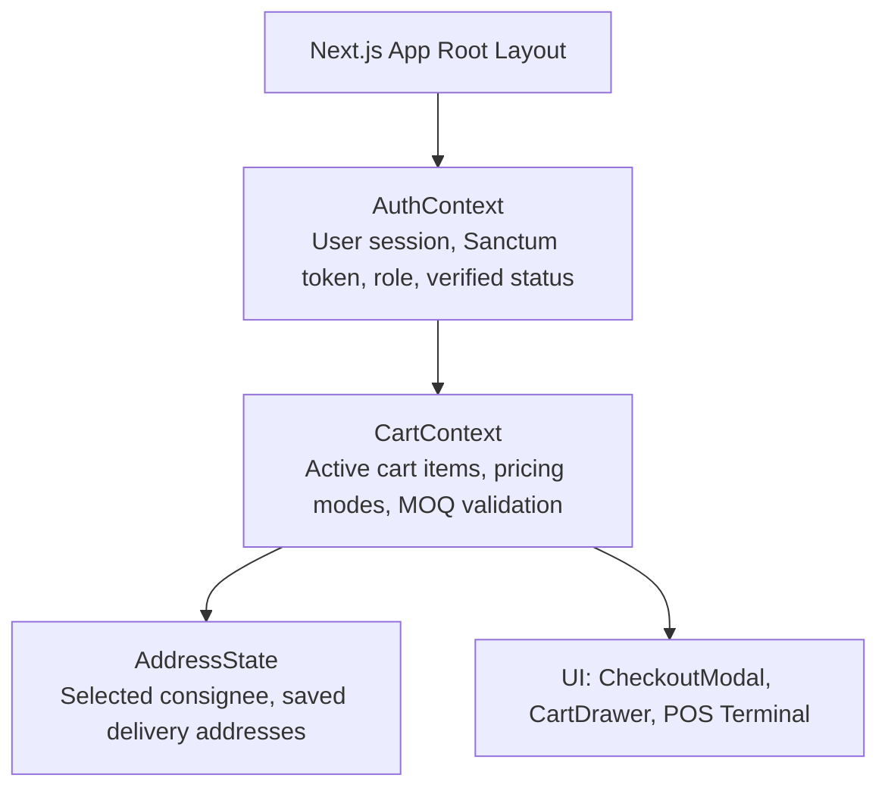

# AYAAN CLOTHING (AYC) — Frontend Architecture

**Document Purpose**: Detailed technical specification for the Next.js 16 frontend application, App Router architecture, UI component hierarchy, design token system, state management, and API client layer.  
**Audience**: Frontend Engineers, Full-Stack Developers, UI/UX Designers.  
**Last Verified Date**: October 20, 2026  
**Environment Baseline**: Production Release `release_20261020_052638_a8d2fef` (Next.js 16.3.2, Turbopack, React 19).

---

## 1. Technology Stack & Framework Core

* **Framework**: Next.js 16 (App Router) with Turbopack compilation.
* **Language**: TypeScript 5.x (Strict mode enforced).
* **UI Library**: React 19.
* **Styling**: Tailwind CSS 3.4 with custom enterprise design tokens.
* **Iconography**: Lucide React.
* **Process Supervisions**: Managed under PM2 as two isolated instances on localhost:
  - `ayaan-customer`: Port 3000 (Storefront, Cart, Checkout, Customer Dashboard)
  - `ayaan-admin`: Port 3001 (Admin Back-Office, POS Terminal, Merchandising)

---

## 2. Directory Structure & Route Hierarchy

The application source code lives entirely under `src/`:

```text
src/
├── app/                          # Next.js App Router route segments
│   ├── (storefront)/             # Public customer browsing routes
│   │   ├── page.tsx              # Storefront Homepage
│   │   ├── products/             # Product catalog browse & slug pages
│   │   ├── cart/                 # Full-page shopping cart view
│   │   ├── checkout/             # Standalone checkout redirect page
│   │   ├── rfq/                  # Custom manufacturing inquiry submission
│   │   └── compliance/           # Factory compliance & certification page
│   ├── auth/                     # Authentication callback & verification routes
│   │   ├── callback/             # OAuth token exchange & session storage
│   │   └── verify-email/         # Cryptographic email verification landing
│   ├── dashboard/                # Customer self-service portal (Customer role)
│   │   ├── orders/               # Order history & live tracking
│   │   ├── quotes/               # Submitted RFQs & active quotations
│   │   ├── documents/            # Commercial Document Center (PI, Offer Sheets)
│   │   └── settings/             # Profile, company info & address book
│   └── ayc/                      # Administrative Management Portal (Admin role)
│       ├── dashboard/            # High-level KPIs & sales analytics
│       ├── products/             # Catalog management, inventory & pricing
│       ├── orders/               # Order fulfillment & wire payment audit
│       ├── pos/                  # Point-of-Sale terminal
│       ├── rfq/                  # RFQ processing & quotation builder
│       └── settings/             # Global store configurations & banners
├── components/                   # Reusable React components
│   ├── account/                  # Address forms, profile cards
│   ├── admin/                    # POS controls, document viewers, data tables
│   ├── auth/                     # Login modal, signup forms, Google button
│   ├── cart/                     # CartDrawer, CheckoutModal, PriceBreakdown
│   ├── common/                   # Honeypots, badges, status pills, modals
│   ├── layout/                   # Header, MegaMenu, Footer, MobileNav
│   └── products/                 # ProductCard, VolumePricingTable, ImageGallery
├── config/                       # Business profile & environment configurations
├── hooks/                        # Custom React hooks (useMediaQuery, useDebounce)
├── lib/                          # Utility libraries, formatters, and contexts
│   ├── AuthContext.tsx           # Customer & Admin authentication state
│   ├── CartContext.tsx           # Shopping cart synchronization & persistence
│   ├── formatters.ts             # Currency, date, and dimension formatting
│   └── pdf-generator.ts          # Client-side fallback generators (when offline)
├── services/                     # Typed API client services
│   ├── api-client.ts             # Central Axios/Fetch HTTP client abstraction
│   ├── order.service.ts          # Order creation, tracking & PDF download
│   ├── product.service.ts        # Catalog browsing, specs & Offer Sheets
│   └── auth.service.ts           # Authentication & token management
└── types/                        # Global TypeScript interface definitions
```

---

## 3. Rendering Strategy: Server vs. Client Components

The platform strategically balances Server Components (RSC) and Client Components (`"use client"`):

### Server Components (Default)
Used for fast initial rendering, search engine crawlability (SEO), and minimal JavaScript client payloads:
* Product Detail Pages (`src/app/products/[slug]/page.tsx`): Pre-renders technical specs, packaging details, and dynamic Open Graph tags.
* Homepage (`src/app/page.tsx`): Pre-renders hero banners, featured categories, and trending products.
* Static Legal Pages: Privacy policy, terms of service, and compliance credentials.

### Client Components (`"use client"`)
Used wherever user interaction, local browser state, or authenticated session tokens are required:
* `CheckoutModal.tsx`: Manages interactive checkout wizard, dynamic address creation, shipping quote selection, and the Order Placed confirmation state.
* `CartDrawer.tsx` & `CartContext.tsx`: Tracks shopping bag items, MOQ calculations, and quantity increments in `localStorage`.
* `POS Terminal` (`src/app/ayc/pos/page.tsx`): High-speed barcode scanning, line item adjustments, and receipt generation.

---

## 4. UI Design System & Token Architecture

The design system is built with Tailwind CSS using semantic design tokens defined in `src/app/globals.css`:

```css
:root {
  --background: 0 0% 100%;
  --foreground: 222.2 84% 4.9%;
  --card: 0 0% 100%;
  --card-foreground: 222.2 84% 4.9%;
  --popover: 0 0% 100%;
  --popover-foreground: 222.2 84% 4.9%;
  --primary: 221.2 83.2% 53.3%;
  --primary-foreground: 210 40% 98%;
  --secondary: 210 40% 96.1%;
  --secondary-foreground: 222.2 47.4% 11.2%;
  --muted: 210 40% 96.1%;
  --muted-foreground: 215.4 16.3% 46.9%;
  --accent: 210 40% 96.1%;
  --accent-foreground: 222.2 47.4% 11.2%;
  --destructive: 0 84.2% 60.2%;
  --destructive-foreground: 210 40% 98%;
  --border: 214.3 31.8% 91.4%;
  --input: 214.3 31.8% 91.4%;
  --ring: 221.2 83.2% 53.3%;
  --radius: 0.75rem;
}
```

### Visual Standards
* **Typography**: Clean, highly readable sans-serif typography (Inter & Outfit) with dedicated monospace styling for SKUs, order references, and monetary values.
* **Dark / Light Modes**: Full dual-theme support using Tailwind's `class` strategy.
* **Component Encapsulation**: Interactive cards, buttons, badges, and modals use predefined semantic classes (`bg-card`, `bg-secondary/50`, `border-border`, `text-primary`) ensuring uniform visual hierarchy.

---

## 5. State Management & Context Architecture

Global state is partitioned into specialized React Contexts:



### 1. `AuthContext.tsx`
* Stores authenticated customer or administrator profile.
* Manages Sanctum Bearer token in secure cookie / memory.
* Tracks `isEmailVerified` flag: Immediately signals to checkout components whether the customer is authorized to place orders.
* Provides `login()`, `logout()`, `verifyEmail()`, and `refreshUser()` actions.

### 2. `CartContext.tsx`
* Manages local and server-synchronized cart line items.
* Enforces single-order compatibility: Automatically warns if a buyer attempts to add Pre-Order garments to a Ready-Stock cart.
* Calculates subtotal, volume discount reductions, and total unit counts in real time.

---

## 6. Typed API Client Layer (`apiClient`)

Frontend HTTP communication is centralized in `src/services/api-client.ts`:

```typescript
// Core download helper for commercial PDFs
async downloadBlob(endpoint: string, options?: RequestInit): Promise<{ blob: Blob; filename: string }> {
  const token = this.getToken();
  const headers = new Headers(options?.headers || {});
  if (token) {
    headers.set("Authorization", `Bearer ${token}`);
  }
  headers.set("Accept", "application/pdf");

  const res = await fetch(`${this.baseUrl}${endpoint}`, {
    ...options,
    headers,
  });

  if (!res.ok) {
    throw new Error(`Failed downloading document: HTTP ${res.status}`);
  }

  // Extract canonical filename from Content-Disposition header
  const disposition = res.headers.get("content-disposition") || "";
  const filenameMatch = disposition.match(/filename="?([^";]+)"?/);
  const filename = filenameMatch ? filenameMatch[1] : "document.pdf";
  const blob = await res.blob();

  return { blob, filename };
}
```

### Key Client Features
* **Automatic Bearer Token Injection**: Seamlessly attaches authenticated customer Sanctum tokens.
* **Blob Download Trigger**: `triggerBlobDownload(blob, filename)` automatically constructs an object URL and triggers a native browser download without opening blank tabs.
* **Error Normalization**: Maps backend validation errors (`422`), authentication errors (`401`), and verification barriers (`403 EMAIL_VERIFICATION_REQUIRED`) into user-friendly toast notifications.

---

## 7. Related Documentation

* **[AUTHENTICATION_AND_VERIFICATION.md](AUTHENTICATION_AND_VERIFICATION.md)**: Frontend login and email verification handling.
* **[ORDERS_AND_CHECKOUT.md](ORDERS_AND_CHECKOUT.md)**: Checkout modal component architecture.
* **[PRODUCT_OFFER_SHEETS.md](PRODUCT_OFFER_SHEETS.md)**: Product Offer Sheet download flows.
