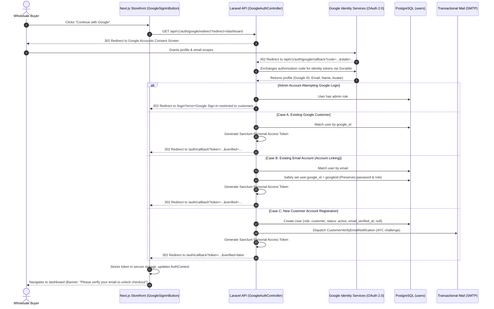

# AYAAN CLOTHING (AYC) — Google OAuth Architecture

**Document Purpose**: Detailed technical specification for the Google Sign-In integration via Laravel Socialite, account creation and linking rules, administrative privilege isolation, and email verification boundary enforcement.  
**Audience**: Security Auditors, Backend Engineers, Frontend Developers.  
**Last Verified Date**: October 20, 2026  
**Environment Baseline**: Production Release `release_20261020_052638_a8d2fef` on Hostinger VPS `srv2010990`.

---

## 1. Architectural Scope & Purpose

Google Sign-In is provided as a friction-reducing convenience for **international wholesale buyers (customers)** to authenticate, track quotations, and manage wishlists.

To uphold enterprise security and compliance standards, two strict boundaries govern Google OAuth:

1. **Customer-Only Privilege Barrier**: Administrative users (`admin` role) are **strictly forbidden** from authenticating through Google. Administrators must use username/email and strong password authentication via the dedicated admin portal.
2. **Mandatory AYC Email Verification**: Authenticating via Google confirms the user's identity with Google, but does **NOT** grant the user verified status on AYAAN CLOTHING. All newly created Google customer accounts must complete AYC's own email verification challenge before placing orders.

---

## 2. OAuth Execution Flow



---

## 3. Account Resolution & Linking Logic

All callback logic is encapsulated in `App\Http\Controllers\Api\V1\GoogleAuthController::callback`:

### Case A: Existing Google Identity
* Query: `User::where('google_id', $googleId)->first()`
* Checks:
  - If `$user->isAdmin()`, returns HTTP 403 error: *"Google Sign-In is restricted to customer accounts only."*
  - If `$user->status === 'inactive'`, returns HTTP 403 deactivated account error.
* Updates: Updates `avatar_url` if previously empty.
* Issues: Sanctum bearer token with user's existing verification status.

### Case B: Linking to Existing Email Account
* Query: `User::where('email', $email)->first()`
* Safeguards:
  - If the existing account is an administrator, the link attempt is **rejected** with HTTP 403.
  - **Does NOT modify** the user's password hash, role, or permissions.
  - **Does NOT auto-verify** the account. If the pre-existing account was unverified, it remains unverified.
* Sets `user.google_id = $googleId` and saves.

### Case C: New Account Registration
* Creates a new customer record:
  ```php
  $user = User::create([
      'name' => $name,
      'email' => $email,
      'google_id' => $googleId,
      'password' => Hash::make(Str::random(40)),
      'role' => User::ROLE_CUSTOMER,
      'status' => 'active',
      'avatar_url' => $avatar,
      'email_verified_at' => null, // Explicitly UNVERIFIED
  ]);
  ```
* Dispatches branded verification challenge:
  ```php
  app(EmailVerificationService::class)->sendVerificationNotification($user);
  ```
* Returns Sanctum token with `verified: false`.

---

## 4. Configuration Reference

Google OAuth relies on the following environment variables defined in `config/services.php`:

| Environment Variable | Required | Description & Format |
| :--- | :---: | :--- |
| `GOOGLE_CLIENT_ID` | Yes | Google Cloud Console OAuth 2.0 Web Client ID (`xxx.apps.googleusercontent.com`). |
| `GOOGLE_CLIENT_SECRET` | Yes | Google Cloud Console OAuth 2.0 Client Secret (Never commit to repo). |
| `GOOGLE_REDIRECT_URI` | Yes | Fully qualified callback URL (`https://ayaanclothing.com/api/v1/auth/google/callback`). |

### Authorized URIs in Google Cloud Console
* **Authorized JavaScript Origins**:
  - `https://ayaanclothing.com`
  - `https://www.ayaanclothing.com`
* **Authorized Redirect URIs**:
  - `https://ayaanclothing.com/api/v1/auth/google/callback`

---

## 5. Security & Risk Analysis

| Threat / Risk | Implemented Defense Mechanism |
| :--- | :--- |
| **Admin Privilege Escalation via Google** | Controller strictly blocks Google login for any user with `role === 'admin'` or `$user->isAdmin()`. |
| **Bypassing Email Verification via Gmail** | All Google accounts are created with `email_verified_at = null` and must complete AYC's own verification flow. |
| **CSRF in OAuth Handshake** | Socialite validates cryptographic OAuth `state` parameter on callback. |
| **Account Takeover via OAuth Link** | Only links if incoming Google identity email matches existing customer account exactly; admins cannot be linked. |
| **User Cancellation / Denied Consent** | Handled gracefully: detects `error=access_denied` and redirects to `/login` with an informational notice. |

---

## 6. Associated Automated Test Coverage

* `backend/tests/Feature/Auth/GoogleAuthTest.php`: Tests Socialite driver mocking, state validation, and identity extraction.
* `backend/tests/Feature/Auth/GoogleCustomerAuthenticationWorkflowTest.php`: Tests admin boundary blocking, account creation, account linking, and unverified state enforcement.
