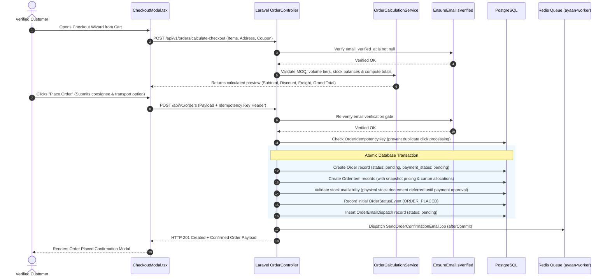
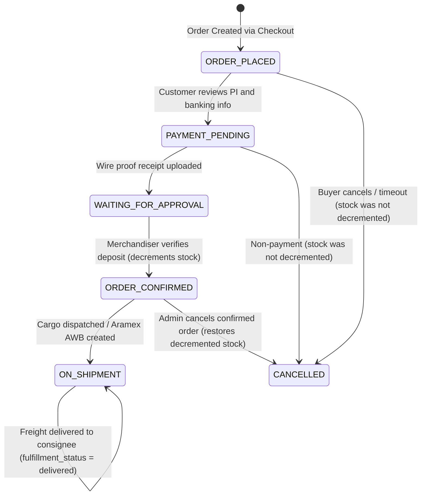

# AYAAN CLOTHING (AYC) — Orders & Checkout Pipeline

**Document Purpose**: Detailed technical specification for the checkout pipeline, idempotency locks, order state machine, stock deduction semantics, and the Order Placed confirmation modal.  
**Audience**: Backend Engineers, Frontend Developers, E-Commerce Operations, QA Testers.  
**Last Verified Date**: October 20, 2026  
**Environment Baseline**: Production Release `release_20261020_052638_a8d2fef` on Hostinger VPS `srv2010990`.

---

## 1. End-to-End Checkout Pipeline

The checkout pipeline enforces strict B2B business rules and security invariants before committing order records:



---

## 2. Mandatory Verification & Validation Gates

Before an order record is persisted, five validation gates must pass:

1. **Authentication Gate**: User must be authenticated with role `customer`. Admins cannot check out via the storefront.
2. **Email Verification Gate**: The customer must have verified their email address via AYC's challenge link (`$user->hasVerifiedEmail()`). Rejects unverified buyers with HTTP 403 `EMAIL_VERIFICATION_REQUIRED`.
3. **Cart Compatibility Gate**: Ready-Stock items and Pre-Order garments cannot be mixed in the same order. Rejects with HTTP 422 if detected.
4. **MOQ & Package Assortment Gate**: Every line item must satisfy the minimum order quantity configured for the product.
5. **Idempotency Gate**: Every checkout submission must include a unique idempotency key. Rapid duplicate clicks return the existing order payload without creating duplicate database rows.

---

## 3. Authoritative Order State Machine

Order lifecycle is tracked across four distinct status dimensions:



### State Dimensions & Field Mappings:
| Dimension | Column / Attribute | Valid Production Values | Description |
| :--- | :--- | :--- | :--- |
| **System Status** | `status` (DB column) | `pending`, `order_placed`, `confirmed`, `processing`, `shipped`, `delivered`, `cancelled`, `refunded` | Primary administrative lifecycle state. |
| **Customer Status** | `customer_status` (Eloquent accessor) | `ORDER_PLACED`, `PAYMENT_PENDING`, `WAITING_FOR_APPROVAL`, `ORDER_CONFIRMED`, `ON_SHIPMENT` | Buyer-facing status computed from `status`, `payment_status`, and carrier data. Freight delivery maps into `ON_SHIPMENT`. |
| **Payment Status** | `payment_status` (DB column) | `pending`, `payment_submitted`, `paid`, `failed`, `refunded` | Financial settlement state (default: `pending`). |
| **Fulfillment Status**| `fulfillment_status` (DB column)| `unfulfilled`, `processing`, `shipped`, `delivered`, `returned`, `partially_shipped` | Warehouse freight dispatch state. |

---

## 4. The Order Placed Confirmation Modal

Upon successful checkout, `CheckoutModal.tsx` switches seamlessly to the approved **Order Placed** confirmation view:

```text
┌────────────────────────────────────────────────────────────────────────┐
│  ✔ Order Placed   [PAYMENT PENDING]          Ref: #AYN-20261020-WYUWFB │
├────────────────────────────────────────────────────────────────────────┤
│  Your order has been placed and is awaiting payment. Open your order   │
│  to enter payment details or upload your wire transfer proof.          │
│                                                                        │
│  Consignee: Global Retail Ltd (John Smith)                             │
│  Destination: Hamburg, Germany (Destination Port: DEHAM)               │
│  Merchandise Value (3 items): $3,850.00 USD                            │
│  Freight Estimate: $297.50 USD                                         │
│  Grand Total: $4,147.50 USD                                            │
│                                                                        │
│  COMMERCIAL DOCUMENTS                                                  │
│  ┌──────────────────────────────────────────────────────────────────┐  │
│  │ 📄 Proforma Invoice (PI)                             [Download]  │  │
│  └──────────────────────────────────────────────────────────────────┘  │
│  ┌──────────────────────────────────────────────────────────────────┐  │
│  │ 📄 Product Offer Sheets                              [Download]  │  │
│  └──────────────────────────────────────────────────────────────────┘  │
├────────────────────────────────────────────────────────────────────────┤
│  [ Contact on WhatsApp ]         [ View Order & Submit Payment -> ]    │
│  └──────────────────────────────────────────────────────────────────┘  │
└────────────────────────────────────────────────────────────────────────┘
```

### Document Integration Architecture:
* **Proforma Invoice (PI)**: Triggered via `handleDownloadProformaInvoice()`. Calls `orderServiceClient.downloadOrderCommercialDocumentPdf(order.id, 'PROFORMA_INVOICE')` first; if the backend request fails, the catch block executes client-side `downloadProformaInvoicePDF(confirmedOrder)` as an emergency fallback.
* **Product Offer Sheets**: Triggered via `handleDownloadOfferSheets()`. Calls `orderServiceClient.downloadOrderCommercialDocumentPdf(order.id, 'OFFER_SHEET')`.
* **Zero Client Fallback Rule for Offer Sheets**: Product Offer Sheets strictly download the canonical, pre-generated, compressed, and merged backend PDF. Client-side `jsPDF` re-rendering has been eliminated to ensure zero document variance. If backend generation fails, the UI displays a retry error banner rather than running client jsPDF.

---

## 5. Related Technical Documentation

* **[AUTHENTICATION_AND_VERIFICATION.md](AUTHENTICATION_AND_VERIFICATION.md)**: Verification gate enforcement during checkout.
* **[PRODUCT_OFFER_SHEETS.md](PRODUCT_OFFER_SHEETS.md)**: Pre-generation and multi-product merging mechanics.
* **[PAYMENTS_AND_INVENTORY.md](PAYMENTS_AND_INVENTORY.md)**: Wire transfer proof uploads and stock adjustments.
