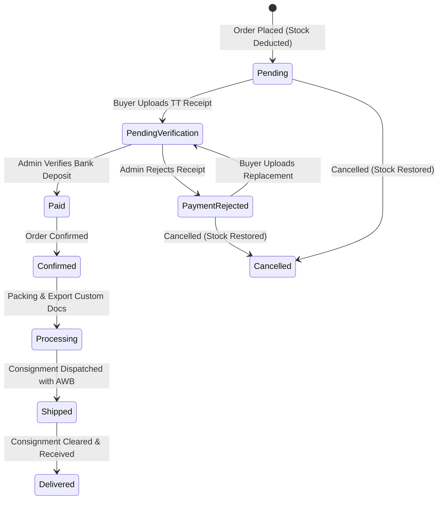

# Orders, Payments & Receipts — AYAAN CLOTHING (AYC)

> [!WARNING]
> **Historical Predecessor Document — Explicitly Superseded:**
> This document is preserved solely for historical context and architectural evolution records. The canonical, actively maintained technical specifications are documented in:
> - **[ORDERS_AND_CHECKOUT.md](ORDERS_AND_CHECKOUT.md)** (Canonical order state machine, computed `customer_status` mapping, checkout invariants)
> - **[PAYMENTS_AND_INVENTORY.md](PAYMENTS_AND_INVENTORY.md)** (Verified inventory deduction rules, payment verification workflows, WebP receipt storage)
> - **[DATABASE.md](DATABASE.md)** (Exact PostgreSQL schema definitions, `fulfillment_status`, table constraints)
> 
> **Explicitly Superseded Historical Claims in This Document**:
> 1. *Stock Deduction Timing*: Stock is **not** deducted at initial order placement (`OrderController::store`). Physical stock is deducted across `product_variants`, `products`, and `inventories` only when an administrator confirms payment (`AdminOrderController::reviewPaymentProof`) or at the counter during POS checkout (`AdminPosSaleService`).
> 2. *Cancellation Restoration*: Stock is restored upon cancellation **only if** `inventory_decremented === true` on the order; unpaid or non-decremented cancelled orders do not trigger stock restoration.
> 3. *Database Enums*: The physical database columns are `orders.status`, `orders.payment_status` (default: `pending`), and `orders.fulfillment_status`. The state labels `PendingVerification` and `PaymentRejected` were early architectural placeholders; actual payment statuses are `payment_submitted` and `failed`.
> 4. *Permissions*: Administrative review uses `permission:payment.receipt.verify` and `permission:payment.receipt.reject` (legacy `orders.verify_payment` does not exist).

## 1. Canonical Order State Machine

The order lifecycle coordinates wholesale commercial commitments, payment verification, and export logistics. Orders progress through three decoupled status dimensions:



---

## 2. Order Status Dimensions & Definitions

| Status Field | Allowed Values | Definition & State Transitions |
| :--- | :--- | :--- |
| **`status`** | `pending` | Initial state upon checkout; stock deducted; awaiting payment. |
| | `confirmed` | Payment approved or authorized; order entered into factory queue. |
| | `processing` | Cartons packed, labeled, and export customs documentation assembled. |
| | `shipped` | Consignment in transit with assigned carrier and AWB tracking number. |
| | `delivered` | Delivery completed at destination airport, port, or consignee address. |
| | `cancelled` | Order terminated; inventory restored immediately to physical stock. |
| **`payment_status`** | `pending` | No payment proof submitted. |
| | `pending_verification`| Wire transfer receipt uploaded by buyer; awaiting admin review. |
| | `paid` | Deposit verified against company bank account; locked against edits. |
| | `payment_rejected` | Uploaded receipt rejected; buyer prompted to upload replacement. |
| **`fulfillment_status`**| `unfulfilled` | Goods not yet dispatched. |
| | `fulfilled` | Goods handed over to freight forwarder with bill of lading / AWB. |

---

## 3. Order Item Snapshotting Invariant

When an order is created, item attributes are frozen permanently in `order_items`:
* **`product_name`**, **`product_slug`**, **`sku`**: Preserves catalog state at time of purchase.
* **`unit_price`**: Locked wholesale price after applying the achieved volume tier discount.
* **`buying_price_at_sale`**: Internal purchase cost snapshot allowing exact gross margin reporting even if factory sourcing costs change later.
* **`package_breakdown`**: JSONB snapshot of size/color assortment ratios.

*Removal of Customer Reorder*: In previous releases, a customer "Reorder" button allowed duplicating past orders. This was intentionally removed in commit `3fd8150` because garment surplus stock lots are finite, and wholesale pricing tiers fluctuate between production batches.

---

## 4. Payment Submission & Verification Pipeline

Because wholesale apparel orders typically involve high monetary values ($2,000–$50,000+ USD) settled via international bank telegraphic transfers (T/T), automated card charging is supplemented by an authoritative manual verification workflow:

```mermaid
sequenceDiagram
    autonumber
    actor Buyer as International Buyer
    participant Front as Next.js Dashboard
    participant API as Laravel OrderService
    actor Admin as AYC Finance Admin
    participant Bank as The City Bank Ltd

    Buyer->>Front: Uploads Wire Transfer Slip
    Front->>API: POST /orders/{id}/payment-proof (Multipart Form)
    API->>API: Validate MIME, 10MB limit, transcode to WebP
    API->>API: Update payment_status = pending_verification
    API-->>Front: 200 OK (Receipt Stored)
    Admin->>API: Inspects Receipt in /ayc/orders
    Admin->>Bank: Cross-checks SWIFT Reference & Amount
    alt Deposit Confirmed
        Admin->>API: POST /orders/{id}/payment/verify
        API->>API: Update payment_status = paid, status = confirmed
        API->>API: Record event in order_status_events
        API-->>Buyer: Notifies Order Confirmed & Generates PI/CI
    else Deposit Invalid / Unmatched
        Admin->>API: POST /orders/{id}/payment/reject (Reason provided)
        API->>API: Update payment_status = payment_rejected
        API-->>Buyer: Notifies Rejection; Unlocks Replacement
    end
```

---

## 5. Receipt Upload Security & Transcoding Rules

The receipt upload endpoint (`POST /api/v1/orders/{id}/payment-proof`) enforces defensive file handling:

1. **Size Boundary**: Exactly **10 MB** (10,485,760 bytes) ceiling.
2. **Accepted MIME Types**: `image/jpeg`, `image/png`, `image/webp`. PDFs or scriptable files are rejected.
3. **WebP Transcoding**:
   * Uses PHP GD/Imagick to process uploaded binary streams in memory.
   * Transcodes input images to WebP format, achieving ~75% reduction in file size while preserving legibility of bank stamps, account numbers, and SWIFT references.
   * Strips all EXIF camera and GPS metadata.
4. **Filename Sanitization**:
   * Stored under `storage/app/public/receipts/{uuid}.webp`.
   * Public URL served via `/storage/receipts/{uuid}.webp`.

---

## 6. Receipt Replacement Safety Policy

To prevent fraud and maintain financial audit integrity:

* **When Replacement is Allowed**:
  * An order with `payment_status = pending` or `payment_status = payment_rejected` permits the buyer to upload a new receipt. The previous file is replaced safely, and the status updates to `pending_verification`.
* **When Replacement is Locked**:
  * As soon as an administrator verifies the payment and the order transitions to `payment_status = paid`, the receipt upload endpoint returns `HTTP 403 Forbidden` (`"Cannot replace payment receipt for an order that is already verified and paid."`).
  * Verified financial proofs cannot be overwritten by customer requests.

---

## 7. Inventory Safety & Audit Event Trail

* **Zero Ghost Inventory**: Physical stock is deducted at the exact instant an order is placed. If a buyer fails to provide payment proof within 72 hours or the order is explicitly cancelled, an administrator cancels the order, restoring the inventory.
* **Immutable Audit Trail (`order_status_events`)**:
  * Every status change records: `order_id`, `event_type`, `message`, `operator_id` (admin user ID or NULL for system actions), and UTC `created_at`.
  * Audit logs are strictly append-only and cannot be altered or deleted.
