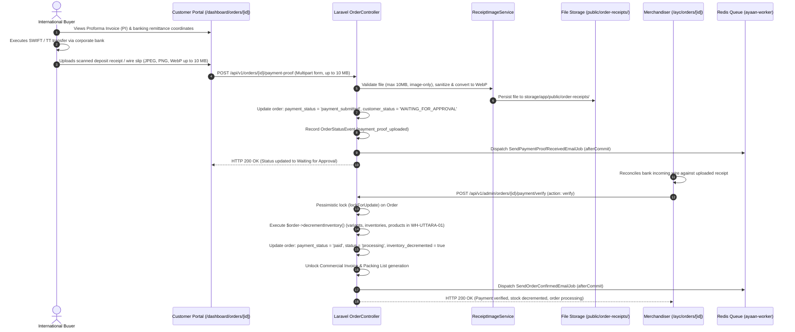

# AYAAN CLOTHING (AYC) — Payments & Inventory Architecture

**Document Purpose**: Detailed technical specification for B2B payment methods, wire transfer proof uploads, administrative payment verification, and atomic inventory deduction/restoration mechanics.  
**Audience**: Financial Controllers, Backend Engineers, Inventory Managers, Operations Auditors.  
**Last Verified Date**: October 20, 2026  
**Environment Baseline**: Production Release `release_20261020_052638_a8d2fef` on Hostinger VPS `srv2010990`.

---

## 1. Supported B2B Payment Methods

Because AYAAN CLOTHING deals in high-value international garment exports (ranging from several thousand to hundreds of thousands of USD per order), commercial settlement uses standard international banking instruments:

1. **Telegraphic Transfer (T/T / SWIFT Wire)**: Primary settlement method for wholesale ready-stock orders. Customer instructs their commercial bank to wire funds directly to AYC's export banking account.
2. **Irrevocable Letter of Credit (L/C at Sight)**: Used for high-volume container exports and bespoke RFQ manufacturing runs.
3. **Showroom Cash / Local Card**: Restricted strictly to in-person transactions executed through the `/ayc/pos` terminal at the physical warehouse showroom.

---

## 2. Bank Wire Remittance Workflow



---

## 3. Payment Proof Upload Implementation Details

* **Endpoint**: `POST /api/v1/orders/{id}/payment-proof`
* **Nginx Configuration**: Configured with a dedicated `client_max_body_size 20M;` and `req_api_upload` rate limit zone (max 3 burst per IP).
* **Accepted Formats**: `jpg`, `jpeg`, `png`, `webp` (strict image MIME validation). **Note: PDFs are not accepted by `ReceiptImageService` and throw validation errors**.
* **Processing Service (`App\Services\ReceiptImageService`)**:
  - Enforces strict 10 MB limit (`MAX_SOURCE_BYTES = 10485760`).
  - Validates MIME type and magic byte headers using GD driver.
  - Dimension safety checks: min 10px, max 8000px bounds.
  - Converts image to optimized WebP format (`WEBP_QUALITY = 85`).
  - Generates safe unique filename: `receipt_{cleanOrder}_{uniqueToken}_{timestamp}.webp`.
  - Persists to public disk: `storage/app/public/order-receipts/`.
  - Static access: Served directly by Nginx at `https://ayaanclothing.com/storage/order-receipts/{filename}`.

---

## 4. Administrative Verification & Gate Unlocking

Payment verification is executed via administrative endpoints protected by granular RBAC permissions:

* **Review Endpoints**:
  - `POST /api/v1/admin/orders/{id}/payment/verify` (`permission:payment.receipt.verify`): Confirms wire deposit, executes `$order->decrementInventory()`, updates `payment_status` to `'paid'`, and sets `status` to `'processing'` (or preserves confirmed status).
  - `POST /api/v1/admin/orders/{id}/payment/reject` (`permission:payment.receipt.reject`): Rejects receipt with notes, updates `payment_status` to `'failed'`, updates `payments.status` to `'failed'`. The order remains open so the buyer can re-upload proof.
  - `POST /api/v1/admin/orders/{id}/payment-proof/review` (`permission:payment.receipt.verify`): Consolidated review handler supporting `action: verify` and `action: reject`.
* **Gated Document Unlocking**:
  - **Before Verification**: Customer can only download `OFFER_SHEET` and `PROFORMA_INVOICE`. Attempts to download `COMMERCIAL_INVOICE` or `PACKING_LIST` return HTTP 403:
    ```json
    {
      "success": false,
      "is_gated": true,
      "message": "Commercial Invoice is generated exclusively upon payment confirmation."
    }
    ```
  - **Upon Verification**: `orders.payment_status` becomes `'paid'`, unlocking Commercial Invoice and Packing List endpoints for export customs clearing.

---

## 5. Inventory & Stock Mutation Mechanics

### A. Stock Deduction Timing (Verified Truth: Evidence `INV-001`)
* **Initial Web Checkout**: `OrderController::store` does **NOT** decrement physical inventory. The order is committed with `status: 'pending'` and `payment_status: 'pending'`. Stock availability is verified with pessimistic locks, but physical deduction is deferred until financial settlement.
* **Payment Approval Deduction**: When an administrator approves payment via `AdminOrderController::verifyPayment`, the system executes `$order->decrementInventory()`.
* **Showroom POS Deduction**: When a cashier completes a sale via `AdminPosSaleService`, physical stock is decremented immediately because payment is collected at the counter.

### B. Two-Pass Atomic Stock Deduction Flow
Executed inside a pessimistic database transaction (`lockForUpdate`):
1. **Pass 1 (Availability Validation)**: Checks stock across all line items (variants, package breakdowns, or base products). If any SKU has insufficient quantity, throws a `RuntimeException` to roll back cleanly without partial deductions.
2. **Pass 2 (Atomic Deduction)**:
   - Decrements variant stock: `ProductVariant::decrement('stock', $qty)`.
   - Decrements warehouse stock: `Inventory::decrement('quantity', $qty)` targeting canonical warehouse `WH-UTTARA-01` (`Uttara Warehouse`).
   - Decrements aggregate product stock: `Product::decrement('stock', $qty)`.
   - Records audit trail: Inserts `admin_inventory_adjustments` row with operator ID, previous quantity, deducted amount, and resulting quantity.
   - Sets order flag: `$order->payment_details['inventory_decremented'] = true`.

*(Note: The database field `reserved_quantity` was removed and does not exist in production schema. Inventory is managed directly via `quantity`).*

### C. Stock Restoration on Order Cancellation
* Triggered in `AdminOrderController::updateStatus`:
  - When an order transitions to `status: 'cancelled'`, the system checks:
    ```php
    if (!empty($details['inventory_decremented'])) {
        // Restores stock across variants, products, and inventories
        // Logs restoration in admin_inventory_adjustments
        $details['inventory_decremented'] = false;
    }
    ```
  - If the order was never paid or decremented, cancellation executes cleanly without phantom restocks.

---

## 6. Related Technical Documentation

* **[ORDERS_AND_CHECKOUT.md](ORDERS_AND_CHECKOUT.md)**: Order creation and checkout state flow.
* **[COMMERCIAL_DOCUMENTS.md](COMMERCIAL_DOCUMENTS.md)**: Gated Commercial Invoices and Packing Lists.
* **[CUSTOMERS_AND_ADMINISTRATION.md](CUSTOMERS_AND_ADMINISTRATION.md)**: Admin payment verification and POS terminals.
* **[PRODUCTION_STATE_AUDIT.md](PRODUCTION_STATE_AUDIT.md)**: Live VPS interrogation evidence (`INV-001`, `PAY-001`, `DB-001`).
* **[SECURITY.md](SECURITY.md)**: Upload size limits and rate limiting policies.

