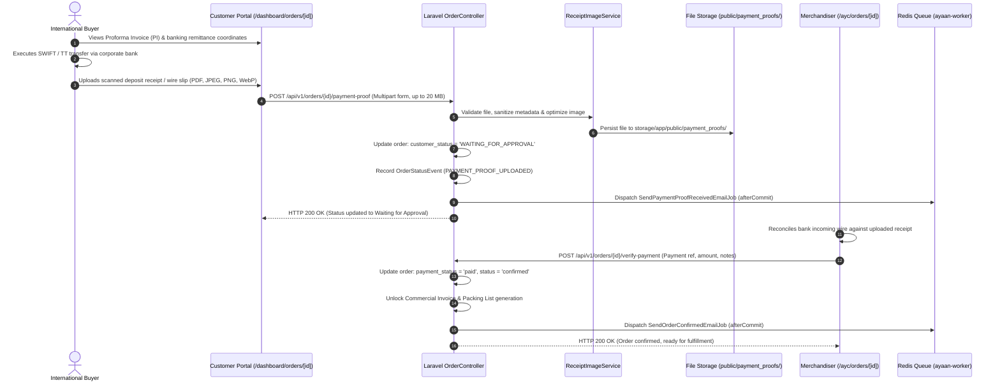

# AYAAN CLOTHING (AYC) — Payments & Inventory Architecture

**Document Purpose**: Detailed technical specification for B2B payment methods, wire transfer proof uploads, administrative payment verification, and atomic inventory deduction/restoration mechanics.  
**Audience**: Financial Controllers, Backend Engineers, Inventory Managers, Operations Auditors.  
**Last Verified Date**: October 20, 2026  
**Environment Baseline**: Production Release `release_20261020_052638_a8d2fef` on Hostinger VPS `srv2010990`.

---

## 1. Supported B2B Payment Methods

Because AYAAN CLOTHING deals in high-value international garment exports (ranging from several thousand to hundreds of thousands of USD per order), commercial settlement uses standard international banking instruments:

1. **Telegraphic Transfer (T/T / SWIFT Wire)**: Primary settlement method for wholesale ready-stock orders. Customer instructs their commercial bank to wire funds directly to AYC's export banking account.
2. **Irrevocable Letter of Credit (L/C at Sight)**: Used for high-volume container exports and bespoke RFQ manufacturing runs.
3. **Showroom Cash / Local Card**: Restricted strictly to in-person transactions executed through the `/ayc/pos` terminal at the physical warehouse showroom.

---

## 2. Bank Wire Remittance Workflow



---

## 3. Payment Proof Upload Implementation Details

* **Endpoint**: `POST /api/v1/orders/{id}/payment-proof`
* **Nginx Configuration**: Configured with a dedicated `client_max_body_size 20M;` and `req_api_upload` rate limit zone (max 3 burst per IP).
* **Accepted Formats**: `pdf`, `jpg`, `jpeg`, `png`, `webp`.
* **Processing Service (`App\Services\ReceiptImageService`)**:
  - Validates MIME type and magic byte headers.
  - Strips potentially sensitive EXIF metadata from camera uploads.
  - Image files are converted to optimized WebP format (max 2048px bounds).
  - PDFs are preserved in their native binary form.
  - Files are written to `storage/app/public/payment_proofs/receipt_{order_id}_{hash}.{ext}`.

---

## 4. Administrative Verification & Gate Unlocking

Payment verification unlocks subsequent export trade documentation:

* **Before Verification**: Customer can only download the `OFFER_SHEET` and `PROFORMA_INVOICE`. Attempts to download `COMMERCIAL_INVOICE` or `PACKING_LIST` return HTTP 403:
  ```json
  {
    "success": false,
    "is_gated": true,
    "message": "Commercial Invoice is generated exclusively upon payment confirmation."
  }
  ```
* **Upon Verification**:
  - `orders.payment_status` is updated to `'paid'`.
  - `orders.status` is updated to `'confirmed'`.
  - Commercial Invoice and Packing List endpoints become immediately accessible for customs clearing.

---

## 5. Inventory & Stock Mutation Mechanics

To prevent overselling limited ready-stock apparel, stock mutations are executed atomically within database transactions:

### A. Stock Deduction on Order Placement
* Triggered in `OrderController::store`:
  ```php
  DB::transaction(function () use ($order, $items) {
      foreach ($items as $item) {
          $inventory = Inventory::where('product_id', $item->product_id)
              ->where('product_variant_id', $item->product_variant_id)
              ->lockForUpdate()
              ->first();
          
          if ($inventory->quantity < $item->quantity) {
              throw new OutOfStockException("Insufficient stock for {$item->product_name}");
          }
          
          $inventory->decrement('quantity', $item->quantity);
      }
  });
  ```

### B. Stock Restoration on Order Cancellation
* Triggered in `OrderController::cancel`:
  - If an unpaid order is cancelled by the customer or expires, the reserved quantities are incremented back into inventory.
  - A cancellation event is recorded in `order_status_events`.

### C. Showroom POS Adjustments
* Showroom sales through `AdminPosSaleService` immediately deplete physical stock balances.
* Manual warehouse stock adjustments are logged in `admin_inventory_adjustments` with operator ID, reason, and previous/new quantities.

---

## 6. Related Technical Documentation

* **[ORDERS_AND_CHECKOUT.md](ORDERS_AND_CHECKOUT.md)**: Order creation and checkout state flow.
* **[COMMERCIAL_DOCUMENTS.md](COMMERCIAL_DOCUMENTS.md)**: Gated Commercial Invoices and Packing Lists.
* **[SECURITY.md](SECURITY.md)**: Upload size limits and rate limiting policies.
