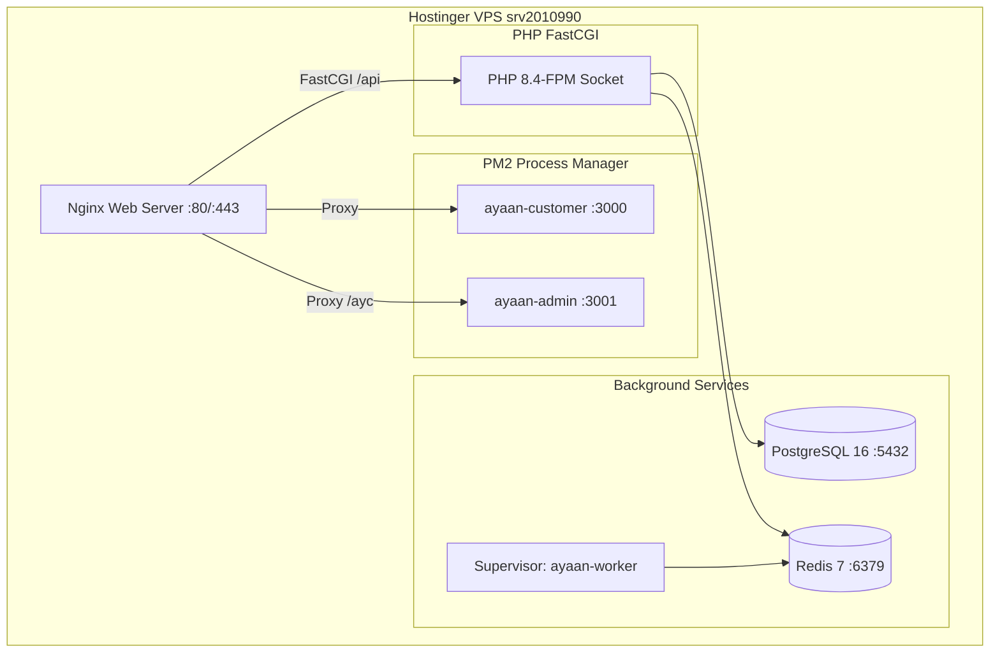

# Production Operations & Runbook — AYAAN CLOTHING (AYC)

> [!NOTE]
> **Canonical Notice**: This historical document has been modernized and superseded by the authoritative canonical references at **[docs/OPERATIONS_RUNBOOK.md](OPERATIONS_RUNBOOK.md)** and **[docs/BACKUP_AND_RECOVERY.md](BACKUP_AND_RECOVERY.md)**. Please consult those guides for active operations, health diagnostics, and disaster recovery procedures.

## 1. Production Topology & Environment Specifications

The production system runs on a high-performance cloud Virtual Private Server hosted in Mumbai, India:

* **Host Node Identifier**: `srv2010990` (Hostinger Mumbai 2 Data Center)
* **Operating System**: Ubuntu 24.04 LTS (Linux Kernel 6.8.0)
* **Public IPv4**: `200.97.169.230` (Hostinger AS47583)
* **Public IPv6**: `2a02:4780:63:21bf::1` (Hostinger AS47583)
* **Primary Domain**: `ayaanclothing.com` (Authoritative A and AAAA records active)
* **Application Directory**: `/var/www/ayaan`
* **Backup Root Directory**: `/var/backups/ayaan` (Permissions `0700`, owner `root:root`)



---

## 2. Service Management & Daily Health Checks

Execute these commands via SSH (`ssh 200.97.169.230`) to verify all system services:

### A. PM2 Process Status (Customer & Admin Daemons)
```bash
# Check running PM2 services:
su - ayaan -c "pm2 status"

# View combined live application logs:
su - ayaan -c "pm2 logs --lines 50"

# Restart application daemons safely:
su - ayaan -c "pm2 reload ayaan-customer"
su - ayaan -c "pm2 reload ayaan-admin"
```

### B. Core System Services (Systemd)
```bash
# Check Nginx status & syntax:
systemctl status nginx
nginx -t

# Check PHP-FPM status:
systemctl status php8.4-fpm

# Check PostgreSQL status:
systemctl status postgresql

# Check Redis status:
systemctl status redis
redis-cli ping # Returns PONG

# Check Background Queue Workers:
supervisorctl status
```

### C. Public Health Endpoint Verification
```bash
curl -s -k https://127.0.0.1/api/v1/health -H "Host: ayaanclothing.com"
```
*Expected Response*: `{"success":true,"message":"API is healthy","data":{"status":"ok",...}}`

---

## 3. Log File Locations

When debugging incidents, inspect the following system logs:

| Service | Log File Location | Description |
| :--- | :--- | :--- |
| **Nginx Access** | `/var/log/nginx/access.log` | Inbound HTTP/HTTPS requests, IPs, status codes, user agents. |
| **Nginx Errors** | `/var/log/nginx/error.log` | Upstream connection timeouts, 502 Bad Gateway triggers. |
| **Laravel Application** | `/var/www/ayaan/backend/storage/logs/laravel.log` | PHP exceptions, database query errors, failed jobs. |
| **Next.js Customer** | `/home/ayaan/.pm2/logs/ayaan-customer-error.log` | SSR rendering exceptions, React hydrate errors. |
| **Next.js Admin** | `/home/ayaan/.pm2/logs/ayaan-admin-error.log` | Admin proxy exceptions, PDF generation errors. |
| **Queue Worker** | `/var/log/supervisor/ayaan-worker.log` | Background transactional email and RFQ processing logs. |
| **Firewall / UFW** | `/var/log/ufw.log` | Dropped packet logs and connection tracking events. |

---

## 4. Disaster Recovery & Backup Runbook

All automated daily backups are stored outside the Git repository in `/var/backups/ayaan/`:

### A. Hard Production Safety Invariants
1. **NEVER** run `php artisan migrate:fresh`, `migrate:refresh`, `migrate:reset`, or `db:wipe` on `ayaan_production`.
2. **NEVER** run `TRUNCATE` or `DROP TABLE` statements on the production database.
3. **NEVER** run demo seeders (`db:seed --class=DemoSeeder`) in production.
4. **NEVER** delete or overwrite live media in `/var/www/ayaan/backend/storage/app/public` without verifying an existing backup.

### B. Critical Distinction: Database Restore vs. Application Rollback
* **APPLICATION ROLLBACK**: Reverts software code to an earlier Git commit or release directory via `./scripts/deploy-production.sh --rollback`. This operation is fast, non-destructive, and **does not alter customer or order data**.
* **DATABASE RESTORE**: Destructively overwrites database tables, sequences, and records with a point-in-time snapshot. This must **only** be executed during catastrophic data loss, database corruption, or irreversible data destruction.

### C. Full Database Disaster Recovery Procedure
If `ayaan_production` suffers catastrophic corruption:

1. **Pause Background Queue Workers**:
   ```bash
   supervisorctl stop all
   ```
2. **Terminate Active PostgreSQL Connections**:
   ```bash
   su - postgres -c "psql -c \"SELECT pg_terminate_backend(pid) FROM pg_stat_activity WHERE datname = 'ayaan_production' AND pid <> pg_backend_pid();\""
   ```
3. **Drop and Recreate Clean Database**:
   ```bash
   su - postgres -c "dropdb ayaan_production"
   su - postgres -c "createdb -O ayaan_user ayaan_production"
   ```
4. **Restore Latest Verified Dump**:
   ```bash
   LATEST_DUMP=$(ls -t /var/backups/ayaan/database/*.dump | head -n 1)
   echo "Restoring from: ${LATEST_DUMP}"
   su - postgres -c "pg_restore --verbose --clean --no-acl --no-owner -d ayaan_production ${LATEST_DUMP}"
   ```
5. **Restart Services & Verify**:
   ```bash
   supervisorctl start all
   curl -s http://127.0.0.1:8000/api/v1/health
   ```
