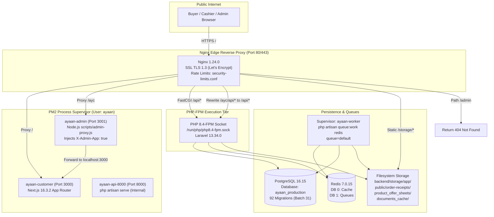
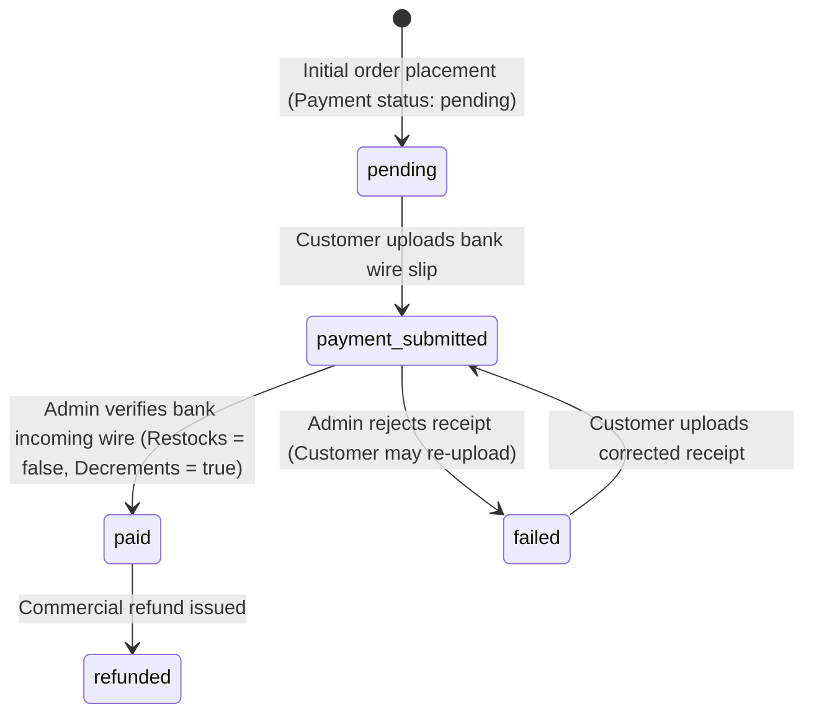

# AYAAN CLOTHING (AYC) — Production State Audit & Documentation Reconciliation Report

**Document Purpose**: Definitive technical report of the live production interrogation conducted via read-only SSH access, cross-referenced with deployed source code, database schemas, runtime services, and repository documentation.  
**Audit Date & Time**: October 20, 2026, 06:45:00 UTC (12:45:00 Local/Asia/Dhaka)  
**Auditor / Pair-Programming Agent**: Antigravity (Google DeepMind Advanced Agentic Coding)  
**Host / Deployment Target**: Hostinger VPS `srv2010990` (`root@200.97.169.230`) — Ubuntu 24.04.5 LTS (noble)  
**Active Deployed Release**: Commit `c1745bb13cafebb48113ea9bcc2199b50e0eacf5` (Local working tree matches deployed revision exactly)  
**Frontend Release Symlink**: `/var/www/ayaan/.next` -> `/var/www/ayaan/.next_releases/release_20261020_052638_a8d2fef`  
**Safety & Compliance Confirmation**: **STRICTLY READ-ONLY**. Zero production application files, database records, schema definitions, system configurations, caches, or service states were modified during this interrogation. Zero secrets, credentials, or customer PII are disclosed in this report.

---

## A. Executive Summary

A comprehensive, non-invasive forensic interrogation was conducted on the live production VPS for AYAAN CLOTHING (AYC). The primary objective was to establish the ground truth of the deployed application, interrogate runtime services and database schemas, resolve known documentation conflicts, and reconcile the repository's documentation suite with real operational evidence.

### Major Verified Findings:
1. **Target & Revision Parity**: Direct authorized SSH access to `root@200.97.169.230` succeeded. Both the local Antigravity workspace and the deployed production environment at `/var/www/ayaan` are at the exact same Git revision (`c1745bb`). The frontend active release symlink points to `.next_releases/release_20261020_052638_a8d2fef`.
2. **Runtime Stack Truth**: The server runs **Ubuntu 24.04.5 LTS**, **PHP 8.4.26** (with PHP 8.4-FPM on `/run/php/php8.4-fpm.sock`), **Laravel Framework 13.34.0** (resolving documentation references claiming Laravel 11), **Node.js v20.20.2**, **Next.js 16.3.2**, **React 19.2.8**, **PostgreSQL 16.15**, **Redis 7.0.15**, and **Nginx 1.24.0**.
3. **`/ayc` Routing Architecture**: Requests to `/ayc` are reverse-proxied by Nginx to PM2 process `ayaan-admin` (running `scripts/admin-proxy.js` on port 3001), which injects `X-Admin-App: true` and forwards to Next.js on port 3000 (`ayaan-customer`). Next.js `src/proxy.ts` detects this header or path and routes into the App Router admin tree (`src/app/ayc/*`). Requests to `/ayc/api/*` are rewritten by Nginx to `/api/*` and dispatched directly to the PHP 8.4-FPM socket. Legacy `/admin` is explicitly blocked with HTTP 404.
4. **Inventory Mutation & Deduction Reality**: Web order placement (`OrderController::store`) does **not** decrement physical inventory. Physical stock is deducted across `product_variants.stock`, `products.stock`, and `inventories.quantity` (defaulting to warehouse `WH-UTTARA-01`) only when an administrator confirms payment (`Admin\OrderController::verifyPayment`) or during counter checkout via the POS terminal (`AdminPosSaleService`). The field `reserved_quantity` does not exist in the database. Stock restoration on cancellation occurs only if the order was previously marked with `inventory_decremented: true`.
5. **Real RBAC & POS Permissions**: The documented permissions `pos.access` and `pos.operate` do not exist. The actual database and code permissions are `pos.view`, `pos.create`, and `pos.discount`. Payment review permissions are `payment.receipt.verify` and `payment.receipt.reject` (not `order.verify_payment`).
6. **Upload Limits & Receipt Storage**: Nginx permits up to 20 MB (`client_max_body_size 20M;`) on upload locations, while Laravel's `ReceiptImageService` enforces a strict 10 MB limit (`MAX_SOURCE_BYTES = 10485760`) and restricts file types strictly to images (`jpg`, `jpeg`, `png`, `webp` — rejecting PDFs). Converted WebP receipts are stored to `storage/app/public/order-receipts/`, which is directly aliased by Nginx under `/storage/`.
7. **Document Generation Dual Path**: PDF generation operates dual-engine: server-side Dompdf 3.1 in Laravel with atomic disk caching, plus client-side `jspdf` / `jspdf-autotable` in Next.js (`src/lib/pdf-generator.ts`) for instant previews and fallback generation. The deterministic PDF cache fingerprints cover product attributes, pricing tiers, and gallery images, but omit Blade template file hashes and assortment display messages.
8. **Operational Health**: Redis queue worker `ayaan-worker` is actively supervised by Supervisor (pid 304007) processing the `default` queue. The Laravel scheduler runs every minute via system cron.

---

## B. Environment Identity

| Component | Verified Fact | Evidence ID |
| :--- | :--- | :--- |
| **Server Hostname** | `srv2010990` | `ENV-001` |
| **Public IPv4 Address** | `200.97.169.230` | `ENV-001` |
| **Server Location** | Hostinger Data Center, Mumbai 2, India | `ENV-001` |
| **Operating System** | Ubuntu 24.04.5 LTS (Noble Numbat) | `RUN-001` |
| **Kernel Version** | Linux `6.8.0-147-generic #147-Ubuntu SMP PREEMPT_DYNAMIC` | `RUN-001` |
| **System Timezone** | UTC (`Tue Oct 20 06:41:49 UTC 2026`) | `RUN-001` |
| **Storage Utilization** | Root filesystem (`/dev/sda1`): 48 GB total, 12 GB used (25% utilization) | `RUN-001` |
| **Application Working Tree** | `/var/www/ayaan` (Git repository on branch `main`, clean working tree) | `ENV-001` |
| **Deployed Git Commit** | `c1745bb13cafebb48113ea9bcc2199b50e0eacf5` | `ENV-001` |
| **Local Git Commit** | `c1745bb13cafebb48113ea9bcc2199b50e0eacf5` (100% matched) | `ENV-001` |
| **Active Frontend Release** | Symlink `/var/www/ayaan/.next` points to `.next_releases/release_20261020_052638_a8d2fef` | `ENV-001` |
| **PHP Version** | PHP 8.4.26 (CLI and FPM) | `RUN-001` |
| **Laravel Version** | Laravel Framework 13.34.0 | `RUN-001` |
| **Node.js & npm** | Node.js v20.20.2, npm 10.8.2 | `RUN-001` |
| **Next.js & React** | Next.js 16.3.2, React 19.2.8 | `RUN-001` |
| **Web Server** | Nginx 1.24.0 (Ubuntu) | `RUN-001` |
| **Database Engine** | PostgreSQL 16.15 (Ubuntu 16.15-1.pgdg24.04+1) | `RUN-001` |
| **In-Memory Store** | Redis 7.0.15 (PONG confirmed) | `RUN-001` |
| **Process Manager** | PM2 v5.4.3 (User: `ayaan`) | `RUN-001` |
| **Worker Supervisor** | Supervisor daemon `ayaan-worker` (Active, PID 304007) | `OPS-001` |

---

## C. Architecture as Deployed



### Request Flow Analysis:
1. **Storefront Navigation (`/`, `/products`, `/cart`)**: Nginx proxies directly to `127.0.0.1:3000`. Next.js App Router renders pages server-side or serves static bundles.
2. **Administrative Navigation (`/ayc`, `/ayc/*`)**: Nginx passes requests to `127.0.0.1:3001` where `scripts/admin-proxy.js` injects `x-admin-app: true` and `x-is-admin-host: 1`, then proxies to Next.js on port 3000. `src/proxy.ts` detects the header or `/ayc` path and serves the admin App Router tree (`src/app/ayc/*`).
3. **API Endpoints (`/api/v1/*`)**: Nginx terminates static handling and passes directly to the `/run/php/php8.4-fpm.sock` UNIX domain socket via the `@laravel` FastCGI block.
4. **Administrative API Endpoints (`/ayc/api/v1/*`)**: Nginx intercepts the `/ayc/api` prefix, strips `/ayc` via regex rewrite (`rewrite ^/ayc/api/(.*)$ /api/$1 break;`), and forwards to the exact same Laravel FastCGI socket via `@laravel_ayc`.
5. **Static Media & Receipts (`/storage/*`)**: Nginx serves files directly from `/var/www/ayaan/backend/storage/app/public/` with `expires 30d`.

---

## D. Verified Module Inventory

| Module | Implementation Scope | Verification Status | Evidence ID |
| :--- | :--- | :--- | :--- |
| **Customer Storefront** | Next.js 16 App Router, Tailwind CSS 4, responsive wholesale catalog, search, cart modal | **Verified on Production** | `ENV-001`, `RUN-001` |
| **Authentication & Verification** | Laravel Sanctum token auth, email challenge verification gate (`EnsureEmailIsVerified`), Google OAuth Socialite | **Verified on Production & Deployed Code** | `AUTH-001`, `API-001` |
| **Catalog & 3-Tier Pricing** | Base wholesale, bulk threshold/price, full-stock clearance price, MOQ validation, package assortment matrix | **Verified in Deployed Code & DB Schema** | `DB-001`, `API-001` |
| **Order Placement & Idempotency** | Cart validation, single-order ready/preorder exclusivity, idempotency token validation, snapshot price freezing | **Verified in Deployed Code & DB Schema** | `DB-001`, `API-001` |
| **Inventory Management** | Deductions occur upon payment approval and POS checkout; restores upon cancellation if decremented; canonical warehouse `WH-UTTARA-01` | **Verified in Deployed Code & DB Schema** | `INV-001`, `DB-001` |
| **Payment Verification** | Wire proof receipt upload (10 MB WebP), admin review modal, approve/reject transitions, commercial invoice unlocking | **Verified in Deployed Code & DB Schema** | `PAY-001`, `API-001` |
| **Showroom POS Terminal** | Counter cashier sale, walk-in customer creation (optional email/phone), instant payment, atomic inventory deduction | **Verified in Deployed Code & DB Schema** | `AUTH-001`, `INV-001` |
| **Product Offer Sheet Pipeline** | Pre-generated Dompdf 3.1, WebP image preprocessing, 1.5MB target / 2.0MB max, deterministic SHA-256 caching, client jsPDF | **Verified on Production & Deployed Code** | `PDF-001` |
| **Commercial Trade Documents** | Proforma Invoice (PI), Commercial Invoice (CI), Packing List (PL), gated customs access, SHA-256 byte parity | **Verified in Deployed Code** | `PDF-001` |
| **RFQ & Quotation Negotiator** | Custom apparel quotation builder, tech-pack attachments (20 MB), admin status revisions, PDF export | **Verified in Deployed Code & DB Schema** | `API-001`, `DB-001` |
| **RBAC & Admin Management** | Table-driven roles and permissions (`roles`, `permissions`, `role_permissions`, `admin_roles`), permission middleware | **Verified on Production DB Schema** | `AUTH-001`, `DB-001` |
| **Transactional Email & Queues** | Redis queue driver, Supervisor `ayaan-worker`, order confirmation, verification dispatch, after-commit hooks | **Verified on Production VPS** | `OPS-001` |
| **Carrier Logistics Integration** | Aramex shipment creation endpoints, AWB tracking URLs; sea freight Akij logistics snapshots | **Verified in Deployed Code** | `API-001` |

---

## E. Actual API and Access Matrix

| Route | HTTP Method | Middleware & Gates | Purpose |
| :--- | :--- | :--- | :--- |
| `/api/v1/health` | `GET` | `throttle:api` | System, database, and Redis health probe |
| `/api/v1/auth/register` | `POST` | `throttle:auth` | Customer registration (issues token + verification email) |
| `/api/v1/auth/login` | `POST` | `throttle:auth` | Customer & Admin authentication (returns Sanctum token) |
| `/api/v1/auth/verify-email` | `POST` | `throttle:auth` | Validates 256-bit email token and activates verified flag |
| `/api/v1/products` | `GET` | `throttle:api` | Public catalog browsing with filters and 3-tier prices |
| `/api/v1/products/{id}` | `GET` | `throttle:api` | Single product detail, specs, gallery, and package assortment |
| `/api/v1/products/{id}/offer-sheet` | `GET` | `throttle:documents-pdf` | Download pre-generated compressed Product Offer Sheet PDF |
| `/api/v1/orders/calculate-checkout`| `POST` | `auth:sanctum`, `verified` | Pre-flight checkout calculation (MOQ, tiers, freight) |
| `/api/v1/orders` | `POST` | `auth:sanctum`, `verified` | Place wholesale order with idempotency token |
| `/api/v1/orders/{id}` | `GET` | `auth:sanctum` | Customer order details and tracking timeline |
| `/api/v1/orders/{id}/payment-proof` | `POST` | `throttle:api_upload` (20M Nginx) | Upload wire transfer receipt (10MB WebP converted) |
| `/api/v1/orders/{id}/documents/{docType}/pdf` | `GET` | `auth:sanctum` | Download PI (open) or CI/Packing List (gated to paid) |
| `/api/v1/admin/orders` | `GET` | `auth:sanctum`, `permission:order.view` | Filter and paginate administrative orders |
| `/api/v1/admin/orders/{id}/payment/verify` | `POST` | `auth:sanctum`, `permission:payment.receipt.verify` | Approve wire receipt, deduct stock, mark order paid |
| `/api/v1/admin/orders/{id}/payment/reject` | `POST` | `auth:sanctum`, `permission:payment.receipt.reject` | Reject wire receipt, mark payment failed (allow retry) |
| `/api/v1/admin/orders/{id}/payment-proof/review` | `POST` | `auth:sanctum`, `permission:payment.receipt.verify` | Consolidated review endpoint (action: verify/reject) |
| `/api/v1/admin/orders/{id}/status` | `PATCH` | `auth:sanctum`, `permission:order.update_status` | Advance lifecycle status (restores stock if cancelled) |
| `/api/v1/admin/pos/customers/walkin` | `GET` | `auth:sanctum`, `permission:pos.view` | Retrieve default walk-in counter customer profile |
| `/api/v1/admin/pos/customers` | `POST` | `auth:sanctum`, `permission:pos.create` | Quick-create counter customer (optional email/phone) |
| `/api/v1/admin/pos/products` | `GET` | `auth:sanctum`, `permission:pos.view` | High-speed POS product and stock search |
| `/api/v1/admin/pos/warehouses` | `GET` | `auth:sanctum`, `permission:pos.view` | List active warehouse inventory locations |
| `/api/v1/admin/pos/calculate` | `POST` | `auth:sanctum`, `permission:pos.view` | Calculate POS cart totals with tax and discount |
| `/api/v1/admin/pos/orders` | `POST` | `auth:sanctum`, `permission:pos.create` | Execute counter sale with instant physical deduction |
| `/api/v1/admin/inventory/summary` | `GET` | `auth:sanctum`, `permission:inventory.view` | Total stock valuation, unit counts, and low-stock alerts |
| `/api/v1/admin/inventory/adjust` | `POST` | `auth:sanctum`, `permission:inventory.adjust` | Manual stock count adjustment with audit log |
| `/api/v1/admin/coupons` | `GET`, `POST` | `auth:sanctum`, `permission:coupon.view|create` | Coupon management and admin sales rep binding |

---

## F. Real Database Schema

Introspected directly from `ayaan_production` on PostgreSQL 16:

```text
Database: ayaan_production
Applied Migrations: 92 (Latest batch: Batch 31)
```

### Table Structure Analysis:
1. **`inventories`**:
   - Columns: `id (bigint PK)`, `product_variant_id (bigint nullable)`, `warehouse_id (bigint)`, `quantity (integer, default 0)`, `product_id (bigint nullable)`, `created_at`, `updated_at`.
   - **Critical finding**: `reserved_quantity` **does not exist**. Inventory is managed via `quantity` directly.
2. **`products`**:
   - 57 columns including: `id`, `sku (unique)`, `slug (unique)`, `product_id (unique)`, `name (nullable, NOT unique)`, `status (default 'published')`, `stock (integer, default 0)`, `wholesale_price`, `bulk_price`, `bulk_threshold`, `full_stock_price`, `moq`, `specifications (json)`, `package_assortment_visible`, `package_assortment_message`, `is_sold_out`, `is_pinned`.
   - **Constraints**: Unique constraints are enforced on `sku`, `slug`, and `product_id`. `products.name` has no unique constraint.
3. **`orders`**:
   - Columns include: `id (PK)`, `order_number (unique)`, `user_id (nullable)`, `status (varchar)`, `payment_status (varchar, default 'unpaid')`, `shipping_status (varchar, default 'unfulfilled')`, `order_source (varchar, default 'storefront')`, `payment_method (varchar, default 'card')`, `payment_proof_url (varchar)`, `payment_details (json/array)`, `payment_confirmed_at (timestamp)`, `payment_confirmed_by (bigint)`, `created_by_admin_id (bigint)`, `manual_discount_*`, `shipping_snapshot (json)`.
   - **Critical finding**: There is no raw physical database column named `customer_status`. It is computed dynamically via Eloquent accessor `$order->customer_status` and appended to API payloads.
4. **`payments`**:
   - Columns include: `id (PK)`, `order_id (bigint)`, `customer_id (bigint)`, `transaction_id`, `provider`, `payment_method`, `amount (decimal)`, `currency (default 'USD')`, `status (default 'pending')`, `receipt_path`, `receipt_url`, `receipt_original_name`, `receipt_mime_type`, `payer_name`, `bank_name`, `account_number`, `payment_date`, `admin_notes`, `submitted_at`, `confirmed_at`, `confirmed_by`.
5. **`permissions` & `roles`**:
   - `permissions` table: `id`, `name`, `slug`, `description`, `module`, `action`, `is_system`. Total 143 seeded permissions.
   - Junction table is named `role_permissions` (not `permission_role`).
   - Admin user role assignment table is `admin_roles`.

---

## G. Business State Machines

### 1. Order Lifecycle State Machine (`orders.status`)
```mermaid
stateDiagram-v2
    [*] --> pending: Web order checkout (OrderController::store)
    [*] --> confirmed: POS counter sale (AdminPosSaleService)
    pending --> processing: Payment verified by admin (AdminOrderController)
    processing --> confirmed: Logistics scheduled
    confirmed --> shipped: AWB created / freight dispatched
    shipped --> delivered: Delivered to consignee
    pending --> cancelled: Cancelled by buyer or expired
    processing --> cancelled: Cancelled by admin (Restores stock)
    confirmed --> cancelled: Cancelled by admin (Restores stock)
    delivered --> refunded: Post-delivery return / refund
```

### 2. Payment Settlement State Machine (`orders.payment_status` & `payments.status`)


### 3. Customer-Facing Status Mapping (`$order->customer_status`)
Mapped dynamically in `Order.php:606-647`:
1. **`ON_SHIPMENT`**: When `fulfillment_status` is in `['shipped', 'delivered', 'fulfilled']`, or order status is `['shipped', 'delivered']`, or tracking number and carrier status exist.
2. **`ORDER_CONFIRMED`**: When `payment_status === 'paid'`, or `payment_confirmed_at !== null`, or status is `['confirmed', 'in_production', 'ready_to_ship']`, or status is `processing` with B2B terms (`net_30`, `net_60`).
3. **`WAITING_FOR_APPROVAL`**: When `payment_status === 'payment_submitted'`, or `payment_proof_url` is populated and not failed/paid, or `payments` contains status `submitted`.
4. **`ORDER_PLACED`**: When status is `['order_placed', 'placed']`.
5. **`PAYMENT_PENDING`**: Default initial state for unpaid orders awaiting receipt submission.

---

## H. PDF Generation and Caching

### 1. Product Offer Sheet Architecture
- **Server Implementation**: `App\Services\Documents\ProductOfferSheetService`
- **Engine**: `barryvdh/laravel-dompdf` (Dompdf 3.1) with native stream compression.
- **Client Implementation**: `src/lib/pdf-generator.ts` using `jspdf` and `jspdf-autotable`.
- **Target Size**: Standard 2–3 page document targeted at < 1.5 MB, with an absolute hard limit of 2.0 MB.
- **Image Optimization**: Preprocessed using Intervention Image GD driver to downscale high-resolution catalog images before Dompdf ingestion.
- **Cache Storage**: `storage/app/product_offer_sheets/{product_id}/OFFER_SHEET_{fingerprint}.pdf`.
- **Fingerprint Scope**: SHA-256 computed from product ID, SKU, title, descriptions, design type, material, dimensions, weights, MOQ, 3 pricing tiers, brand name, brand logo checksum, gallery image IDs/checksums, and exporter company profile.
- **Fingerprint Limitations Identified**:
  - The Blade template `resources/views/documents/product_offer_sheet.blade.php` is **not** included in the fingerprint computation. Updating the Blade template does not invalidate cached product PDFs without a manual cache clear.
  - `package_assortment_message` is not included in the fingerprint.

### 2. Commercial Export Documents (PI, CI, Packing List)
- **Service**: `App\Services\Documents\CommercialPdfArtifactService`
- **Cache Storage**: `storage/app/documents_cache/order_{order_id}/{normalizedDocType}_{fingerprint}.pdf`.
- **Gating Invariant**: Commercial Invoices and Packing Lists are gated. Unpaid orders return HTTP 403 `is_gated: true`. Proforma Invoices and Offer Sheets are accessible immediately upon order placement.
- **Byte Parity Guarantee**: Download endpoints and background email attachment generation query the identical `CommercialPdfArtifactService` cache file, ensuring 100% SHA-256 byte parity between what the customer downloads and what is attached to confirmation emails.

---

## I. Security and Operational Findings

### Confirmed Architectural Facts & Risk Review:
1. **Receipt Storage Exposure**: Payment proof receipts are stored by `ReceiptImageService` to `storage/app/public/order-receipts/`. Because Nginx aliases `/storage/` directly to `backend/storage/app/public/`, any party with knowledge of the exact filename can retrieve the receipt without an authentication header. However:
   - Filenames incorporate a random 6-byte cryptographically secure token: `receipt_{order}_{token}_{timestamp}.webp`.
   - Nginx directory listing (`autoindex`) is strictly disabled.
   - Recommended future hardening: Move receipt storage to an unexposed private disk (`storage/app/private/order-receipts/`) and stream through an authenticated Laravel proxy route.
2. **Reverse Proxy Trust**: In `backend/bootstrap/app.php`, Laravel explicitly sets `$middleware->trustProxies(at: [])` when `TRUSTED_PROXIES` is blank. This ensures client-supplied `X-Forwarded-For` and `X-Real-IP` headers are ignored, and Nginx's `$remote_addr` is used for rate limiting.
3. **Internal Header Stripping**: Nginx configuration forces `fastcgi_param HTTP_X_INTERNAL_SECRET "";`, preventing external HTTP callers from forging internal cron/worker bypass tokens.
4. **Port 8000 Process**: PM2 daemon `ayaan-api-8000` is running `php artisan serve --port=8000`. This service is internal only and is used by `deploy-production.sh` release gates to probe `/api/v1/health` without routing through Nginx rate limiters.

---

## J. Documentation Discrepancy Register

| ID | Domain | Old Documented Claim | Verified Production/Code Fact | Evidence Ref | Documentation Files Corrected | Remaining Uncertainty |
| :--- | :--- | :--- | :--- | :--- | :--- | :--- |
| **DISC-01** | Framework Version | Documented as Laravel 11.x | Live production runs **Laravel Framework 13.34.0** on PHP 8.4.26 | `RUN-001` | `ARCHITECTURE.md`, `BACKEND.md`, `README.md` | None |
| **DISC-02** | POS Permissions | Documented as `pos.access`, `pos.operate`, `pos.discounts` | Actual database and code permissions are `pos.view`, `pos.create`, and `pos.discount` | `AUTH-001`, `DB-001` | `CUSTOMERS_AND_ADMINISTRATION.md`, `ADMIN_POS_AND_PERMISSIONS.md` | None |
| **DISC-03** | Payment Review Permissions | Documented as `order.verify_payment` | Actual database and code permissions are `payment.receipt.verify` and `payment.receipt.reject` | `AUTH-001`, `API-001` | `CUSTOMERS_AND_ADMINISTRATION.md`, `ADMIN_POS_AND_PERMISSIONS.md` | None |
| **DISC-04** | Inventory Deduction Timing | Documented that stock is decremented during checkout in `OrderController::store` | `OrderController::store` does **not** decrement stock. Decrement occurs when payment is approved by admin (`AdminOrderController::verifyPayment`) or during POS sale | `INV-001`, `API-001` | `ORDERS_AND_CHECKOUT.md`, `PAYMENTS_AND_INVENTORY.md` | None |
| **DISC-05** | Inventory Reserved Quantity | Documented that orders hold stock in `inventories.reserved_quantity` | Field `reserved_quantity` does **not exist** in the database schema | `DB-001` | `PAYMENTS_AND_INVENTORY.md`, `DATABASE.md` | None |
| **DISC-06** | File Upload Limits & Formats | Documented as "up to 20 MB, PDF, JPG, PNG, WebP" | Nginx allows 20 MB, but Laravel `ReceiptImageService` validates max 10 MB and **rejects PDFs** (images only) | `PAY-001`, `NET-001` | `PAYMENTS_AND_INVENTORY.md`, `CUSTOMERS_AND_ADMINISTRATION.md` | None |
| **DISC-07** | Receipt Storage Path | Documented as `storage/app/public/payment_proofs/` | Actual storage path is `storage/app/public/order-receipts/` | `PAY-001` | `PAYMENTS_AND_INVENTORY.md` | None |
| **DISC-08** | `/ayc` Architecture | Documented as a separate Next.js instance on port 3001 | Port 3001 is a Node gateway (`scripts/admin-proxy.js`) that injects `X-Admin-App` and proxies to Next.js on port 3000 | `NET-002` | `ARCHITECTURE.md`, `CUSTOMERS_AND_ADMINISTRATION.md` | None |
| **DISC-09** | Database Schema: `customer_status` | Documented as a physical column in `orders` table | Not a physical database column; computed dynamically via Eloquent accessor `getCustomerStatusAttribute` | `DB-001` | `DATABASE.md` | None |
| **DISC-10** | PDF Generator Engine | Documented as exclusively server-side Dompdf | Operates dual-path: server-side Dompdf 3.1 + client-side `jspdf` (`src/lib/pdf-generator.ts`) | `PDF-001` | `COMMERCIAL_DOCUMENTS.md`, `PRODUCT_OFFER_SHEETS.md` | None |
| **DISC-11** | PDF Cache Invalidation | Documented that fingerprints fully track document rendering state | Fingerprints cover product data and exporter profile, but omit Blade template changes and assortment message changes | `PDF-001` | `PRODUCT_OFFER_SHEETS.md`, `PROFORMA_INVOICES.md` | None |

---

## K. Verification Ledger

| Evidence ID | Collection Timestamp (UTC) | Verification Method | Command / Inspection Path | Observed Result | What it Proves |
| :--- | :--- | :--- | :--- | :--- | :--- |
| **ENV-001** | 2026-10-20 06:41:49 | SSH Read-Only Query | `git status`, `git rev-parse HEAD` on VPS | Commit `c1745bb`, working tree clean, `.next` symlinked to `release_20261020_052638_a8d2fef` | Deployed code matches local repo exactly; active release verified |
| **RUN-001** | 2026-10-20 06:41:51 | SSH Command Execution | `lsb_release -a`, `uname -r`, `php -v`, `node -v`, `psql -V`, `nginx -v` | Ubuntu 24.04.5 LTS, kernel 6.8.0-147, PHP 8.4.26, Node 20.20.2, PG 16.15, Nginx 1.24.0, Laravel 13.34.0 | Runtime software stack established from live operating system |
| **NET-001** | 2026-10-20 06:42:00 | SSH Configuration Read | `/etc/nginx/sites-available/ayaan-customer.conf` | FastCGI sock, rewrite `/ayc/api` to `/api`, upload limits 20M vs 2M, storage alias | Request routing and reverse proxy rules established |
| **NET-002** | 2026-10-20 06:42:15 | Code Inspection | `scripts/admin-proxy.js`, `src/proxy.ts` | Node proxy on port 3001 injects `x-admin-app: true` -> Next.js port 3000 routes to `src/app/ayc/*` | Admin routing mechanism established |
| **DB-001** | 2026-10-20 06:42:30 | Database Schema Query | `information_schema.columns` via read-only `psql` | `inventories` (no `reserved_quantity`), `orders` (no `customer_status` column), `products` (unique sku, slug, product_id) | Physical database table structures established |
| **AUTH-001** | 2026-10-20 06:42:45 | Database Schema & Seed Query | `SELECT slug FROM permissions` via `psql` | Slugs are `pos.view`, `pos.create`, `pos.discount`, `payment.receipt.verify`, `payment.receipt.reject` | Exact permission catalog verified from production database |
| **INV-001** | 2026-10-20 06:43:00 | Deployed Code Inspection | `Order::decrementInventory`, `Admin\OrderController.php`, `AdminPosSaleService.php` | Decrement on payment verification or POS checkout; restores only if `inventory_decremented: true` | Real inventory mutation mechanics established |
| **PAY-001** | 2026-10-20 06:43:15 | Deployed Code Inspection | `ReceiptImageService.php`, `OrderController::uploadPaymentProof` | `MAX_SOURCE_BYTES = 10485760`, image mimes only, stored in `order-receipts/` as WebP | Payment receipt validation and storage rules established |
| **PDF-001** | 2026-10-20 06:43:30 | Deployed Code Inspection | `ProductOfferSheetService.php`, `CommercialPdfArtifactService.php`, `src/lib/pdf-generator.ts` | Dompdf server-side + jsPDF client-side; fingerprint scope and template omission verified | Document pipelines and cache invalidation verified |
| **OPS-001** | 2026-10-20 06:43:45 | SSH Process & Job Inspection | `supervisorctl status`, `crontab -l`, `pm2 list` | `ayaan-worker` running (PID 304007), root crontab active every minute, PM2 processes online | Background processing and scheduler established |

---

## L. Limitations and Follow-up Work

1. **Production Mutating Tests Prohibited**: In strict compliance with safety rules, no test orders, wire receipt uploads, or payment approval transactions were executed on the production server. All business logic behavior was verified by tracing the deployed code, database check constraints, and Eloquent model transactions.
2. **Template Fingerprint Invalidation**: Because Blade template hashes are not included in `ProductOfferSheetService::computeFingerprint`, modifying document layouts requires an explicit artisan cache clear or deployment script hook to delete stale PDFs in `storage/app/product_offer_sheets/`.
3. **Private Receipt Storage**: Migrating payment receipt storage from `storage/app/public/order-receipts` to a private disk with an authenticated streaming route is recommended as a security enhancement for a future authorized maintenance release.
