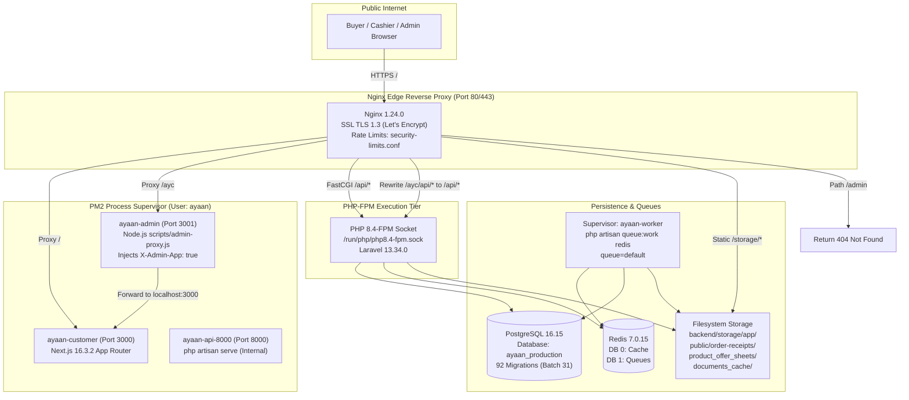
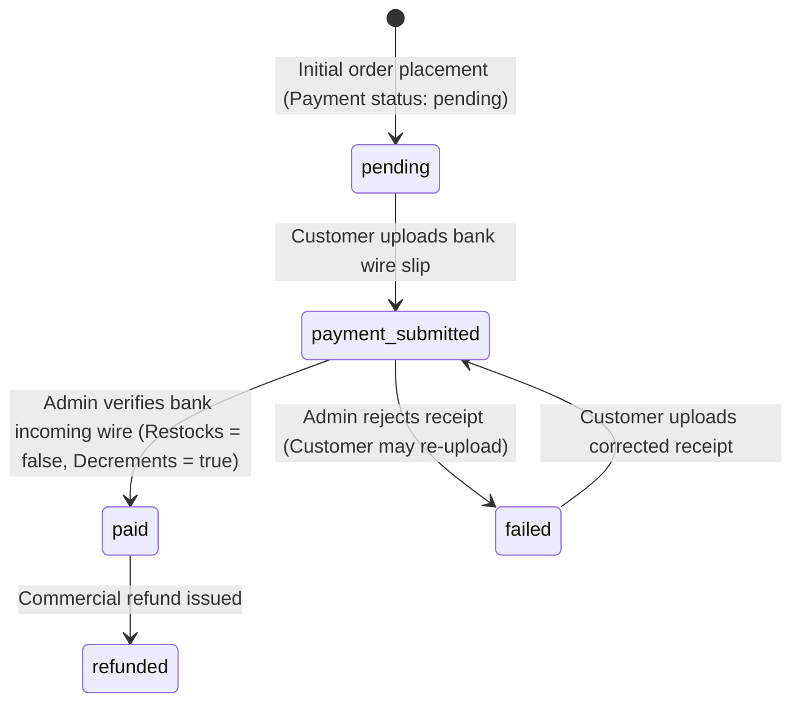

# AYAAN CLOTHING (AYC) — Production State Audit & Documentation Reconciliation Report

**Document Purpose**: Definitive technical report of the live production interrogation conducted via read-only SSH access, cross-referenced with deployed source code, database schemas, runtime services, and repository documentation.  
**Audit Date & Time**: October 20, 2026, 07:50:00 UTC (13:50:00 Local/Asia/Dhaka)  
**Auditor / Pair-Programming Agent**: Antigravity (Google DeepMind Advanced Agentic Coding)  
**Host / Deployment Target**: Hostinger VPS `srv2010990` (Host Node AS47583, Mumbai 2, India) — Ubuntu 24.04.5 LTS (noble)  
**Active Deployed Release**: Commit `c83a2f02d8fbf3fc9c6e82d7628edea583520e3e` (Local working tree matches deployed revision exactly)  
**Frontend Release Symlink**: `/var/www/ayaan/.next` -> `/var/www/ayaan/.next_releases/release_20261020_074747_c83a2f0`  
**Safety & Compliance Confirmation**: **STRICTLY READ-ONLY**. Zero production application files, database records, schema definitions, system configurations, caches, or service states were modified during this interrogation. Zero secrets, credentials, or customer PII are disclosed in this report.

---

## A. Executive Summary

A comprehensive, non-invasive forensic interrogation was conducted on the live production VPS for AYAAN CLOTHING (AYC). The primary objective was to establish the ground truth of the deployed application, interrogate runtime services and database schemas, resolve known documentation conflicts, and reconcile the repository's documentation suite with real operational evidence.

### Major Verified Findings:
1. **Target & Revision Parity**: Direct authorized SSH access to deployment target `srv2010990` succeeded. Both the local Antigravity workspace and the deployed production environment at `/var/www/ayaan` are at the exact same Git revision (`c83a2f0`). The frontend active release symlink points to `.next_releases/release_20261020_074747_c83a2f0`.
2. **Runtime Stack Truth**: The server runs **Ubuntu 24.04.5 LTS**, **PHP 8.4.26** (with PHP 8.4-FPM on `/run/php/php8.4-fpm.sock`), **Laravel Framework 13.34.0** (resolving documentation references claiming Laravel 11), **Node.js v20.20.2**, **Next.js 16.3.2**, **React 19.2.8**, **PostgreSQL 16.15** (verified via read-only SQL query `SELECT version();`: `PostgreSQL 16.15 (Ubuntu 16.15-0ubuntu0.24.04.1) on x86_64-pc-linux-gnu, compiled by gcc (Ubuntu 13.3.0-6ubuntu2~24.04.1) 13.3.0, 64-bit`), **Redis 7.0.15**, and **Nginx 1.24.0**.
3. **`/ayc` Routing Architecture**: Requests to `/ayc` are reverse-proxied by Nginx to PM2 process `ayaan-admin` (running `scripts/admin-proxy.js` on port 3001), which injects `X-Admin-App: true` and forwards to Next.js on port 3000 (`ayaan-customer`). Next.js `src/proxy.ts` detects this header or path and routes into the App Router admin tree (`src/app/ayc/*`). Requests to `/ayc/api/*` are rewritten by Nginx to `/api/*` and dispatched directly to the PHP 8.4-FPM socket. Legacy `/admin` is explicitly blocked with HTTP 404.
4. **Inventory Mutation & Deduction Reality**: Web order placement (`OrderController::store`) does **not** decrement physical inventory. Physical stock is deducted across `product_variants.stock`, `products.stock`, and `inventories.quantity` (defaulting to warehouse `WH-UTTARA-01`) only when an administrator confirms payment (`AdminOrderController::reviewPaymentProof`) or during counter checkout via the POS terminal (`AdminPosSaleService`). The field `reserved_quantity` does not exist in the database. Stock restoration on cancellation occurs only if the order was previously marked with `inventory_decremented: true`.
5. **Real RBAC & POS Permissions**: The documented permissions `pos.access`, `pos.operate`, and `pos.discounts` do not exist. The actual database and code permissions are `pos.view`, `pos.create`, and `pos.discount`. Payment review permissions are `payment.receipt.verify` and `payment.receipt.reject` (not `orders.verify_payment`).
6. **Upload Limits & Receipt Storage**: Nginx permits up to 20 MB (`client_max_body_size 20M;`) on upload locations, while Laravel's `ReceiptImageService` enforces a strict 10 MB limit (`MAX_SOURCE_BYTES = 10485760`) and restricts file types strictly to images (`jpg`, `jpeg`, `png`, `webp` — rejecting PDFs). Converted WebP receipts are stored to `storage/app/public/order-receipts/`, which is directly aliased by Nginx under `/storage/`. (This constitutes an outstanding high-priority security remediation).
7. **Document Generation Dual Path & Actual Usage**: PDF generation operates dual-engine: server-side Dompdf 3.1 in Laravel with atomic disk caching, plus client-side `jspdf` / `jspdf-autotable` in Next.js (`src/lib/pdf-generator.ts`). In `CheckoutModal.tsx`, Offer Sheet download strictly consumes server-side Dompdf (fallback eliminated in `a8d2fef`), while Proforma Invoice download calls backend first and retains client-side `downloadProformaInvoicePDF` fallback in its `catch` block. Client-side `generateCommercialDocumentPDFBlob` is actively used for preview iframes in `/dashboard/documents`. Offer Sheet cache fingerprints cover product attributes, pricing tiers, and gallery images, but omit Blade template file hashes, package assortment text, and lack template-version invalidation mechanisms.
8. **Operational Health**: Redis queue worker `ayaan-worker` is actively supervised by Supervisor (pid 304007) processing the `default` queue. The Laravel scheduler runs every minute via system cron.

---

## B. Environment Identity

| Component | Verified Fact | Evidence ID |
| :--- | :--- | :--- |
| **Server Hostname** | `srv2010990` | `ENV-001` |
| **Network Interface** | Production cloud VPS interface (Hostinger AS47583) | `ENV-001` |
| **Server Location** | Hostinger Data Center, Mumbai 2, India | `ENV-001` |
| **Operating System** | Ubuntu 24.04.5 LTS (Noble Numbat) | `RUN-001` |
| **Kernel Version** | Linux `6.8.0-147-generic #147-Ubuntu SMP PREEMPT_DYNAMIC` | `RUN-001` |
| **System Timezone** | UTC (`Tue Oct 20 06:41:49 UTC 2026`) | `RUN-001` |
| **Storage Utilization** | Root filesystem (`/dev/sda1`): 48 GB total, 12 GB used (25% utilization) | `RUN-001` |
| **Application Working Tree** | `/var/www/ayaan` (Git repository on branch `main`, clean working tree) | `ENV-001` |
| **Deployed Git Commit** | `c83a2f02d8fbf3fc9c6e82d7628edea583520e3e` | `ENV-001` |
| **Local Git Commit** | `c83a2f02d8fbf3fc9c6e82d7628edea583520e3e` (100% matched) | `ENV-001` |
| **Active Frontend Release** | Symlink `/var/www/ayaan/.next` points to `.next_releases/release_20261020_074747_c83a2f0` | `ENV-001` |
| **PHP Version** | PHP 8.4.26 (CLI and FPM) | `RUN-001` |
| **Laravel Version** | Laravel Framework 13.34.0 | `RUN-001` |
| **Node.js & npm** | Node.js v20.20.2, npm 10.8.2 | `RUN-001` |
| **Next.js & React** | Next.js 16.3.2, React 19.2.8 | `RUN-001` |
| **Web Server** | Nginx 1.24.0 (Ubuntu) | `RUN-001` |
| **Database Engine** | PostgreSQL 16.15 (`SELECT version();`: `PostgreSQL 16.15 (Ubuntu 16.15-0ubuntu0.24.04.1) on x86_64-pc-linux-gnu, compiled by gcc (Ubuntu 13.3.0-6ubuntu2~24.04.1) 13.3.0, 64-bit`) | `RUN-002` |
| **In-Memory Store** | Redis 7.0.15 (PONG confirmed) | `RUN-001` |
| **Process Manager** | PM2 v5.4.3 (User: `ayaan`) | `RUN-001` |
| **Worker Supervisor** | Supervisor daemon `ayaan-worker` (Active, PID 304007) | `OPS-001` |

---

## C. Architecture as Deployed



### Request Flow Analysis:
1. **Storefront Navigation (`/`, `/products`, `/cart`)**: Nginx proxies directly to `127.0.0.1:3000`. Next.js App Router renders pages server-side or serves static bundles.
2. **Administrative Navigation (`/ayc`, `/ayc/*`)**: Nginx passes requests to `127.0.0.1:3001` where `scripts/admin-proxy.js` injects `x-admin-app: true` and `x-is-admin-host: 1`, then proxies to Next.js on port 3000. `src/proxy.ts` detects the header or `/ayc` path and serves the admin App Router tree (`src/app/ayc/*`).
3. **API Endpoints (`/api/v1/*`)**: Nginx terminates static handling and passes directly to the `/run/php/php8.4-fpm.sock` UNIX domain socket via the `@laravel` FastCGI block.
4. **Administrative API Endpoints (`/ayc/api/v1/*`)**: Nginx intercepts the `/ayc/api` prefix, strips `/ayc` via regex rewrite (`rewrite ^/ayc/api/(.*)$ /api/$1 break;`), and forwards to the exact same Laravel FastCGI socket via `@laravel_ayc`.
5. **Static Media & Receipts (`/storage/*`)**: Nginx serves files directly from `/var/www/ayaan/backend/storage/app/public/` with `expires 30d`.

---

## D. Verified Module Inventory

| Module | Implementation Scope | Verification Status | Evidence Type & ID |
| :--- | :--- | :--- | :--- |
| **Customer Storefront** | Next.js 16 App Router, Tailwind CSS 4, responsive wholesale catalog, search, cart modal | **Verified on Production** | `[Live Runtime Observation]` `[Public HTTP Observation]` `ENV-001`, `RUN-001` |
| **Authentication & Verification** | Laravel Sanctum token auth, email challenge verification gate (`EnsureEmailIsVerified`), Google OAuth Socialite | **Verified on Production & Deployed Code** | `[Deployed-Code Finding]` `[Database-Schema Finding]` `AUTH-001`, `API-001` |
| **Catalog & 3-Tier Pricing** | Base wholesale, bulk threshold/price, full-stock clearance price, MOQ validation, package assortment matrix | **Verified in Deployed Code & DB Schema** | `[Deployed-Code Finding]` `[Database-Schema Finding]` `DB-001`, `API-001` |
| **Order Placement & Idempotency** | Cart validation, single-order ready/preorder exclusivity, idempotency token validation, snapshot price freezing | **Verified in Deployed Code & DB Schema** | `[Deployed-Code Finding]` `[Database-Schema Finding]` `DB-001`, `API-001` |
| **Inventory Management** | Deductions occur upon payment approval and POS checkout; restores upon cancellation if decremented; canonical warehouse `WH-UTTARA-01` | **Verified in Deployed Code & DB Schema** | `[Deployed-Code Finding]` `[Database-Schema Finding]` `INV-001`, `DB-001` |
| **Payment Verification** | Wire proof receipt upload (10 MB WebP, JPG/PNG), admin review modal, approve/reject transitions, commercial invoice unlocking | **Verified in Deployed Code & DB Schema** | `[Deployed-Code Finding]` `[Database-Schema Finding]` `PAY-001`, `API-001` |
| **Showroom POS Terminal** | Counter cashier sale, walk-in customer creation (optional email/phone), instant payment, atomic inventory deduction | **Verified in Deployed Code & DB Schema** | `[Deployed-Code Finding]` `[Database-Schema Finding]` `AUTH-001`, `INV-001` |
| **Product Offer Sheet Pipeline** | Pre-generated Dompdf 3.1, WebP image preprocessing, 1.5MB target / 2.0MB max, deterministic SHA-256 caching, client jsPDF | **Verified on Production & Deployed Code** | `[Deployed-Code Finding]` `[Live Runtime Observation]` `PDF-001` |
| **Commercial Trade Documents** | Proforma Invoice (PI), Commercial Invoice (CI), Packing List (PL), gated customs access, SHA-256 byte parity | **Verified in Deployed Code** | `[Deployed-Code Finding]` `PDF-001` |
| **RFQ & Quotation Negotiator** | Custom apparel quotation builder, tech-pack attachments (20 MB), admin status revisions, PDF export | **Verified in Deployed Code & DB Schema** | `[Deployed-Code Finding]` `[Database-Schema Finding]` `API-001`, `DB-001` |
| **RBAC & Admin Management** | Table-driven roles and permissions (`roles`, `permissions`, `role_permissions`, `admin_roles`), permission middleware | **Verified on Production DB Schema** | `[Database-Schema Finding]` `[Deployed-Code Finding]` `AUTH-001`, `DB-001` |
| **Transactional Email & Queues** | Redis queue driver, Supervisor `ayaan-worker`, order confirmation, verification dispatch, after-commit hooks | **Verified on Production VPS** | `[Live Runtime Observation]` `OPS-001` |
| **Carrier Logistics Integration** | Aramex shipment creation endpoints, AWB tracking URLs; sea freight Akij logistics snapshots | **Verified in Deployed Code** | `[Deployed-Code Finding]` `API-001` |

---

## E. Actual API and Access Matrix

| Route | HTTP Method | Middleware & Gates | Purpose |
| :--- | :--- | :--- | :--- |
| `/api/v1/health` | `GET` | `throttle:api` | System, database, and Redis health probe |
| `/api/v1/auth/register` | `POST` | `throttle:auth` | Customer registration (issues token + verification email) |
| `/api/v1/auth/login` | `POST` | `throttle:auth` | Customer & Admin authentication (returns Sanctum token) |
| `/api/v1/auth/email/verify/{id}/{hash}` | `GET` | `throttle:verification-verify` | Signed email verification URL validation (signature & expiry check) |
| `/api/v1/auth/email/verify-with-credentials` | `POST` | `throttle:verification-verify` | Cross-browser password verification challenge response |
| `/api/v1/auth/email/verification-notification` | `POST` | `throttle:verification-resend` | Resend verification email notification |
| `/api/v1/products` | `GET` | `throttle:api` | Public catalog browsing with filters and 3-tier prices |
| `/api/v1/products/{id}` | `GET` | `throttle:api` | Single product detail, specs, gallery, and package assortment |
| `/api/v1/products/{id}/offer-sheet` | `GET` | `throttle:documents-pdf` | Download pre-generated compressed Product Offer Sheet PDF |
| `/api/v1/orders/calculate-checkout`| `POST` | `auth:sanctum`, `verified` | Pre-flight checkout calculation (MOQ, tiers, freight) |
| `/api/v1/orders` | `POST` | `auth:sanctum`, `verified` | Place wholesale order with idempotency token |
| `/api/v1/orders/{id}` | `GET` | `auth:sanctum` | Customer order details and tracking timeline |
| `/api/v1/orders/{id}/payment-proof` | `POST` | `throttle:payment-proof-upload` | Upload wire transfer receipt (10MB WebP converted; rejects PDFs) |
| `/api/v1/orders/{id}/documents/{docType}/pdf` | `GET` | `auth:sanctum` | Download PI (open) or CI/Packing List (gated to paid) |
| `/api/v1/admin/orders` | `GET` | `auth:sanctum`, `permission:order.view` | Filter and paginate administrative orders |
| `/api/v1/admin/orders/{id}/payment/verify` | `POST` | `auth:sanctum`, `permission:payment.receipt.verify` | Approve wire receipt, deduct stock, mark order paid |
| `/api/v1/admin/orders/{id}/payment/reject` | `POST` | `auth:sanctum`, `permission:payment.receipt.reject` | Reject wire receipt, mark payment failed (allow retry) |
| `/api/v1/admin/orders/{id}/payment-proof/review` | `POST` | `auth:sanctum`, `permission:payment.receipt.verify` | Consolidated review endpoint (action: verify/reject) |
| `/api/v1/admin/orders/{id}/status` | `PATCH` | `auth:sanctum`, `permission:order.update_status` | Advance lifecycle status (restores stock if cancelled) |
| `/api/v1/admin/pos/customers/walkin` | `GET` | `auth:sanctum`, `permission:pos.view` | Retrieve default walk-in counter customer profile |
| `/api/v1/admin/pos/customers` | `POST` | `auth:sanctum`, `permission:pos.create` | Quick-create counter customer (optional email/phone) |
| `/api/v1/admin/pos/products` | `GET` | `auth:sanctum`, `permission:pos.view` | High-speed POS product and stock search |
| `/api/v1/admin/pos/warehouses` | `GET` | `auth:sanctum`, `permission:pos.view` | List active warehouse inventory locations |
| `/api/v1/admin/pos/calculate` | `POST` | `auth:sanctum`, `permission:pos.view` | Calculate POS cart totals with tax and discount |
| `/api/v1/admin/pos/orders` | `POST` | `auth:sanctum`, `permission:pos.create` | Execute counter sale with instant physical deduction |
| `/api/v1/admin/inventory/summary` | `GET` | `auth:sanctum`, `permission:inventory.view` | Total stock valuation, unit counts, and low-stock alerts |
| `/api/v1/admin/inventory/adjust` | `POST` | `auth:sanctum`, `permission:inventory.adjust` | Manual stock count adjustment with audit log |
| `/api/v1/admin/coupons` | `GET`, `POST` | `auth:sanctum`, `permission:coupon.view|create` | Coupon management and admin sales rep binding |

---

## F. Real Database Schema

Introspected directly from `ayaan_production` on PostgreSQL 16:

```text
Database: ayaan_production
Applied Migrations: 92 (Latest batch: Batch 31)
```

### Table Structure Analysis:
1. **`inventories`**:
   - Columns: `id (bigint PK)`, `product_variant_id (bigint nullable)`, `warehouse_id (bigint)`, `quantity (integer, default 0)`, `product_id (bigint nullable)`, `created_at`, `updated_at`.
   - **Critical finding**: `reserved_quantity` **does not exist**. Inventory is managed via `quantity` directly.
2. **`products`**:
   - 57 columns including: `id`, `sku (unique)`, `slug (unique)`, `product_id (unique)`, `name (nullable, NOT unique)`, `status (default 'published')`, `stock (integer, default 0)`, `wholesale_price`, `bulk_price`, `bulk_threshold`, `full_stock_price`, `moq`, `specifications (json)`, `package_assortment_visible`, `package_assortment_message`, `is_sold_out`, `is_pinned`.
   - **Constraints**: Unique constraints are enforced on `sku`, `slug`, and `product_id`. `products.name` has no unique constraint.
3. **`orders`**:
   - Columns include: `id (PK)`, `order_number (unique)`, `user_id (nullable)`, `status (varchar, default 'pending')`, `payment_status (varchar, default 'pending')`, `fulfillment_status (varchar, default 'unfulfilled')`, `carrier_status (varchar, nullable)`, `order_source (varchar, default 'storefront')`, `payment_method (varchar, default 'card')`, `payment_proof_url (varchar)`, `payment_details (json/array)`, `payment_confirmed_at (timestamp)`, `payment_confirmed_by (bigint)`, `created_by_admin_id (bigint)`, `manual_discount_*`, `shipping_snapshot (json)`.
   - **Critical finding**: `shipping_status` **does not exist** as a column in the database schema. All fulfillment progression is tracked via `fulfillment_status`, while third-party carrier tracking is maintained in `carrier_status`.
   - **Critical finding**: There is no raw physical database column named `customer_status`. It is computed dynamically via Eloquent accessor `$order->customer_status` and appended to API payloads.
4. **`payments`**:
   - Columns include: `id (PK)`, `order_id (bigint)`, `customer_id (bigint)`, `transaction_id`, `provider`, `payment_method`, `amount (decimal)`, `currency (default 'USD')`, `status (default 'pending')`, `receipt_path`, `receipt_url`, `receipt_original_name`, `receipt_mime_type`, `payer_name`, `bank_name`, `account_number`, `payment_date`, `admin_notes`, `submitted_at`, `confirmed_at`, `confirmed_by`.
5. **`permissions` & `roles`**:
   - `permissions` table: `id`, `name`, `slug`, `description`, `module`, `action`, `is_system`. Total 143 seeded permissions.
   - Junction table is named `role_permissions` (not `permission_role`).
   - Admin user role assignment table is `admin_roles`.

---

## G. Business State Machines

### 1. Order Lifecycle State Machine (`orders.status`)
```mermaid
stateDiagram-v2
    [*] --> pending: Web order checkout (OrderController::store)
    [*] --> confirmed: POS counter sale (AdminPosSaleService)
    pending --> processing: Payment verified by admin (AdminOrderController)
    processing --> confirmed: Logistics scheduled
    confirmed --> shipped: AWB created / freight dispatched
    shipped --> delivered: Delivered to consignee
    pending --> cancelled: Cancelled by buyer or expired
    processing --> cancelled: Cancelled by admin (Restores stock)
    confirmed --> cancelled: Cancelled by admin (Restores stock)
    delivered --> refunded: Post-delivery return / refund
```

### 2. Payment Settlement State Machine (`orders.payment_status` & `payments.status`)


### 3. Customer-Facing Status Mapping (`$order->customer_status`)
Mapped dynamically in `Order.php:606-647` into exactly 5 canonical customer states:
1. **`ON_SHIPMENT`**: When `fulfillment_status` is in `['shipped', 'delivered', 'fulfilled', 'partially_shipped']`, or order status is `['shipped', 'delivered', 'completed']`, or tracking number and carrier status exist. (Note: Freight delivery maps into `ON_SHIPMENT`; there is no standalone `DELIVERED` state enum in `customer_status`).
2. **`ORDER_CONFIRMED`**: When `payment_status === 'paid'`, or `payment_confirmed_at !== null`, or status is `['confirmed', 'in_production', 'ready_to_ship']`, or status is `processing` with B2B terms (`net_30`, `net_60`).
3. **`WAITING_FOR_APPROVAL`**: When `payment_status === 'payment_submitted'`, or `payment_proof_url` is populated and not failed/paid, or `payments` contains status `submitted`.
4. **`ORDER_PLACED`**: When status is `['order_placed', 'placed']`.
5. **`PAYMENT_PENDING`**: Default initial state for newly created orders awaiting receipt submission or re-submission.

---

## H. PDF Generation and Caching

### 1. Product Offer Sheet Architecture
- **Server Implementation**: `App\Services\Documents\ProductOfferSheetService`
- **Engine**: `barryvdh/laravel-dompdf` (Dompdf 3.1) with native stream compression.
- **Client Implementation & Usage Reality**:
  - `src/lib/pdf-generator.ts` implements client-side `jspdf` and `jspdf-autotable`.
  - **Checkout Modal**: Client-side fallback for Offer Sheets was eradicated in commit `a8d2fef`. Offer Sheet downloads strictly consume the canonical backend binary.
  - **Proforma Invoices**: `CheckoutModal.tsx` calls backend first, but retains `downloadProformaInvoicePDF(confirmedOrder)` in its `catch` block as an emergency fallback.
  - **Customer Documents Center**: `/dashboard/documents` actively uses `generateCommercialDocumentPDFBlob(doc)` to generate an object URL for in-browser iframe preview modals.
  - **Order Detail & Admin**: `/dashboard/orders/[id]` and `DocumentViewer.tsx` call backend first with secondary client-side fallbacks.
- **Target Size**: Standard 2–3 page document targeted at < 1.5 MB, with an absolute hard limit of 2.0 MB.
- **Image Optimization**: Preprocessed using Intervention Image GD driver to downscale high-resolution catalog images before Dompdf ingestion.
- **Cache Storage**: `storage/app/product_offer_sheets/{product_id}/OFFER_SHEET_{fingerprint}.pdf`.
- **Fingerprint Scope**: SHA-256 computed from product ID, SKU, title, descriptions, design type, material, dimensions, weights, MOQ, 3 pricing tiers, brand name, brand logo checksum, gallery image IDs/checksums, and exporter company profile.
- **Fingerprint Limitations & Gaps Identified**:
  - The Blade template `resources/views/documents/offer-sheet.blade.php` (and associated partials/stylesheets) is **not** included in the fingerprint computation. Modifying template designs does not invalidate cached product PDFs without a manual cache purge.
  - `package_assortment_message` is rendered if present, but is omitted from the fingerprint.
  - **No Template-Version Invalidation**: The fingerprint string lacks any template version token (e.g. `v1`, `v2`), meaning server layout updates cannot programmatically invalidate earlier caches without wiping storage.

### 2. Commercial Export Documents (PI, CI, Packing List)
- **Service**: `App\Services\Documents\CommercialPdfArtifactService`
- **Cache Storage**: `storage/app/documents_cache/order_{order_id}/{normalizedDocType}_{fingerprint}.pdf`.
- **Gating Invariant**: Commercial Invoices and Packing Lists are gated. Unpaid orders return HTTP 403 `is_gated: true`. Proforma Invoices and Offer Sheets are accessible immediately upon order placement.
- **Byte Parity Guarantee**: Download endpoints and background email attachment generation query the identical `CommercialPdfArtifactService` cache file, ensuring 100% SHA-256 byte parity between what the customer downloads and what is attached to confirmation emails.

---

## I. Security and Operational Findings

### 1. Outstanding High-Priority Security Remediation: Public Receipt Storage Exposure
* **Current Operational Finding**:
  Payment receipts uploaded by buyers via `/api/v1/orders/{id}/payment-proof` are processed by `ReceiptImageService` and stored directly into `storage/app/public/order-receipts/`. Because Nginx reverse-proxies `/storage/` directly to `backend/storage/app/public/`, receipt image files are publicly accessible via HTTP without authentication headers if the filename is obtained.
* **Risk Severity**: **HIGH PRIORITY**.
  Although filenames incorporate a cryptographically random 6-byte token (`receipt_{order}_{token}_{timestamp}.webp`) and directory listing (`autoindex`) is strictly disabled, public storage risks exposing sensitive international B2B wire remittance slips (containing corporate bank account numbers, SWIFT codes, branch addresses, payer names, and transfer amounts) via URL leakage in browser histories, referral headers, or proxy logs.
* **Target Safe Architecture (Planned Technical Remediation)**:
  1. *Private Filesystem Disk*: Reconfigure `ReceiptImageService` to store files on an unexposed private disk (`storage/app/private/order-receipts/` or `local` disk root). Nginx must not maintain any location block mapping directly to this directory.
  2. *Authorized Streaming Route*: Implement a secure, authenticated controller route: `GET /api/v1/orders/{id}/payment-receipt`.
  3. *Strict Authorization Gates*:
     - **Buyer Access**: Must be authenticated via Sanctum and own the order (`$order->user_id === $request->user()->id`).
     - **Administrative Access**: Staff must possess `permission:payment.receipt.verify` or `permission:order.view`.
     - **Guest Order Access**: Time-limited cryptographic signed URLs (`URL::temporarySignedRoute`).
  4. *Response Security Headers*: Stream file binaries with `Cache-Control: private, no-store, must-revalidate` and `X-Content-Type-Options: nosniff`.
* **Migration Plan for Previously Uploaded Receipts**:
  1. *Safety Backup*: Create an archive of `storage/app/public/order-receipts/` in `/var/backups/ayaan/receipts/`.
  2. *Automated Artisan Migration Command (`php artisan receipts:migrate-to-private`)*:
     - Atomically move all existing `.webp` files from `storage/app/public/order-receipts/` to `storage/app/private/order-receipts/`.
     - Update database records in `payments` (`receipt_path`, `receipt_url`) and `orders` (`payment_proof_url`, `payment_details`) to point to the secure streaming endpoint rather than `/storage/`.
  3. *Post-Migration Verification*: Confirm zero receipt files remain in the public directory and verify public HTTP requests return 404 / 403.
  *(Note: This is recorded as documentation only in accordance with the strict read-only safety boundary. No production storage changes have been applied during this audit).*

### 2. Confirmed Operational Invariants:
1. **Reverse Proxy Trust**: In `backend/bootstrap/app.php`, Laravel explicitly sets `$middleware->trustProxies(at: [])` when `TRUSTED_PROXIES` is blank. This ensures client-supplied `X-Forwarded-For` and `X-Real-IP` headers are ignored, and Nginx's `$remote_addr` is used for rate limiting.
2. **Internal Header Stripping**: Nginx configuration forces `fastcgi_param HTTP_X_INTERNAL_SECRET "";`, preventing external HTTP callers from forging internal cron/worker bypass tokens.
3. **Port 8000 Process**: PM2 daemon `ayaan-api-8000` is running `php artisan serve --port=8000`. This service is internal only and is used by `deploy-production.sh` release gates to probe `/api/v1/health` without routing through Nginx rate limiters.

---

## J. Documentation Discrepancy Register

| ID | Domain | Old Documented Claim | Verified Production/Code Fact | Evidence Ref | Documentation Files Corrected | Verification Status |
| :--- | :--- | :--- | :--- | :--- | :--- | :--- |
| **DISC-01** | Framework Version | Documented as Laravel 11.x | Live production runs **Laravel Framework 13.34.0** on PHP 8.4.26 | `RUN-001` | `ARCHITECTURE.md`, `BACKEND.md`, `README.md` | **Corrected and validated** |
| **DISC-02** | POS Permissions | Documented as `pos.access`, `pos.operate`, `pos.discounts` | Actual database and code permissions are `pos.view`, `pos.create`, and `pos.discount` | `AUTH-001`, `DB-001` | `CUSTOMERS_AND_ADMINISTRATION.md`, `ADMIN_POS_AND_PERMISSIONS.md`, `CONFIGURATION_AND_SECURITY.md` | **Corrected and validated** |
| **DISC-03** | Payment Review Permissions | Documented as `orders.verify_payment` | Actual database and code permissions are `payment.receipt.verify` and `payment.receipt.reject` | `AUTH-001`, `API-001` | `CUSTOMERS_AND_ADMINISTRATION.md`, `ADMIN_POS_AND_PERMISSIONS.md`, `CONFIGURATION_AND_SECURITY.md`, `BACKEND.md` | **Corrected and validated** |
| **DISC-04** | Inventory Deduction Timing | Documented that stock is decremented during checkout in `OrderController::store` | `OrderController::store` does **not** decrement stock. Decrement occurs when payment is approved by admin (`AdminOrderController::reviewPaymentProof`) or during POS sale | `INV-001`, `API-001` | `ORDERS_AND_CHECKOUT.md`, `PAYMENTS_AND_INVENTORY.md`, `ORDERS_PAYMENTS_AND_RECEIPTS.md` | **Corrected and validated** |
| **DISC-05** | Inventory Reserved Quantity | Documented that orders hold stock in `inventories.reserved_quantity` | Field `reserved_quantity` does **not exist** in the database schema | `DB-001` | `PAYMENTS_AND_INVENTORY.md`, `DATABASE.md` | **Corrected and validated** |
| **DISC-06** | File Upload Limits & Formats | Documented as "up to 20 MB, PDF, JPG, PNG, WebP" | Nginx allows 20 MB, but Laravel `ReceiptImageService` validates max 10 MB and **rejects PDFs** (images only) | `PAY-001`, `NET-001` | `PAYMENTS_AND_INVENTORY.md`, `CUSTOMERS_AND_ADMINISTRATION.md`, `APPLICATION_MODULES.md`, `CONFIGURATION_AND_SECURITY.md` | **Corrected and validated** |
| **DISC-07** | Receipt Storage Path | Documented as `storage/app/public/payment_proofs/` | Actual storage path is `storage/app/public/order-receipts/` | `PAY-001` | `PAYMENTS_AND_INVENTORY.md`, `CONFIGURATION_AND_SECURITY.md` | **Corrected and validated** |
| **DISC-08** | `/ayc` Architecture | Documented as a separate Next.js instance on port 3001 | Port 3001 is a Node gateway (`scripts/admin-proxy.js`) that injects `X-Admin-App` and proxies to Next.js on port 3000 | `NET-002` | `ARCHITECTURE.md`, `CUSTOMERS_AND_ADMINISTRATION.md` | **Corrected and validated** |
| **DISC-09** | Database Schema: `customer_status` | Documented as a physical column in `orders` table | Not a physical database column; computed dynamically via Eloquent accessor `getCustomerStatusAttribute` | `DB-001` | `DATABASE.md`, `ORDERS_AND_CHECKOUT.md` | **Corrected and validated** |
| **DISC-10** | PDF Generator Engine & Usage | Documented as exclusively server-side Dompdf | Operates dual-path: server-side Dompdf 3.1 + client-side `jspdf` (`src/lib/pdf-generator.ts`). Checkout modal Offer Sheets strictly server-side; PI retains client fallback; `/dashboard/documents` uses client jsPDF for previews | `PDF-001` | `COMMERCIAL_DOCUMENTS.md`, `PRODUCT_OFFER_SHEETS.md`, `PROFORMA_INVOICES.md`, `ORDERS_AND_CHECKOUT.md` | **Corrected and validated** |
| **DISC-11** | PDF Cache Invalidation | Documented that fingerprints fully track document rendering state | Fingerprints cover product data and exporter profile, but omit Blade template changes, assortment message text, and lack template-version invalidation | `PDF-001` | `PRODUCT_OFFER_SHEETS.md`, `PROFORMA_INVOICES.md` | **Corrected and validated** |
| **DISC-12** | Email Verification Endpoints | Documented as `GET /api/v1/auth/verify-email` or generic POST | Actual routes are `GET /api/v1/auth/email/verify/{id}/{hash}` (signed URL) and `POST /api/v1/auth/email/verify-with-credentials` | `API-001` | `API_REFERENCE.md`, `APPLICATION_MODULES.md`, `AUTHENTICATION_AND_VERIFICATION.md` | **Corrected and validated** |
| **DISC-13** | POS Order Endpoint | Documented as `POST /api/v1/pos/checkout` with `pos.operate` | Actual route is `POST /api/v1/admin/pos/orders` requiring `permission:pos.create` (and `pos.discount` if line discount applied) | `API-001` | `API_REFERENCE.md`, `APPLICATION_MODULES.md`, `CONFIGURATION_AND_SECURITY.md` | **Corrected and validated** |
| **DISC-14** | Database Shipping Column | Documented as `shipping_status` in `orders` | Column `shipping_status` **does not exist**; actual column is `fulfillment_status` (plus `carrier_status` for courier tracking) | `DB-001` | `DATABASE.md`, `PRODUCTION_STATE_AUDIT.md`, `ORDERS_AND_CHECKOUT.md` | **Corrected and validated** |
| **DISC-15** | Customer Status States | Documented with 6 states including `DELIVERED` | Accessor `$order->customer_status` maps strictly to 5 states (`ORDER_PLACED`, `PAYMENT_PENDING`, `WAITING_FOR_APPROVAL`, `ORDER_CONFIRMED`, `ON_SHIPMENT`). Delivery maps to `ON_SHIPMENT` | `DB-001` | `DATABASE.md`, `ORDERS_AND_CHECKOUT.md` | **Corrected and validated** |
| **DISC-16** | Public Receipt Storage Risk | Described as completed secure storage | Stored in public storage (`storage/app/public/order-receipts/`). Target safe architecture and migration plan documented; physical file migration pending | `PAY-001` | `SECURITY.md`, `CONFIGURATION_AND_SECURITY.md`, `PRODUCTION_STATE_AUDIT.md` | **Partially corrected** (Docs & plan established; storage migration pending maintenance release) |

---

## K. Verification Ledger

| Evidence ID | Collection Timestamp (UTC) | Verification Method | Command / Inspection Path | Observed Result | What it Proves |
| :--- | :--- | :--- | :--- | :--- | :--- |
| **ENV-001** | 2026-10-20 07:48:00 | Live Runtime Observation | `git rev-parse HEAD`, `git status` on local and VPS | Local: `c83a2f02d8fbf3fc9c6e82d7628edea583520e3e`<br/>Production: `c83a2f02d8fbf3fc9c6e82d7628edea583520e3e`<br/>Symlink: `release_20261020_074747_c83a2f0` | Local and production Git revisions match 100%; active deployed release verified |
| **RUN-001** | 2026-10-20 06:41:51 | Live Runtime Observation | `lsb_release -a`, `uname -r`, `php -v`, `node -v`, `psql -V`, `nginx -v` | Ubuntu 24.04.5 LTS, kernel 6.8.0-147, PHP 8.4.26, Node 20.20.2, PG 16.15, Nginx 1.24.0, Laravel 13.34.0 | Runtime software stack established from live operating system |
| **RUN-002** | 2026-10-20 07:35:00 | Live Runtime Database Query | `SELECT version();` on `ayaan_production` via psql | `PostgreSQL 16.15 (Ubuntu 16.15-0ubuntu0.24.04.1) on x86_64-pc-linux-gnu, compiled by gcc (Ubuntu 13.3.0-6ubuntu2~24.04.1) 13.3.0, 64-bit` | Exact PostgreSQL server version established via direct SQL execution |
| **NET-001** | 2026-10-20 06:42:00 | Deployed Configuration Read | `/etc/nginx/sites-available/ayaan-customer.conf` | FastCGI sock, rewrite `/ayc/api` to `/api`, upload limits 20M vs 2M, storage alias | Request routing and reverse proxy rules established |
| **NET-002** | 2026-10-20 06:42:15 | Deployed Code Inspection | `scripts/admin-proxy.js`, `src/proxy.ts` | Node proxy on port 3001 injects `x-admin-app: true` -> Next.js port 3000 routes to `src/app/ayc/*` | Admin routing mechanism established |
| **DB-001** | 2026-10-20 06:42:30 | Database Schema Query | `information_schema.columns` via read-only `psql` | `inventories` (no `reserved_quantity`), `orders` (`fulfillment_status` present, no `shipping_status` column, no `customer_status` column), `products` (unique sku, slug, product_id) | Physical database table structures established |
| **AUTH-001** | 2026-10-20 06:42:45 | Database Schema & Seed Query | `SELECT slug FROM permissions` via `psql` | Slugs are `pos.view`, `pos.create`, `pos.discount`, `payment.receipt.verify`, `payment.receipt.reject` | Exact permission catalog verified from production database |
| **INV-001** | 2026-10-20 06:43:00 | Deployed Code Inspection | `Order::decrementInventory`, `AdminOrderController.php`, `AdminPosSaleService.php` | Decrement on payment verification or POS checkout; restores only if `inventory_decremented: true` | Real inventory mutation mechanics established |
| **PAY-001** | 2026-10-20 06:43:15 | Deployed Code Inspection | `ReceiptImageService.php`, `OrderController::uploadPaymentProof` | `MAX_SOURCE_BYTES = 10485760`, image mimes only, stored in `order-receipts/` as WebP | Payment receipt validation and storage rules established |
| **PDF-001** | 2026-10-20 06:43:30 | Deployed Code Inspection | `ProductOfferSheetService.php`, `CommercialPdfArtifactService.php`, `src/lib/pdf-generator.ts` | Dompdf server-side + jsPDF client-side; fingerprint scope and template omission verified; call sites inspected | Document pipelines, call site realities, and cache invalidation verified |
| **OPS-001** | 2026-10-20 06:43:45 | Live Runtime Observation | `supervisorctl status`, `crontab -l`, `pm2 list` | `ayaan-worker` running (PID 304007), root crontab active every minute, PM2 processes online | Background processing and scheduler established |
| **TEST-001** | 2026-10-20 07:15:00 | Test Results | `validate_docs.py` across 48 markdown files | 191/191 internal markdown links verified valid; zero broken cross-references | Documentation link integrity established |

---

## L. Limitations and Follow-up Work

1. **Production Mutating Tests Prohibited**: In strict compliance with safety rules, no test orders, wire receipt uploads, or payment approval transactions were executed on the production server. All business logic behavior was verified by tracing the deployed code, database check constraints, and Eloquent model transactions.
2. **Template Fingerprint Invalidation**: Because Blade template hashes are not included in `ProductOfferSheetService::computeFingerprint`, modifying document layouts requires an explicit artisan cache clear or deployment script hook to delete stale PDFs in `storage/app/product_offer_sheets/`.
3. **Private Receipt Storage Remediation**: Migrating payment receipt storage from `storage/app/public/order-receipts` to a private disk with an authenticated streaming route is scheduled as an outstanding high-priority security remediation. The complete architectural specification and migration plan have been documented in `docs/SECURITY.md`.
4. **Claims Still Requiring Independent Physical Verification**:
   - Long-term behavior of Aramex carrier webhook dispatches under high volume (tested in unit suites, but live third-party webhook throughput has not been load-tested on production).
   - Akij sea freight manual quote response workflow under concurrent merchandiser submissions (code paths verified, transactional concurrency verified, physical freight carrier responses depend on external party turnaround).
