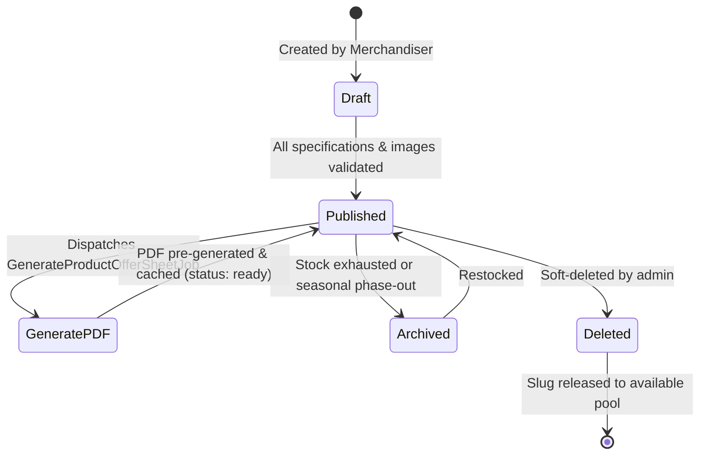
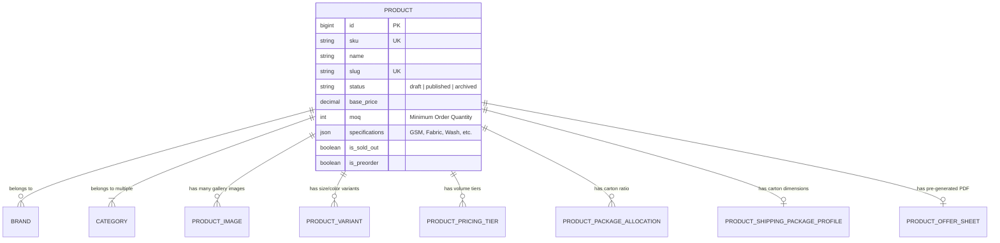

# AYAAN CLOTHING (AYC) — Products & Catalog Architecture

**Document Purpose**: Detailed technical specification for catalog lifecycle management, 3-tier wholesale pricing curves, package assortment ratios, media storage, and automated Offer Sheet generation triggers.  
**Audience**: Merchandisers, Catalog Engineers, Frontend Developers, Database Administrators.  
**Last Verified Date**: October 20, 2026  
**Environment Baseline**: Production Release `release_20261020_052638_a8d2fef` on Hostinger VPS `srv2010990`.

---

## 1. Product Lifecycle & State Progression

Products traverse an explicit lifecycle governed by the `status` column on the `products` table:



### State Definitions:
1. **`draft`**: Incomplete or unapproved item. Hidden from the customer storefront. Does not generate public Offer Sheets.
2. **`published`**: Active catalog item available for customer browsing, MOQ purchase, and RFQ inquiries. Triggers automatic background Offer Sheet pre-generation.
3. **`archived`**: Hidden from public browse queries but accessible directly via historical order lines.
4. **`deleted`**: Soft-deleted record (`deleted_at` timestamped). Releases historical slugs to prevent collision if a new product reuses the SKU or name.

---

## 2. Core Relational Data Model

A single catalog item coordinates multiple specialized child entities:



### Key Schema Entities:
* **`Product`**: Primary catalog entity (`products`). Holds SKU, slug, base price, MOQ, specifications, and availability flags.
* **`Brand`**: Fashion label / brand entity (`brands`). Holds brand name and logo image path used in official document headers.
* **`ProductImage`**: Ordered gallery images (`product_images`). Manages primary thumbnail vs. multi-angle detail shots.
* **`ProductVariant`**: Size, color, and stock attributes (`product_variants`).
* **`ProductOfferSheet`**: Registry of pre-generated canonical PDF artifacts (`product_offer_sheets`).

---

## 3. 3-Tier B2B Wholesale Pricing

Unlike B2C retail, AYC implements volume discounting curves to support international wholesale importers:

| Pricing Tier | Volume Range | Calculation Formula | Typical Margin / Discount |
| :--- | :--- | :--- | :--- |
| **Tier 1 (Base Wholesale)** | MOQ to Mid-Tier Threshold (e.g. 500 – 1,999 pcs) | Baseline wholesale price per unit | Standard wholesale catalog rate |
| **Tier 2 (Volume Discount)** | Mid-Tier to High-Tier (e.g. 2,000 – 4,999 pcs) | Configured in `product_pricing_tiers` | 5% – 12% discount off Tier 1 |
| **Tier 3 (Container Export)** | High-Tier Container Orders (e.g. $\ge$ 5,000 pcs) | Configured in `product_pricing_tiers` | 15% – 25% factory direct export rate |

### Cart & Checkout Resolution
* When a customer adds garments to their cart, `OrderCalculationService::calculate()` audits the total item quantity against the product's tier matrix.
* The tier discount is automatically applied to unit prices across the line item.

---

## 4. Package Assortment & Carton Ratio Breakdown

Global apparel export requires strict ratio packing per carton:
* **Carton Capacity**: Total garments per standard export carton (e.g. 24, 36, or 48 pcs).
* **Size Ratio Profile**: Distribution of garment sizes within each carton.
  - Example Ratio: `S: 1, M: 2, L: 2, XL: 1` (Total ratio units = 6).
  - For a 36-piece carton: 6 Small, 12 Medium, 12 Large, 6 Extra Large.
* **Shipping Specs Profile**: `ProductShippingPackageProfile` records carton length, width, height (cm), and gross weight (kg) to feed dynamic air/sea freight calculators.

---

## 5. Media Pipeline & Storage Layout

Product photography is converted and stored under `backend/storage/app/public/products/`:

```text
storage/app/public/products/
├── {product_id}/
│   ├── original_{hash}.jpg       # High-resolution original upload
│   ├── display_{hash}.webp       # 1200px optimized WebP for desktop UI
│   ├── thumb_{hash}.webp         # 400px optimized WebP for product grid
│   └── pdf_ready_{hash}.jpg      # RGB JPEG optimized for Dompdf rendering
```

### Media Invariants:
1. **Format Optimization**: WebP is used across all web views to minimize network transfer.
2. **PDF Engine Compatibility**: Dompdf has limited support for modern WebP features; therefore, `DocumentHelper` automatically resolves or transcodes images to standard RGB JPEGs during PDF generation.
3. **URL Deduplication**: Media URLs are normalized and deduplicated before rendering in Offer Sheet templates.

---

## 6. Automated PDF Generation Trigger

Whenever a product is published or its core specifications/images are updated in the admin portal:
1. `ProductController::store` or `update` executes.
2. An asynchronous job is dispatched to the background queue:
   ```php
   \App\Jobs\GenerateProductOfferSheetJob::dispatch($product->id)->afterCommit();
   ```
3. The queue worker generates, compresses, and caches the official 2–3-page Offer Sheet PDF, ensuring it is ready for instant download before any customer requests it.

---

## 7. Related Technical Documentation

* **[PRODUCT_OFFER_SHEETS.md](PRODUCT_OFFER_SHEETS.md)**: Dedicated guide on Offer Sheet pre-generation and compression.
* **[ORDERS_AND_CHECKOUT.md](ORDERS_AND_CHECKOUT.md)**: Pricing tiers and package breakdowns during checkout.
* **[COMMERCIAL_DOCUMENTS.md](COMMERCIAL_DOCUMENTS.md)**: Document rendering and branding standards.
