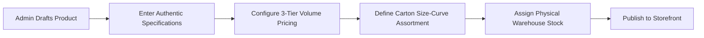

# Product Catalog & Inventory — AYAAN CLOTHING (AYC)

> [!NOTE]
> **Canonical Documentation Notice:** This document is preserved for historical context. The canonical, actively maintained technical documentation for product catalog and inventory management can be found in [PRODUCTS_AND_CATALOG.md](PRODUCTS_AND_CATALOG.md) and [PAYMENTS_AND_INVENTORY.md](PAYMENTS_AND_INVENTORY.md).

## 1. Product Lifecycle & Creation Workflow

Managing export garment stock lots and OEM production styles requires precision across physical specifications, volume pricing structures, and inventory tracking. Products are authored and maintained through the Admin Portal (`/ayc/products`).



---

## 2. Identifier Uniqueness & Duplicate Name Semantics

The data model enforces strict identifier rules designed specifically for apparel wholesale:

### A. Non-Unique Product Names
* **Business Rule**: Product display names (`products.name`) are **not** required to be unique.
* **Rationale**: An export manufacturer frequently produces repeat runs of popular styles (e.g., *"Classic Crewneck Sweatshirt"* or *"Heavyweight Cargo Pants"*) differentiated by color, fabric weight, or production season. Requiring unique names would force artificial suffixes on customer-facing titles.

### B. Strictly Unique Identifiers
To guarantee relational integrity, logistics tracking, and URL routing, three identifiers must be globally unique:
1. **Master SKU (`products.sku`)**: Unique alphanumeric code (e.g. `AYC-SWT-BLK-01`).
2. **Visible Product ID (`products.product_id`)**: Commercial trade reference displayed on Offer Sheets and invoices (e.g. `PRD-0089`).
3. **URL Slug (`products.slug`)**: Canonical URL path segment (e.g. `classic-crewneck-sweatshirt-black`).

### C. Slug Recycling for Soft-Deleted Products
When a product is deleted or archived, its URL slug is automatically released via database migration `2026_09_26_220000`:
* The deleted record's slug is transformed to `{slug}-deleted-{timestamp}`.
* This immediately frees the clean, human-readable slug for assignment to a new product without constraint violations.

---

## 3. Garment Specifications & Fabric Integrity

Product specifications are stored in PostgreSQL JSONB (`products.specifications`). To maintain brand trust with international buyers:

1. **Zero Specification Fabrication**: Only attributes explicitly verified by the merchandiser (Fabric Composition, GSM, Fit, Weave, Care Instructions) are saved.
2. **Elimination of Generic GSM Claims**: Garments without measured weight data omit the GSM field entirely. Universal boilerplate claims (e.g., *"Premium 200+ GSM"*) are strictly prohibited across all product descriptions and metadata generators.
3. **Country of Origin**: Standardized as `Bangladesh (Export Certified)` across all catalog items.

---

## 4. Supplier Privacy & Cost Confidentiality

To protect factory sourcing relationships and profit margins:
* **Internal Supplier Fields**: `products.supplier_id` and `products.supplier_name`.
* **Internal Cost Fields**: `products.buying_price` and historical snapshot `order_items.buying_price_at_sale`.
* **Strict Privacy Boundary**: The Laravel API layer filters out all supplier and cost fields from public resources. These attributes are never transmitted to customer-facing clients or exposed in public JSON responses. Only administrators with `catalog.manage` or `reports.view` permissions can view cost structures.

---

## 5. Pinned & Featured Catalog Ordering Contract

The product catalog and customer-facing Featured Products section share an authoritative, synchronized ordering and eligibility model (`src/app/ayc/products/page.tsx`, `backend/app/Http/Controllers/Api/V1/ProductController.php`, and `backend/app/Http/Controllers/Api/V1/HomepageController.php`):

### A. Admin Manual Sequence Representation & Persistence
* **Admin Sequence Definition**: The Admin Product Management table displays all products in a unified, deterministic order where pinned products (`is_pinned = TRUE` or `is_featured = TRUE`) precede unpinned products.
* **Manual Reordering**: When administrators reorder products via drag-and-drop or **Move Up / Down** controls, `PUT /api/v1/products/reorder` atomically updates:
  - `products.sort_order`: Sequential integer (`1..N`) representing overall catalog position.
  - `products.pinned_order` and `products.featured_sort_order`: Sequential integer (`1..M`) for pinned items.
  - `homepage_featured_products.sort_order`: Synchronized `sort_order` in the featured pivot table.
* **Default Tie-Breaker**: For products whose custom ranking is unassigned or equal (`sort_order = 0` / `pinned_order = 0`), the canonical secondary key is `products.id ASC` (deterministic primary key order).

### B. Customer Storefront Featured Products Ordering
* **Priority 1 (Admin-Curated Pinned Products)**:
  - Eligible products present in `homepage_featured_products` (`is_active = TRUE`) are rendered first in strict `sort_order ASC`, with `product_id ASC` tie-breaking.
* **Priority 2 (Remaining Eligible Products)**:
  - Storefront-eligible products not pinned follow in upload sequence (`created_at DESC`), ensuring new catalog additions remain discoverable without displacing curated items.
* **No Client-Side Reordering**: Next.js client components (`src/components/home/FeaturedProducts.tsx`) and service mappers (`src/lib/services/products.ts`) preserve the exact array order delivered by the backend API.

### C. Eligibility vs. Ordering Boundary
* **Eligibility Rule**: A product is only eligible for public storefront display if:
  1. `products.status = 'published'` (draft and archived items are strictly excluded).
  2. `products.is_hidden_from_storefront = FALSE`.
  3. `products.deleted_at IS NULL`.
* Eligibility determines *whether* a product may appear, while the admin manual sequence strictly dictates *where* it appears among eligible items.

### D. Cache Invalidation & Event Propagation
* When an admin updates product pins or reorders products:
  - Backend: `CatalogCacheService::invalidateAll()` clears key caches and `CatalogCacheService::bumpFeaturedVersion()` immediately invalidates all versioned featured product page cache keys (`catalog:products:featured:v{N}`).
  - Frontend: `homepageService.invalidateStorefrontCache()` and `ayaan:homepage-updated` custom DOM events notify mounted browser tabs to reload active featured slices.

### E. Regression Test Coverage
* Behavior is safeguarded by automated regression suites:
  - `tests/admin-storefront-featured-ordering-reconciliation.test.ts` (covers manual sequence, eligibility, pin vs rank separation, persistence, frontend parity, and zero regressions).
  - `tests/featured-products-order.test.ts` (verifies Priority 1 sort_order, Priority 2 created_at DESC, and deduplication).
  - `tests/admin-featured-products-tile-and-priority.test.ts` (verifies admin metrics and storefront priority invariants).

---

## 6. Authoritative Inventory Model & Stock Deductions

AYC operates on a **Single Authoritative Physical Stock Model**:

### A. No Reserved Stock Complexity
* Migration `2026_09_29_070000` dropped the legacy `reserved_quantity` column from the `inventories` table.
* **Immediate Stock Deduction**: When a buyer submits an order or a POS cashier tenders a sale, the exact carton unit quantity is deducted immediately from physical inventory (`inventories.quantity` and `products.stock`) inside a database transaction:
  ```php
  DB::transaction(function () use ($orderData) {
      // 1. Lock inventory row
      $inventory = Inventory::where('product_id', $productId)->lockForUpdate()->first();
      
      // 2. Validate availability
      if ($inventory->quantity < $requiredQuantity) {
          throw new InsufficientStockException("Insufficient stock available.");
      }
      
      // 3. Deduct stock immediately
      $inventory->decrement('quantity', $requiredQuantity);
      $product->decrement('stock', $requiredQuantity);
  });
  ```

### B. Automatic Stock Restorations
If an order is cancelled or payment verification is permanently rejected, the system automatically restores the deducted quantity back to the active warehouse inventory, logging an audit record in `admin_inventory_adjustments`.

### C. Full-Page Stock Management & Auditing
The Stock Management interface (`/ayc/products/inventory`) provides:
* Warehouse-level physical count updates.
* Historical change logs capturing timestamp, previous quantity, new quantity, delta, and operating administrator ID.
* Low-stock warning indicators triggered when availability drops below carton MOQ thresholds.
