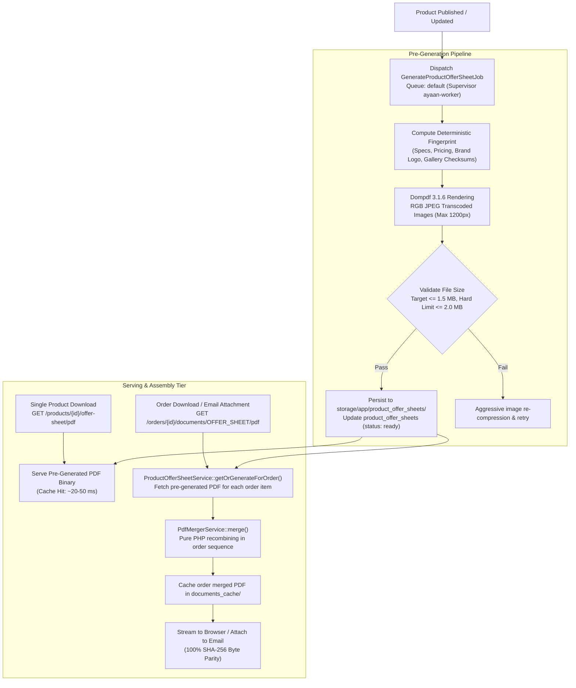

# AYAAN CLOTHING (AYC) — Product Offer Sheet Architecture

**Document Purpose**: Definitive technical specification for the canonical Product Offer Sheet system: pre-generation lifecycle, compression thresholds ($\le 1.5$ MB target, 2.0 MB maximum), fingerprint invalidation, pure PHP PDF merging, and download entry points.  
**Audience**: Backend Engineers, DevOps Engineers, Catalog Managers, QA Engineers, AI Coding Agents.  
**Last Verified Date**: October 20, 2026  
**Environment Baseline**: Production Release `release_20261020_052638_a8d2fef` on Hostinger VPS `srv2010990`.

---

## 1. Architectural Motivation & Strategy

Historical implementations rendered product Offer Sheets on-demand during customer requests or order placement. This caused three severe production bottlenecks:
1. High CPU and memory spikes on PHP-FPM when multiple customers requested PDFs simultaneously.
2. Uncompressed image payloads resulting in 5–15 MB PDFs that failed email attachment delivery.
3. Inconsistent layouts between client-side `jsPDF` generators and backend templates.

The current architecture resolves these challenges through **product-level pre-generation, rigorous image compression, deterministic artifact caching, and pure PHP PDF merging**:



---

## 2. Pre-Generation & Publication Lifecycle

Individual product Offer Sheets are generated and cached **once** when a product is published or modified:

### A. Database Registry (`product_offer_sheets` table)
| Column | Type | Description |
| :--- | :--- | :--- |
| `id` | `bigint` | Primary key |
| `product_id` | `bigint` | Foreign key referencing `products.id` |
| `sku` | `varchar` | Authoritative product SKU |
| `status` | `varchar` | Status: `pending`, `processing`, `ready`, `failed` |
| `fingerprint` | `varchar` | Deterministic SHA-256 data fingerprint |
| `file_path` | `varchar` | Relative disk storage path (`product_offer_sheets/...`) |
| `filename` | `varchar` | Canonical download filename (`AYC_Offer_Sheet_{SKU}.pdf`) |
| `filesize_bytes` | `integer` | Exact file size in bytes |
| `checksum_sha256` | `varchar` | Cryptographic SHA-256 hash of PDF binary |
| `page_count` | `integer` | Number of rendered pages (typically 2 or 3 pages) |
| `generated_at` | `timestamp`| Timestamp of generation completion |

### B. Background Execution (`GenerateProductOfferSheetJob`)
* **Queue**: `config('order.emails.queue', 'default')` processed by Supervisor daemon `ayaan-worker`.
* **Retry Strategy**: 3 attempts with exponential backoff (`[30, 90, 180]` seconds).
* **Execution Boundary**: Wrapped in `afterCommit()` to guarantee all product database rows and media uploads are committed before rendering begins.

### C. Artisan CLI Command
To warm or regenerate the entire catalog via terminal:
```bash
# Pre-generate all published products
php artisan ayaan:pregenerate-offer-sheets

# Force regeneration of a specific product by SKU or ID
php artisan ayaan:pregenerate-offer-sheets --product=FAC-TSH-MEN-6074-01 --force
```

---

## 3. Compression & Size Enforcement Rules

To ensure fast customer downloads and comply with email gateway limits:
* **Target Size**: **$\le$ 1.5 MB** per standard 2–3-page product Offer Sheet.
* **Hard Maximum Limit**: **2.0 MB** absolute cap.

### Measured Production Statistics (Verified October 20, 2026):
| Product ID | Product SKU | Description | Pages | Measured Size | Production Compliance |
| :---: | :--- | :--- | :---: | :---: | :---: |
| #177 | `FAC-TSH-MEN-6074-01` | Men's AOP T-shirt | 2 | **476.96 KB (0.47 MB)** | **PASS** ($< 1.5$ MB) |
| #152 | `ONL-CAR-LAD-2274` | Ladies' Wide-Leg Cargo Pants | 2 | **154.77 KB (0.15 MB)** | **PASS** ($< 1.5$ MB) |
| #23 | `AY-APP-MEN-2534` | Men's Branded Denim Shirts | 3 | **334.54 KB (0.33 MB)** | **PASS** ($< 1.5$ MB) |

### Compression Implementation (`DocumentHelper` & `ProductOfferSheetService`):
1. **Resolution Bounds**: High-resolution gallery images (often 4K or 10 MB+ from camera uploads) are scaled down to maximum 1200px width/height while maintaining aspect ratio.
2. **Quality & Color Space**: Converted into standard RGB JPEGs at quality 80. This eliminates transparency rendering bugs in Dompdf while achieving a $>85\%$ reduction in binary size.
3. **FlateDecode PDF Streams**: Internal PDF content streams and cross-reference tables are compressed using zlib `FlateDecode`.

---

## 4. Deterministic Artifact Fingerprints & Invalidation

To guarantee that cached artifacts are never stale, `ProductOfferSheetService::computeFingerprint()` computes a composite fingerprint covering all rendered data:

```php
public function computeFingerprint(Product $product): string
{
    $brandName = $product->brand?->name ?? '';
    $brandLogoChecksum = $this->resolveLocalImageChecksum($product->brand?->logo_url);
    
    // Ordered gallery images with individual file content checksums
    $galleryFingerprint = $product->images->map(function ($img) {
        $checksum = $this->resolveLocalImageChecksum($img->image_url);
        return "{$img->id}_{$img->is_primary}_{$img->sort_order}_{$checksum}";
    })->join(',');

    $primaryChecksum = $this->resolveLocalImageChecksum($product->primary_image_url);
    $specsFingerprint = json_encode($product->specifications ?? '');
    
    // Exporter profile (company address, phone, email)
    $exporter = DocumentHelper::getExporterProfile();
    $exporterFingerprint = md5(implode('|', [
        $exporter['company_name'], $exporter['address'], $exporter['whatsapp_display']
    ]));

    return hash('sha256', implode('~', [
        $product->id, $product->sku, $product->name, $product->base_price,
        $product->moq, $specsFingerprint, $primaryChecksum, $galleryFingerprint,
        $brandName, $brandLogoChecksum, $exporterFingerprint
    ]));
}
```

### Invalidation Rules:
* **Invalidates & Regenerates**: Updates to product title, SKU, base price, wholesale price, bulk pricing tiers, full stock price, MOQ, specifications (GSM, fabric, wash care, CBM, weight), primary photo, gallery photos, brand name, brand logo, or company exporter profile.
* **Does NOT Invalidate**: Updates to stock quantities, inventory warehouse balances, or order history (these do not appear on product Offer Sheets).

### Documented Cache Fingerprint Gaps & Limitations:
1. **Blade Template File Hash Omission**: The Blade view `resources/views/documents/offer-sheet.blade.php` (and associated partials/stylesheets) is **not** hashed in `computeFingerprint()`. Changes to HTML structure, styling, or static disclaimers do not invalidate existing disk caches. Modifying template designs requires a manual cache purge (`storage/app/product_offer_sheets/`).
2. **Package Assortment Text Omission**: The product field `package_assortment_message` is rendered in the document if present, but is omitted from the fingerprint payload.
3. **Absence of Template-Version Invalidation**: The fingerprint string does not incorporate a template version constant (e.g. `v1`, `v2`), meaning server-side layout updates cannot programmatically invalidate earlier caches without wiping storage.

---

## 5. Pure PHP Multi-Product PDF Merger (`PdfMergerService`)

When an order contains multiple products, or when an administrative user requests a bulk Offer Sheet for several items, the system combines individual canonical product PDFs into a single document:

### A. Pure PHP Implementation Highlights
* **Zero Shell Dependencies**: Operates 100% in native PHP memory without requiring `pdftk`, `poppler-utils`, or `ghostscript` binaries.
* **Object Parsing & Re-Indexing**:
  - Parses `%PDF-1.4` objects (`obj ... endobj`).
  - Rewrites internal object numbers (`objId`) sequentially to avoid collisions.
  - Builds a unified Master Catalog (`1 0 obj << /Type /Catalog /Pages 2 0 R >>`).
  - Builds a unified Master Pages Root (`2 0 obj << /Type /Pages /Kids [...] /Count N >>`).
* **Resource Isolation**: Retains independent `/Resources` subtrees for each document, ensuring fonts (`/F1`, `/F2`) and image XObjects (`/Im1`, `/Im2`) from different products never overwrite or distort each other.
* **Strict Sequence Preservation**: Pages appear in the exact order items were added to the order.

### Verified Multi-Product Merge (Order #31 Test):
* **Order Item 1**: Product 177 (2 pages) $\rightarrow$ Pages 1 & 2
* **Order Item 2**: Product 152 (2 pages) $\rightarrow$ Pages 3 & 4
* **Order Item 3**: Product 23 (3 pages) $\rightarrow$ Pages 5, 6 & 7
* **Combined Output**: **7 pages**, **988,781 bytes (0.94 MB)**, Retrieval time: **72 ms** (instant cache hit).

---

## 6. Complete Offer Sheet Entry Points

| Entry Point | Trigger Location | Target Document | Underlying Mechanism |
| :--- | :--- | :--- | :--- |
| **Catalog Single Download** | Product Detail Page (`/products/[slug]`) | Single Product Offer Sheet | `GET /api/v1/products/{id}/offer-sheet/pdf` |
| **Catalog Bulk Selection** | Products Browse (`/products`) | Multi-Product Combined PDF | `POST /api/v1/products/bulk-offer-sheet` |
| **Order Placed Modal** | `CheckoutModal.tsx` ("Product Offer Sheets" icon) | Order Combined Offer Sheet | `GET /api/v1/orders/{id}/documents/OFFER_SHEET/pdf` |
| **Customer Documents Center** | `/dashboard/documents` | Order Combined Offer Sheet | `GET /api/v1/orders/{id}/documents/OFFER_SHEET/pdf` |
| **Order Confirmation Email** | `SendOrderConfirmationEmailJob` | Order Combined Offer Sheet | Attached directly from `documents_cache/` |
| **Admin Documents Viewer** | `/ayc/orders/[id]` | Order Combined Offer Sheet | `GET /ayc/api/orders/{id}/documents/OFFER_SHEET/pdf` |

### Client-Side vs Server-Side PDF Generation Reality:
* **Checkout Modal Offer Sheets**: In `CheckoutModal.tsx`, the legacy client-side jsPDF fallback for Offer Sheets was eradicated in commit `a8d2fef`. Offer Sheet downloads strictly consume the canonical backend binary. If generation fails, a retry banner is shown.
* **Client-Side jsPDF Generator Implementation (`src/lib/pdf-generator.ts`)**: Client-side PDF generation remains active in the codebase and is utilized for:
  1. Instant in-browser iframe document previews in `/dashboard/documents` (`generateCommercialDocumentPDFBlob`).
  2. Emergency Proforma Invoice download fallback in `CheckoutModal.tsx` (`downloadProformaInvoicePDF`) if the backend service is temporarily unreachable.
  3. Secondary fallback downloads in `/dashboard/orders/[id]` and `DocumentViewer.tsx`.

---

## 7. Related Technical Documentation

* **[PROFORMA_INVOICES.md](PROFORMA_INVOICES.md)**: Separate lifecycle for order-specific Proforma Invoices.
* **[DOCUMENT_STORAGE_AND_DELIVERY.md](DOCUMENT_STORAGE_AND_DELIVERY.md)**: Storage paths and SHA-256 parity guarantees.
* **[COMMERCIAL_DOCUMENTS.md](COMMERCIAL_DOCUMENTS.md)**: Overview of export trade documentation.
