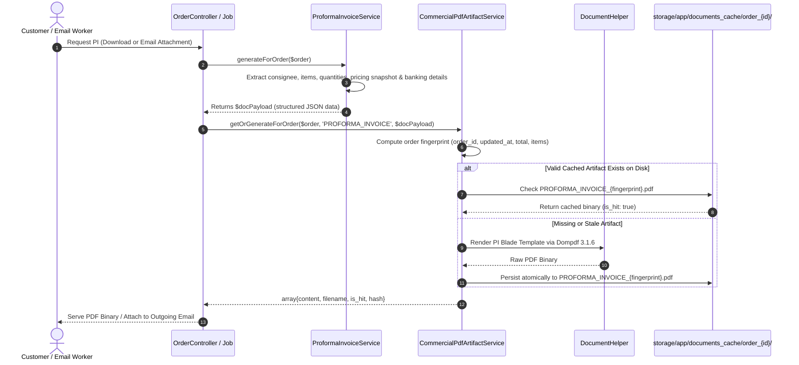

# AYAAN CLOTHING (AYC) — Proforma Invoice (PI) Architecture

**Document Purpose**: Detailed technical specification for order-specific Proforma Invoice (PI) generation, export banking remittance coordinates, commercial calculation rules, disk persistence, and transactional email attachment parity.  
**Audience**: Financial Accountants, Backend Engineers, Export Operations Officers, Billing Developers.  
**Last Verified Date**: October 20, 2026  
**Environment Baseline**: Production Release `release_20261020_052638_a8d2fef` on Hostinger VPS `srv2010990`.

---

## 1. Scope & Separation from Product Offer Sheets

A fundamental architectural distinction exists between **Product Offer Sheets** and **Proforma Invoices (PI)**:

| Architectural Attribute | Product Offer Sheet (`OFFER_SHEET`) | Proforma Invoice (`PROFORMA_INVOICE`) |
| :--- | :--- | :--- |
| **Domain Scope** | Generic product presentation & catalog specifications | Order-specific legal billing & commercial contract |
| **Target Entity** | Catalog Product (Shared across all buyers) | Specific Customer Order (`orders` table) |
| **Buyer Personalization**| Shared catalog content (Not personalized) | Contains buyer company name, destination port, consignee |
| **Financial Details** | Base price & wholesale volume tier curves | Exact quantities, snapshot prices, discounts, freight, grand total |
| **Banking Coordinates** | General company contacts only | Authoritative international SWIFT / IBAN remittance coordinates |
| **Generation Lifecycle**| Pre-generated once upon product publishing | Generated upon order placement; updated only if order changes |
| **Canonical Service** | `App\Services\Documents\ProductOfferSheetService` | `App\Services\Documents\ProformaInvoiceService` |

> **Critical Maintainer Rule**: Never replace the Proforma Invoice with a generic product Offer Sheet or merge PI generation into the product-level Offer Sheet generator. The PI is an order-specific financial document.

---

## 2. Proforma Invoice Generation Architecture

---

## 3. Core Data Elements & Calculation Rules

The Proforma Invoice payload is constructed by `ProformaInvoiceService::generateForOrder($order)`:

### A. Document Identification
* **Document Number**: `docNumber` formatted as `PI-YYYY-XXXXXX` (derived from the order's unique alphanumeric reference).
* **Issue Date**: Order creation date (`orders.created_at`).
* **Validity Period**: Standard 15 or 30 days from issuance.

### B. Consignee & International Shipping Profile
* **Consignee**: Company name, contact person, street address, city, country.
* **Destination Port**: International port code (e.g. `DEHAM` for Hamburg, `USLAX` for Los Angeles).
* **Mode of Transport**: Air Freight, Ocean Freight, or Manual Export Arrangement.

### C. Financial Calculation Table
1. **Line Items**: Itemized table showing:
   - Garment SKU and Description.
   - Quantity ordered (pcs) and carton count.
   - Snapshot Unit Price (USD) locked at the moment of checkout.
   - Line Total (Quantity $\times$ Unit Price).
2. **Merchandise Subtotal**: Sum of all line item totals.
3. **Discounts**: Itemized coupon code or promotional discount deductions.
4. **Export Freight Charges**: Air or ocean shipping charges calculated based on gross weight/CBM.
5. **Grand Total**: Final payable amount in USD (`$orders.total_amount`).

### D. Export Remittance Banking Coordinates
Extracted authoritatively from `DocumentHelper::getBankingProfile()`:
* **Beneficiary Account Name**: Registered corporate manufacturing entity name.
* **Bank Name**: Authoritative commercial export bank.
* **Branch Address**: Principal export branch in Dhaka, Bangladesh.
* **SWIFT / BIC Code**: Valid international telegraphic routing identifier.
* **Account Number / IBAN**: Dedicated export remittance account.

---

## 4. Disk Caching & 100% SHA-256 Byte Parity

* **Storage Path**: `backend/storage/app/documents_cache/order_{id}/PROFORMA_INVOICE_{fingerprint}.pdf`
* **Download Filename**: `AYC_PI_{pi_number}.pdf` (e.g. `AYC_PI_PI-2026-WYUWFB.pdf`)
* **Typical File Size**: ~16 KB – 48 KB (vector typography, lightweight formatting).
* **Byte Parity Guarantee**: Because `OrderController::downloadDocumentPdf` and `SendOrderConfirmationEmailJob` both call `CommercialPdfArtifactService::getOrGenerateForOrder()`, the customer downloads the exact byte-for-byte identical file that is attached to their confirmation email.

### Client-Side Download Fallback in Checkout Modal:
While `CommercialPdfArtifactService` and Dompdf 3.1 serve as the canonical generator for all PI downloads and email attachments, `CheckoutModal.tsx` retains an emergency client-side fallback in its catch block (`downloadProformaInvoicePDF(confirmedOrder)` via `src/lib/pdf-generator.ts`). If the backend request fails or times out, the browser renders an emergency client-side Proforma Invoice so the customer is not stranded without payment instructions.

---

## 5. Approved Reference Rebuild & Layout Standards (v7 Canonical Commercial PDF Layout)

As part of the v7 commercial document visual refinements and data-integrity audit (October 21, 2026):

* **Page Geometry & Invisible Border**:
  - Strict A4 portrait (`210 mm x 297 mm`, `595.28 x 841.89 pt`).
  - The visible neutral-grey border stroke has been **completely removed** (`$pdf->rectangle(...)` call removed in Dompdf canvas `page_script`).
  - The exact physical margins (`14mm 14mm 16mm 14mm`) and 7 mm (`19.84 pt`) content insets are strictly **retained**, preserving identical spacing and header/footer positioning.
* **Header Layout & Contact Lines**:
  - Full-width dark navy block (`#0f172a`).
  - Preserved blue rectangular box (`#1e3a8a`, `w = 195px`, `h = 56px`) with vertically and horizontally centered `PROFORMA INVOICE` title (10.5pt bold) and subtitle `Official PI (USD)` (7.8pt).
  - Clean company contact lines:
    - `Email: sales@ayaanclothing.com`
    - `WhatsApp: +880 1620-853502` (immediately following line; no bullet, no combined line).
* **Parties Panels & Authoritative Beneficiary Settings**:
  - Side-by-side Exporter/Beneficiary card and Consignee/Buyer card.
  - **Admin Editability**: All 6 Exporter/Beneficiary fields are independently editable and strictly validated under `Admin → Storefront → Homepage Management`:
    1. Company Name (`AYAAN CLOTHING`)
    2. Registered Address (`House #33 (2nd floor), Road #12, Sector #11`)
    3. Country of Origin (`Bangladesh`)
    4. Contact Email (`sales@ayaanclothing.com`)
    5. WhatsApp Number (`+880 1620-853502`)
    6. Registration Number (`TRAD/DNCC/012458/2022`)
  - Strict frontend and backend validation rejects missing, null, empty, or whitespace-only inputs.
  - Beneficiary card displays email and WhatsApp on separate lines without bullet separators; obsolete `export@` email is eliminated.
* **Commercial Metadata Strip**: 6-item grid displaying P.I. Number, Order Reference, Issue Date, Validity, Shipping Arrangement, and Payment Terms.
* **Consignee Address Normalization**:
  - Populates `postal_code`, `city`, and `country` in `$buyer` array without duplicate punctuation (`implode(', ', array_filter([...]))`).
* **HS Code Classification**:
  - Centralized in `DocumentHelper::resolveHsCode(?string $productName, ?string $explicitHsCode = null)`:
    - Pants / Denim: `6203.42.00`
    - Jackets / Outerwear: `6201.40.00`
    - Hoodies / Sweatshirts: `6110.20.00`
    - T-Shirts: `6109.10.00`
* **Typography Enhancements & Line Spacing (~2 pt Increase)**:
  - Body text and table content: ~9.5–10.5 pt with comfortable line heights.
  - Unit prices & Line amounts: 11.0 pt bold monospace right-aligned (`white-space: nowrap;`).
  - Subtotal amount: 11.0 pt bold.
  - Merchandise Total / Total Payable: **13.5 pt bold** in `#1e3a8a`.
  - Footer: 8.0 pt legible grey.
  - Non-wrapping table columns: Quantity (`1,000 pcs`), Unit Price, and Amount USD are wrapped in `white-space: nowrap;` to prevent awkward splitting.
* **Financial Calculation & Tax Reconciliation**:
  - **Audit Finding**: Order 45 displayed line items totaling USD 4,980.00 but printed Merchandise Total USD 5,229.00 (+USD 249.00 discrepancy) because the template hardcoded `$0.00 (Zero Rated)` while printing `$grandTotal`.
  - **Resolution**: Template now dynamically renders the authoritative `$tax` amount (`Estimated Tax: USD 249.00` at 5%) when tax > 0, reconciling line items ($4,980.00) + tax ($249.00) = Merchandise Total ($5,229.00). When tax is zero, displays `$0.00 (Zero Rated)`.
  - **Price Snapshots**: Authoritative order-item snapshots (e.g. $4.30 for Item 198 Mens Interlock Jacket) are preserved rather than overwritten with catalog prices.
* **Authorized Signatory Section**:
  - Heading reads strictly: `Authorized Signatory` (`& Export Seal` is removed).
  - Deliberate top whitespace (`margin-top: 24px`) provides clean visual separation from the banking panel.
  - Right-aligned and safely inset within page content boundaries.
* **Dynamic Canvas Footer**: Printed at $y = 814.0$ pt (`AYAAN CLOTHING • Proforma Invoice Ref: {ref} • Generated on {date} • Page {PAGE_NUM} of {PAGE_COUNT}`).
* **Deterministic Layout Invalidation**:
  - `CommercialPdfArtifactService::LAYOUT_VERSION = 'v7_canonical_layout'`.
  - Exporter profile checksum is incorporated into `computeOrderFingerprint()`, ensuring changes to beneficiary settings automatically invalidate cached documents.

---

## 6. Related Technical Documentation

* **[PRODUCT_OFFER_SHEETS.md](PRODUCT_OFFER_SHEETS.md)**: Product Offer Sheet pre-generation and merger.
* **[COMMERCIAL_DOCUMENTS.md](COMMERCIAL_DOCUMENTS.md)**: General commercial export documents catalog.
* **[DOCUMENT_STORAGE_AND_DELIVERY.md](DOCUMENT_STORAGE_AND_DELIVERY.md)**: Disk caching and byte parity mechanics.

