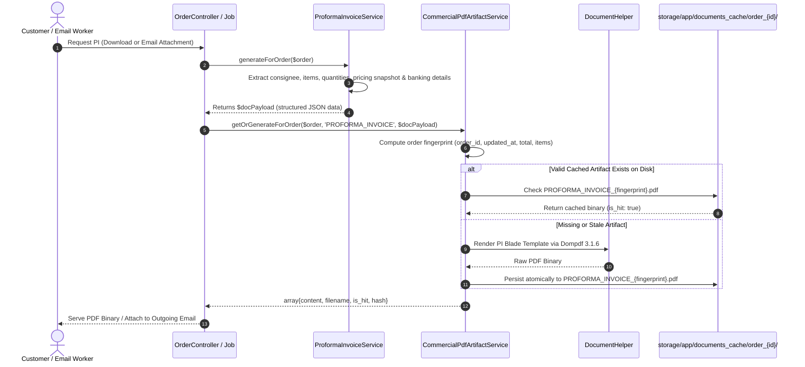

# AYAAN CLOTHING (AYC) — Proforma Invoice (PI) Architecture

**Document Purpose**: Detailed technical specification for order-specific Proforma Invoice (PI) generation, export banking remittance coordinates, commercial calculation rules, disk persistence, and transactional email attachment parity.  
**Audience**: Financial Accountants, Backend Engineers, Export Operations Officers, Billing Developers.  
**Last Verified Date**: October 20, 2026  
**Environment Baseline**: Production Release `release_20261020_052638_a8d2fef` on Hostinger VPS `srv2010990`.

---

## 1. Scope & Separation from Product Offer Sheets

A fundamental architectural distinction exists between **Product Offer Sheets** and **Proforma Invoices (PI)**:

| Architectural Attribute | Product Offer Sheet (`OFFER_SHEET`) | Proforma Invoice (`PROFORMA_INVOICE`) |
| :--- | :--- | :--- |
| **Domain Scope** | Generic product presentation & catalog specifications | Order-specific legal billing & commercial contract |
| **Target Entity** | Catalog Product (Shared across all buyers) | Specific Customer Order (`orders` table) |
| **Buyer Personalization**| Shared catalog content (Not personalized) | Contains buyer company name, destination port, consignee |
| **Financial Details** | Base price & wholesale volume tier curves | Exact quantities, snapshot prices, discounts, freight, grand total |
| **Banking Coordinates** | General company contacts only | Authoritative international SWIFT / IBAN remittance coordinates |
| **Generation Lifecycle**| Pre-generated once upon product publishing | Generated upon order placement; updated only if order changes |
| **Canonical Service** | `App\Services\Documents\ProductOfferSheetService` | `App\Services\Documents\ProformaInvoiceService` |

> **Critical Maintainer Rule**: Never replace the Proforma Invoice with a generic product Offer Sheet or merge PI generation into the product-level Offer Sheet generator. The PI is an order-specific financial document.

---

## 2. Proforma Invoice Generation Architecture

---

## 3. Core Data Elements & Calculation Rules

The Proforma Invoice payload is constructed by `ProformaInvoiceService::generateForOrder($order)`:

### A. Document Identification
* **Document Number**: `docNumber` formatted as `PI-YYYY-XXXXXX` (derived from the order's unique alphanumeric reference).
* **Issue Date**: Order creation date (`orders.created_at`).
* **Validity Period**: Standard 15 or 30 days from issuance.

### B. Consignee & International Shipping Profile
* **Consignee**: Company name, contact person, street address, city, country.
* **Destination Port**: International port code (e.g. `DEHAM` for Hamburg, `USLAX` for Los Angeles).
* **Mode of Transport**: Air Freight, Ocean Freight, or Manual Export Arrangement.

### C. Financial Calculation Table
1. **Line Items**: Itemized table showing:
   - Garment SKU and Description.
   - Quantity ordered (pcs) and carton count.
   - Snapshot Unit Price (USD) locked at the moment of checkout.
   - Line Total (Quantity $\times$ Unit Price).
2. **Merchandise Subtotal**: Sum of all line item totals.
3. **Discounts**: Itemized coupon code or promotional discount deductions.
4. **Export Freight Charges**: Air or ocean shipping charges calculated based on gross weight/CBM.
5. **Grand Total**: Final payable amount in USD (`$orders.total_amount`).

### D. Export Remittance Banking Coordinates
Extracted authoritatively from `DocumentHelper::getBankingProfile()`:
* **Beneficiary Account Name**: Registered corporate manufacturing entity name.
* **Bank Name**: Authoritative commercial export bank.
* **Branch Address**: Principal export branch in Dhaka, Bangladesh.
* **SWIFT / BIC Code**: Valid international telegraphic routing identifier.
* **Account Number / IBAN**: Dedicated export remittance account.

---

## 4. Disk Caching & 100% SHA-256 Byte Parity

* **Storage Path**: `backend/storage/app/documents_cache/order_{id}/PROFORMA_INVOICE_{fingerprint}.pdf`
* **Download Filename**: `AYC_PI_{pi_number}.pdf` (e.g. `AYC_PI_PI-2026-WYUWFB.pdf`)
* **Typical File Size**: ~16 KB – 48 KB (vector typography, lightweight formatting).
* **Byte Parity Guarantee**: Because `OrderController::downloadDocumentPdf` and `SendOrderConfirmationEmailJob` both call `CommercialPdfArtifactService::getOrGenerateForOrder()`, the customer downloads the exact byte-for-byte identical file that is attached to their confirmation email.

### Client-Side Download Fallback in Checkout Modal:
While `CommercialPdfArtifactService` and Dompdf 3.1 serve as the canonical generator for all PI downloads and email attachments, `CheckoutModal.tsx` retains an emergency client-side fallback in its catch block (`downloadProformaInvoicePDF(confirmedOrder)` via `src/lib/pdf-generator.ts`). If the backend request fails or times out, the browser renders an emergency client-side Proforma Invoice so the customer is not stranded without payment instructions.

---

## 5. Approved Reference Rebuild & Layout Standards (v5 Refined Layout)

As part of the v5 commercial document overhaul, the Proforma Invoice was refined across both the Dompdf backend template (`backend/resources/views/pdf/proforma-invoice.blade.php`) and the jsPDF client fallback (`src/lib/pdf-generator.ts`):

* **Page Geometry & Frame**: Strict A4 portrait (`210 mm x 297 mm`, `595.28 x 841.89 pt`) with 14 mm margins and a subtle full-page outer border outline (`#e2e8f0`, 0.75pt) inset precisely 7 mm from the physical paper edges on every page.
* **Header Layout**:
  - Full-width dark navy block (`#0f172a`).
  - Left side: Authoritative exporter branding, address, origin, export desk email/WhatsApp, and BGMEA certification. Company title enlarged to 16pt.
  - Right side: Preserved blue rectangular box (`#1d4ed8`, `w = 52 mm`, `h = 16 mm`, `x = right - 56 mm`, `y = 4 mm`). The box coordinates and dimensions are strictly preserved.
  - **Internal Alignment**: Title `PROFORMA INVOICE` and subtitle `Official PI (USD)` are precisely centered horizontally and vertically within the blue box as a balanced composition.
* **Parties Panels**: Side-by-side Exporter/Beneficiary card and Consignee/Buyer card.
* **Commercial Metadata Strip**: 6-item grid displaying P.I. Number, Order Reference, Issue Date, Validity, Shipping Arrangement, and Payment Terms.
* **Typography Enhancements (+1 pt)**: All text elements bumped by +1 pt (company name 16pt, section headings 8.5–9pt, body 7.8–8.5pt, table text 7.8–8.2pt) for immediate legibility without visual fatigue.
* **Prominent Financial Figures (+2 pt)**: Pricing numbers bumped by +2 pt (unit prices 8.8pt, line amounts 8.8pt, subtotal 9.2pt, and Merchandise Total 10pt bold in `#1d4ed8`).
* **Goods Table**: 7 columns (`#`, Description of Goods & Package Assortment, SKU / Style, HS Code, Quantity, Unit Price, Amount USD) with clean alignments and row spacing.
* **Shipping & Delivery vs Financial Summary**: Paired lower section. Left: Shipping arrangements note, scheduled packaging summary, logistics desk contact. Right: Goods Value / Subtotal, Estimated Tax (B2B Export Zero-Rated), and Merchandise Total in bold USD.
* **Beneficiary Bank Details**: Full-width light grey/blue card with authoritative bank name, account title, account number, SWIFT code, and branch address.
* **Signature Alignment & Zero-Clipping**: Authorized Signatory block inset safely (`margin-right: 12px` / `right: 14mm`) ensuring it never overlaps or touches the outer page border outline.
* **Dynamic Canvas Footer**: Printed at $y = 814.0$ pt (`Official Commercial Document • Page {PAGE_NUM} of {PAGE_COUNT}`).
* **Deterministic Layout Invalidation**: `CommercialPdfArtifactService::LAYOUT_VERSION = 'v5_refined_layout'` is incorporated into `computeOrderFingerprint()`, ensuring all previously cached PDFs are automatically invalidated upon deployment.

---

## 6. Related Technical Documentation

* **[PRODUCT_OFFER_SHEETS.md](PRODUCT_OFFER_SHEETS.md)**: Product Offer Sheet pre-generation and merger.
* **[COMMERCIAL_DOCUMENTS.md](COMMERCIAL_DOCUMENTS.md)**: General commercial export documents catalog.
* **[DOCUMENT_STORAGE_AND_DELIVERY.md](DOCUMENT_STORAGE_AND_DELIVERY.md)**: Disk caching and byte parity mechanics.

