# Project Overview — AYAAN CLOTHING (AYC)

> [!NOTE]
> **Canonical Notice**: This historical document has been modernized and superseded by the authoritative canonical reference at **[docs/SYSTEM_OVERVIEW.md](SYSTEM_OVERVIEW.md)**. Please consult `SYSTEM_OVERVIEW.md` for current production architecture, workflows, and specifications.

## 1. Business Purpose & Mission

**AYAAN CLOTHING (AYC)** is a premier Bangladesh garment manufacturer and export trading enterprise based in Uttara, Dhaka. Established in 2010, the company specializes in supplying bulk apparel, factory surplus stock lots, original-branded overruns, and custom Original Equipment Manufacturing (OEM) production to international B2B wholesale buyers, boutique retail chains, and commercial importers worldwide.

The digital platform functions as an integrated **B2B Wholesale Portal, Export Document Generation Engine, and Showroom POS System**. It bridges Bangladesh's world-class ready-made garment (RMG) manufacturing capabilities with overseas buyers across North America, Europe, the Middle East, and Asia.

---

## 2. Product Scope & Core Capabilities

The AYC platform provides an end-to-end commercial operating system tailored specifically for garment manufacturing and wholesale trade:

### A. Wholesale Catalog & Tiered Pricing
* **Wholesale Bulk Catalog**: Products are configured with real garment specifications (fabric composition, weave, fit, sizing curves, colors, and package assortments).
* **3-Tier Volume Pricing**: Automatic unit price discounts applied at quantity thresholds (e.g., Tier 1: 50–99 pcs, Tier 2: 100–499 pcs, Tier 3: 500+ pcs).
* **Package Assortments**: Orders are fulfilled in pre-packed carton ratios (e.g., 30 pcs/carton with balanced size curves S:6, M:12, L:8, XL:4).
* **Stock & Inventory Transparency**: Real-time warehouse availability tracking with immediate stock deductions upon order placement to prevent overselling.

### B. International Export Documentation
* **Commercial Document Generation**: Automated rendering of official B2B trade documents matching international banking and customs standards:
  * **Offer Sheet (Quotation)**: Initial product quotation outlining prices, validity, package assortments, and shipping terms.
  * **Proforma Invoice (PI)**: Legally binding pre-shipment invoice required by international buyers for opening Letters of Credit (L/C) or sending wire transfers (TT).
  * **Commercial Invoice (CI)**: Post-payment shipping invoice required for customs clearance at export and import ports.
* **Pixel-Perfect PDF Generation**: Client-side SVG/Canvas to PDF rendering engine ensuring 100% data fidelity without text overlapping or layout clipping.

### C. Secure Payment Proof Verification
* **B2B Payment Methods**: Supports Bank Wire Transfer (T/T), Letter of Credit (L/C), Company Card, and Direct Showroom Payment.
* **Receipt Proof Upload**: Buyers upload wire transfer receipts or deposit slips (up to 10 MB). Images are automatically validated, sanitized, and transcoded to WebP for long-term secure archival.
* **Manual Verification Workflow**: Orders remain in `pending_verification` until an authorized administrator verifies the deposit with the company bank account, transitioning the order to `paid` or `processing`.

### D. Multi-Channel Retail & POS
* **Integrated Point-of-Sale (POS)**: Showroom sales interface operating on the same canonical database and inventory model.
* **Walk-In Customers**: Fast customer creation requiring only a phone number and name (email is optional for walk-ins).
* **Admin-Bound Coupons**: Sales representatives can apply promotional codes and custom item discounts with complete audit logging.

### E. Geographically Aware Access Control
* **Bangladesh Storefront Geo-Restriction**: Storefront browsing routes (`/` and `/products/*`) are restricted for visitors from Bangladesh IP addresses via an internal Laravel GeoIP check. This safeguards negotiated international B2B wholesale export pricing from competing with local domestic retail channels.
* **Global Buyer Fulfillment & Admin Access**: Operational customer endpoints (`/login`, `/signup`, `/dashboard`, `/order-access`, `/rfq`) and the entire Admin Portal (`/ayc`) remain globally accessible regardless of geographical location.

---

## 3. Supported User Journeys

```mermaid
graph TD
    subgraph International B2B Buyer Journey
        A[Explore Catalog] --> B[Review Bulk Tier Prices & MOQ]
        B --> C[Configure Carton Assortments]
        C --> D[Cart & Checkout]
        D --> E[Submit Order & Order Number Generated]
        E --> F[Upload Bank TT Payment Receipt]
        F --> G[Download Proforma Invoice / PI]
        G --> H[Track Fulfillment & Shipping]
    end

    subgraph Showroom POS Journey
        P1[Walk-In Customer Arrives] --> P2[POS Operator Selects Items]
        P2 --> P3[Apply Coupon / Showroom Discount]
        P3 --> P4[Record Cash / Card Payment]
        P4 --> P5[Instant Stock Deduction & Receipt Print]
    end

    subgraph Admin Operational Journey
        M1[Admin Logs in at /ayc] --> M2[Review Pending Orders]
        M2 --> M3[Inspect Uploaded Bank Receipt]
        M3 --> M4[Approve Payment -> Status: Paid]
        M4 --> M5[Generate Shipping Documents CI/PI]
        M5 --> M6[Assign Tracking & Mark Shipped]
    end
```

---

## 4. Major System Components

1. **Customer Web Application (`src/app/(customer)/`)**:
   * Modern, responsive Next.js 16 App Router application running on Node.js port 3000.
   * Delivers server-rendered catalog pages, instant faceted search, responsive mobile filter drawers, and a customer self-service dashboard.
2. **Admin Management Gateway (`scripts/admin-proxy.js` & `src/app/(admin)/`)**:
   * Isolated admin portal accessible via the unified `/ayc` path, reverse-proxied internally to Node.js port 3001.
   * Provides full catalog management, order verification, RBAC user permissions, and POS terminals.
3. **Core REST API Backend (`backend/`)**:
   * High-performance Laravel 11 application served via PHP 8.4-FPM.
   * Houses business logic, PostgreSQL database migrations, authentication guards, payment verification, and automated background jobs.
4. **Data & Storage Infrastructure**:
   * **PostgreSQL 16**: Primary ACID-compliant relational datastore (`ayaan_production`).
   * **Redis 7**: High-speed memory store for session state, API response caching, and asynchronous job queues.
   * **Local Storage / Media**: Managed storage directory (`backend/storage/app/public`) hosting WebP product images, brand assets, and customer payment receipts.
5. **Reverse Proxy & Edge Ingress**:
   * **Nginx 1.24+**: SSL termination (Let's Encrypt TLS 1.3), gzip compression, rate limiting, and reverse proxy routing to Next.js and PHP-FPM.
