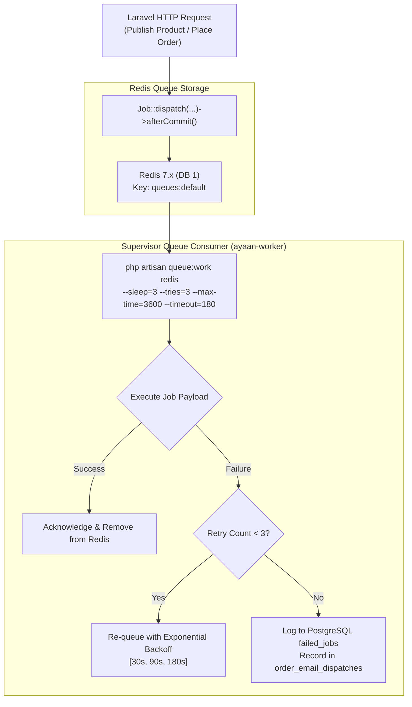

# AYAAN CLOTHING (AYC) — Queues & Background Jobs Architecture

**Document Purpose**: Detailed technical specification for the asynchronous background job architecture, Redis queue configuration, Supervisor daemon management, retry/backoff policies, and after-commit dispatching.  
**Audience**: DevOps Engineers, Backend Developers, System Administrators.  
**Last Verified Date**: October 20, 2026  
**Environment Baseline**: Production Release `release_20261020_052638_a8d2fef` on Hostinger VPS `srv2010990`.

---

## 1. Queue Architecture Overview

To maintain low latency on user-facing HTTP requests, CPU-intensive operations (PDF generation, image compression, MIME assembly, and SMTP delivery) are offloaded to background workers:



---

## 2. Supervisor Configuration & Operational Daemon

The queue worker runs as a dedicated system service managed by Supervisor:

* **Config File**: `/etc/supervisor/conf.d/ayaan-worker.conf`
* **Service Name**: `ayaan-worker`
* **Service Definition**:
  ```ini
  [program:ayaan-worker]
  process_name=%(program_name)s_%(process_num)02d
  command=php /var/www/ayaan/backend/artisan queue:work redis --sleep=3 --tries=3 --max-time=3600 --timeout=180
  autostart=true
  autorestart=true
  user=ayaan
  numprocs=1
  redirect_stderr=true
  stdout_logfile=/var/www/ayaan/backend/storage/logs/worker.log
  stopwaitsecs=3600
  ```

### Operational Invariants:
* **Memory Leak Prevention**: `--max-time=3600` ensures PHP worker processes recycle gracefully every hour.
* **Non-Root Execution**: Runs strictly as user `ayaan` to adhere to filesystem permission boundaries.
* **Graceful Worker Reload on Deploy**: Deployments reload workers cleanly via `supervisorctl restart ayaan-worker` or `php artisan queue:restart`.

---

## 3. Core Background Jobs Inventory

| Job Class | Queue | Retries & Backoff | Timeout | Primary Function |
| :--- | :--- | :---: | :---: | :--- |
| **`GenerateProductOfferSheetJob`** | `default` | 3 tries (`[30, 90, 180]s`) | 180s | Pre-renders, compresses, and caches product Offer Sheet PDFs upon publishing. |
| **`SendOrderConfirmationEmailJob`** | `default` | 3 tries (`[30, 90, 180]s`) | 120s | Retrieves cached PI + Offer Sheets, validates $\le 20$ MB limit, and dispatches email. |
| **`SendPaymentProofReceivedEmailJob`** | `default` | 3 tries | 60s | Notifies customer that wire transfer receipt was received by auditing merchandisers. |
| **`SendOrderConfirmedEmailJob`** | `default` | 3 tries | 60s | Notifies customer upon payment confirmation and attaches Commercial Invoice. |
| **`GenerateCommercialDocumentJob`** | `default` | 3 tries | 180s | Asynchronously pre-warms commercial order documents. |

---

## 4. `afterCommit()` Transactional Safety

A critical engineering standard implemented across all AYC background jobs is **`afterCommit()` dispatching**:

```php
// Example from GenerateProductOfferSheetJob constructor
public function __construct(public int $productId, public bool $force = false)
{
    $this->onQueue(config('order.emails.queue', 'default'));
    $this->afterCommit();
}
```

### Why This Is Essential:
Without `afterCommit()`, a background worker running in a parallel process could pick up a job payload before the database transaction committing the parent record (e.g. `products` or `orders`) has finished. This would cause `ModelNotFoundException` errors. With `afterCommit()`, Laravel guarantees the job is only dispatched to Redis after the database transaction successfully completes.

---

## 5. Diagnostic & Monitoring Runbook

```bash
# Check worker status
supervisorctl status ayaan-worker

# Restart worker daemon
supervisorctl restart ayaan-worker

# Inspect failed jobs
php artisan queue:failed

# Retry all failed jobs
php artisan queue:retry all

# Clear failed jobs table
php artisan queue:flush
```

---

## 6. Related Technical Documentation

* **[PRODUCT_OFFER_SHEETS.md](PRODUCT_OFFER_SHEETS.md)**: Offer Sheet background generation mechanics.
* **[EMAIL_AND_NOTIFICATIONS.md](EMAIL_AND_NOTIFICATIONS.md)**: Transactional email queueing.
* **[OPERATIONS_RUNBOOK.md](OPERATIONS_RUNBOOK.md)**: Operational commands for worker diagnostics.
