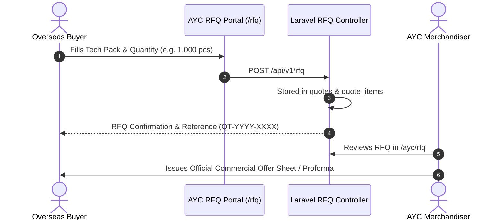
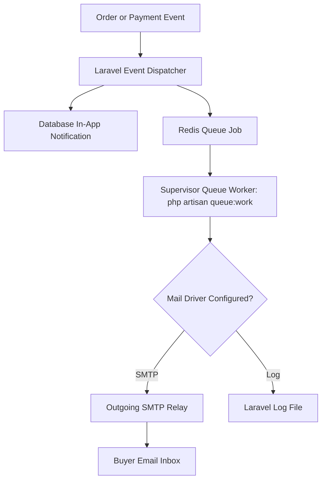

# RFQ & Notifications — AYAAN CLOTHING (AYC)

> [!NOTE]
> **Canonical Documentation Notice:** This document is preserved for historical context. The canonical, actively maintained technical documentation for RFQ workflows and transactional notifications can be found in [APPLICATION_MODULES.md](APPLICATION_MODULES.md) and [EMAIL_AND_NOTIFICATIONS.md](EMAIL_AND_NOTIFICATIONS.md).

## 1. Request for Quotation (RFQ) Lifecycle

While the public catalog handles ready-to-ship export overruns and factory stock lots, overseas retail brands and bulk importers frequently require **Custom OEM Garment Manufacturing** (custom fabrics, private labeling, specific sizing curves, and branded packaging). This is managed via the **Request for Quotation (RFQ)** system.



---

## 2. RFQ Submission & Data Structures

### A. Customer Submission Form (`/rfq`)
Buyers provide technical production parameters:
* **Garment Category**: T-Shirts, Polos, Hoodies, Woven Shirts, Denim, Activewear.
* **Target Quantity**: High-volume custom manufacturing typically requires a minimum of 500–1,000 pcs per style/colorway.
* **Target Delivery Date & Target FOB Price**: Expected budget per unit in USD.
* **Custom Specifications**: Fabric composition (e.g. 100% Organic Cotton), weight (e.g. 240 GSM), dye technique (e.g. Reactive Dye, Acid Wash), embroidery/print specifications.
* **Tech Pack Attachments**: Upload of vector artwork, measurement charts, or spec sheets.

### B. Database Schema (`quotes` and `quote_items`)
* `quotes`: Stores buyer identity, company name, contact phone, destination country, target terms (FOB Chittagong, CIF, EXW), and status (`pending`, `under_review`, `quoted`, `accepted`, `declined`).
* `quote_items`: Specific line items with target quantities and target unit costs.

---

## 3. Transactional Email & Notifications Architecture

The notification engine keeps buyers informed of order status transitions, wire transfer receipt reviews, and RFQ quotations:



### A. Notification Channels
1. **In-App Database Notifications (`notifications` table)**:
   * Stored in PostgreSQL with unique UUIDs.
   * Rendered on the buyer's dashboard bell icon and admin activity feed.
   * Captured immediately regardless of external mail connectivity.
2. **Transactional Email**:
   * Implemented via Laravel Mailable classes:
     * `OrderPlacedMailable`: Dispatches order confirmation with proforma wire instructions.
     * `PaymentProofReceivedMailable`: Confirms wire receipt is undergoing finance review.
     * `PaymentVerifiedMailable`: Notifies buyer that payment is approved and exports PI.
     * `PaymentRejectedMailable`: Alerts buyer of receipt issues with administrative guidance.
     * `OrderShippedMailable`: Dispatches carrier AWB number and live tracking link.

---

## 4. Operational Status & Verified Mail Configuration

To maintain strict documentation accuracy, the operational state of the mail subsystem is classified as follows:

| Component | Implemented in Code | Configured & Operational in Production | Status / Details |
| :--- | :---: | :---: | :--- |
| **Database Notifications** | ✅ Yes | ✅ Yes | Fully operational. Logged to `notifications` table and displayed on dashboard. |
| **Mailable Templates** | ✅ Yes | ✅ Yes | Standardized Blade templates with AYC corporate branding and order summaries. |
| **Redis Queue Worker** | ✅ Yes | ✅ Yes | Active under Supervisor process manager on production VPS. |
| **SMTP Delivery Relay** | ✅ Yes | ⚠️ Configured Dependent | The system supports both Hostinger SMTP and local Postfix relay. If upstream network or port 587/465 is filtered, notifications fall back safely to database logs without failing user transactions. |

### Operational Recommendation for Operators
* During production operations, verify the queue worker health:
  ```bash
  supervisorctl status ayaan-worker
  ```
* Inspect recent dispatch activity in Laravel logs:
  ```bash
  tail -n 50 /var/www/ayaan/backend/storage/logs/laravel.log
  ```
