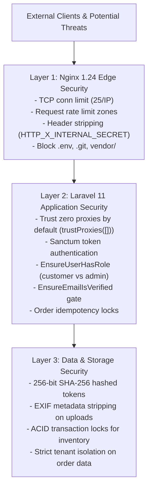

# AYAAN CLOTHING (AYC) — Security Architecture

**Document Purpose**: Comprehensive technical reference for the platform's multi-layered security controls, threat mitigations, rate-limiting policies, token cryptography, and boundary defense mechanisms.  
**Audience**: Security Auditors, System Architects, DevOps Engineers, Backend Developers.  
**Last Verified Date**: October 20, 2026  
**Environment Baseline**: Production Release `release_20261020_052638_a8d2fef` on Hostinger VPS `srv2010990`.

---

## 1. Security Architecture & Threat Model

The AYC security model enforces defense-in-depth across the network, reverse proxy, application framework, and database tiers:



---

## 2. Authentication & Authorization Boundaries

### A. Customer vs. Administrator Role Segregation
* **Two Mutually Exclusive Roles**: Users are partitioned strictly into `customer` or `admin`.
* **Admin Storefront Prohibition**: Administrators cannot check out garments through the storefront (`OrderController::store` rejects non-customers with HTTP 403). Administrators must use the Point-of-Sale (POS) terminal.
* **Google OAuth Boundary**: Google OAuth authentication is strictly restricted to customer accounts. Any attempt by an administrative user to authenticate or link Google accounts is blocked with HTTP 403.

### B. Mandatory Verified-Only Ordering
* **Security Gate**: Unverified accounts cannot place orders or trigger checkout calculation mutations.
* **Cryptographic Token Challenge**: Verification tokens are generated with 256-bit entropy (`bin2hex(random_bytes(32))`) and stored solely as SHA-256 hashes. Raw tokens are never stored in the database.
* **Replay Protection**: Single-use tokens expire after 60 minutes and are permanently locked upon use (`used_at`).

---

## 3. Dual-Layer Rate Limiting & DoS Protection

The platform pairs edge Nginx rate limiters with Laravel application-level throttle middleware:

### Layer 1: Nginx Connection & Request Zones
| Zone Name | Rate Limit | Burst | Target Endpoints | Protective Role |
| :--- | :--- | :---: | :--- | :--- |
| `conn_per_ip` | 25 TCP conns | — | Global server wide | Mitigates slowloris and TCP starvation attacks |
| `req_api_general`| 30 req/sec | 30 | `/api/*`, `/ayc/api/*` | General API abuse and scraping protection |
| `req_api_search` | 10 req/sec | 10 | `/api/v1/search/suggestions` | Protects database search suggestion queries |
| `req_api_auth` | 5 req/min | 5 | `/api/v1/auth/*` | Mitigates brute-force credential stuffing |
| `req_api_heavy` | 5 req/min | 5 | `/api/v1/orders` (Checkout, PDF) | Protects CPU-intensive Dompdf rendering and order transactions |
| `req_api_upload` | 5 req/min | 3–5 | `/api/v1/rfq`, `/payment-proof` | Prevents disk space exhaustion from large uploads |

### Layer 2: Laravel Application Throttles
* `throttle:checkout-order`: Enforces per-user submission quotas.
* `throttle:documents-pdf`: Limits on-demand PDF rendering requests to 15 per minute.
* `throttle:email-verification`: Limits verification email resend requests to 5 per 10 minutes.

---

## 4. Reverse Proxy Trust & Header Sanitization

### A. Zero Trust Proxy Invariant
When directly exposed to the internet without an upstream CDN, Laravel is configured with:
```php
$middleware->trustProxies(at: []);
```
* **Effect**: Laravel strictly ignores incoming `X-Forwarded-For`, `X-Forwarded-Host`, and `X-Real-IP` headers.
* **Rate Limiting Accuracy**: Rate limits are keyed against the real TCP socket address (`REMOTE_ADDR`), preventing attackers from bypassing IP throttling by spoofing client IP headers.
* **Upstream CDN Configuration**: If an upstream provider (e.g. Cloudflare) is enabled, its specific IP ranges must be populated in the `TRUSTED_PROXIES` environment variable.

### B. Internal Header Stripping
Nginx unconditionally strips incoming internal secret headers:
```nginx
fastcgi_param HTTP_X_INTERNAL_SECRET "";
```
This guarantees that external clients cannot forge internal service-to-service communication secrets.

---

## 5. Input Validation & File Upload Security

### A. File Size Enforcements
* **Standard Web & API Requests**: Capped at **2 MB** via Nginx `client_max_body_size 2M;`.
* **Authorized Large Upload Endpoints**: Dedicated locations (`/payment-proof`, `/rfq`, `/upload`) permit up to **20 MB** via `client_max_body_size 20M;`.

### B. Media Sanitization (`ReceiptImageService`)
* **MIME Verification**: Inspects magic byte headers rather than relying on client-supplied extensions.
* **EXIF Stripping**: Strips embedded EXIF metadata (GPS coordinates, camera serial numbers, timestamps) from uploaded wire receipts to protect buyer privacy.
* **Format Transcoding**: Re-encodes uploaded images into WebP format within strict 2048px bounding boxes, defusing potential image-based buffer overflow exploits.

---

## 6. Order Idempotency Protection

To protect international buyers against duplicate credit charges or repeated inventory deductions on network timeouts or double-clicks:
* **Mechanism**: Every checkout request transmits an `X-Idempotency-Key` or payload key.
* **Registry (`order_idempotency_keys` table)**: Records key hash, user ID, request payload hash, and generated order ID.
* **Replay Response**: Identical keys submitted within 24 hours immediately return the cached order payload without re-executing inventory deductions or database insertions.

---

## 7. Sensitive Files & Secrets Management

* **Filesystem Rules**: Nginx blocks public access to:
  ```nginx
  location ~ /\.env { deny all; return 404; }
  location ~ /\.git { deny all; return 404; }
  location ~* ^/vendor/ { deny all; return 404; }
  ```
* **Zero Secrets in Code**: Database credentials, SMTP passwords, Google OAuth secrets, and application keys reside exclusively in the server's `.env` file and are never committed to version control.

---

## 8. Related Technical Documentation

* **[AUTHENTICATION_AND_VERIFICATION.md](AUTHENTICATION_AND_VERIFICATION.md)**: Verification challenge token cryptography.
* **[GOOGLE_OAUTH.md](GOOGLE_OAUTH.md)**: Google OAuth security boundary and customer isolation.
* **[PAYMENTS_AND_INVENTORY.md](PAYMENTS_AND_INVENTORY.md)**: Payment proof upload security.
