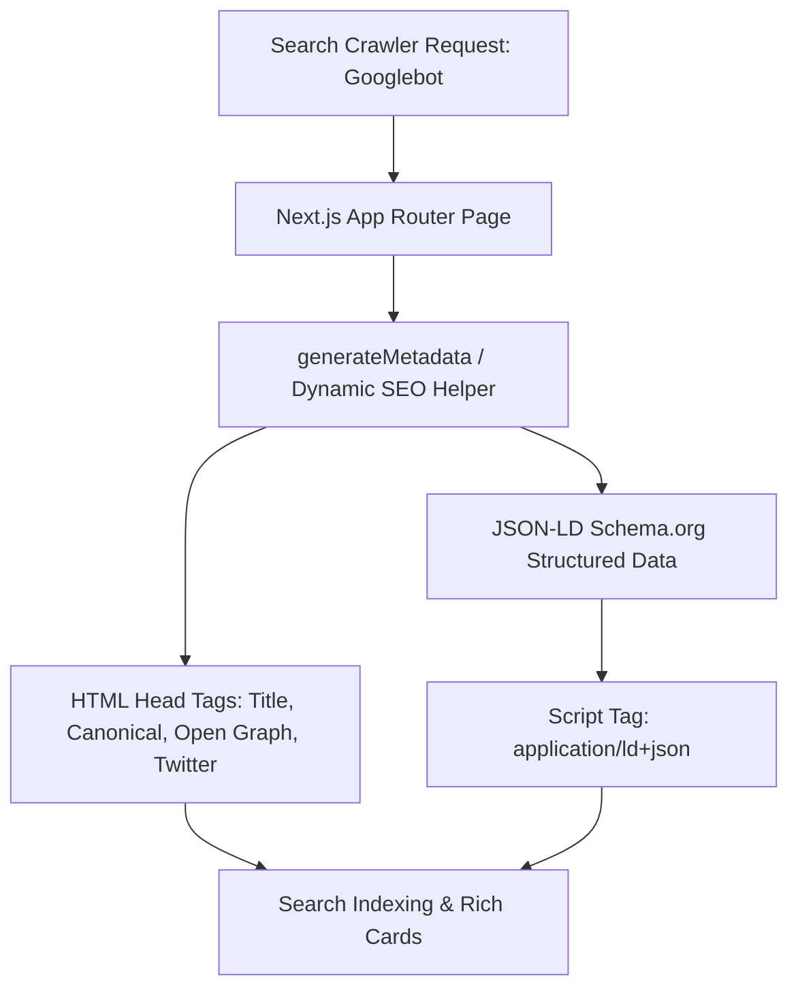

# SEO & Social Sharing — AYAAN CLOTHING (AYC)

## 1. Search Engine Optimization (SEO) Architecture

The AYC platform incorporates automated, metadata-driven SEO to maximize visibility for garment manufacturing, apparel wholesale sourcing, and export stock lot keywords across Google, Bing, and international trade directories.



---

## 2. Dynamic Metadata Generation (`generateMetadata`)

Every public catalog page and product detail page dynamically computes metadata at request time:

### A. Title & Canonical URL Hierarchy
* **Homepage**: `Ayaan Clothing | Garment Manufacturer & Exporter in Bangladesh`
* **Wholesale Catalog**: `Wholesale Apparel & Stock Lots | Ayaan Clothing`
* **Product Detail Page (PDP)**:
  * Title: `{Product Name} | Ayaan Clothing`
  * Canonical URL: Enforces strict canonical tags to prevent duplicate content indexing:
    ```html
    <link rel="canonical" href="https://ayaanclothing.com/products/{slug}" />
    ```

### B. Elimination of Unsupported Product Claims (GSM Fix)
In historical revisions, an automated metadata generator appended generic fabric claims (such as *"Premium 200+ GSM garments manufactured for bulk B2B orders..."*) to all apparel items.
* In commit `18c11ba`, this was replaced with **Factual Specification Interpolation**:
  * If authentic GSM exists in `products.specifications`, it is included.
  * If GSM is missing, the description highlights the verified fabric composition, weave, and Bangladesh export origin without guessing fabric weights.

---

## 3. Social Media Sharing & Open Graph (OG) Cards

When buyers or sales agents share product links via WhatsApp, Facebook, LinkedIn, or Twitter/X, the system generates high-impact preview cards:

### A. Open Graph & Twitter Card Specifications
* `og:site_name`: `Ayaan Clothing`
* `og:type`: `website` / `product`
* `og:title`: `{Product Name} | Garment Manufacturer & Exporter in Bangladesh`
* `og:description`: Factual excerpt of garment specifications and MOQ carton requirements.
* `og:image`: Direct absolute URL to the primary product photo (`https://ayaanclothing.com/storage/...`).
* `og:image:width`: `1200`
* `og:image:height`: `630`
* `twitter:card`: `summary_large_image`

### B. External Crawler Image Accessibility Invariant
Social media crawlers (`facebookexternalhit`, `Twitterbot`, `LinkedInBot`, `WhatsApp/2.x`) must be able to fetch preview images without authentication or session cookies:
* Product media in `/storage/products/` is served directly by Nginx with public caching headers (`expires 30d; add_header Cache-Control "public";`).
* The Bangladesh Storefront Geo-Block specifically allows static media extensions (`.png`, `.jpg`, `.jpeg`, `.webp`, `.svg`) to pass through without evaluation, ensuring social preview images render reliably worldwide.

---

## 4. JSON-LD Structured Data (Schema.org)

The application embeds schema markup directly into the HTML:

### A. Organization Schema (Global Layout)
```json
{
  "@context": "https://schema.org",
  "@type": "Organization",
  "name": "AYAAN CLOTHING",
  "legalName": "AYAAN CLOTHING",
  "alternateName": ["Ayaan Clothing", "AYC"],
  "url": "https://ayaanclothing.com",
  "logo": "https://ayaanclothing.com/logo.png",
  "foundingDate": "2010",
  "address": {
    "@type": "PostalAddress",
    "streetAddress": "House #33 (2nd floor), Road #12, Sector #11",
    "addressLocality": "Uttara, Dhaka",
    "postalCode": "1230",
    "addressCountry": "BD"
  },
  "contactPoint": {
    "@type": "ContactPoint",
    "telephone": "+880 1620-853502",
    "contactType": "sales",
    "availableLanguage": ["English", "Bengali"]
  }
}
```

### B. Product Schema (Product Detail Page)
Embeds product identifiers, SKU, brand name, and currency pricing offers:
```json
{
  "@context": "https://schema.org",
  "@type": "Product",
  "name": "Men's Heavyweight Fleece Hoodie",
  "image": ["https://ayaanclothing.com/storage/products/hoodie-black.webp"],
  "description": "Export-grade 100% cotton fleece hoodie manufactured in Bangladesh for wholesale bulk orders.",
  "sku": "AYC-HOOD-BLK-01",
  "brand": {
    "@type": "Brand",
    "name": "Ayaan Clothing"
  },
  "offers": {
    "@type": "AggregateOffer",
    "priceCurrency": "USD",
    "lowPrice": "8.90",
    "highPrice": "12.50",
    "offerCount": "3",
    "availability": "https://schema.org/InStock"
  }
}
```

---

## 5. Automated Sitemaps & Search Console Normalization

* **Dynamic Sitemap (`src/app/sitemap.ts`)**: Generates an XML sitemap at `/sitemap.xml` dynamically including the homepage, all active category landing routes, legal policy pages, and every published product.
* **Robots Policy (`src/app/robots.ts`)**: Directs web spiders to `/sitemap.xml`, allowing indexing of `/` and `/products/*`, while strictly disallowing administrative routes (`/ayc`, `/ayc/*`, `/admin`) and private buyer workflows (`/checkout`, `/dashboard`, `/cart`).
* **Leading Slash URL Normalization**: Proxy middleware (`src/proxy.ts`) intercepts malformed crawler submissions with leading double slashes (e.g. `//sitemap.xml`) and internally rewrites them to `/sitemap.xml` without emitting an HTTP 308 redirect, preventing crawler "Couldn't fetch" errors in Google Search Console.
