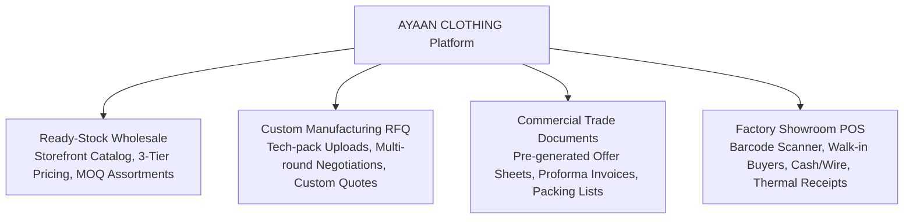

# AYAAN CLOTHING (AYC) — System Overview

**Document Purpose**: High-level overview of the AYAAN CLOTHING (AYC) digital commerce and manufacturing platform, business model, operational scopes, and user journeys.  
**Audience**: Product Managers, Software Engineers, Enterprise Partners, Technical Auditors.  
**Last Verified Date**: October 20, 2026  
**Environment Baseline**: Production Release `release_20261020_052638_a8d2fef` on Hostinger VPS `srv2010990`.

---

## 1. Business Context & Operational Domain

AYAAN CLOTHING (AYC) is an enterprise digital commerce and manufacturing platform operating out of Dhaka, Bangladesh, serving international apparel buyers, retail chains, and corporate importers across Europe, North America, the Middle East, and Asia.

The platform unifies four distinct B2B commerce channels into a single technological infrastructure:

1. **Ready-Stock Export Wholesale**: Immediate purchase and dispatch of bulk ready-made garments (RMG) categorized across Men's, Ladies', and Kids' apparel, subject to strict Minimum Order Quantities (MOQ) and size assortment ratios.
2. **Custom Manufacturing Request for Quotation (RFQ)**: Direct negotiation pipeline for bespoke apparel production runs where international buyers submit tech-packs, fabric compositions, target quantities, and custom labeling requirements.
3. **Official Commercial Document Issuance**: Automated generation and delivery of authoritative international trade documents complying with global export standards (Offer Sheets, Proforma Invoices, Commercial Invoices, Packing Lists).
4. **Physical Factory Showroom Point-of-Sale (POS)**: In-person wholesale ordering terminal at factory showrooms supporting barcode scanning, walk-in customer accounts, cash/wire payments, coupon applications, and direct inventory depletion.

---

## 2. Core User Personas & System Journeys

### A. International Wholesale Buyer (Customer)
* **Discovery & Selection**: Browses published catalog items, filters by category, brand, fabric, and availability (Ready Stock vs. Pre-Order).
* **Tiered Wholesale Pricing**: Selects pricing modes based on order volume (Tier 1: MOQ baseline, Tier 2: Mid-tier volume, Tier 3: High-volume container pricing).
* **Account Registration**: Registers with email/password or Google OAuth.
* **Mandatory Email Verification**: Before placing any commercial order, the buyer must verify their email address via AYC's cryptographic email verification challenge link.
* **Checkout & Order Placement**: Submits commercial shipping details, chooses air or sea freight or requests manual shipping arrangements, and completes checkout under idempotency protection.
* **Document Retrieval**: Immediately downloads official Proforma Invoices (PI) and merged Product Offer Sheets from the Order Placed confirmation modal or Customer Documents section.
* **Payment Submission**: Conducts international wire transfer (SWIFT/TT) to the export banking coordinates provided in the PI and uploads proof of remittance via the order tracking portal.

### B. Enterprise Apparel Importer (RFQ Negotiator)
* **Custom Inquiries**: Submits comprehensive RFQ forms detailing required GSM, fabric composition, custom stitching, target delivery dates, and size breakdown tables with attached PDF/ZIP tech-packs up to 20 MB.
* **Quote Iteration**: Reviews itemized supplier quotations generated by the administrative merchandising team, responds with amendments, and accepts quotes.
* **Order Transition**: Upon quote acceptance, converts the quotation directly into a confirmed commercial order.

### C. Factory Merchandiser & Administrator
* **Catalog Management**: Creates and publishes product profiles, uploads high-resolution media galleries, defines 3-tier pricing curves, and configures ratio package assortments.
* **Automatic PDF Pre-Generation**: Catalog publishing dispatches asynchronous queue jobs that render, compress, and cache 2–3-page product Offer Sheets ($<1.5$ MB).
* **Order Audit & Payment Verification**: Inspects uploaded customer wire receipts, verifies bank deposits against the export accounting ledger, transitions order status to confirmed, and releases shipment dispatch events.
* **RFQ Quoting**: Constructs official quotations with component-level pricing breakdowns and exporter commitments.

### D. Factory Showroom Sales Operator (POS)
* **Terminal Operation**: Operates the high-speed `/ayc/pos` terminal using hardware barcode scanners.
* **Walk-In Creation**: Automatically generates lightweight synthetic customer profiles for in-person wholesale buyers.
* **Real-Time Stock Depletion**: Adjusts warehouse inventory balances atomically upon checkout.
* **Commercial Documentation**: Prints on-demand commercial receipts and export invoices.

---

## 3. High-Level Technology Blueprint

The AYC platform leverages modern, battle-tested technologies selected for maximum reliability, speed, and maintainability:

| Layer | Selected Technology | Operational Role & Characteristics |
| :--- | :--- | :--- |
| **Storefront & Admin UI** | Next.js 16 (App Router), React 19, TypeScript | Server-Side Rendering (SSR), Static Site Generation (SSG), and client interactions. Managed under PM2 (`ayaan-customer`: 3000, `ayaan-admin`: 3001). |
| **Design System** | Tailwind CSS 3.4, Lucide React | Curated high-contrast design token system (`bg-card`, `bg-secondary`, `text-primary`, `border-border`) optimized for dark/light themes and international enterprise usability. |
| **Backend REST API** | Laravel 11.x, PHP 8.4 | Enterprise domain service layers, Sanctum token authentication, form request validation, Eloquent ORM, and artisan commands. Runs on PHP 8.4-FPM Unix sockets. |
| **Relational Database** | PostgreSQL 16 | ACID-compliant transactional persistence for orders, inventory balances, users, commercial document metadata, and RFQ negotiations. |
| **Cache & Asynchronous Queues** | Redis 7.x, Laravel Queue Worker | High-speed cache for catalog statistics, session tokens, and async job queues (`ayaan-worker` managed by Supervisor). |
| **PDF Generation Engine** | Dompdf 3.1.6, Intervention Image 4.3, Custom Pure PHP Merger | Pre-generates compressed product Offer Sheets; merges multi-product order PDFs natively without external binary dependencies. |
| **Reverse Proxy & Web Server** | Nginx 1.24+ | Dual vhost TLS termination (Let's Encrypt SSL), gzip compression, HTTP/2, client upload routing, and multi-tier IP rate limiting. |
| **Host Infrastructure** | Hostinger VPS `srv2010990` | Hardened Ubuntu 24.04 LTS server located in Mumbai 2, India. |

---

## 4. Key Architectural Invariants

Throughout the codebase, several core invariants are enforced unconditionally:

1. **Email Verification Before Ordering**: Unverified customer accounts cannot place orders or trigger checkout calculation mutations, regardless of authentication provider (Password or Google OAuth).
2. **Canonical PDF Pre-Generation**: Catalog Offer Sheets are never rendered on the fly during customer requests if a valid, compressed artifact is cached on disk.
3. **Strict PDF Size Caps**: Every standard 2–3-page product Offer Sheet must target $\le 1.5$ MB and strictly respect a 2.0 MB hard limit.
4. **100% SHA-256 Byte Parity**: The PDF file downloaded by a customer in the portal and the file attached to their transactional confirmation email originate from the exact same disk artifact.
5. **Zero-Downtime Deployment**: Application releases use atomic symlink switching (`.next` target swap) and multi-gate chunk retrieval tests to guarantee zero asset 404s for active users.

---

## 5. Related Architecture Documents

* **[ARCHITECTURE.md](ARCHITECTURE.md)**: Deep dive into network topology, process execution, and service boundaries.
* **[APPLICATION_MODULES.md](APPLICATION_MODULES.md)**: Exhaustive functional inventory of storefront and administrative modules.
* **[ORDERS_AND_CHECKOUT.md](ORDERS_AND_CHECKOUT.md)**: Order creation lifecycle and checkout pipeline.
* **[PRODUCT_OFFER_SHEETS.md](PRODUCT_OFFER_SHEETS.md)**: Canonical Offer Sheet pre-generation and merging architecture.
