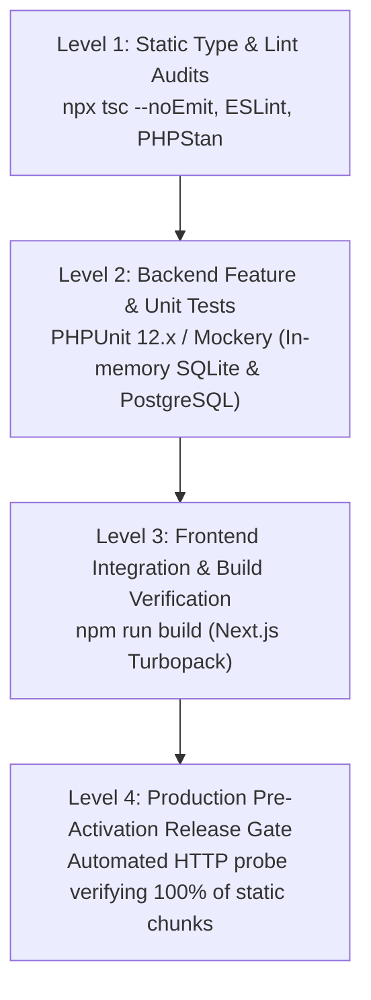

# AYAAN CLOTHING (AYC) — Testing & Quality Assurance

**Document Purpose**: Detailed technical specification for automated test suites, test execution commands, coverage boundaries, release verification gates, and manual QA protocols.  
**Audience**: QA Engineers, Software Developers, Release Engineers.  
**Last Verified Date**: October 20, 2026  
**Environment Baseline**: Production Release `release_20261020_052638_a8d2fef` on Hostinger VPS `srv2010990`.

---

## 1. Testing Pyramid & Verification Strategy

Quality assurance is enforced across four distinct levels:



---

## 2. Backend Automated Test Suites (PHPUnit)

Backend tests reside in `backend/tests/`:

### A. Core Test Suites
| Test Suite File | Domain Scope | What It Verifies |
| :--- | :--- | :--- |
| `tests/Feature/Auth/CustomerAuthWorkflowTest.php` | Auth | Registration, login, password hashing, Sanctum token issuance. |
| `tests/Feature/Auth/GoogleCustomerAuthenticationWorkflowTest.php` | OAuth | Google Socialite flow, admin blocking, unverified status enforcement. |
| `tests/Feature/Auth/EmailVerificationDeliveryTest.php` | Verification | 256-bit challenge token generation, SHA-256 hashing, replay blocking. |
| `tests/Feature/Order/VerifiedCustomerOrderingEnforcementTest.php` | Checkout Gate | Unverified customer checkout blocking (HTTP 403 `EMAIL_VERIFICATION_REQUIRED`). |
| `tests/Feature/Order/OrderCreationIdempotencyTest.php` | Checkout | Idempotency key replay protection, inventory stock decrements. |
| `tests/Feature/Order/PaymentProofUploadTest.php` | Payments | 20 MB wire receipt upload, MIME validation, status transition. |
| `tests/Feature/Documents/ProductOfferSheetPreGenerationTest.php` | Offer Sheets | Pre-generation, $\le 1.5$ MB size enforcement, deterministic fingerprinting. |
| `tests/Feature/Documents/OfferSheetMergeIntegrityTest.php` | PDF Merger | Pure PHP PDF merging, master page tree construction, sequence preservation. |
| `tests/Feature/Pos/AdminPosSaleWorkflowTest.php` | POS Terminal | Barcode lookup, synthetic walk-in buyer creation, immediate stock depletion. |

### B. Executing Backend Tests
```bash
# Run all backend tests
cd backend && php artisan test

# Run a specific test suite
cd backend && php artisan test tests/Feature/Auth/VerifiedCustomerOrderingEnforcementTest.php

# Run with test coverage report
cd backend && php artisan test --coverage
```

---

## 3. Frontend Audits & Build Validation

```bash
# 1. Strict TypeScript compilation check (Zero errors allowed)
npx tsc --noEmit

# 2. Production build verification
npm run build
```

---

## 4. Production Release Gate (Pre-Activation)

Integrated into `/var/www/ayaan/scripts/deploy-production.sh`, this automated script acts as the final gatekeeper before new code serves production traffic:

1. **Daemon Probe**: Validates that PM2 instances (`ayaan-customer` and `ayaan-admin`) are running without crash loops.
2. **Health Probe**: Requests `/api/v1/health` to confirm PostgreSQL and Redis connections are responsive.
3. **Route Audit**: Queries 6 core customer and admin pages, extracting all `<script src="...">` and `<link rel="stylesheet">` tags.
4. **100% Asset Retrieval Audit**: Executes live HTTP requests for every single compiled static chunk. If any chunk returns HTTP 404 or 500, the release is aborted and automatically rolled back.

---

## 5. Safe Testing with Mocked Mailers & Sandboxes

To test checkout and email flows without emailing live customers:

### A. Isolated Diagnostic Commands
* **Test Verification Email**:
  ```bash
  php artisan ayaan:test-verification-email your_email@test.com
  ```
* **Test Order Confirmation with Real Attachments**:
  ```bash
  php artisan ayaan:test-order-email 31 your_email@test.com
  ```

### B. Environment Isolation Rule
In local or staging environments, always set `MAIL_MAILER=log` in `.env`. Outgoing email payloads and MIME attachments will be written to `storage/logs/laravel.log` without hitting external SMTP servers.

---

## 6. Related Technical Documentation

* **[DEPLOYMENT.md](DEPLOYMENT.md)**: Deployment release gate details.
* **[OPERATIONS_RUNBOOK.md](OPERATIONS_RUNBOOK.md)**: Diagnostic commands.
* **[AUTHENTICATION_AND_VERIFICATION.md](AUTHENTICATION_AND_VERIFICATION.md)**: Verification test scenarios.
