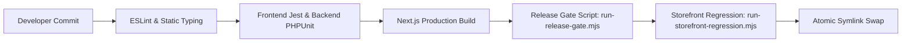

# Testing & Quality Assurance — AYAAN CLOTHING (AYC)

> [!NOTE]
> **Canonical Notice**: This historical document has been modernized and superseded by the authoritative canonical reference at **[docs/TESTING.md](TESTING.md)**. Please consult `TESTING.md` for current test suites, release gates, and QA verification protocols.

## 1. Quality Engineering Standards

The AYC platform manages international export transactions, wholesale volume calculations, and warehouse inventory. Software defects can directly disrupt factory production schedules, lead to overselling, or violate international trade documentation standards. 

Quality assurance enforces a strict gate: **Zero errors across static typing, linting, unit test suites, regression suites, and production release gates.**



---

## 2. Test Suites & Frameworks

### A. Frontend Quality (`tests/` & `npm test`)
* **Framework**: Jest with `@testing-library/react` and `ts-jest`.
* **Coverage Scope**:
  * Cart volume tier calculations and carton quantity step constraints.
  * Payment receipt upload MIME and size validation (`tests/receipt-upload-validation.test.ts`).
  * Commercial document rendering and table alignment (`tests/offer-sheet-gallery.test.ts`).
  * Mobile category drawer interactions and filter state management.

### B. Backend Quality (`backend/tests/` & `php artisan test`)
* **Framework**: PHPUnit with Laravel Testing Suite.
* **Coverage Scope**:
  * `OrderServiceTest`: Immediate stock deduction inside database transactions.
  * `PaymentVerificationTest`: Transition rules from `pending_verification` to `paid` or `payment_rejected`.
  * `RbacMiddlewareTest`: Authorization enforcement for granular admin permissions.
  * `GeoIpStorefrontTest`: Bangladesh storefront access control enforcement.

---

## 3. Specialized Automation & Verification Scripts

The repository includes dedicated Node.js automation scripts under `scripts/` designed for rapid validation:

| Script Name | Purpose & Verified Invariants | Execution Command |
| :--- | :--- | :--- |
| **`run-release-gate.mjs`** | **Mandatory Pre-Activation Gate**: Scans newly built `.next/` release directory, probes all referenced JavaScript and CSS chunks over HTTP, and verifies 100% asset retrieval without 404s. | `node scripts/run-release-gate.mjs` |
| **`run-storefront-regression.mjs`** | Probes catalog listing, search typeahead, real product detail pages, and health check endpoints. | `node scripts/run-storefront-regression.mjs` |
| **`verify-offer-sheet-pdf.mjs`** | Validates Offer Sheet PDF generation, confirming only authentic product data renders with zero placeholder fabrication. | `node scripts/verify-offer-sheet-pdf.mjs` |
| **`verify-pi-and-offer-sheet-non-overlap.ts`** | Header collision test verifying that exporter credentials and invoice titles do not visually overlap on A4 print viewports. | `npx tsx scripts/verify-pi-and-offer-sheet-non-overlap.ts` |
| **`run-all-tests.js`** | Master test runner orchestrating frontend linting, type checks, unit tests, and backend test suites in sequence. | `node scripts/run-all-tests.js` |

---

## 4. Reproducible Quality Verification Commands

Before deploying or submitting pull requests, run these commands:

### Step 1: Type Checking & Static Linting
```bash
# TypeScript compilation check (Must return 0 errors)
npx tsc --noEmit

# Next.js ESLint validation
npm run lint
```

### Step 2: Frontend Unit Tests
```bash
npm test
```

### Step 3: Backend PHPUnit Tests
```bash
cd backend
php artisan test
cd ..
```

### Step 4: Full Storefront & Document Regression Run
```bash
node scripts/run-storefront-regression.mjs
node scripts/verify-offer-sheet-pdf.mjs
```

---

## 5. Regression Prevention & Bug Reproduction Playbooks

### A. Next.js Chunk Desynchronization (404 Failed to Fetch)
* **Root Cause**: In naive deployments, building directly into `.next/` while the application serves live traffic causes existing clients to request old chunks that have been overwritten by the new build.
* **Prevention**: Solved permanently by `scripts/deploy-production.sh`, which builds into an isolated timestamped directory (`.next_releases/release_YYYYMMDD_HHMMSS_sha`), copies prior chunks into the new build, and swaps the symlink atomically via `mv -Tf`.

### B. Payment Receipt Replacement Exploits
* **Root Cause**: Allowing receipt uploads on paid orders allows malicious users to replace approved proofs with blank or falsified slips.
* **Prevention & Test**: Verified in `tests/receipt-upload-validation.test.ts`. Any upload attempt against an order with `payment_status = paid` returns `HTTP 403 Forbidden`.

### C. Commercial Document Layout Overlaps
* **Root Cause**: Responsive flexbox headers wrapping inconsistently on narrow PDF canvas pages.
* **Prevention & Test**: Verified via `scripts/verify-pi-and-offer-sheet-non-overlap.ts`. Uses explicit column boundaries and CSS min-height rules.
