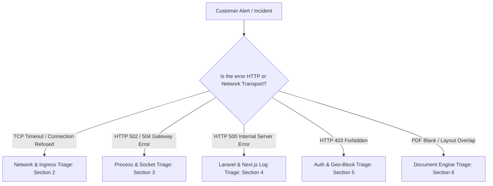

# Troubleshooting & Incident Diagnostics — AYAAN CLOTHING (AYC)

## 1. Quick Diagnostic Decision Tree

When responding to an alert or customer report, use this triage hierarchy:



---

## 2. Network & Ingress Diagnostic Playbook

### Symptom: Client Times Out Over IPv4 (`curl: (28) Connection timed out`)
* **Context**: Inbound connection from certain regional networks times out during the initial TCP handshake (`HTTP 000`).
* **Diagnostic Steps**:
  1. Capture packets on VPS interface during a coordinated client request:
     ```bash
     tcpdump -nn -vv -c 6 -i eth0 'host <client_ip> and tcp port 443'
     ```
  2. Analyze the packet capture:
     * **If Inbound SYN arrives (`Flags [S]`) and server kernel replies with SYN-ACK (`Flags [S.]` or `[S.E]`):**
       * The local server and Nginx are fully operational.
       * The packet loss occurs upstream on the return path between Hostinger Mumbai (AS47583) and the destination network transit provider.
  3. Verify whether IPv6 connects from the same client:
     ```bash
     curl -6 -I https://ayaanclothing.com/api/v1/health
     ```
  4. **Action**: Refer to [docs/KNOWN_ISSUES_AND_OPEN_WORK.md](KNOWN_ISSUES_AND_OPEN_WORK.md) for the active Hostinger network escalation runbook. Do not alter local server routing or firewall rules speculatively.

---

## 3. Web Server & FastCGI Socket Playbook (502 / 504 Bad Gateway)

### Symptom: Nginx returns `502 Bad Gateway` on `/api/*`
* **Root Cause**: PHP-FPM socket crash, worker starvation, or permissions error on the unix socket.
* **Diagnostic Steps**:
  1. Inspect Nginx error log:
     ```bash
     tail -n 20 /var/log/nginx/error.log
     ```
  2. Check if PHP 8.4-FPM socket exists and has correct permissions:
     ```bash
     ls -la /run/php/php8.4-fpm.sock
     # Expected: srw-rw---- 1 www-data www-data
     ```
  3. Check PHP-FPM service status:
     ```bash
     systemctl status php8.4-fpm
     ```
  4. **Resolution**:
     ```bash
     systemctl restart php8.4-fpm
     systemctl reload nginx
     ```

### Symptom: Nginx returns `502 Bad Gateway` on `/` or `/ayc`
* **Root Cause**: Node.js customer (`:3000`) or admin (`:3001`) daemon crashed or failed to bind.
* **Diagnostic Steps**:
  1. Check PM2 status:
     ```bash
     su - ayaan -c "pm2 status"
     ```
  2. Inspect PM2 crash logs:
     ```bash
     tail -n 30 /home/ayaan/.pm2/logs/ayaan-customer-error.log
     tail -n 30 /home/ayaan/.pm2/logs/ayaan-admin-error.log
     ```
  3. **Resolution**:
     ```bash
     su - ayaan -c "pm2 reload all"
     ```

---

## 4. Application & Database Playbook (HTTP 500)

### Symptom: API returns `500 Internal Server Error`
* **Diagnostic Steps**:
  1. Inspect Laravel application error log:
     ```bash
     tail -n 50 /var/www/ayaan/backend/storage/logs/laravel.log
     ```
  2. Verify storage directory write permissions:
     ```bash
     ls -ld /var/www/ayaan/backend/storage
     ls -ld /var/www/ayaan/backend/bootstrap/cache
     ```
  3. **Fix Permissions**:
     ```bash
     chown -R www-data:www-data /var/www/ayaan/backend/storage /var/www/ayaan/backend/bootstrap/cache
     chmod -R 775 /var/www/ayaan/backend/storage /var/www/ayaan/backend/bootstrap/cache
     ```
  4. Verify PostgreSQL connectivity:
     ```bash
     su - ayaan -c "php /var/www/ayaan/backend/artisan db:monitor"
     ```

---

## 5. Storefront Access & Receipt Upload Playbook (HTTP 403 / 422)

### Symptom: Visitor receives `HTTP 403 Forbidden` on Storefront Homepage
* **Root Cause**: Intentional Bangladesh Storefront Access Restriction (`src/proxy.ts`).
* **Verification**:
  * Check the response body: Displays the official `403 Restricted Access` landing template stating that B2B export pricing is restricted to international wholesale buyers.
  * Verify that buyer operational endpoints (`/login`, `/dashboard`, `/order-access`, `/rfq`) and `/ayc` admin portal remain accessible.

### Symptom: Buyer receives `HTTP 422 Unprocessable Entity` when Uploading Wire Receipt
* **Causes & Solutions**:
  1. **File Exceeds 10 MB**: Inform the buyer to compress high-resolution phone scans.
  2. **Unsupported Format**: Verify file is JPG, PNG, or WebP. PDFs are not accepted.
  3. **Order Already Paid**: If `payment_status = paid`, receipt replacement is locked by security design to preserve audit trails.

---

## 6. Commercial Document & PDF Playbook

### Symptom: PDF Output is Blank or Missing Text
* **Diagnostic Steps**:
  1. Verify headless browser rendering fonts are installed on the host:
     ```bash
     fc-list : family | grep -iE 'dejavu|liberation|roboto'
     ```
  2. Run the automated PDF verification suite:
     ```bash
     node scripts/verify-offer-sheet-pdf.mjs
     ```
  3. Confirm that product records in the database contain real attribute values in `specifications`. Remember: Document generators strictly omit missing attributes rather than fabricating dummy values.
