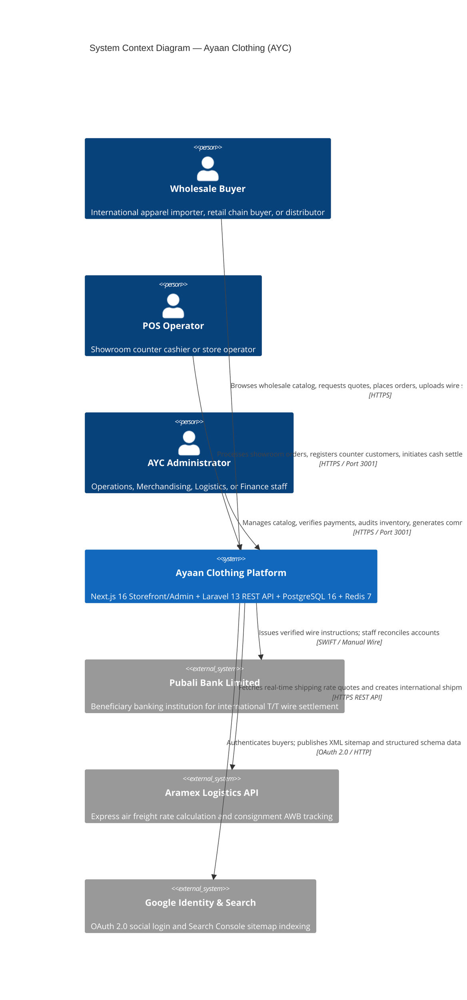
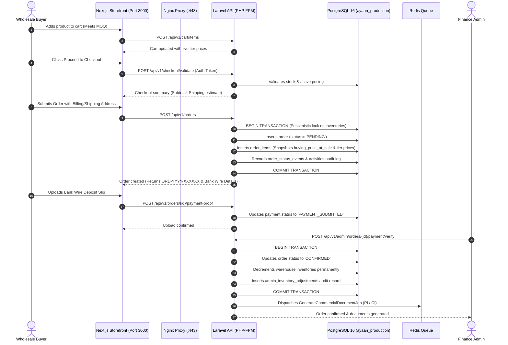

# AYC — System Architecture

## 1. System Context & External Boundaries

The Ayaan Clothing (AYC) platform provides an integrated digital commerce and operations suite for international garment manufacturing, export trade, and showroom operations.



---

## 2. Container & Component Architecture

AYC employs a decoupled full-stack architecture featuring a **Next.js 16 (App Router)** presentation tier and a **Laravel 13** REST API service tier, backed by **PostgreSQL 16** relational persistence and **Redis 7** in-memory caching and background queues.

```mermaid
graph TB
    subgraph "Client Layer"
        Browser["Modern Web Browser (Chrome, Safari, Firefox, Edge)"]
    end

    subgraph "Edge / Ingress Tier (Nginx 1.24 on Ubuntu 24.04)"
        Nginx["Nginx Reverse Proxy & SSL Termination<br/>ayaanclothing.com (:443)"]
    end

    subgraph "Frontend Presentation Tier (Node.js 20 / PM2)"
        CustomerApp["Next.js 16 Customer Storefront & Buyer Portal<br/>Port 3000 (PID 2147276)"]
        AdminProxy["Node.js Admin Gateway Proxy<br/>scripts/admin-proxy.js — Port 3001 (PID 2147299)"]
        NextProxy["Next.js Proxy Handler (src/proxy.ts)<br/>Host routing, //sitemap normalization, GeoIP lock"]
    end

    subgraph "Backend Application Tier (PHP 8.4-FPM / Laravel 13)"
        FPM["PHP-FPM Socket (/run/php/php8.4-fpm.sock)<br/>Laravel 13.x REST API Engine"]

        subgraph "Laravel Core Services"
            AuthSvc["Sanctum Auth & RBAC Guard"]
            OrderSvc["OrderCalculationService & AdminPosSaleService"]
            DocSvc["Commercial Document Engine (CI, PI, Offer Sheet)"]
            ShipSvc["ShippingManager & PackageCalculator"]
            GeoSvc["StorefrontCountryAccessService (GeoIP)"]
            AuditSvc["ActivityLogger (Audit Trail)"]
        end
    end

    subgraph "Asynchronous Queue Workers (Supervisor)"
        SupervisorWorker["Supervisor Managed Worker (ayaan-worker)<br/>artisan queue:work redis --queue=default"]
    end

    subgraph "Data & Persistence Tier"
        PG[("PostgreSQL 16.15 Database<br/>ayaan_production (53 Tables)")]
        Redis[("Redis 7.0.15<br/>Cache, Locks & Asynchronous Jobs")]
        Disk[("Local Storage Disk<br/>backend/storage/app/public")]
    end

    Browser -->|HTTPS :443| Nginx

    Nginx -->|/ /products /dashboard /cart /checkout| CustomerApp
    Nginx -->|/ayc (Admin Portal Gateway)| AdminProxy
    AdminProxy -->|Forward with x-admin-app header| CustomerApp
    CustomerApp --> NextProxy

    Nginx -->|/api/v1/* (Customer API)| FPM
    Nginx -->|/ayc/api/* (Admin API Rewrite)| FPM
    Nginx -->|/storage/* (Public Media)| Disk

    CustomerApp -->|Server-to-Server Internal Check| FPM
    FPM --> AuthSvc
    FPM --> OrderSvc
    FPM --> DocSvc
    FPM --> ShipSvc
    FPM --> GeoSvc
    FPM --> AuditSvc

    FPM -->|Read / Write SQL| PG
    FPM -->|Cache Keys & Locks| Redis
    FPM -->|Dispatch Jobs| Redis
    SupervisorWorker -->|Pulls Jobs| Redis
    SupervisorWorker -->|PDF Generation & Heavy Processing| FPM

    FPM -->|Stores Uploads & PDFs| Disk
```

---

## 3. Physical Infrastructure & Hosting Topology

AYC is deployed on a dedicated Linux VPS located at IP `200.97.169.230`:

```mermaid
graph LR
    subgraph "Production VPS: 200.97.169.230 (Ubuntu 24.04 LTS)"
        subgraph "Ingress"
            NginxServer["Nginx 1.24.0<br/>Managed Let's Encrypt SSL Cert"]
        end

        subgraph "PM2 Process Supervisor (User: ayaan)"
            PM2_Cust["ayaan-customer (Port 3000)<br/>next start -p 3000 -H 127.0.0.1"]
            PM2_Admin["ayaan-admin (Port 3001)<br/>node scripts/admin-proxy.js"]
        end

        subgraph "PHP FastCGI Process Manager"
            PHPFPM["php8.4-fpm<br/>unix:/run/php/php8.4-fpm.sock"]
        end

        subgraph "System Services"
            Supervisor["supervisord<br/>ayaan-worker (queue:work redis)"]
            PostgresSvc["PostgreSQL 16.15<br/>Database: ayaan_production"]
            RedisSvc["Redis 7.0.15<br/>Port 6379"]
            BackupTimer["systemd timer<br/>ayaan-backup.timer (02:00:31 UTC)"]
        end
    end

    Internet(("Public Internet")) -->|Port 80 (HTTP 301)| NginxServer
    Internet -->|Port 443 (HTTPS)| NginxServer

    NginxServer -->|127.0.0.1:3000| PM2_Cust
    NginxServer -->|127.0.0.1:3001| PM2_Admin
    NginxServer -->|FastCGI Socket| PHPFPM

    PM2_Admin -->|Proxy with Admin Headers| PM2_Cust
    PHPFPM -->|SQL :5432| PostgresSvc
    PHPFPM -->|In-Memory :6379| RedisSvc
    Supervisor -->|Redis Queues| RedisSvc
    BackupTimer -->|Daily pg_dump| PostgresSvc
```

---

## 4. End-to-End Request Lifecycles

### 4.1 Wholesale Checkout & Order Processing Lifecycle



---

## 5. Security & Isolation Architecture

### 5.1 Customer vs. Administrator Boundary
The application enforces strict isolation between customer buyers and administrators:
1. **Network & Routing Boundary**:
   - Customer Storefront operates on `http://127.0.0.1:3000`.
   - Admin Portal operates on dedicated gateway `http://127.0.0.1:3001` via `scripts/admin-proxy.js`.
   - `scripts/admin-proxy.js` attaches `x-admin-app: true` and `x-is-admin-host: 1`.
   - Nginx routes `/ayc` requests strictly to Port 3001. The retired legacy `/admin` namespace explicitly returns HTTP 404 (do not redirect).
2. **Database Role Consolidation**:
   - The foundational role model distinguishes `admin` from `customer` via `users.role`.
   - `role:admin` middleware protects all `/api/v1/admin/*` endpoints.
   - `role:customer` middleware protects buyer mutations (`/api/v1/users/me`, `/api/v1/addresses/*`, `/api/v1/orders`).
3. **Granular RBAC Permissions**:
   - Beyond the high-level role, administrative accounts are governed by permissions assigned via `admin_roles` and `role_permissions` (e.g., `product.create`, `order.update_status`, `payment.receipt.verify`, `pos.sale`).
4. **Authoritative Server Pricing**:
   - Client applications never supply unit prices. Pricing is computed strictly on the backend via `OrderCalculationService`.

### 5.2 Storefront Regional Access Control (Bangladesh GeoIP)
To accommodate selective international buyer targeting while keeping buyer account self-service universally functional:
- `src/proxy.ts` evaluates incoming client IP addresses forwarded via Nginx (`X-Real-IP`).
- Buyer fulfillment routes (`/login`, `/signup`, `/rfq`, `/order-access/*`, `/dashboard/*`, `/profile/*`) are classified as operational customer services and **never blocked**.
- Storefront catalog browsing (`/`, `/products`, `/search`) is checked via the internal server-to-server endpoint:
  `GET /api/v1/internal/storefront/access-check`
- The endpoint is secured by `X-Internal-Secret` and queries the authoritative MaxMind GeoLite2 database managed by `StorefrontCountryAccessService`.
- If the administrator enables `bangladesh_storefront_blocked = true` in `system_settings`, visitors from Bangladesh receive an HTTP 403 Access Restricted screen (`GEO_BLOCKED_HTML`).
- **Fail-Open Policy**: If the GeoIP service or internal network times out, access is automatically permitted to prevent false-positive customer lockouts.
