# AYC — Project Overview & Business Context

## 1. Executive Summary

**Ayaan Clothing (AYC)** is a specialized B2B e-commerce platform and operational operating system designed for an international ready-made garments (RMG) manufacturer and wholesale exporter headquartered in Uttara, Dhaka, Bangladesh.

Unlike conventional B2C retail e-commerce stores that process single-item consumer transactions, AYC is engineered from the ground up to support the complex, volume-driven realities of cross-border garment manufacturing, liquidation wholesale, and trade export. The platform bridges the gap between digital discovery and industrial apparel commerce by unifying:
1. **Public Wholesale Storefront**: An international, multi-currency buyer catalog displaying wholesale MOQ rules, 3-tier bulk volume discounts, package assortment breakdowns, and full-stock liquidation opportunities.
2. **Buyer Portal & Commercial Self-Service**: Dedicated accounts for verified international apparel buyers, retail chains, and distributors to manage RFQs (Requests for Quotation), negotiate custom pricing, review payment instructions, submit bank wire slips, and download customs-ready trade documentation.
3. **Dedicated Admin Portal (`/ayc`)**: An enterprise operational hub providing granular Role-Based Access Control (RBAC), multi-warehouse inventory auditing, order payment verification, coupon campaign attribution, merchandising controls, and Point-of-Sale (POS) counter transaction processing.
4. **Canonical Commercial Document Generation**: An automated document engine producing official export instruments: **Offer Sheets**, **Proforma Invoices (PI)**, and **Commercial Invoices (CI)**.

---

## 2. Business Model & Core Workflows

### 2.1 The Ready-Made Garments (RMG) Export Landscape
Bangladesh is the world's second-largest garment exporter. Garment manufacturing and export workflows operate under distinct commercial conventions:
- **Minimum Order Quantities (MOQs)**: Garment factories and wholesale liquidators do not sell individual pieces. Production runs and warehouse allocations are bundled into pre-packaged cartons (e.g., 24, 48, or 100 pieces per carton) with defined size-and-color ratio assortments.
- **Pre-Assorted Cartons**: A carton of garments contains a strict assortment curve (e.g., Size S: 2 pcs, M: 4 pcs, L: 4 pcs, XL: 2 pcs). If variant stock is imbalanced, unbroken complete cartons cannot be formed. AYC calculates real carton bottlenecks on the server to prevent broken ratios.
- **Volume-Tiered Tier Pricing**: Unit prices decline substantially as order volume increases. Buyers ordering standard wholesale quantities pay the base wholesale price ($P_{\text{base}}$), while bulk buyers receive structured volume discounts ($P_{\text{tier2}}$ and $P_{\text{tier3}}$).
- **Full-Stock Clearance**: Wholesale liquidators periodically sell out entire warehouse lots. AYC provides a dedicated "Full Stock" liquidation option on product pages, computing complete package availability and applying clearance pricing dynamically.
- **Cross-Border Payment by Bank Wire (T/T Advance)**: Wholesale international transactions exceed standard consumer credit card limits. Payments are executed via Telegraphic Transfer (T/T) bank wire directly to AYC's beneficiary account at Pubali Bank Limited, Dhaka. Customers submit wire transfer deposit slips for administrative verification prior to order fulfillment.

### 2.2 Core Business Capabilities
| Capability | Implementation | Primary Business Benefit |
|---|---|---|
| **Dynamic Tiered Pricing** | Server-side resolution via `product_pricing_tiers` and volume thresholds | Guarantees transparent, automated bulk pricing without manual quote friction for standard volumes |
| **Package Assortment Logic** | Variant allocation matrix (`product_package_allocations`) | Eliminates ratio mismatches; guarantees buyers receive complete factory-packed assortments |
| **Full Stock Liquidation** | Dynamic lot availability calculator in `Product.php` | Enables rapid inventory turnover for overstock, surplus lots, and clearance runs |
| **Three-Document Suite** | Standardized Offer Sheet, PI, and CI generation | Directly satisfies customs, freight forwarder, and bank wire compliance requirements |
| **Integrated POS Terminal** | Counter cashier interface creating standard AYC orders | Unifies physical warehouse counter sales with online inventory without data fragmentation |
| **Coupon-Bound Sales Attribution**| Granular admin bindings in `coupon_admin_bindings` | Enables marketing managers and affiliate reps to track coupon performance and attributed sales |
| **Regional Access Control** | Authoritative internal GeoIP inspection in `src/proxy.ts` | Allows site owners to manage storefront access policies while keeping buyer operational portals globally reachable |

---

## 3. System Actors & Operational Personas

```mermaid
graph TD
    subgraph "External Actors"
        Buyer["International Wholesale Buyer / Retail Chain"]
        CounterBuyer["Counter / Showroom Wholesale Buyer"]
        SearchCrawler["Search Engine Crawler (Googlebot)"]
    end

    subgraph "Internal Actors (AYC Personnel)"
        SuperAdmin["Super Administrator"]
        SalesManager["Sales & Merchandising Manager"]
        WarehouseOp["Warehouse & Logistics Operator"]
        Cashier["Showroom POS Cashier"]
        FinanceAdmin["Finance & Accounts Auditor"]
        CouponManager["Coupon Sales Representative"]
    end

    Buyer -->|Browses Catalog, Submits RFQs, Places Orders| Storefront["Public Storefront & Buyer Portal (Port 3000)"]
    CounterBuyer -->|Purchases at Showroom Counter| POS["POS Terminal (Port 3001)"]
    SearchCrawler -->|Indexes Products, Reads Sitemap| Storefront

    SuperAdmin -->|Full System Governance, RBAC, Settings| AdminGateway["Admin Portal /ayc (Port 3001)"]
    SalesManager -->|Catalog, Pricing, Merchandising, RFQ Response| AdminGateway
    WarehouseOp -->|Stock Adjustments, Fulfillment, Aramex AWB| AdminGateway
    Cashier -->|Counter Customer Order Creation, Cash Tender| AdminGateway
    FinanceAdmin -->|Wire Slip Review, Payment Verification, P&L| AdminGateway
    CouponManager -->|Bound Coupon Sales & Revenue Reports| AdminGateway
```

### Detailed Actor Profiles
1. **International Wholesale Buyer / Retailer**:
   - Accesses: Public Storefront (`/`, `/products`, `/cart`, `/checkout`) and Customer Portal (`/dashboard/*`, `/profile/*`).
   - Behaviors: Searches garments by category, brand, or specification; reviews size ratio assortments; calculates live bulk volume discounts; requests custom quotations (RFQs); downloads Proforma Invoices for bank wire processing; uploads wire transfer receipts; tracks consignment shipments.
2. **Showroom / Counter Buyer**:
   - Interacts with AYC cashier in person at Dhaka/Uttara showroom.
   - Profile: Identified by mobile phone number and name. Receives official commercial documents for counter orders.
3. **Super Administrator**:
   - Accesses: `/ayc/*` with unrestricted privileges.
   - Responsibilities: Manages system administrators, assigns granular roles and permissions, updates business profile and bank wire credentials, configures legal policies, manages Google Search Console verification.
4. **Sales & Merchandising Manager**:
   - Accesses: Catalog management, homepage merchandising, RFQ negotiations, quotations.
   - Responsibilities: Creates and updates products, uploads 4:5 fashion photography, configures pricing tiers, reviews and responds to incoming buyer RFQs, issues formal commercial quotations.
5. **Warehouse & Logistics Operator**:
   - Accesses: `/ayc/inventory`, `/ayc/orders`, fulfillment tools.
   - Responsibilities: Audits stock across physical warehouses (`WH-UTTARA-01`, `WH-CTG-01`), records stock adjustments with mandatory audit reasons, creates Aramex air freight consignments, inputs international bills of lading (AWB).
6. **Showroom POS Cashier**:
   - Accesses: `/ayc/pos`.
   - Responsibilities: Identifies or registers buyers by phone, selects warehouse stock, calculates totals and cash tender change, generates standard commercial orders.
7. **Finance & Accounts Auditor**:
   - Accesses: Orders, payments, coupon sales, financial analytics.
   - Responsibilities: Inspects uploaded bank wire payment proofs, verifies funds against Pubali Bank statements, confirms orders (triggering automated inventory deduction), reviews historical Gross Profit and COGS metrics.
8. **Coupon Sales Representative**:
   - Accesses: `/ayc/coupon-sales/*`.
   - Responsibilities: Analyzes sales, revenue, and order volume strictly attributed to promotional coupons bound to their administrative user account.

---

## 4. Key Terminology & Abbreviations

| Term / Abbreviation | Definition & System Meaning |
|---|---|
| **AYC** | Ayaan Clothing — the brand, company, and platform identifier. |
| **RMG** | Ready-Made Garments — the primary industry domain (knits, wovens, denim, sweaters). |
| **MOQ** | Minimum Order Quantity — the mandatory lowest unit count required to place an order for a product. |
| **Package Assortment** | Pre-bundled size/color ratio within a master carton (e.g., 2S, 4M, 4L, 2XL). |
| **Full Stock** | Complete clearance liquidation mode representing the maximum complete cartons currently in stock. |
| **FOB** | Free On Board (Incoterm) — exporter delivers goods loaded on vessel at designated port of loading (e.g., Chattogram Sea Port). |
| **DAP** | Delivered At Place (Incoterm) — exporter delivers goods to buyer's destination before unloading (used for international air express). |
| **DDP** | Delivered Duty Paid (Incoterm) — exporter pays all freight and customs import duties. |
| **CBM** | Cubic Meters ($m^3$) — volumetric space calculation used for international ocean and air freight logistics. |
| **COGS** | Cost of Goods Sold — purchase cost per piece permanently snapshotted in `order_items.buying_price_at_sale`. |
| **PI** | Proforma Invoice — preliminary commercial document specifying goods, totals, and beneficiary bank wire details. |
| **CI** | Commercial Invoice — authoritative customs clearance document detailing tariff codes, values, and freight terms. |
| **Offer Sheet** | Visual product specification and quotation document detailing garment attributes, packaging, and prices. |
| **HS Code** | Harmonized System Code — 6-to-8 digit international tariff classification used for export customs declarations. |
| **T/T Wire** | Telegraphic Transfer — electronic bank wire transfer between commercial banking institutions. |
| **AWB** | Air Waybill — tracking and consignment identifier issued by international air carriers (e.g., Aramex). |
| **RBAC** | Role-Based Access Control — system enforcing granular permissions across administrative operations. |

---

## 5. Platform Scope & System Boundaries

### What AYC Is
- An authoritative, server-driven B2B commerce platform with strict inventory and pricing invariants.
- A centralized commercial document generation suite with immutable historical records.
- A unified multi-channel order engine where online orders and showroom POS orders share one relational schema.
- A secure administrative portal enforcing two-tier role separation (`admin` vs `customer`) with fine-grained capability checks.

### What AYC Is NOT (Explicit Non-Goals & Boundaries)
- **Not a B2C fast-fashion shopping cart**: Does not permit single-piece consumer checkout below defined MOQs.
- **Not an anonymous retail cash register**: POS terminal does not allow anonymous cash walk-ins without customer registration.
- **Not an automated merchant-gateway processor**: Does not directly process credit card tokenization or third-party consumer gateways; payments rely on wire transfer review or webhook-verified clearing.
- **Not a thermal roll slip printer**: Does not format mini-receipt slips; all physical and digital records output as standardized A4 commercial export documents.
