# AYC — Complete Database Schema Reference

## 1. Relational Database Overview

The Ayaan Clothing platform uses **PostgreSQL 16.15** (`ayaan_production`) as its authoritative persistence engine. The schema contains exactly **53 relational tables** organized into distinct operational domains.

### Core Database Principles
1. **Single Source of Truth**: All operational state (inventory balances, prices, orders, permissions) resides authoritatively in PostgreSQL.
2. **Pessimistic Concurrency**: Financial and stock operations employ explicit database transactions and row locks (`SELECT ... FOR UPDATE`).
3. **Audit Immutability**: Historical financial records (`order_items.buying_price_at_sale`), warehouse adjustments (`admin_inventory_adjustments`), and system activities (`activities`) are append-only.
4. **Soft Deletes**: Key business entities (`products`, `categories`, `brands`, `orders`, `customers`) utilize soft deletion (`deleted_at`) to preserve historical integrity in export documentation.
5. **Strict No-Wipe Policy**: Production commands like `migrate:fresh`, `db:wipe`, or `truncate` are strictly prohibited.
6. **Internal Sourcing Protection**: Factory supplier references (`supplier_id`, `supplier_name`) and procurement baseline costs (`buying_price`) are strictly private internal fields, accessible only to authorized administrators and never serialized in customer API payloads.

---

## 2. Master Entity-Relationship Diagram (ERD)

```mermaid
erDiagram
    users ||--o{ personal_access_tokens : "owns"
    users ||--o{ addresses : "has"
    users ||--o{ orders : "places"
    users ||--o{ carts : "owns"
    users ||--o{ wishlists : "owns"
    users ||--o{ quotes : "submits"
    users ||--o{ quotations : "receives"
    users ||--o{ rfq_messages : "sends"
    users ||--o{ admin_roles : "assigned"
    users ||--o{ coupon_admin_bindings : "bound_to"

    roles ||--o{ admin_roles : "assigned_to"
    roles ||--o{ role_permissions : "contains"
    permissions ||--o{ role_permissions : "granted_by"
    permissions ||--o{ permission_dependencies : "requires"

    categories ||--o{ category_product : "classifies"
    products ||--o{ category_product : "belongs_to"
    brands ||--o{ products : "brands"
    suppliers ||--o{ products : "supplies"
    products ||--o{ product_images : "has"
    products ||--o{ product_variants : "has"
    products ||--o{ product_pricing_tiers : "has"
    products ||--o{ product_package_allocations : "specifies"
    products ||--o{ product_shipping_package_profiles : "profiles"

    warehouses ||--o{ inventories : "stores"
    product_variants ||--o{ inventories : "stocked_in"
    inventories ||--o{ admin_inventory_adjustments : "audits"

    carts ||--o{ cart_items : "contains"
    products ||--o{ cart_items : "item_in"
    product_variants ||--o{ cart_items : "variant_in"

    orders ||--o{ order_items : "contains"
    orders ||--o{ order_status_events : "tracks"
    orders ||--o{ payments : "receives"
    products ||--o{ order_items : "ordered_in"
    coupons ||--o{ orders : "applies_to"
    coupons ||--o{ coupon_admin_bindings : "binds"

    quotes ||--o{ quote_items : "contains"
    quotations ||--o{ quotation_items : "contains"
    quotations ||--o{ rfq_messages : "discusses"
```

---

## 3. Comprehensive Data Dictionary by Domain

### 3.1 Authentication, Users & RBAC

#### 1. `users`
- **Purpose**: Master table for both wholesale customer accounts and system administrators.
- **Key Columns**:
  - `id` (bigint, PK)
  - `name` (varchar(255), not null)
  - `email` (varchar(255), nullable) — Nullable to support phone-only POS customer registrations.
  - `phone` (varchar(50), nullable, indexed)
  - `password` (varchar(255), not null)
  - `role` (varchar(20), not null, default 'customer') — Foundational role: `'admin'` or `'customer'`.
  - `company_name` (varchar(255), nullable) — Buyer business name.
  - `tax_id` (varchar(100), nullable) — Buyer VAT/TIN number.
  - `status` (varchar(20), default 'active') — `'active'`, `'suspended'`, `'pending'`.
  - `google_id` (varchar(255), nullable, unique) — Google OAuth subject ID.
  - `is_demo` (boolean, default false)
  - `created_at`, `updated_at`, `deleted_at` (timestamp, nullable)

#### 2. `personal_access_tokens`
- **Purpose**: Laravel Sanctum bearer tokens for stateless REST authentication.
- **Key Columns**: `id` (PK), `tokenable_type`, `tokenable_id` (FK -> users.id), `name`, `token` (varchar(64), unique hashed SHA-256), `abilities` (text), `last_used_at`, `expires_at`.

#### 3. `roles`
- **Purpose**: Administrative RBAC role definitions (e.g., Super Admin, Merchandiser, Cashier).
- **Key Columns**: `id` (PK), `name` (varchar(100)), `slug` (varchar(100), unique), `description` (text), `is_system` (boolean, default false).

#### 4. `permissions`
- **Purpose**: Atomic capability registry (e.g., `product.create`, `order.update_status`, `pos.sale`).
- **Key Columns**: `id` (PK), `name` (varchar(100)), `slug` (varchar(100), unique), `module` (varchar(50)), `description` (text).

#### 5. `role_permissions`
- **Purpose**: Pivot table granting atomic permissions to roles.
- **Key Columns**: `role_id` (FK -> roles.id), `permission_id` (FK -> permissions.id). Composite PK: `[role_id, permission_id]`.

#### 6. `admin_roles`
- **Purpose**: Pivot table assigning RBAC roles to administrative users.
- **Key Columns**: `admin_user_id` (FK -> users.id), `role_id` (FK -> roles.id). Composite PK: `[admin_user_id, role_id]`.

#### 7. `permission_dependencies`
- **Purpose**: Enforces prerequisite relationships between permissions (e.g., `product.edit` requires `product.view`).
- **Key Columns**: `permission_id` (FK -> permissions.id), `depends_on_permission_id` (FK -> permissions.id).

#### 8. `password_reset_tokens`
- **Purpose**: Password recovery tokens.
- **Key Columns**: `email` (PK), `token`, `created_at`.

---

### 3.2 Product Catalog & Sourcing

#### 9. `products`
- **Purpose**: Core wholesale garment master record.
- **Key Columns**:
  - `id` (bigint, PK)
  - `product_id` (varchar(50), nullable, indexed) — Human-readable public code (e.g., `AYC-POLO-001`).
  - `title` (varchar(255), not null)
  - `slug` (varchar(255), not null, unique where null deleted_at)
  - `sku` (varchar(100), not null, unique where null deleted_at)
  - `brand_id` (bigint, nullable, FK -> brands.id)
  - `supplier_id` (bigint, nullable, FK -> suppliers.id) — Internal only.
  - `supplier_name` (varchar(255), nullable) — Internal supplier name mirror.
  - `design_type` (varchar(50), nullable) — Garment styling (e.g., Slim Fit, Oversized).
  - `description` (text, nullable)
  - `specifications` (jsonb, nullable) — Fabric composition, GSM, wash care.
  - `wholesale_price` (numeric(10,2), not null) — Base standard unit price ($P_{\text{base}}$).
  - `bulk_price` (numeric(10,2), nullable) — Tier 2 volume price ($P_{\text{tier2}}$).
  - `bulk_min_quantity` (integer, nullable) — Volume threshold ($Q_2$).
  - `full_stock_price` (numeric(10,2), nullable) — Lot liquidation clearance price.
  - `buying_price` (numeric(10,2), not null) — Procurement cost price (COGS baseline; internal only).
  - `purchase_price_updated_at` (timestamp, nullable)
  - `moq` (integer, not null, default 1) — Minimum order quantity.
  - `stock` (integer, not null, default 0) — Denormalized aggregate warehouse stock preview.
  - `is_published` (boolean, default false)
  - `is_hidden_from_storefront` (boolean, default false)
  - `is_sold_out` (boolean, default false)
  - `bulk_pricing_enabled` (boolean, default true)
  - `package_assortment_message` (text, nullable)
  - `seo_title`, `seo_description`, `seo_keywords` (text, nullable)
  - `created_at`, `updated_at`, `deleted_at` (timestamp)

#### 10. `categories`
- **Purpose**: Garment taxonomy hierarchy (e.g., T-Shirts, Denim Jeans, Hoodies).
- **Key Columns**: `id` (PK), `name`, `slug` (unique), `description`, `image`, `sort_order`, `is_active`, `is_featured`, `created_at`, `updated_at`.

#### 11. `category_product`
- **Purpose**: Many-to-many pivot associating products with categories.
- **Key Columns**: `product_id` (FK -> products.id), `category_id` (FK -> categories.id). Composite PK: `[product_id, category_id]`.

#### 12. `brands`
- **Purpose**: Garment labels, private brands, and manufacturer collections.
- **Key Columns**: `id` (PK), `name`, `slug` (unique), `logo`, `website`, `sort_order`, `is_featured`, `is_active`, `created_at`, `updated_at`.

#### 13. `suppliers`
- **Purpose**: Upstream garment manufacturing factories and fabric mills (internal management only).
- **Key Columns**: `id` (PK), `name` (varchar(255)), `contact_person`, `phone`, `email`, `address`, `country`, `is_active`, `created_at`, `updated_at`.

#### 14. `product_variants`
- **Purpose**: Size and color permutations of a product.
- **Key Columns**: `id` (PK), `product_id` (FK -> products.id), `sku` (unique), `color` (varchar(50)), `size` (varchar(50)), `additional_price` (numeric(10,2), default 0), `created_at`, `updated_at`.

#### 15. `product_images`
- **Purpose**: 4:5 aspect ratio garment photography and gallery assets.
- **Key Columns**: `id` (PK), `product_id` (FK -> products.id), `url`, `is_primary` (boolean), `sort_order` (integer), `created_at`, `updated_at`.

#### 16. `product_pricing_tiers`
- **Purpose**: Granular volume tier discount schedules.
- **Key Columns**: `id` (PK), `product_id` (FK -> products.id), `tier_name`, `min_quantity` (integer), `unit_price` (numeric(10,2)), `created_at`, `updated_at`.

#### 17. `product_package_allocations`
- **Purpose**: Carton assortment breakdown specifying pieces per variant in a master carton.
- **Key Columns**: `id` (PK), `product_id` (FK -> products.id), `product_variant_id` (FK -> product_variants.id), `quantity` (integer, not null), `created_at`, `updated_at`.

#### 18. `product_shipping_package_profiles`
- **Purpose**: Carton dimensions and gross weights for logistics and CBM calculations.
- **Key Columns**: `id` (PK), `product_id` (FK -> products.id), `length_cm`, `width_cm`, `height_cm`, `gross_weight_kg`, `pieces_per_carton`, `cbm`, `created_at`, `updated_at`.

---

### 3.3 Inventory & Warehouses

#### 19. `warehouses`
- **Purpose**: Physical facility storage locations (e.g., `WH-UTTARA-01`, `WH-CTG-01`).
- **Key Columns**: `id` (PK), `name`, `code` (unique), `address`, `city`, `country`, `is_active`, `created_at`, `updated_at`.

#### 20. `inventories`
- **Purpose**: Authoritative physical stock balances by variant and warehouse.
- **Key Columns**:
  - `id` (PK)
  - `product_id` (FK -> products.id)
  - `product_variant_id` (FK -> product_variants.id, nullable for variantless)
  - `warehouse_id` (FK -> warehouses.id)
  - `quantity` (integer, not null, default 0) — On-hand physical units.
  - Unique composite index: `['product_variant_id', 'warehouse_id']`
  - `created_at`, `updated_at`

#### 21. `admin_inventory_adjustments`
- **Purpose**: Relational audit log of all manual and automated warehouse stock movements.
- **Key Columns**:
  - `id` (PK)
  - `inventory_id` (FK -> inventories.id)
  - `quantity_change` (integer, not null) — Positive for additions/returns, negative for deductions/sales.
  - `reason` (varchar(255), not null)
  - `admin_user_id` (FK -> users.id, nullable)
  - `created_at` (timestamp)

---

### 3.4 Carts, Orders, Payments & Fulfillment

#### 22. `carts`
- **Purpose**: Wholesale shopping carts (guest session or authenticated buyer).
- **Key Columns**: `id` (PK), `user_id` (FK -> users.id, nullable), `session_id` (varchar(100), nullable), `created_at`, `updated_at`.

#### 23. `cart_items`
- **Purpose**: Line items inside wholesale carts.
- **Key Columns**: `id` (PK), `cart_id` (FK -> carts.id), `product_id` (FK -> products.id), `product_variant_id` (FK -> product_variants.id, nullable), `quantity` (integer), `pricing_mode` (varchar(30), default 'STANDARD'), `package_breakdown` (jsonb, nullable), `created_at`, `updated_at`.

#### 24. `orders`
- **Purpose**: Master wholesale order records across online store and POS terminal.
- **Key Columns**:
  - `id` (PK)
  - `order_number` (varchar(50), not null, unique) — Format: `ORD-YYYY-XXXXXX` or `AYN-POS-YYYYMMDD-XXXXXX`.
  - `user_id` (FK -> users.id, nullable) — Buyer account.
  - `guest_email` (varchar(255), nullable)
  - `order_source` (varchar(30), default 'ONLINE') — `'ONLINE'`, `'POS'`.
  - `operator_id` (FK -> users.id, nullable) — Staff member who processed the order.
  - `status` (varchar(30), not null, default 'PENDING') — `'PENDING'`, `'CONFIRMED'`, `'PROCESSING'`, `'SHIPPED'`, `'DELIVERED'`, `'CANCELLED'`.
  - `payment_status` (varchar(30), default 'UNPAID') — `'UNPAID'`, `'PAYMENT_SUBMITTED'`, `'PAID'`, `'REJECTED'`, `'pending'`.
  - `payment_method` (varchar(50), default 'WIRE_TRANSFER') — `'WIRE_TRANSFER'`, `'pos_cash'`, `'bank_transfer'`, `'LC'`.
  - `subtotal`, `tax_amount`, `shipping_amount`, `discount_amount`, `total_amount` (numeric(10,2)).
  - `coupon_id` (FK -> coupons.id, nullable)
  - `coupon_code` (varchar(50), nullable)
  - `shipping_address`, `billing_address` (jsonb)
  - `shipping_snapshot` (jsonb, nullable) — Cartons, CBM, weight.
  - `payment_details` (jsonb, nullable) — Stores `payment_note`, `bank_profile_id`, `bank_name`, and references.
  - `aramex_shipment_id`, `tracking_number` (varchar(100), nullable)
  - `pos_cash_tendered`, `pos_change_due` (numeric(10,2), nullable)
  - `created_at`, `updated_at`, `deleted_at`

#### 25. `order_items`
- **Purpose**: Line items for confirmed and historical orders.
- **Key Columns**:
  - `id` (PK)
  - `order_id` (FK -> orders.id)
  - `product_id` (FK -> products.id)
  - `product_variant_id` (FK -> product_variants.id, nullable)
  - `product_name`, `product_slug`, `sku` (varchar, immutable snapshot)
  - `quantity` (integer, not null)
  - `unit_price` (numeric(10,2), not null) — Resolved wholesale tier price.
  - `buying_price_at_sale` (numeric(10,2), not null) — Immutable purchase cost price (COGS).
  - `total_price` (numeric(10,2), not null)
  - `package_breakdown` (jsonb, nullable)
  - `created_at`, `updated_at`

#### 26. `order_status_events`
- **Purpose**: Audit timeline tracking order status changes.
- **Key Columns**: `id` (PK), `order_id` (FK -> orders.id), `from_status`, `to_status`, `comment`, `user_id` (FK -> users.id), `created_at`.

#### 27. `payments`
- **Purpose**: Payment transactions, wire transfer slips, and verification notes.
- **Key Columns**:
  - `id` (PK)
  - `order_id` (FK -> orders.id)
  - `amount` (numeric(10,2), not null)
  - `currency` (varchar(10), default 'USD')
  - `status` (varchar(30), default 'PENDING') — `'PENDING'`, `'VERIFIED'`, `'FAILED'`, `'REFUNDED'`.
  - `payment_method` (varchar(50))
  - `transaction_reference` (varchar(100), nullable) — Bank reference or slip number.
  - `payment_proof_path` (varchar(255), nullable) — Uploaded bank slip image/PDF.
  - `verified_by` (FK -> users.id, nullable)
  - `verified_at` (timestamp, nullable)
  - `created_at`, `updated_at`

#### 28. `addresses`
- **Purpose**: Saved customer shipping and billing addresses.
- **Key Columns**: `id` (PK), `user_id` (FK -> users.id), `address_type` ('SHIPPING' | 'BILLING'), `name`, `company`, `address_line1`, `address_line2`, `city`, `state`, `postal_code`, `country`, `phone`, `is_default`, `created_at`, `updated_at`.

#### 29. `wishlists` & 30. `wishlist_items`
- **Purpose**: Wholesale buyer saved favorites and product collections.
- **Key Columns**: `wishlists`: `id`, `user_id`; `wishlist_items`: `id`, `wishlist_id`, `product_id`, `created_at`.

---

### 3.5 RFQs, Quotations & Commercial Documents

#### 31. `quotes` & 32. `quote_items`
- **Purpose**: Preliminary inbound customer quote requests.
- **Key Columns**: `quotes`: `id`, `quote_number`, `user_id`, `status`, `total_amount`; `quote_items`: `id`, `quote_id`, `product_id`, `quantity`, `target_price`.

#### 33. `quotations` & 34. `quotation_items`
- **Purpose**: Formal administrative commercial quotations issued to buyers.
- **Key Columns**:
  - `quotations`: `id`, `quotation_number` (unique), `user_id` (FK -> users.id), `status` ('DRAFT' | 'SENT' | 'ACCEPTED' | 'REJECTED' | 'EXPIRED'), `currency` (default 'USD'), `subtotal`, `shipping_cost`, `total_amount`, `valid_until`, `created_at`, `updated_at`.
  - `quotation_items`: `id`, `quotation_id` (FK -> quotations.id), `product_id`, `product_name`, `quantity`, `unit_price`, `total_price`.

#### 35. `rfq_messages`
- **Purpose**: In-platform messaging negotiation thread between buyer and sales manager.
- **Key Columns**: `id` (PK), `rfq_id` (FK -> quotes.id or quotations.id), `sender_id` (FK -> users.id), `sender_type` ('customer' | 'admin'), `message` (text), `attachments` (jsonb, nullable), `is_read`, `created_at`.

---

### 3.6 Promotions & Coupon Sales Attribution

#### 36. `coupons`
- **Purpose**: Promotional discount codes (percentage or fixed amount).
- **Key Columns**: `id` (PK), `code` (varchar(50), unique), `discount_type` ('PERCENTAGE' | 'FIXED'), `discount_value` (numeric(10,2)), `min_order_amount` (numeric(10,2)), `max_discount_amount`, `usage_limit`, `used_count`, `is_active` (boolean), `starts_at`, `expires_at`, `created_at`, `updated_at`.

#### 37. `coupon_admin_bindings`
- **Purpose**: Relational binding associating promotional coupons with administrative sales representatives.
- **Key Columns**:
  - `id` (PK)
  - `coupon_id` (FK -> coupons.id, on delete cascade)
  - `admin_user_id` (FK -> users.id, on delete cascade)
  - `created_by` (FK -> users.id, nullable)
  - Unique composite index: `['coupon_id', 'admin_user_id']`
  - `created_at`, `updated_at`

---

### 3.7 Merchandising, Settings & Content Management

#### 38. `homepage_banners`
- **Purpose**: Storefront hero banner carousel and call-to-action slides.
- **Key Columns**: `id`, `title`, `subtitle`, `image_url`, `link_url`, `badge_text`, `sort_order`, `is_active`, `created_at`, `updated_at`.

#### 39. `homepage_featured_brands`
- **Purpose**: Curated "Shop by Brand" carousel on homepage.
- **Key Columns**: `id`, `brand_id` (FK -> brands.id), `sort_order`, `is_active`.

#### 40. `homepage_featured_products`
- **Purpose**: Featured product display ordering on the homepage.
- **Key Columns**: `id`, `product_id` (FK -> products.id), `sort_order`, `is_active`.

#### 41. `homepage_hot_sale_categories`
- **Purpose**: Featured category navigation pills.
- **Key Columns**: `id`, `category_id` (FK -> categories.id), `sort_order`, `is_active`.

#### 42. `homepage_ticker_items`
- **Purpose**: Announcements and export guarantees scrolling ticker.
- **Key Columns**: `id`, `text` (varchar(255)), `icon` (varchar(50)), `sort_order`, `is_active`.

#### 43. `legal_pages`
- **Purpose**: Editable legal policies (Privacy Policy, Terms and Conditions).
- **Key Columns**: `id`, `type` (varchar(50), unique) — `'privacy-policy'`, `'terms-and-conditions'`, `title`, `content` (text), `updated_by` (FK -> users.id), `updated_at`.

#### 44. `system_settings`
- **Purpose**: Key-value operational configuration table.
- **Key Columns**: `id`, `key` (varchar(100), unique), `value` (text), `type` (varchar(20)), `group` (varchar(50)), `updated_at`.
- **Key Values Configured**:
  - `site_logo`: Uploaded corporate branding asset.
  - `whatsapp_number`: Authoritative customer service phone (`8801620853502`).
  - `google_site_verification`: Google Search Console verification meta token.
  - `bangladesh_storefront_blocked`: Regional access control boolean toggle (`true` | `false`).
  - `bank_name`, `bank_account_number`, `bank_swift_code`, `bank_branch`: Pubali Bank wire details.

---

### 3.8 System Infrastructure, Queues & Logging

#### 45. `activities`
- **Purpose**: System-wide administrative action audit trail.
- **Key Columns**: `id`, `user_id` (FK -> users.id, nullable), `action` (varchar(100)), `entity_type` (varchar(100)), `entity_id` (bigint), `payload` (jsonb), `ip_address`, `created_at`.

#### 46. `notifications`
- **Purpose**: Buyer and staff notification feed.
- **Key Columns**: `id` (uuid, PK), `type`, `notifiable_type`, `notifiable_id`, `data` (jsonb), `read_at`, `created_at`.

#### 47. `jobs`
- **Purpose**: Database queue fallback (when Redis queue driver is not active).
- **Key Columns**: `id`, `queue`, `payload`, `attempts`, `reserved_at`, `available_at`, `created_at`.

#### 48. `failed_jobs`
- **Purpose**: Dead-letter queue tracking failed asynchronous jobs.
- **Key Columns**: `id`, `uuid` (unique), `connection`, `queue`, `payload`, `exception`, `failed_at`.

#### 49. `job_batches`
- **Purpose**: Batch queue job tracking.
- **Key Columns**: `id` (varchar, PK), `name`, `total_jobs`, `pending_jobs`, `failed_jobs`, `failed_job_ids`, `options`, `created_at`, `finished_at`.

#### 50. `cache` & 51. `cache_locks`
- **Purpose**: Database cache driver tables.
- **Key Columns**: `cache`: `key` (PK), `value`, `expiration`; `cache_locks`: `key` (PK), `owner`, `expiration`.

#### 52. `sessions`
- **Purpose**: Database session driver records.
- **Key Columns**: `id` (PK), `user_id`, `ip_address`, `user_agent`, `payload`, `last_activity`.

#### 53. `migrations`
- **Purpose**: Laravel schema migration execution history.
- **Key Columns**: `id` (PK), `migration` (varchar(255)), `batch` (integer).
