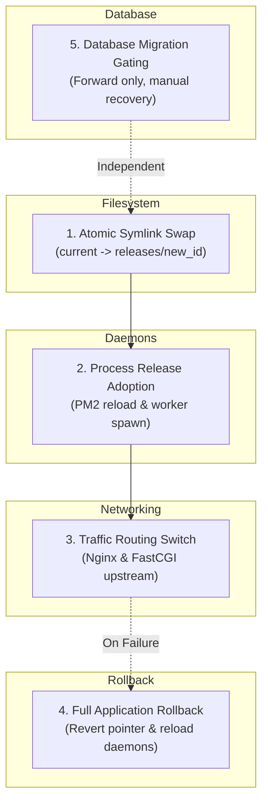
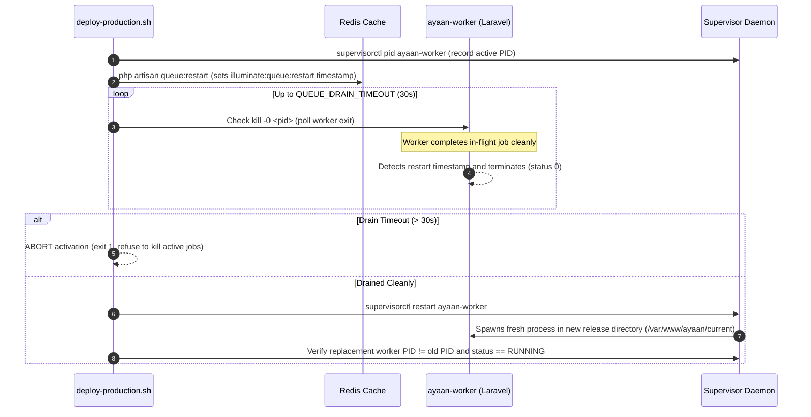
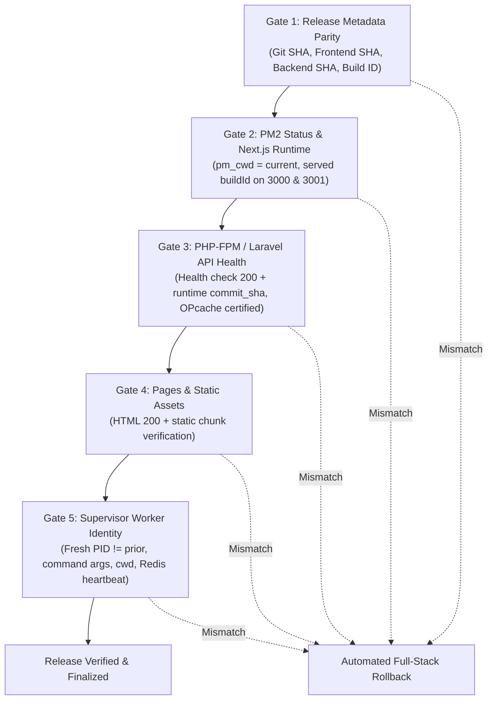

# Ayaan Clothing — Production GitHub Actions CI/CD Deployment Guide
## Single-Pointer Full-Stack Release Architecture, Infrastructure Migration Runbook & Safety Assessment

- **Document Purpose:** Definitive technical specification, architecture, security manual, and operational runbook for the Ayaan Clothing automated full-stack production deployment pipeline.
- **Authoritative Status:** **PREPARED WITH BLOCKERS — DEPLOYMENT REMAINS DISABLED**.
- **Target Repository:** `ayaanclproject26-max/ayaan`
- **Authorized Deployment Branch:** `backend-development`
- **Production VPS:** `200.97.169.230` (`srv2010990`)
- **Deployment User:** `ayaan` (with `NOPASSWD: ALL` in sudoers)
- **Application Directory:** `/var/www/ayaan`
- **Operating System:** Ubuntu 24.04.5 LTS (Noble Numbat)
- **Last Updated:** October 29, 2026

---

## 1. Executive Summary & Authoritative Safety Verdict

```text
VERDICT: PREPARED WITH BLOCKERS — DEPLOYMENT REMAINS DISABLED
```

### Safety Assessment Summary:
1. **Pipeline & Workflow Readiness:** The deployment script (`scripts/deploy-production.sh`), GitHub Actions workflow (`.github/workflows/deploy-production.yml`), migration script (`scripts/migrate-to-shared-release.sh`), release gate verification engine (`scripts/verify-deployment-release-gate.mjs`), PHP 8.4 syntax validation CI job (`validate-php-84`), and the comprehensive 54-test automated safety suite (`tests/deploy-production-script.test.mjs`, 54/54 passing) are fully developed, verified, and hardened.
2. **Infrastructure Blockers on Live Host (`200.97.169.230`):**
   - The production VPS currently operates on legacy in-place paths (`/var/www/ayaan/backend/public` in Nginx, `/var/www/ayaan` in PM2, and `/var/www/ayaan/backend/artisan` in Supervisor).
   - The shared release root `/var/www/ayaan/current` does not yet exist on the host.
   - The persistent shared storage directory `/var/www/ayaan/shared` does not yet exist on the host.
3. **Architecture Compatibility Gate:**
   - Real deployment (`--execute`) is **strictly blocked in code** by `scripts/deploy-production.sh` and the GitHub Actions workflow.
   - If executed on the live host in its current state, the pipeline halts immediately before any mutations occur.
   - Non-destructive preflight validation (`--dry-run`) is fully operational and safely reports the infrastructure prerequisite.

---

## 2. Core Architectural Distinctions & Process Realities

A robust deployment system must clearly distinguish five distinct operational concepts:



### 2.1 Atomic Replacement of a Filesystem Pointer
Swapping the root symlink (`/var/www/ayaan/current -> releases/<release-id>`) via POSIX `rename()` is an atomic operation at the kernel VFS level (under 1 millisecond). Any *new* process starting up or any file path opened through `current` after the swap resolves to the new directory.

### 2.2 Adoption of a Release by Running Application Processes
**A symlink swap alone does NOT update running processes.**
- **PM2 (Node.js):** Running Node.js instances (`ayaan-customer`, `ayaan-admin`) maintain open file descriptors and in-memory JavaScript module graphs in V8 heap memory. They continue executing old code until PM2 executes a reload (`pm2 reload`). Furthermore, PM2 process definitions must resolve their working directory (`pm_cwd`) to `/var/www/ayaan/current` so that internal relative lookups resolve to the newly activated release.
- **Supervisor (`ayaan-worker`):** Laravel's `queue:work` boots the application once into memory and loops indefinitely polling Redis. It is completely unaware of disk symlink changes until signaled to drain and restart (`php artisan queue:restart`). The Supervisor worker must terminate cleanly, be replaced by a fresh process with a new PID under `/var/www/ayaan/current`, and report an active release heartbeat in Redis.
- **PHP-FPM & Laravel API:** While PHP-FPM resolves `$realpath_root` on each FastCGI request, PHP's OPcache retains compiled bytecode in shared memory. PHP-FPM must be reloaded (`systemctl reload php8.4-fpm`) to invalidate cached bytecode. Dynamic code execution of the candidate release is certified via non-sensitive runtime metadata returned in `/api/v1/health`.

**Safety Enforcement:** `scripts/verify-deployment-release-gate.mjs` executes an exhaustive 5-gate runtime verification before any release is declared successful:
1. *Release Metadata Parity Gate:* Verifies cryptographic SHA parity and build identifiers across release root and backend.
2. *PM2 Process & Next.js Runtime Gate:* Verifies online status, valid `pm_cwd`, and served `buildId` matching candidate build for both customer (port 3000) and admin (port 3001) applications.
3. *PHP-FPM & Laravel API Runtime Gate:* Verifies health endpoints and served runtime `commit_sha` / `release_id`, proving OPcache invalidation.
4. *Page & Asset Deliverability Gate:* Verifies critical route HTML responses and static chunk delivery.
5. *Supervisor Queue Worker Release Identity Gate:* Verifies worker PID freshness, OS command line, working directory, and Redis worker heartbeat.

If any running process serves stale build IDs, outdated commit SHAs, or fails to report candidate release identity, the release gate fails immediately and triggers an automated full-stack rollback.

### 2.3 Traffic Switching to a Candidate Release
Incoming HTTP traffic is routed through Nginx:
- FastCGI requests (`/api/*`, `/sanctum/*`) route dynamically via PHP-FPM.
- Next.js storefront traffic (`/`) routes to upstream `127.0.0.1:3000`.
- Admin portal traffic (`/ayc`) routes to upstream `127.0.0.1:3001`.
Traffic adoption occurs as soon as the respective upstream processes complete their reload.

### 2.4 Complete Application Rollback & Adoption Verification
If health checks or release identity verification fail at any point:
1. `/var/www/ayaan/current` is atomically swapped back to `PREVIOUS_RELEASE`.
2. PM2 daemons are reloaded on the restored release pointer.
3. Queue workers are gracefully drained and reloaded on the restored release pointer.
4. PHP-FPM and Nginx are reloaded.
5. Persistent shared data in `/var/www/ayaan/shared` remains strictly intact.
6. **Rollback Adoption Verification:** When `DEPLOY_VERIFY_ROLLBACK_ADOPTION=true` (and during standalone `--rollback`), `verify-deployment-release-gate.mjs` is executed against the restored release to prove that PM2, PHP-FPM, and Supervisor workers have demonstrably adopted the previous release. Rollback is not declared successful while any runtime process remains executing the failed candidate release.

### 2.5 Database Schema Recovery
Database migrations (`php artisan migrate --force`) are **forward-only** operations. Automated down-migrations are strictly forbidden by policy. If an application rollback occurs after forward migrations have executed, the database schema remains in place, requiring application backward-compatibility or explicit DBA manual intervention.

---

## 3. Activation Strategy Comparison

Two strategies for production release activation were assessed:

| Evaluation Dimension | Strategy A: Coordinated Single-Pointer Activation (Selected) | Strategy B: True Blue-Green Activation |
| :--- | :--- | :--- |
| **Description** | Atomic `current` symlink swap followed by graceful queue drain, PM2 rolling reload, and PHP-FPM reload. | Parallel candidate PM2 daemons on alternate ports (3002/3003), parallel queue workers, dynamic Nginx upstream switch. |
| **Transient Window** | Small ~1–2 second reload window while PM2 cycles workers. Requires backward-compatible API contracts. | Zero transient window (traffic switched only after full candidate readiness). |
| **Host Resource Cost** | Minimal (single set of processes running; transient double-memory during PM2 reload). | High (requires 2x memory on 8 GB VPS to run dual Next.js stacks simultaneously). |
| **Infrastructure Complexity**| Low (single fixed Nginx upstream config, single PM2 ecosystem). | High (requires dynamic Nginx upstream reconfiguration, dual-port socket management). |
| **Feasibility on Current VPS** | **Immediately feasible** following the documented 5-step host migration. | Unfeasible without significant re-architecting of port allocation and Nginx dynamic reloading. |

**Selected Architecture:** Strategy A is the selected, supported deployment model for Ayaan Clothing. Releases must maintain backward-compatible database schemas and API contracts during the brief reload interval.

---

## 4. Target Single-Pointer Shared-Release Layout

```text
/var/www/ayaan/
├── current -> releases/release_YYYYMMDD_HHMMSS_<commit>  [ATOMIC ROOT POINTER via POSIX rename]
├── .deploy.lock                                          [Concurrency mutex lock via flock/fcntl]
├── releases/                                             [Immutable release repository, retained to last 5]
│   ├── CURRENT_RELEASE                                   [Pointer to active release ID]
│   ├── PREVIOUS_RELEASE                                  [Pointer to rollback release ID]
│   └── release_20261029_191732_e95e200/
│       ├── .next/                                        [Real directory of Next.js production build artifacts]
│       │   ├── BUILD_ID
│       │   ├── build-manifest.json
│       │   └── static/chunks/                            [Merged with prior release chunks to prevent 404s]
│       ├── .env.production -> /var/www/ayaan/shared/.env.production
│       ├── .env.local -> /var/www/ayaan/shared/.env.local
│       ├── RELEASE_METADATA.json                         [Cryptographic record of release SHAs and build IDs]
│       └── backend/                                      [Compiled Laravel backend at verified commit]
│           ├── .env -> /var/www/ayaan/shared/backend.env
│           ├── artisan
│           ├── composer.lock
│           ├── public/
│           │   ├── index.php                             [FastCGI ingress root]
│           │   └── storage -> /var/www/ayaan/shared/storage/app/public
│           └── storage -> /var/www/ayaan/shared/storage  [Persistent application storage symlink]
├── shared/                                               [Stateful and persistent directory, never overwritten]
│   ├── backend.env                                       [Database, Redis, and Sanctum credentials (0600)]
│   ├── .env.production                                   [Public Next.js runtime environment (0600)]
│   ├── .env.local                                        [Host local overrides (0600)]
│   └── storage/
│       ├── app/
│       │   ├── public/                                   [Product photos, customer uploads]
│       │   └── private/product_offer_sheets/             [Canonical generated Offer Sheet PDFs]
│       ├── framework/                                    [Cache, sessions, views]
│       └── logs/                                         [Laravel production logs]
└── scripts/
    ├── deploy-production.sh                              [Full-stack zero-downtime deployment script]
    ├── migrate-to-shared-release.sh                      [Idempotent infrastructure migration script]
    └── verify-deployment-release-gate.mjs                 [5-tier runtime release verification gate]
```

---

## 5. Future Infrastructure Migration Runbook

> [!IMPORTANT]
> The following steps are future infrastructure migration commands to be executed on the production VPS during an approved maintenance window. **Do not execute these commands during automated CI/CD runs.**

### Automated Migration via `scripts/migrate-to-shared-release.sh`
The helper script `scripts/migrate-to-shared-release.sh` automates steps 1 through 3 safely with conflict detection and rollback guarantees:

```bash
# On VPS as root / user ayaan:
# 1. Non-destructive preview (default):
/var/www/ayaan/scripts/migrate-to-shared-release.sh --dry-run

# 2. Execute migration operations:
/var/www/ayaan/scripts/migrate-to-shared-release.sh --execute
```

### Manual Step-by-Step Procedure

#### Step 1: Provision Shared Storage & Environment Files (Idempotent & Non-Destructive)
1. Check available disk space (requires at least 200 MB free).
2. Create directories:
   ```bash
   mkdir -p /var/www/ayaan/shared/storage/app/{public,private/product_offer_sheets}
   mkdir -p /var/www/ayaan/shared/storage/{framework/{cache,sessions,views},logs}
   ```
3. Copy persistent uploads and documents without overwriting differing existing files:
   ```bash
   # Copy preserving timestamps and permissions (-p), no-clobber (-n)
   cp -R -p -n /var/www/ayaan/backend/storage/app/* /var/www/ayaan/shared/storage/app/
   cp -R -p -n /var/www/ayaan/backend/storage/logs/* /var/www/ayaan/shared/storage/logs/
   chmod -R 775 /var/www/ayaan/shared/storage/framework /var/www/ayaan/shared/storage/logs
   ```
4. Copy and protect environment files:
   ```bash
   # Only copy if destination does not exist; verify SHA256 parity
   [ ! -f /var/www/ayaan/shared/.env.production ] && cp -p /var/www/ayaan/.env.production /var/www/ayaan/shared/.env.production
   [ ! -f /var/www/ayaan/shared/.env.local ] && [ -f /var/www/ayaan/.env.local ] && cp -p /var/www/ayaan/.env.local /var/www/ayaan/shared/.env.local
   [ ! -f /var/www/ayaan/shared/backend.env ] && cp -p /var/www/ayaan/backend/.env /var/www/ayaan/shared/backend.env
   chmod 600 /var/www/ayaan/shared/*.env*
   chown -R ayaan:ayaan /var/www/ayaan/shared
   ```

#### Step 2: Seed Baseline Release & Dereference `.next` Symlink
The existing `.next` path is a symlink pointing to `.next_releases/release_...`. A plain `cp -a /var/www/ayaan/.next` copies a broken relative symlink. The migration procedure resolves the real directory and copies the physical build:

```bash
# 1. Resolve actual physical Next.js build directory
SOURCE_NEXT="/var/www/ayaan/.next"
RESOLVED_BUILD=$(readlink -f "${SOURCE_NEXT}")

# 2. Validate build integrity
test -d "${RESOLVED_BUILD}" || (echo "Dangling .next symlink!" && exit 1)
test -f "${RESOLVED_BUILD}/BUILD_ID" || (echo "Missing BUILD_ID!" && exit 1)
test -f "${RESOLVED_BUILD}/build-manifest.json" || (echo "Missing build manifest!" && exit 1)
test -d "${RESOLVED_BUILD}/static/chunks" || (echo "Missing static chunks!" && exit 1)

# 3. Create baseline release directory
GIT_SHA=$(git -C /var/www/ayaan rev-parse --short HEAD)
BASELINE_ID="release_$(date -u +%Y%m%d_%H%M%S)_${GIT_SHA}"
BASELINE_DIR="/var/www/ayaan/releases/${BASELINE_ID}"
mkdir -p "${BASELINE_DIR}/backend"
mkdir -p "${BASELINE_DIR}/.next"

# 4. Copy backend source (excluding legacy storage/env) via tar streaming
(cd /var/www/ayaan/backend && tar -cf - .) | (cd "${BASELINE_DIR}/backend" && tar -xf -)
rm -rf "${BASELINE_DIR}/backend/storage" "${BASELINE_DIR}/backend/.env"

# 5. Copy resolved Next.js build as a REAL directory (dereferenced, preserving all hidden dotfiles/dotdirs)
(cd "${RESOLVED_BUILD}" && tar -cf - .) | (cd "${BASELINE_DIR}/.next" && tar -xf -)

# 6. Copy root package files
cp -p /var/www/ayaan/package*.json "${BASELINE_DIR}/"

# 7. Wire shared symlinks inside baseline release
ln -sfn /var/www/ayaan/shared/storage "${BASELINE_DIR}/backend/storage"
ln -sfn /var/www/ayaan/shared/backend.env "${BASELINE_DIR}/backend/.env"
ln -sfn /var/www/ayaan/shared/.env.production "${BASELINE_DIR}/.env.production"
ln -sfn /var/www/ayaan/shared/.env.local "${BASELINE_DIR}/.env.local"
chown -R ayaan:ayaan "${BASELINE_DIR}"

# 8. Atomically link 'current'
ln -sfn "${BASELINE_DIR}" /var/www/ayaan/current
echo "${BASELINE_ID}" > /var/www/ayaan/releases/CURRENT_RELEASE
chown -h ayaan:ayaan /var/www/ayaan/current
```

#### Step 3: Update Nginx Configuration (`/etc/nginx/sites-available/ayaanclothing.com`)
```nginx
# 1. Update FastCGI root to use the single-pointer path:
root /var/www/ayaan/current/backend/public;

# 2. Update media storage aliases to persistent shared directory:
location ^~ /storage/ {
    alias /var/www/ayaan/shared/storage/app/public/;
    expires 30d;
    access_log off;
}
location ^~ /ayc/storage/ {
    alias /var/www/ayaan/shared/storage/app/public/;
    expires 30d;
    access_log off;
}
```
Test and reload:
```bash
nginx -t && systemctl reload nginx
```

#### Step 4: Update PM2 Working Directory
```bash
# As user ayaan:
pm2 delete ayaan-customer ayaan-admin
pm2 start npm --name "ayaan-customer" --cwd "/var/www/ayaan/current" -- start
pm2 start scripts/admin-proxy.js --name "ayaan-admin" --cwd "/var/www/ayaan/current"
pm2 save
```

#### Step 5: Update Supervisor Queue Worker (`/etc/supervisor/conf.d/ayaan-worker.conf`)
```ini
[program:ayaan-worker]
process_name=%(program_name)s_%(process_num)02d
command=php /var/www/ayaan/current/backend/artisan queue:work redis --sleep=3 --tries=3 --max-time=3600 --queue=default
autostart=true
autorestart=true
user=ayaan
numprocs=1
redirect_stderr=true
stdout_logfile=/var/www/ayaan/shared/storage/logs/worker.log
```
Reload Supervisor:
```bash
supervisorctl reread && supervisorctl update && supervisorctl restart ayaan-worker:*
```

#### Verification After Migration
Run dry-run validation:
```bash
/var/www/ayaan/scripts/deploy-production.sh --dry-run
```
Output must display:
`Architecture compatibility gate PASSED: Host is configured for single-pointer shared releases.`

---

## 6. Queue Processing Protection & Drain Policy

During release transitions, queued background jobs are protected by an explicit bounded drain-before-restart sequence implemented in `scripts/deploy-production.sh` (`handover_queue_workers`):



1. **Active Job Preservation:** `php artisan queue:restart` sets a cache timestamp in Redis. The worker finishes its active job before terminating.
2. **Bounded Drain Loop:** The pipeline polls the worker PID for up to `QUEUE_DRAIN_TIMEOUT` (default: 30 seconds). If active work does not terminate within the window, the deployment halts safely with exit code 1 without sending `kill -9` or truncating work.
3. **Supervisor Replacement Verification:** Supervisor reloads and spawns a fresh worker under the updated `current` pointer. The pipeline verifies that the new worker process has a distinct PID and is in `RUNNING` state before declaring handover success.
4. **Rollback Handover:** Standalone and automated rollbacks (`execute_rollback`) execute the exact same graceful drain procedure to prevent orphaned workers during recovery.
5. **Payload Compatibility:** Because jobs are serialized into Redis, releases must avoid breaking changes to job constructor signatures across consecutive commits.
6. **Canonical Document Storage:** Generated Offer Sheet PDFs reside in `/var/www/ayaan/shared/storage/app/private/product_offer_sheets/` and remain accessible across all release cycles.

---

## 7. Multi-Tier Runtime Release Identity & 5-Gate Verification Engine

A reliable deployment architecture must verify that running processes have actually adopted the deployed candidate code at runtime, rather than merely verifying that files exist on disk or that processes respond with HTTP 200.



### 7.1 Single Cryptographic Source of Truth (`RELEASE_METADATA.json` & `ReleaseIdentity.php`)
Every candidate release generates immutable release identity records baked directly into the release structure before activation:
1. **JSON Release Metadata:** Recorded at both `${NEW_REL_DIR}/RELEASE_METADATA.json` and `${NEW_REL_DIR}/backend/RELEASE_METADATA.json`:
   - `git_commit_sha`: 40-character canonical Git commit SHA
   - `frontend_source_sha`: SHA-256 tree hash of customer and admin UI source code
   - `backend_source_sha`: SHA-256 tree hash of Laravel application source code
   - `build_id`: Unique Next.js production build identifier (`.next/BUILD_ID`)
   - `release_id`: Release directory name (`release_YYYYMMDD_HHMMSS_<commit>`)
   - `deployed_at`: ISO 8601 UTC timestamp
2. **Immutable PHP Bytecode Artifact (`App\Support\ReleaseIdentity`):** Generated inside `${NEW_REL_DIR}/backend/app/Support/ReleaseIdentity.php`:
   - Defines compile-time class constants (`COMMIT_SHA`, `RELEASE_ID`, `BUILD_ID`, `BUILT_AT`).
   - When PHP-FPM compiles this file into OPcache, class constants are locked into shared memory opcode.
   - If OPcache has not been invalidated or an old PHP-FPM worker handles requests, it executes the old opcode and returns the old commit SHA. It is physically impossible for old opcode to return a candidate SHA merely because files on disk or `current` symlinks changed.
   - For uncompiled or fallback lookups, `ReleaseIdentity::get()` resolves strictly relative to `__DIR__` (physical release directory), never following `/var/www/ayaan/current`.

Gate 1 verifies that metadata files exist, are strictly identical, and that `git_commit_sha`, `frontend_source_sha`, and `backend_source_sha` match expected candidate values.

### 7.2 Customer & Admin Next.js Runtime Verification (Gate 2)
1. **PM2 Ecosystem State:** `pm2 jlist` verifies that both `ayaan-customer` and `ayaan-admin` processes are `online`.
2. **Working Directory Parity (`pm_cwd`):** Verifies that each process's `pm_cwd` points to `/var/www/ayaan/current` (or the explicit release directory), ensuring that internal relative lookups do not resolve to obsolete directories.
3. **Storefront Runtime Adoption:** Requests `http://127.0.0.1:3000/` and extracts the runtime `buildId` embedded within Next.js page state (`__NEXT_DATA__` or script tags). Must match the candidate `build_id`.
4. **Admin Gateway Runtime Adoption:** Requests `http://127.0.0.1:3001/ayc` and extracts the runtime `buildId`. An HTTP 200 response alone is rejected if the served build ID is missing or does not match candidate `build_id` (preventing zombie processes or obsolete proxy targets).

### 7.3 PHP-FPM / Laravel API Runtime Verification (Gate 3)
FastCGI workers frequently retain compiled bytecode in OPcache memory across symlink updates unless properly invalidated. Gate 3 guarantees runtime adoption:
1. Calls `/api/v1/health` via local HTTP request (`Host: ayaanclothing.com` or `APP_BASE_URL`).
2. Checks that status is `ok` and core subsystems (database, cache, storage) report operational health.
3. **Dynamic Bytecode Verification:** Checks that `/api/v1/health` returns `commit_sha` and `release_id` dynamically provided by `\App\Support\ReleaseIdentity::get()`. Because the controller queries compile-time class constants rather than reading mutable disk paths via `base_path()`, an un-reloaded PHP-FPM process holding old bytecode in OPcache returns its old commit SHA. Gate 3 detects the mismatch and halts activation.
4. **OPcache Invalidation Requirement:** `scripts/deploy-production.sh` executes `systemctl reload php8.4-fpm` to reset OPcache shared memory. Gate 3 actively verifies that running workers actually serve the candidate commit SHA rather than assuming reload success.
5. **Privacy Boundary & Zero-Leakage Guarantee:**
   - **Public Callers (External IP / Unauthenticated):** The health endpoint exposes only aggregate service health (`services.queue = 'ok'`). It strictly excludes worker PIDs, instance UUIDs, and filesystem paths.
   - **Internal Callers (Loopback `127.0.0.1` / `::1` or `X-Internal-Secret`):** Diagnostic details (`queue_workers` array containing PIDs, instance IDs, and status) are provided exclusively for internal release gate verification.

### 7.4 Supervisor Queue Worker Release Identity (Gate 5)
Laravel background workers (`artisan queue:work`) run as persistent CLI loops and do not reload code on symlink swaps. Gate 5 verifies that the worker process running on the host is executing candidate code:
1. **Supervisor Process State:** `supervisorctl status ayaan-worker:*` confirms the process is in `RUNNING` state. Production configuration runs `numprocs=1`, command `php /var/www/ayaan/current/backend/artisan queue:work redis --sleep=3 --tries=3 --max-time=3600 --queue=default`.
2. **PID Freshness:** The worker PID is compared against `DEPLOY_PRIOR_WORKER_PID` recorded prior to queue restart (`pid !== DEPLOY_PRIOR_WORKER_PID`).
3. **OS Process Arguments:** Inspects `/proc/<pid>/cmdline` or `ps -p <pid> -o args=` to ensure the process is genuinely executing `artisan queue:work`.
4. **Process Working Directory:** On Linux, inspects `/proc/<pid>/cwd` to confirm it resolves to `/var/www/ayaan/current` or the candidate release path.
5. **Synchronous Worker Execution Reality:** In Laravel's single-threaded CLI worker loop, `Queue::looping` callbacks only fire *before* polling for the next job. While a synchronous job (e.g. generating an Offer Sheet PDF with Dompdf taking 30–45+ seconds) is executing, the single PHP thread is blocked on `$job->fire()`. No looping callbacks execute during job execution. A naive fixed 30s TTL would falsely expire during legitimate long-running jobs.
6. **Lifecycle Event Hooks & Extended Heartbeat TTL:**
   - `Queue::before`: Sets `status: 'busy'`, records `job_started_at = time()`, records `job_name`, and extends Redis TTL to `retry_after + 30` (120 seconds, based on `config('queue.connections.redis.retry_after')` which defaults to 90s).
   - `Queue::after` / `Queue::failing`: Sets `status: 'idle'`, resets `job_started_at = null`, records fresh `recorded_at = time()`, and restores idle TTL (60 seconds).
   - `HealthController` Freshness Logic:
     - For `status === 'busy'`: Evaluates as fresh and active if `($now - $jobStartedAt) >= 0 && ($now - $jobStartedAt) <= $retryAfter` (90s). Jobs taking 10s, 30s, 45s, 60s remain active without premature expiration.
     - For `status === 'idle'`: Evaluates as fresh if `($now - $recordedAt) >= 0 && ($now - $recordedAt) <= 45`.
     - If a worker dies or freezes during a job (>90s): It is flagged as stale (`active: false`) and fails Gate 5.
7. **Multi-Worker Safety Model:**
   - Isolated per-worker keys (`ayaan:worker:{pid}`) prevent race conditions when `numprocs > 1`.
   - Worker PIDs are maintained in the `ayaan:workers:active_pids` Redis set.
   - Gate 5 audits **every** worker process reported by Supervisor. An adopted worker cannot mask an obsolete or stale worker.
8. **Heartbeat Failure Isolation:** Redis write failures in all queue event listeners are caught in `try ... catch (\Throwable $e)` blocks. A Redis connection blip or cache write error will never crash the worker loop or abort queue jobs.
9. **Rate-Limited Publishing:** The worker publishes at most once every 5 seconds during idle loops, preventing excessive Redis write load.

### 7.5 CI PHP 8.4 Syntax Validation Job (`validate-php-84`)
To guarantee PHP code integrity prior to any production deployment, `.github/workflows/deploy-production.yml` includes a dedicated CI job running on `ubuntu-latest` with PHP 8.4:
- Executes `composer validate --strict` to ensure composer manifest integrity.
- Executes `php -l` syntax linting across 100% of PHP files in `backend/`.
- Generates candidate `ReleaseIdentity.php` and executes `php -l` and constant verification under PHP 8.4.
- Runs completely decoupled from production `.env` and external databases.
- Required as a strict prerequisite (`needs: [validate-and-dry-run, validate-php-84]`) before `deploy-production` can run.

### 7.6 Standalone & Automated Rollback Adoption Verification
Whenever a rollback is triggered (either automatically due to release gate failure, or manually via `deploy-production.sh --rollback`):
- `execute_rollback` atomically restores `/var/www/ayaan/current` to `PREVIOUS_RELEASE`.
- PM2, PHP-FPM, and Supervisor are signaled to reload on the restored release pointer.
- `verify-deployment-release-gate.mjs` is executed against `RESTORE_RELEASE_ID` with `DEPLOY_EXPECTED_COMMIT` set to the previous release SHA.
- Rollback is rejected with exit code 1 if any runtime component fails to adopt the restored release, ensuring complete observability and zero undetected partial states.

---

## 8. Automated Safety Test Suite Results (`tests/deploy-production-script.test.mjs`)

The test suite runs 54 isolated mock unit tests covering all deployment guards, migration procedures, conflict detection, graceful queue draining, process adoption, runtime release identity verification, worker heartbeat lifecycle, multi-worker safety, endpoint privacy, PHP 8.4 compile-time immutability, and rollback adoption:

```text
▶ Single-Pointer Full-Stack Deployment Safety Test Suite
  ✔ 1. Current production-style path configuration (legacy in-place) is rejected for real deployment (43.6ms)
  ✔ 2. Dry-run succeeds without activating or modifying a release, even on legacy layout (67.9ms)
  ✔ 3. Compatible shared-release fixture passes architecture checks and executes cleanly (3350.3ms)
  ✔ 4. Frontend and backend SHAs that differ or mismatch in candidate release are rejected (225.5ms)
  ✔ 5. Incomplete candidate release (missing build artifacts) is rejected (209.4ms)
  ✔ 6. Invalid or broken current pointer is rejected (35.3ms)
  ✔ 7. Missing or broken persistent storage is rejected (36.2ms)
  ✔ 8. Missing or unsafe (empty/0-byte) environment files cause immediate pre-flight rejection (34.8ms)
  ✔ 9. Missing value for --commit argument is rejected (6.2ms)
  ✔ 10. Candidate release is activated only after every preflight and artifact gate passes (3325.7ms)
  ✔ 11. Failed post-activation health checks restore the previous root release pointer (current) (3324.5ms)
  ✔ 12. Failed activation or health check preserves both previous release and persistent data (192.7ms)
  ✔ 13. Automated database rollback is strictly prohibited and never invoked (0.2ms)
  ✔ 14. Real execution remains blocked when the infrastructure prerequisite is unmet (31.4ms)
  ✔ 15. Disabled GitHub deployment gate cannot be bypassed through manual inputs (0.2ms)
  ✔ 16. Rejects mismatched deployment script checksum (--expected-checksum) (63.6ms)
  ✔ 17. Mutex lock contention prevents concurrent deployment (56.5ms)
  ✔ 18. Release retention policy preserves active and rollback releases while pruning obsolete ones (3359.2ms)
  ✔ 19. Symlinked .next baseline is resolved and copied as real build content (not a symlink) (118.7ms)
  ✔ 20. Dangling .next symlink is detected and rejected without data mutation (41.4ms)
  ✔ 21. Invalid .next build (missing BUILD_ID or static chunks) is rejected (38.9ms)
  ✔ 22. Persistent storage migration detects conflicting destination file and refuses to overwrite (40.2ms)
  ✔ 23. Partially completed shared-storage migration is detected and completed without data loss (116.8ms)
  ✔ 24. Environment file protection: byte-for-byte preservation and conflict detection (10.3ms)
  ✔ 25. Switching root pointer alone does not falsely count as release adoption if running process serves old build ID (54.1ms)
  ✔ 26. Service release identity check passes when served buildId matches candidate buildId (53.2ms)
  ✔ 27. Queue workers follow the documented drain/restart policy before daemon reload (0.2ms)
  ✔ 28. Repeat baseline migration is idempotent and does not delete or overwrite existing valid files (182.7ms)
  ✔ 29. Corrupt or incomplete existing baseline release destination causes migration to abort with conflict error (53.3ms)
  ✔ 30. Worker drain timeout detection in handover_queue_workers aborts with exit code 1 when old worker process remains alive past timeout (1805.7ms)
  ✔ 31. Successful worker drain handover when old worker exits after restart signal and Supervisor spawns replacement worker (957.0ms)
  ✔ 32. PM2 working directory check detects obsolete pm_cwd and fails adoption check (296.3ms)
  ✔ 33. Full-stack release metadata SHA mismatch (frontend_sha !== backend_sha) fails release gate (58.9ms)
  ✔ 34. An HTTP 200 response alone is insufficient to certify admin release if admin gateway serves obsolete buildId (276.5ms)
  ✔ 35. Laravel API reported runtime SHA mismatching candidate commit causes release gate failure (59.4ms)
  ✔ 36. Stale PHP-FPM response after simulated reload causes release gate rejection even if disk metadata matches (46.4ms)
  ✔ 37. Supervisor queue worker whose runtime release identity is old causes release gate failure (278.1ms)
  ✔ 38. Supervisor queue worker with matching runtime release identity and active heartbeat passes release gate (471.0ms)
  ✔ 39. Metadata SHAs matching on disk cannot override a running-process identity failure (65.6ms)
  ✔ 40. Rollback is not declared successful while any required component remains on the failed release (2145.9ms)
  ✔ 41. Old PHP-FPM process holding immutable compiled bytecode returns old SHA despite current pointer swap, causing gate rejection (46.8ms)
  ✔ 42. Old queue worker preserving boot-time release identity ignores updated disk metadata, causing gate rejection (298.0ms)
  ✔ 43. Worker heartbeat expiration: heartbeat timestamp >30s is detected as stale and active: false (0.2ms)
  ✔ 44. Stale worker heartbeat (>30s since last cycle) causes release gate rejection (280.2ms)
  ✔ 45. Redis/Cache heartbeat exception inside Queue::looping is safely handled without crashing worker or queue job (0.2ms)
  ✔ 46. Worker job completion lifecycle: transition from busy back to idle resets fresh idle TTL (0.1ms)
  ✔ 47. Long-running jobs (10s, 30s, 45s, 60s): heartbeat status busy with job_started_at prevents premature stale expiration during legitimate job processing (512.5ms)
  ✔ 48. Dead worker during job: job executing beyond retry_after window (>90s) is flagged stale and fails release gate (503.3ms)
  ✔ 49. Multi-worker Supervisor configuration: an adopted worker cannot mask an obsolete worker (522.4ms)
  ✔ 50. Multi-worker Supervisor configuration: all configured workers adopted on candidate commit pass release gate (495.5ms)
  ✔ 51. Public unauthenticated /api/v1/health requests exclude internal worker PIDs, UUIDs, and paths; internal loopback/secret requests expose diagnostics (0.2ms)
  ✔ 52. Generated ReleaseIdentity class contains immutable constants with zero dynamic/symlinked disk queries, generating distinct identities for candidate releases (1.0ms)
  ✔ 53. Structural and lexical validation of ReleaseIdentity.php, HealthController.php, and AppServiceProvider.php ensuring balanced braces, valid namespaces, and no unresolved tokens (2.1ms)
  ✔ 54. Safety boundary: zero real SSH, production migrations, or /var/www/ayaan mutations during tests (0.1ms)
▶ Single-Pointer Full-Stack Deployment Safety Test Suite (24277.2ms)
ℹ tests 54
ℹ suites 1
ℹ pass 54
ℹ fail 0
ℹ cancelled 0
ℹ skipped 0
ℹ todo 0
```
**Pass Rate: 100% (54/54 passing).**

---

## 9. Summary Checklist for Future Deployment Activation

Before removing blockers and setting `ENABLE_PRODUCTION_DEPLOYMENT='true'`:

- [ ] Complete the 5-step infrastructure migration during approved maintenance (`scripts/migrate-to-shared-release.sh --execute`).
- [ ] Verify `/var/www/ayaan/current` is active and resolves to a valid baseline release.
- [ ] Verify persistent storage `/var/www/ayaan/shared/storage` contains all media uploads and canonical Offer Sheet PDFs.
- [ ] Verify Nginx, PM2, and Supervisor service paths are updated and reloaded.
- [ ] Run dry-run validation on VPS: `/var/www/ayaan/scripts/deploy-production.sh --dry-run` (Compatibility Gate must pass).
- [ ] Configure GitHub `production` environment secrets (`PRODUCTION_SSH_PRIVATE_KEY`, `PRODUCTION_KNOWN_HOSTS`).
- [ ] Merge feature branch into `backend-development`.
- [ ] Set GitHub variable `ENABLE_PRODUCTION_DEPLOYMENT='true'`.
- [ ] Dispatch GitHub Actions workflow and confirm release gate verification succeeds.
