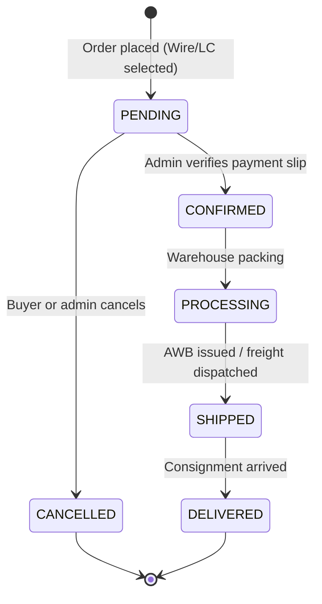

# AYC — Complete Feature Reference Catalog

This document provides exhaustive, implementation-verified specifications for all 25 major functional capabilities of the Ayaan Clothing (AYC) platform.

---

## 1. Authentication and Customer Accounts
- **Architecture**: Powered by Laravel Sanctum issuing 64-character hashed bearer tokens stored in `personal_access_tokens`.
- **Foundational Role Model**: Every registered user possesses a foundational `role` in `users.role` (`'customer'` or `'admin'`).
- **Customer Account Registration**: Captures Full Name, Email, Password, Mobile Phone, Company Name, and Tax ID / VAT Number.
- **Google OAuth 2.0**: Integrated social single-sign-on (`src/app/auth/callback/`) linking Google profile ID to `users.google_id` strictly for customer accounts.
- **Security Safeguards**: Bcrypt password hashing (12 rounds production, 4 rounds testing), rate-limited login endpoints (`throttle:auth-login`, 5 attempts/minute), and separate admin login routes.

---

## 2. Admin Roles and Permissions (RBAC)
- **Granular RBAC Tables**: `roles`, `permissions`, `role_permissions`, `admin_roles`, `permission_dependencies`.
- **System Roles**: Includes pre-seeded roles such as `Super Admin`, `Merchandiser`, `Warehouse Operator`, `Cashier`, and `Coupon Sales Manager`.
- **Super Admin Privilege**: Bypasses atomic permission checks through `AdminAuthorizationService`.
- **Dynamic Role Management**: Super Admins can create new custom roles, modify descriptions, and attach/detach permissions via the UI at `/ayc/roles`.
- **Permission Dependencies**: Validates required prerequisite capabilities (e.g., granting `order.update_status` automatically verifies or requires `order.view`).

---

## 3. Product Catalog and Media Management
- **Media Pipeline**: Handled by `ProductImagePipelineService` and `Intervention\Image`.
- **4:5 Aspect Ratio Standard**: All product photography uploaded via the admin portal is validated, sanitized, and stored in the 4:5 fashion aspect ratio standard.
- **SVG Sanitization**: SVG vector assets (logos, badges) pass through `SvgSanitizer` to strip embedded scripts, external entities, and malicious XML.
- **Gallery Management**: Reorderable gallery thumbnails (`sort_order`), primary image designation (`is_primary`), and thumbnail generation.
- **Rich Product Descriptions**: Formatted specifications covering fabric composition (e.g., 100% Combed Cotton), yarn count, GSM (180–220 GSM), dye fastness, and care instructions.

---

## 4. Product Identifiers, SKUs, Taxonomies & Variants
- **Public Product ID**: Human-friendly alphanumeric identifier (e.g., `AYC-POLO-001`) indexed for catalog lookups.
- **SKU Architecture**: Master product SKU (e.g., `EXP-POLO-BLK`) and child variant SKUs (e.g., `EXP-POLO-BLK-M`).
- **Taxonomies**: Multi-tier categories (`categories`), brand collections (`brands`), and garment suppliers (`suppliers`).
- **Variant Permutations**: Supported dimensions include Color and Size. Default standard variants are generated automatically for variantless products to maintain unified warehouse inventory bindings.
- **Slug Recycling on Deletion**: Eloquent lifecycle hooks (`Product::booted`) suffix deleted slugs (`{slug}-deleted-{id}-{timestamp}`) to immediately free up human-readable URLs for catalog re-use.

---

## 5. Product Publication and Visibility Controls
- **Publication State (`is_published`)**: Boolean flag controlling whether a product is accessible on the public storefront. Draft products remain visible exclusively inside `/ayc/products`.
- **Storefront Hide Toggle (`is_hidden_from_storefront`)**: Enables products to remain orderable by direct URL or quotation link while omitted from the public catalog grid.
- **Sold Out Flag (`is_sold_out`)**: Overrides warehouse calculations to mark a product as out-of-stock when production allocations are exhausted.

---

## 6. B2B Pricing and MOQ Rules
- **Minimum Order Quantity (MOQ)**: Enforces that order line items meet or exceed a defined piece threshold ($\text{MOQ} \ge 1$). Inputs of zero or negative values are strictly rejected.
- **Server-Authoritative Enforcement**: Frontend client code does not dictate prices. The backend `OrderCalculationService` resolves prices strictly from database records.
- **Volume Discounts**: Unit prices decline automatically as purchased quantities increase past tier thresholds.

---

## 7. Standard, Bulk, and Full Stock Pricing Behavior
1. **Standard Wholesale Price ($P_{\text{base}}$)**: Base unit price applied when order quantity satisfies MOQ up to the bulk threshold ($1 \le Q < Q_2$).
2. **Bulk Volume Price ($P_{\text{tier2}}$)**: Discounted unit price applied when order volume reaches $Q_2$. Configurable manually or calculated via default discount fallback ($P_{\text{base}} \times 0.92$).
3. **Full Stock Liquidation Price ($P_{\text{fullstock}}$)**:
   - **Always Visible**: The Full Stock option is continuously displayed on the PDP.
   - **Dynamic Quantity**: Quantity equals $\text{MaxCompletePackages} \times \text{MOQ}$, representing the maximum complete cartons available in the warehouse.
   - **Conditional Price**: If available stock exceeds bulk threshold, the clearance price applies; otherwise, the standard MOQ price is enforced.

---

## 8. Inventory, Warehouses & Audited Adjustments
- **Multi-Warehouse Isolation**: Stock balances are partitioned by physical facility in `inventories` (keyed by `[product_variant_id, warehouse_id]`).
- **Authoritative Warehouse Pool**: Active facilities include Uttara Hub (`WH-UTTARA-01`) and Chattogram Port Hub (`WH-CTG-01`).
- **Audited Stock Movements**: Manual inventory adjustments, returns, write-offs, and initial creation allocations record an append-only entry in `admin_inventory_adjustments` with the acting administrator's ID and reason string.
- **Complete MOQ Previews**: As administrators enter warehouse stock, the system live-calculates complete available orderable cartons: $\lfloor \text{AvailableStock} / \text{MOQ} \rfloor$.

---

## 9. Cart, Checkout & Order Creation
- **Wholesale Cart**: Supports both guest session carts and authenticated buyer carts, seamlessly merging upon login.
- **Cart Revalidation**: Verifies live inventory balances and pricing prior to checkout progression.
- **Checkout Submission**: Captures structured shipping and billing addresses, customer notes, and payment method selection (`WIRE_TRANSFER`, `LC`, `CASH`).
- **Initial Status**: New wholesale orders are assigned the canonical status `PENDING` with payment status `UNPAID`.

---

## 10. Payment Submission, Verification & Financial Records
- **Bank Wire Transfer (T/T Advance)**: Primary wholesale payment method. Displays AYC's beneficiary banking coordinates at Pubali Bank Limited, Dhaka.
- **Payment Proof Upload**: Buyers upload wire transfer deposit receipts (image/PDF) via `POST /api/v1/orders/{id}/payment-proof`.
- **Finance Review Workflow**: Administrators inspect the uploaded slip in `/ayc/orders/{id}`, compare transaction references against banking statements, and click **Verify** or **Reject**.
- **Immutable COGS Snapshots**: During order placement, `buying_price_at_sale` is permanently written into `order_items`. Subsequent edits to product purchase prices never alter historical order profit calculations.

---

## 11. Canonical Order Statuses & Transitions

---

## 12. Order Confirmation & Inventory Deduction Timing
- **Timing Invariant**: Physical warehouse inventory is **NOT** deducted at initial order placement (`PENDING`) to prevent abandoned orders from locking factory inventory.
- **Deduction Trigger**: Inventory is deducted atomically when the order transitions to `CONFIRMED` upon bank wire verification.
- **Atomic Locking**: Uses `SELECT ... FOR UPDATE` row locks inside database transactions to eliminate race conditions between concurrent buyer orders.

---

## 13. Shipment & Fulfillment Workflow
- **Logistics Integration**: Integrated with the Aramex Shipping API for express air freight rate quotes and AWB creation.
- **Carton & CBM Calculation**: Handled by `PackageCalculatorService` based on carton dimensions in `product_shipping_package_profiles`.
- **Shipping Snapshots**: Orders snapshot carton count, gross weight, and CBM at checkout to guarantee immutable logistics records.
- **Fulfillment Updates**: Administrators input consignment tracking numbers, carrier names, and dispatch dates in `/ayc/orders/{id}`.

---

## 14. Customer-Specific Order History & Document Access
- **Buyer Dashboard**: Accessible under `/dashboard/orders/`. Buyers view chronological order histories, fulfillment progress, and AWB tracking links.
- **Direct Order Access Gateway**: Allows buyers to inspect specific orders via reference tokens (`/order-access/[reference]`).
- **Centralized Document Center**: Accessible under `/dashboard/documents/` and `/customer/documents`, providing one-click PDF downloads of authorized commercial documents.

---

## 15. POS Terminal & Standard Order Integration
- **Unified Pipeline**: Counter sales processed in `/ayc/pos` create standard AYC orders (`order_source = 'POS'`) stored in the authoritative `orders` and `order_items` tables.
- **Warehouse decrements**: Decrements stock synchronously from the cashier's selected warehouse location.
- **No Barcode Scanner Dependency**: Products are searched via catalog title, SKU, or category chips.
- **No Thermal Receipt Mini Slips**: Counter orders produce standardized A4 commercial invoices.

---

## 16. In-POS Customer Search & Registration
- **Mandatory Customer Association**: Anonymous walk-in sales are strictly prohibited.
- **Dynamic Lookup**: Cashiers search existing customer accounts by phone number, name, or company.
- **Quick Customer Registration**: If a counter buyer is not found, an in-POS modal captures their Full Name and Mobile Phone Number (Email optional). Synthetic or placeholder emails are prohibited.

---

## 17. Cash Tender & Change Calculation
- **Counter Settlement**: Cashiers select cash tender mode and input the cash amount tendered by the customer.
- **Server-Side Math**: Calculates change due: $\text{Change} = \text{CashTendered} - \text{OrderTotal}$.
- **Immediate Confirmation**: Successful cash transactions transition directly to `CONFIRMED` and `PAID`.

---

## 18. Quotations and Requests for Quotation (RFQs)
- **Buyer RFQ Submission**: Buyers submit custom production requests specifying target quantities, design requirements, and target prices.
- **In-Platform Message Threads**: Buyers and sales managers negotiate terms via `rfq_messages` with file attachment support.
- **Formal Commercial Quotations**: Administrators issue formal quotes (`quotations`) with defined validity windows (`valid_until`), itemized pricing, and shipping terms.
- **One-Click Acceptance**: Buyers can accept quotes directly in `/dashboard/quotes/[id]`, converting them to standard wholesale orders.

---

## 19. Homepage Management & Merchandising
- **Banner Carousel**: Configurable slides (`homepage_banners`) with background images, subtitles, call-to-action buttons, and priority sorting.
- **Announcement Ticker**: Scrolling header ticker (`homepage_ticker_items`) displaying delivery guarantees, BGMEA credentials, and export notes.
- **Shop-by-Brand**: Curated brand carousel (`homepage_featured_brands`).
- **Hot Sale Categories**: Category quick-navigation pills (`homepage_hot_sale_categories`).
- **Featured Products**: Admin-selected product grid ordering (`homepage_featured_products`).

---

## 20. Footer Links, Social Settings & Contact Configuration
- **Authoritative WhatsApp**: Configured centrally via `system_settings` (`whatsapp_number`: `8801620853502`, display: `+880 1620-853502`).
- **Social Media Links**: Configurable profiles for Facebook, LinkedIn, Instagram, and TikTok with active toggles.
- **Dynamic Legal Links**: Direct links to editable `/privacy-policy` and `/terms-and-conditions` legal documents.
- **Corporate Address**: Authoritative headquarters: House #33 (2nd floor), Road #12, Sector #11, Uttara, Dhaka-1230, Bangladesh.

---

## 21. Canonical Commercial Document Generation
All commercial documents generated across the platform are standardized around **three canonical instruments**:
1. **Offer Sheet (`OFFER_SHEET`)**: Visual garment presentation, FOB terms, carton packing specifications, and valid offer dates.
2. **Proforma Invoice (`PROFORMA_INVOICE`)**: Preliminary agreement containing beneficiary bank wire details (Pubali Bank Limited), import terms, and advance payment instructions.
3. **Commercial Invoice (`COMMERCIAL_INVOICE`)**: Authoritative customs declaration containing HS codes, verified payment receipts, package schedules, and legal exporter declarations. Gated on payment verification for non-admins.

---

## 22. PDF Creation, Storage, Download & Authorization
- **Dual Engine Architecture**:
  - **Backend DomPDF Engine**: Vector PDF-1.4 stream renderer (`DocumentPdfService`) for secure binary downloads and queue generation.
  - **Client-Side jsPDF Engine**: Instant in-browser preview rendering in the admin document hub.
- **Authorization Enforcement**: Customers can only download documents for orders they own. Administrators require `document.download` permission.

---

## 23. Technical SEO, Sitemap & Google Search Console
- **Dynamic XML Sitemap**: Generated at `/sitemap.xml` with live `lastmod` timestamps reflecting product `updated_at`.
- **Leading Slash Normalization**: `src/proxy.ts` rewrites `//sitemap.xml` and `//robots.txt` directly to canonical paths, preventing Google Search Console "Couldn't fetch" errors.
- **Schema.org Structured Data**: Generates JSON-LD for `Organization`, `Product`, and `BreadcrumbList`.
- **Dynamic GSC Verification**: Admin-editable Google Search Console verification meta tag stored in `system_settings`.

---

## 24. System Settings, Business Information & Private Config
- **Centralized Settings Repository**: Stored in `system_settings` and managed via `/ayc/settings`.
- **Beneficiary Banking Details**: Bank Name (`Pubali Bank Limited`), Account Title (`M/S AYAAN  CLOTHING`), Account Number (`1788-901-044316`), SWIFT (`PUBABDDH210`), Branch (`Nawabpur Road Branch`).
- **Export Registrations**: Trade License, TIN, BIN, VAT, and BGMEA membership numbers.
- **Secret Redaction**: Sensitive API tokens (Aramex credentials, internal proxy secrets) are excluded from public API responses.

---

## 25. Audit Trails, Background Jobs & Country Access Controls
- **System Activity Log**: Administrative actions record an immutable entry in `activities` capturing user ID, action type, IP address, and JSON payload.
- **Asynchronous Queue Workers**: Supervised worker `ayaan-worker` runs `queue:work redis --queue=default` handling document rendering and email alerts.
- **Bangladesh Storefront Access Control**: Internal MaxMind GeoIP check selectively restricts domestic storefront catalog browsing when toggled by the administrator, while maintaining global buyer account accessibility.
