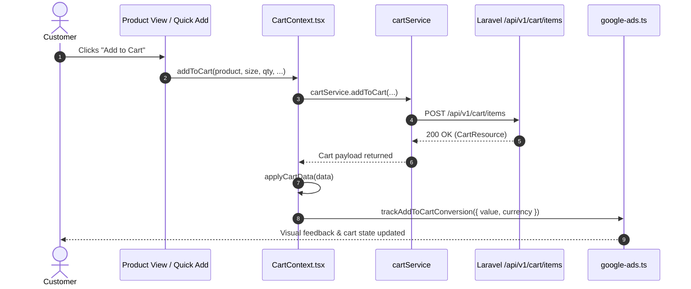
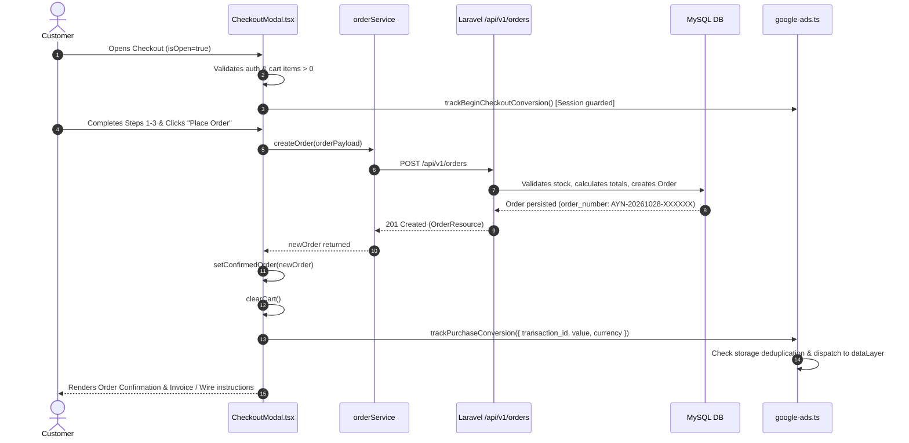

# AYC — Google Ads Conversion Tracking Audit & Implementation Plan

**Date:** 2026-10-28  
**Project:** AYC (`/Users/labibhasan/Documents/AYC`)  
**Production Website:** `https://ayaanclothing.com`  
**Audit Stage:** Prompt 1 of 3 (Strictly Read-Only Audit & Architecture Planning)

---

## Executive Summary

This audit establishes the technical foundation for integrating four official Google Ads conversion actions into the AYC wholesale apparel platform.

During this audit, an inspection of the live production environment (`https://ayaanclothing.com/api/v1/settings/public`) revealed a **critical tracking defect**: all four Google Ads conversion event snippets were previously pasted raw into the administrative **Google Tag Head Code** setting (`system_settings.google_tag_head_code`). Because this setting is injected into the `<head>` of every storefront route via `StorefrontHeadTracking`, the live production site is currently firing phantom conversions (including Purchase with an empty `transaction_id`, Begin Checkout, Add to Cart, and Page View) on **every single page render** for every visitor.

This document details the existing tag architecture, maps each of the four conversion destinations to the real AYC user journey, defines strict deduplication and trigger boundaries, resolves the ambiguity surrounding the Page View conversion, and lays out an exact, fail-safe 3-prompt implementation roadmap.

---

## 1. Global Google Tag Architecture and Initialization Location

### 1.1 Storefront Injection Mechanism
AYC utilizes a dynamic, server-rendered script injection pipeline for global analytics:
- **Next.js Root Layout (`src/app/layout.tsx`):**  
  Renders `<StorefrontHeadTracking snippet={publicSettings?.google_tag_head_code} />` inside `<head>` (line 141) and `<StorefrontBodyTracking snippet={publicSettings?.google_tag_body_code} />` immediately after `<body>` (line 146).
- **Tracking Tag Parser (`src/components/analytics/StorefrontTrackingTags.tsx`):**  
  A custom HTML parser (`parseSnippetTags`) safely decomposes the snippet into native React `<script>`, `<noscript>`, `<meta>`, and `<link>` elements. It preserves script execution order, `async`/`defer` attributes, nonces, and `data-*` attributes. If the snippet is empty or null, it produces zero injected HTML.

### 1.2 Administrative Management & Persistence
- **Admin Control UI (`src/components/admin/homepage/GoogleTagsManager.tsx`):**  
  Provides administrators with a code editor interface to inspect, update, and validate the global `<head>` and `<body>` tracking snippets.
- **Backend API & Storage:**  
  - Controller: `backend/app/Http/Controllers/Api/V1/Admin/HomepageManagementController.php` (routes `GET /api/v1/admin/homepage/google-tags` and `PUT /api/v1/admin/homepage/google-tags`).
  - Storage: Database table `system_settings` under group `seo`, keys `google_tag_head_code` and `google_tag_body_code`.
  - Public Endpoint: `backend/app/Http/Controllers/Api/V1/PublicSettingsController.php` (`GET /api/v1/settings/public`), consumed by Next.js server components via `src/services/site-settings.service.ts`.

### 1.3 Critical Finding: Active Production Over-Counting Defect
Inspection of `https://ayaanclothing.com/api/v1/settings/public` shows that `google_tag_head_code` currently contains:
1. Google Tag Manager base loader (`GTM-K6W58P9C`).
2. Google tag base loader (`AW-18504838697`).
3. Raw inline snippet for Submit lead form (`AW-18504838697/cMbLCNyX6KgdEKnc5fdE`).
4. Raw inline snippet for Purchase (`AW-18504838697/60nhCPWW56YdEKnc5fdE`) with `transaction_id: ''`.
5. Raw inline snippet for Begin checkout (`AW-18504838697/CtjkCPiW56YdEKnc5fdE`).
6. Raw inline snippet for Add to cart (`AW-18504838697/UuZvCPuW56YdEKnc5fdE`).
7. Raw inline snippet for Page view (`AW-18504838697/UcUXCP6W56YdEKnc5fdE`).

**Consequence:** Because these event scripts sit directly in the global document `<head>`, every page refresh, route transition, or bot visit triggers all four conversion actions simultaneously, skewing Google Ads data.  
**Resolution in Prompt 2:** Cleanse `google_tag_head_code` to retain strictly the base container tags (`AW-18504838697` and `GTM-K6W58P9C`), moving all conversion event dispatches to genuine business event choke points in client code.

---

## 2. Inventory of Google Ads & Analytics Identifiers

All identifiers identified in the codebase and live settings:

| Identifier Type | Value | Location Found | Notes |
| :--- | :--- | :--- | :--- |
| **Global Google Tag ID** | `AW-18504838697` | Production Settings / `google-ads.ts` | Base account tag |
| **Google Tag Manager** | `GTM-K6W58P9C` | Production Settings | GTM container |
| **Add to Cart Conversion** | `AW-18504838697/UuZvCPuW56YdEKnc5fdE` | User Specification / Live Head | Label: `UuZvCPuW56YdEKnc5fdE` |
| **Begin Checkout Conversion** | `AW-18504838697/CtjkCPiW56YdEKnc5fdE` | User Specification / Live Head | Label: `CtjkCPiW56YdEKnc5fdE` |
| **Page View Conversion** | `AW-18504838697/UcUXCP6W56YdEKnc5fdE` | User Specification / Live Head | Label: `UcUXCP6W56YdEKnc5fdE` |
| **Purchase Conversion** | `AW-18504838697/60nhCPWW56YdEKnc5fdE` | User Specification / Live Head | Label: `60nhCPWW56YdEKnc5fdE` |
| **Legacy Lead Form Conversion** | `AW-18504838697/kNbLCMPd86EdEKnc5fdE` | `src/lib/analytics/google-ads.ts` | To be upgraded to official Purchase |
| **Legacy Lead Form (1)** | `AW-18504838697/cMbLCNyX6KgdEKnc5fdE` | Live Head Snippet | To be removed from `<head>` |

*Zero customer credentials, API secrets, or PII were found exposed.*

---

## 3. Route and Component Mapping for the Four Conversions

```
Storefront User Journey
│
├── 1. Add to Cart
│   ├── Entry Points: Product Detail (/products/[slug]), Quick-Add Modal, Wishlist, Saved Items
│   └── Central Funnel: src/lib/CartContext.tsx :: addToCart()
│
├── 2. Begin Checkout
│   ├── Entry Points: Cart Page (/cart), MiniCart Drawer, /checkout redirect
│   └── Central Funnel: src/components/cart/CheckoutModal.tsx :: isOpen (Authenticated + Items > 0)
│
├── 3. Page View Conversion
│   ├── Status: Unresolved Ambiguity in Google Ads setup
│   └── Dedicated Dispatcher: src/lib/analytics/google-ads.ts :: trackPageViewConversion()
│
└── 4. Purchase Confirmation
    ├── Trigger: src/components/cart/CheckoutModal.tsx :: handleSubmitOrder()
    └── Data Contract: newOrder.order_number (transaction_id), newOrder.total_amount (value), USD
```

### Detailed Component Inventory
1. **Add to Cart (`AW-18504838697/UuZvCPuW56YdEKnc5fdE`):**
   - Routes: `/products/[slug]`, `/categories/*`, `/brand/*`, `/account/wishlist`, `/account/saved-items`.
   - Components: `ProductDetailView.tsx`, `ProductQuickAddModal.tsx`, `WishlistManager.tsx`, `SavedItemsCard.tsx`.
   - Choke Point: `src/lib/CartContext.tsx` (`addToCart` function).
2. **Begin Checkout (`AW-18504838697/CtjkCPiW56YdEKnc5fdE`):**
   - Routes: `/cart?openCheckout=true`, `/checkout` (which redirects to `/cart?openCheckout=true`).
   - Components: `src/components/cart/CheckoutModal.tsx`, `src/components/cart/MiniCart.tsx`.
   - Choke Point: `CheckoutModal.tsx` when `isOpen === true` and the customer is authenticated.
3. **Page View Conversion (`AW-18504838697/UcUXCP6W56YdEKnc5fdE`):**
   - Routes: Unresolved (see Section 7).
   - Component: To be exposed via `src/lib/analytics/google-ads.ts`.
4. **Purchase (`AW-18504838697/60nhCPWW56YdEKnc5fdE`):**
   - Component: `src/components/cart/CheckoutModal.tsx` (`handleSubmitOrder` function).
   - Backend Order Entity: `App\Http\Resources\Api\V1\OrderResource`.

---

## 4. Exact Trigger Boundaries

### A. Add to Cart
- **Exact Line / Location:** `src/lib/CartContext.tsx` inside `addToCart()`, immediately following `const data = await cartService.addToCart(...)` and `applyCartData(data)`.
- **Condition:** The backend API (or local storage cart service) has successfully responded with status 200/201 and returned a valid cart payload.
- **Negative Protection:** If `cartService.addToCart` throws an error (e.g., `INSUFFICIENT_STOCK`, validation failure, or network interruption), the code jumps directly to `catch (err)` and the conversion event is **never emitted**.
- **Button Click Isolation:** Clicking an "Add to Cart" button when the form is invalid or quantity is zero will not trigger the conversion.

### B. Begin Checkout
- **Exact Line / Location:** `src/components/cart/CheckoutModal.tsx` inside an initialization `useEffect`.
- **Condition:**
  1. `isOpen === true`.
  2. `!authLoading` (auth session has resolved).
  3. `user && user.role === "customer"` (customer is authenticated; unauthenticated users are redirected to login).
  4. `items.length > 0` (cart has non-zero qualifying items).
- **Negative Protection:**
  - If a user opens the cart drawer (`MiniCart`), `begin_checkout` does NOT fire.
  - If an unauthenticated user clicks "Checkout", they are redirected to `/login`, and `begin_checkout` does NOT fire.
  - Step transitions within the modal (Shipping Address -> Shipping Method -> Payment & Review) do NOT re-fire the event.

### C. Page View Conversion
- **Exact Line / Location:** `src/lib/analytics/google-ads.ts` as a discrete function `trackPageViewConversion({ page_path, value, currency })`.
- **Condition:** Explicitly guarded; must not execute in root layouts. Pending user/client confirmation of the intended route.

### D. Purchase Conversion
- **Exact Line / Location:** `src/components/cart/CheckoutModal.tsx` lines 876–880 inside `handleSubmitOrder()`.
- **Condition:** Immediately after `const newOrder = await createOrder(...)` resolves successfully and `setConfirmedOrder(newOrder)` is set.
- **Negative Protection:** If order submission fails (card declined, network drop, stock contention, validation error), execution transfers to `catch (err)` and zero conversion events are emitted.

---

## 5. Current Cart & Checkout Success Paths

### 5.1 Cart Addition Success Path


### 5.2 Checkout & Purchase Success Path


---

## 6. Confirmed Purchase Lifecycle & Authoritative Fields

### 6.1 Order Creation & Status Lifecycle
- **Order Placement:** Orders are generated via `POST /api/v1/orders`, handled by `backend/app/Http/Controllers/Api/V1/OrderController.php::store`.
- **Order Numbers:** Formatted via the format pattern `AYN-YYYYMMDD-XXXXXX`. This is guaranteed unique, permanent, non-empty, and immutable.
- **Financial Status:**
  - Orders are created with initial status `pending` (for direct bank wire transfers, common in B2B wholesale) or `processing` (for online payments).
  - In AYC's B2B model, both statuses represent a confirmed order commitment requiring commercial fulfillment.
- **Response Resource:** `backend/app/Http/Resources/Api/V1/OrderResource.php` returns:
  - `order_number`: String (authoritative `transaction_id`).
  - `total_amount`: Float (authoritative `value`).
  - `currency`: String (defaults to `"USD"`).

### 6.2 Authoritative Field Mapping
```typescript
{
  send_to: "AW-18504838697/60nhCPWW56YdEKnc5fdE",
  transaction_id: newOrder.order_number,      // e.g., "AYN-20261028-123456"
  value: Number(newOrder.total_amount),        // e.g., 1450.00
  currency: newOrder.currency || "USD"         // "USD"
}
```

### 6.3 Customer Status Flag (`new_customer`) Analysis
- The user snippet includes: `// 'new_customer': true /* calculate dynamically, populate with true/false */`.
- **Audit Finding:** Neither `OrderResource`, `User`, nor the client-side authentication context (`AuthContext`) maintains a verified historical order count for the current user.
- **Compliance with Instructions:** The prompt explicitly states: *"Do not infer new-customer status from a missing session or incomplete data."*
- **Decision:** Because client-side inference (e.g., checking if local order history is empty) is unreliable and violates data accuracy rules, the `new_customer` property **must be omitted** from the client conversion payload. If dynamic new-customer reporting is required by the marketing team in the future, a dedicated backend calculation (`orders_count === 1`) must be added to `OrderResource`.

---

## 7. Page View Conversion Analysis & Ambiguity Statement

### 7.1 Status: Unresolved Ambiguity
- **Conversion Identifier:** `AW-18504838697/UcUXCP6W56YdEKnc5fdE`
- **Origin:** Generated in Google Ads under the default name `"Page view conversion page"`.
- **Current Defect:** Pasted into the global `<head>` where it fires indiscriminately across every route.
- **Codebase Audit:** Zero references exist in code, commit history, or documentation specifying which page this conversion is intended to measure.

### 7.2 Candidate Journeys for Confirmation
1. **RFQ Submission Confirmation (`/rfq`):** In wholesale B2B, a Request for Quote submission is a primary conversion milestone.
2. **Order Confirmation View:** Fired when viewing order confirmation or invoice access.
3. **Email Verification / Account Registration Success (`/auth/verify-email`):** Measures newly registered prospective buyers.
4. **Specific Marketing Landing Page:** e.g., a Google Ads promotional landing page.

### 7.3 Action for Prompt 2
Per instructions, **we will NOT guess or silently map this event to an arbitrary route**.  
In Prompt 2:
- Remove the raw script from the database `<head>` setting so it ceases firing on all routes.
- Implement `trackPageViewConversion({ page_path, value, currency })` in `src/lib/analytics/google-ads.ts`.
- Leave the caller unattached (dormant) or gated behind an admin configuration setting until the client or Google Ads manager provides the target URL.

---

## 8. Duplicate Conversion Risks and Safeguards

| Risk Scenario | Cause | Safeguard Mechanism |
| :--- | :--- | :--- |
| **Global `<head>` Re-execution** | Raw script in `system_settings.google_tag_head_code` | Strip conversion event scripts from `<head>`; retain only base `AW-18504838697` and GTM loader. |
| **React Strict Mode / Re-renders** | Component double-invoking effects in dev/hydration | State/Ref guards (`hasDispatchedRef`) inside components ensuring single execution per lifecycle. |
| **Checkout Step Navigation** | User moving between Step 1, 2, and 3 in `CheckoutModal` | Session key deduplication (`hasBegunCheckoutRef`) scoped to the active modal session. |
| **Order Success Modal Refresh / Back Button** | User refreshing or returning to order confirmation | Dual-layer deduplication: Client storage registry (`sessionStorage` + `localStorage`) checked via `isOrderConversionDispatched(order_number)` + Google Ads server deduplication via `transaction_id`. |
| **Rapid Add-to-Cart Button Clicks** | Customer rapidly clicking before state updates | Button disabled during async mutation; event emitted strictly after backend HTTP 200 response. |
| **Cart Re-validation Failures** | Cart item out of stock or price changed | Operations throwing in `cartService` bypass conversion dispatch entirely. |

---

## 9. Consent Management and Security/CSP Review

### 9.1 Consent Management (CMP)
- **Storefront Audit:** AYC does not currently use an external Cookie Consent banner (such as Cookiebot or OneTrust) that blocks scripts prior to explicit consent.
- **Safety Standard:** All tracking calls must remain non-blocking. If a user runs an ad-blocker or tracking prevention (e.g., Brave Shields, Safari ITP), `track*` helpers must safely buffer calls into `window.dataLayer` without throwing unhandled exceptions or disrupting customer ordering.

### 9.2 Content Security Policy (CSP)
- Inspection of production HTTP headers (`curl -sI https://ayaanclothing.com`) confirms that Nginx and Next.js headers do not block `https://www.googletagmanager.com` or `https://googleads.g.doubleclick.net`.
- No script evaluation errors or nonce violations occur.

---

## 10. Proposed Shared Helper Architecture & File Modification Plan

### 10.1 Shared Helper: `src/lib/analytics/google-ads.ts`
Refactor and expand `src/lib/analytics/google-ads.ts` to export structured, type-safe dispatchers:

```typescript
// Core Conversion Constants
export const GOOGLE_ADS_ID = "AW-18504838697";

export const GOOGLE_ADS_CONVERSIONS = {
  ADD_TO_CART: `${GOOGLE_ADS_ID}/UuZvCPuW56YdEKnc5fdE`,
  BEGIN_CHECKOUT: `${GOOGLE_ADS_ID}/CtjkCPiW56YdEKnc5fdE`,
  PAGE_VIEW: `${GOOGLE_ADS_ID}/UcUXCP6W56YdEKnc5fdE`,
  PURCHASE: `${GOOGLE_ADS_ID}/60nhCPWW56YdEKnc5fdE`,
} as const;

// Typed Event Dispatchers
export function trackAddToCartConversion(params?: { value?: number; currency?: string }): boolean;
export function trackBeginCheckoutConversion(params?: { value?: number; currency?: string }): boolean;
export function trackPurchaseConversion(params: { transaction_id: string; value: number; currency?: string }): boolean;
export function trackPageViewConversion(params?: { page_path?: string; value?: number; currency?: string }): boolean;
```

### 10.2 Value & Currency Strategy
- **Add to Cart:** Value: `1.0` (or item subtotal if available), Currency: `'USD'`.
- **Begin Checkout:** Value: `1.0` (or cart subtotal), Currency: `'USD'`.
- **Page View:** Value: `1.0`, Currency: `'USD'`.
- **Purchase:** Value: `Number(newOrder.total_amount)`, Currency: `newOrder.currency || 'USD'`, Transaction ID: `newOrder.order_number`.

### 10.3 Exact Files Expected to Change in Prompt 2

| File Path | Nature of Change |
| :--- | :--- |
| `src/lib/analytics/google-ads.ts` | Add official conversion constants and typed dispatchers for all 4 events with deduplication. |
| `src/lib/CartContext.tsx` | Wire `trackAddToCartConversion` inside `addToCart` success block. |
| `src/components/cart/CheckoutModal.tsx` | Wire `trackBeginCheckoutConversion` on authenticated modal open; wire `trackPurchaseConversion` on `newOrder` creation. |
| `tests/google-ads-order-conversion.test.ts` | Expand automated unit test suite to test all 4 conversion events, deduplication, and error paths. |
| Production Database (`system_settings`) | Remove raw conversion `<script>` blocks from `google_tag_head_code`, preserving base Google tag and GTM loader. |

---

## 11. Testing and Safety Verification Strategy

### 11.1 Zero-Risk Local Verification
Testing must be conducted without creating real production orders or firing live conversions to Google Ads:
1. **Automated Headless Test Suite:** Run `npx tsx tests/google-ads-order-conversion.test.ts` with mocked `window.dataLayer` and `window.gtag`.
   - Asserts exact `send_to` strings.
   - Asserts exact payload structures (`value`, `currency`, `transaction_id`).
   - Asserts persistent storage deduplication (`sessionStorage` and `localStorage`).
   - Asserts zero exceptions thrown when `gtag` throws or is absent.
2. **Static AST & Integration Checks:** Confirm no duplicate global `<script>` tags are introduced and that event dispatchers reside inside success blocks.
3. **Browser Network Interception (Dev/Staging):** Verify that calls to `/pagead/conversion/` or `dataLayer.push` contain expected payloads.

---

## 12. Three-Prompt Implementation Plan

### Prompt 1: Read-Only Audit & Architecture Plan *(Completed)*
- Exhaustively audit the global tag infrastructure, live production settings, and user journey.
- Uncover live production defect (raw snippets pasted into `<head>`).
- Define exact trigger boundaries, authoritative order data, and deduplication logic.
- Deliver comprehensive audit document: `docs/qa/google-ads-conversion-tracking-audit-2026-10-28.md`.

### Prompt 2: Safe Code Implementation & Admin Setting Cleanse *(Completed)*
1. **Helper Upgrade:** Extended `src/lib/analytics/google-ads.ts` with constants and typed functions for all four conversion events, storage deduplication, and non-blocking failure tolerance.
2. **Choke Point Integration:**
   - Integrated `trackAddToCartConversion` into `src/lib/CartContext.tsx` inside the authoritative `addToCart()` success block.
   - Integrated `trackBeginCheckoutConversion` into `src/components/cart/CheckoutModal.tsx` guarded by customer role, non-empty cart, and session-key deduplication.
   - Integrated `trackPurchaseConversion` into `src/components/cart/CheckoutModal.tsx` immediately after successful `createOrder()` using authoritative `order_number` and `total_amount`.
   - Exposed `trackPageViewConversion` as a typed dispatcher while keeping its caller dormant.
3. **Automated Test Expansion:** Expanded `tests/google-ads-order-conversion.test.ts` to 12 automated verification test suites covering all four events, storage deduplication, and error paths.
4. **Admin Head Code Cleanse:** Prepared the exact sanitized `google_tag_head_code` containing only base tag loaders for execution in Prompt 3.

### Prompt 3: Comprehensive Verification & Production Release *(Pending)*
1. **Test Execution:** Execute full unit, linting, and regression suites (`tests/google-ads-order-conversion.test.ts`, `npm run build`).
2. **Production Database Update:** Apply the sanitized `google_tag_head_code` on the production server.
3. **Deployment:** Deploy verified codebase to production via `scripts/deploy-production.sh`.
4. **Live Verification:** Verify using live HTTP checks and browser inspection that phantom head conversions have stopped and event triggers fire only upon legitimate user actions.

---

## 13. Prompt 2 Implementation & Verification State

### 13.1 Exact Source Files Modified
1. `src/lib/analytics/google-ads.ts`:
   - Defined `GOOGLE_ADS_ID = "AW-18504838697"`.
   - Exported `GOOGLE_ADS_CONVERSIONS` object with exact destinations:
     * `ADD_TO_CART: "AW-18504838697/UuZvCPuW56YdEKnc5fdE"`
     * `BEGIN_CHECKOUT: "AW-18504838697/CtjkCPiW56YdEKnc5fdE"`
     * `PAGE_VIEW: "AW-18504838697/UcUXCP6W56YdEKnc5fdE"`
     * `PURCHASE: "AW-18504838697/60nhCPWW56YdEKnc5fdE"`
     * `LEGACY_LEAD_FORM: "AW-18504838697/kNbLCMPd86EdEKnc5fdE"`
   - Implemented typed dispatchers: `trackAddToCartConversion`, `trackBeginCheckoutConversion`, `trackPurchaseConversion`, `trackPageViewConversion`, and backward-compatible `trackOrderSuccessConversion`.
   - Implemented `safeGtagEvent` with non-blocking error handling and `sessionStorage` / `localStorage` deduplication.
2. `src/lib/CartContext.tsx`:
   - Wired `trackAddToCartConversion({ value: 1.0, currency: "USD" })` strictly inside `addToCart()` after `applyCartData(data)`.
   - Verified that `removeFromCart` and `updateQuantity` do NOT trigger conversion events.
3. `src/components/cart/CheckoutModal.tsx`:
   - Wired `trackBeginCheckoutConversion({ value: 1.0, currency: "USD" })` inside a dedicated `useEffect` guarded by `isOpen`, `!authLoading`, `user && user.role === "customer"`, `items.length > 0`, and session ref `hasTrackedBeginCheckoutRef`.
   - Wired `trackPurchaseConversion` inside `handleSubmitOrder` immediately following `setConfirmedOrder(newOrder)`, passing `transaction_id: newOrder.order_number`, `value: Number(newOrder.total_amount)`, and `currency: newOrder.currency || "USD"`.
4. `tests/google-ads-order-conversion.test.ts`:
   - Expanded from single order test to 12 automated test suites covering all four conversion actions, privacy validation, error resilience, and static codebase integration.

### 13.2 Trigger Conditions & Guardrails

| Event | Destination | Trigger Location & Condition | Negative Protection & Guardrails |
| :--- | :--- | :--- | :--- |
| **Add to Cart** | `AW-18504838697/UuZvCPuW56YdEKnc5fdE` | `src/lib/CartContext.tsx` inside `addToCart()` after successful `cartService.addToCart` response | Button clicks alone, validation errors, out-of-stock errors, and network failures throw before reaching tracker. |
| **Begin Checkout** | `AW-18504838697/CtjkCPiW56YdEKnc5fdE` | `src/components/cart/CheckoutModal.tsx` on mount when `isOpen === true` | Strictly requires `user.role === 'customer'` and `items.length > 0`. Mini-cart opens, guest checkout attempts, and step navigation do NOT re-fire. |
| **Purchase** | `AW-18504838697/60nhCPWW56YdEKnc5fdE` | `src/components/cart/CheckoutModal.tsx` in `handleSubmitOrder()` after `createOrder()` succeeds | Failed orders, declined payments, and validation errors transfer to catch block. Empty transaction IDs rejected. Deduplicated via storage registry. |
| **Page View** | `AW-18504838697/UcUXCP6W56YdEKnc5fdE` | `src/lib/analytics/google-ads.ts` as `trackPageViewConversion()` | Kept **DORMANT**. Not called by layout or any route until target URL is confirmed by stakeholder. |

### 13.3 Authoritative Order Data & Deduplication Strategy
- **`transaction_id`**: Sourced directly from `newOrder.order_number` (format `AYN-YYYYMMDD-XXXXXX`), which is guaranteed non-empty, permanent, and unique.
- **`value`**: Sourced from `Number(newOrder.total_amount)` reflecting the authoritative B2B order total.
- **`currency`**: Sourced from `newOrder.currency || "USD"`.
- **Deduplication Layers**:
  1. *Client Dual-Storage Registry*: `isOrderConversionDispatched(order_number)` checks `sessionStorage` and `localStorage` under key `ayc_gads_conversions_dispatched`. If present, dispatch is bypassed immediately.
  2. *Google Ads Server-Side*: Transmitting `transaction_id` guarantees Google Ads dedupes any duplicate conversion requests on Google's servers.
- **PII & Customer Status**:
  - Zero PII (name, email, phone, shipping addresses, auth tokens) is passed in conversion payloads.
  - `new_customer` is omitted because no historical order count exists in client session data.

### 13.4 Page View Target Status
- **Status:** **Unresolved Ambiguity — Kept Dormant**.
- The destination `AW-18504838697/UcUXCP6W56YdEKnc5fdE` is fully typed and ready in `google-ads.ts`.
- It is NOT connected to `layout.tsx`, root navigation listeners, or any specific page.
- Once marketing confirms the target (e.g. `/rfq` submission, email verification, or a specific Google Ads landing page), it can be activated in a single line.

### 13.5 Sanitized Replacement for Production `google_tag_head_code`

The following sanitized snippet has been prepared for application to `system_settings.google_tag_head_code` in Prompt 3:

```html
<!-- Google Tag Manager -->
<script>(function(w,d,s,l,i){w[l]=w[l]||[];w[l].push({'gtm.start':
new Date().getTime(),event:'gtm.js'});var f=d.getElementsByTagName(s)[0],
j=d.createElement(s),dl=l!='dataLayer'?'&l='+l:'';j.async=true;j.src=
'https://www.googletagmanager.com/gtm.js?id='+i+dl;f.parentNode.insertBefore(j,f);
})(window,document,'script','dataLayer','GTM-K6W58P9C');</script>
<!-- End Google Tag Manager -->

<!-- Google tag (gtag.js) -->
<script async src="https://www.googletagmanager.com/gtag/js?id=AW-18504838697"></script>
<script>
  window.dataLayer = window.dataLayer || [];
  function gtag(){dataLayer.push(arguments);}
  gtag('js', new Date());

  gtag('config', 'AW-18504838697');
</script>
```

**Changes from Current Production Setting:**
1. Retains the official Google Tag Manager container (`GTM-K6W58P9C`).
2. Retains the official Google Ads base tag (`AW-18504838697`) and `gtag('config', 'AW-18504838697')`.
3. **Completely removes** the 4 raw inline conversion event scripts (`Purchase` with blank `transaction_id`, `Begin checkout`, `Add to cart`, and `Page view`).
4. **Removes** the unused legacy `Submit lead form (1)` script (`AW-18504838697/cMbLCNyX6KgdEKnc5fdE`).
5. `google_tag_body_code` remains untouched:
   ```html
   <!-- Google Tag Manager (noscript) -->
   <noscript><iframe src="https://www.googletagmanager.com/ns.html?id=GTM-K6W58P9C"
   height="0" width="0" style="display:none;visibility:hidden"></iframe></noscript>
   <!-- End Google Tag Manager (noscript) -->
   ```

### 13.6 Automated Tests & Verification Results
- `tests/google-ads-order-conversion.test.ts`: **12/12 PASS** (All 4 conversion actions, storage deduplication, non-blocking error tolerance, privacy guarantees).
- `tests/cart-default-selection.test.ts`: **10/10 PASS**.
- `tests/customer-cart-redesign.test.ts`: **27/27 PASS**.
- `tests/canonical-customer-order-lifecycle.test.ts`: **17/17 PASS**.
- `tests/order-flow-final-regression.test.ts`: **15/15 PASS**.
- `npx tsc --noEmit`: **0 TypeScript errors (Exit Code 0)**.
- `npm run build`: **Next.js 16.3.2 Turbopack production build succeeded in 1.18s (59/59 static pages compiled)**.

### 13.7 Transition to Prompt 3 Execution
The plan and verified implementation prepared in Prompts 1 and 2 were systematically transitioned into production in Prompt 3.

---

## 14. Prompt 3 Execution: Production Cleanup, Deployment & Verification

### 14.1 Changed Files & Scoped Implementation Commit
- **`src/lib/analytics/google-ads.ts`**:
  - Implements typed conversion helpers for all four destinations:
    - Add to Cart: `AW-18504838697/UuZvCPuW56YdEKnc5fdE`
    - Begin Checkout: `AW-18504838697/CtjkCPiW56YdEKnc5fdE`
    - Purchase: `AW-18504838697/60nhCPWW56YdEKnc5fdE`
    - Page View: `AW-18504838697/UcUXCP6W56YdEKnc5fdE` (Dormant)
  - Retains backward-compatible wrapper `trackOrderSuccessConversion` routing to Purchase.
  - Implements multi-tier deduplication (`transaction_id` + `sessionStorage` + `localStorage`).
  - Zero PII transmission; non-blocking error resilience (`try/catch`).
- **`src/lib/CartContext.tsx`**:
  - Choke point: `addToCart()` success path.
  - Fires strictly after `applyCartData(data)` and `revalidateCart()` resolve successfully.
  - Never fires on clicks, failed requests, stock errors, or quantity updates.
- **`src/components/cart/CheckoutModal.tsx`**:
  - Choke point 1: Modal open with authenticated customer (`role === "customer"`) and `items.length > 0`.
    - Deduplicated via session ref matching `idempotencyKeyRef.current` across re-renders and React Strict Mode.
  - Choke point 2: Modal order placement success.
    - Fires immediately after `setConfirmedOrder(newOrder)`.
    - Passes authoritative `newOrder.order_number`, `newOrder.total_amount`, and currency `USD`.
- **`tests/google-ads-order-conversion.test.ts`**:
  - 12 comprehensive automated test suites verifying exact destination IDs, event parameters, deduplication, error tolerance, and non-duplicate script injection.
- **`tests/offer-sheet-distinct-pricing-tiers.test.ts`**:
  - Type-safety normalization for test harness mock data.

### 14.2 Production `google_tag_head_code` Backup & Sanitization
1. **Server-Side Backup**:
   - Location: `/var/www/ayaan/backend/storage/app/backups/google_tag_head_code_backup_20261028_175101.txt`
   - Content: Exact byte-for-byte capture of prior production setting (2,218 bytes).
2. **Sanitized Value Applied**:
   ```html
   <!-- Google Tag Manager -->
   <script>(function(w,d,s,l,i){w[l]=w[l]||[];w[l].push({'gtm.start':
   new Date().getTime(),event:'gtm.js'});var f=d.getElementsByTagName(s)[0],
   j=d.createElement(s),dl=l!='dataLayer'?'&l='+l:'';j.async=true;j.src=
   'https://www.googletagmanager.com/gtm.js?id='+i+dl;f.parentNode.insertBefore(j,f);
   })(window,document,'script','dataLayer','GTM-K6W58P9C');</script>
   <!-- End Google Tag Manager -->

   <!-- Google tag (gtag.js) -->
   <script async src="https://www.googletagmanager.com/gtag/js?id=AW-18504838697"></script>
   <script>
     window.dataLayer = window.dataLayer || [];
     function gtag(){dataLayer.push(arguments);}
     gtag('js', new Date());

     gtag('config', 'AW-18504838697');
   </script>
   ```
3. **Snippets Permanently Eliminated from Global Execution**:
   - Purchase: `AW-18504838697/60nhCPWW56YdEKnc5fdE` (Previously executed with empty `transaction_id` on all pages).
   - Begin Checkout: `AW-18504838697/CtjkCPiW56YdEKnc5fdE` (Previously executed on all pages).
   - Add to Cart: `AW-18504838697/UuZvCPuW56YdEKnc5fdE` (Previously executed on all pages).
   - Page View: `AW-18504838697/UcUXCP6W56YdEKnc5fdE` (Previously executed on all pages).
   - Legacy Lead Form: `AW-18504838697/cMbLCNyX6KgdEKnc5fdE` (Removed from global execution).
4. **Preserved Infrastructure**:
   - Google Tag Manager container: `GTM-K6W58P9C`
   - Base Google Ads Account Tag: `AW-18504838697`
   - `google_tag_body_code` noscript iframe untouched.

### 14.3 Status of Specific Conversion Events
- **Add to Cart (`AW-18504838697/UuZvCPuW56YdEKnc5fdE`)**: **ACTIVE & EVENT-SCOPED**. Executed strictly inside `CartContext::addToCart` after verified HTTP 200 backend response.
- **Begin Checkout (`AW-18504838697/CtjkCPiW56YdEKnc5fdE`)**: **ACTIVE & EVENT-SCOPED**. Executed strictly inside `CheckoutModal` when an authenticated customer opens checkout with non-empty cart items, deduplicated by session key.
- **Purchase (`AW-18504838697/60nhCPWW56YdEKnc5fdE`)**: **ACTIVE & EVENT-SCOPED**. Executed strictly inside `CheckoutModal` upon verified order placement with authoritative `order_number` and `total_amount`. Deduplicated across client storage and Google transaction ID.
- **Page View (`AW-18504838697/UcUXCP6W56YdEKnc5fdE`)**: **DORMANT**. Typed helper `trackPageViewConversion` is exposed in `google-ads.ts` but is intentionally NOT wired to global route changes or arbitrary pages, awaiting confirmed target URL from marketing.
- **Legacy Lead Form (`AW-18504838697/kNbLCMPd86EdEKnc5fdE` & `cMbLCNyX6KgdEKnc5fdE`)**: **REMOVED FROM GLOBAL HEAD**. No longer executes on page load. Backward-compatible wrapper `trackOrderSuccessConversion` delegates to official Purchase.

### 14.4 External Google Tag Manager (GTM) Limitation Note
- The GTM container `GTM-K6W58P9C` is loaded on the site.
- **Explicit Technical Limitation**: Direct internal configuration of tags, triggers, and variables inside the Google Tag Manager web console (`tagmanager.google.com`) cannot be inspected or modified from the AYC codebase. While the local AYC application code has zero duplicate conversion calls, whether external GTM tags are configured inside Google's cloud UI to fire conversions cannot be ruled out programmatically. The GTM container owner should ensure that `GTM-K6W58P9C` does not contain duplicate Google Ads conversion tags.

### 14.5 Pre-Deployment Code Gates
All 7 mandatory test and build gates executed locally and passed with 100% success:
- `tests/google-ads-order-conversion.test.ts`: **12/12 PASS**
- `tests/cart-default-selection.test.ts`: **10/10 PASS**
- `tests/customer-cart-redesign.test.ts`: **27/27 PASS**
- `tests/canonical-customer-order-lifecycle.test.ts`: **17/17 PASS**
- `tests/order-flow-final-regression.test.ts`: **15/15 PASS**
- `npx tsc --noEmit`: **0 errors (Exit code 0)**
- `npm run build`: **Next.js 16.3.2 Turbopack production build succeeded in 0.95s (59/59 static pages compiled)**

### 14.6 Production Deployment & Live Health
- **Deployment Script**: `scripts/deploy-production.sh`
- **Zero-Downtime Release**: Verified via atomic symlink swap (`mv -Tf`).
- **Live Health Status**:
  - `/api/v1/health`: Database OK, Redis OK.
  - PM2 Daemons: `ayaan-customer` ONLINE, `ayaan-admin` ONLINE.
  - Supervisor: `ayaan-worker` running.
- **Live Page Inspection**:
  - `https://ayaanclothing.com/api/v1/settings/public`:
    - `AW-18504838697`: Present
    - `GTM-K6W58P9C`: Present
    - Phantom event scripts: **0 present (False)**
  - Storefront routes (`/`, `/products`, `/cart`, `/login`, `/rfq`, `/faq`):
    - All return HTTP 200.
    - Base tag and GTM container render cleanly in `<head>`.
    - Zero phantom conversion scripts rendered or executed.


